## Network Overview

### Network Definition

:::note
**Concept: What is a Network?**
A **network** is a group of computers and other devices connected through physical media that follow common **standards** and **protocols** so they can exchange data.
Core: **Network = physical interconnection + communication protocols**
:::

Why study computer networks?
~~At least so I can do more than just call libraries.~~
Because I want to, not because I have to.

### Physical Connection

Communication first requires physical connectivity.

- **Physical media**: Twisted-pair cables, optical fiber, radio waves, and other carriers of signals.
- **Connectivity**: Physical media connect devices to form paths.

In a network topology, we define these roles:

- **Nodes**: Any addressable device on the network.
- **Hosts / end systems**: The network's edge, where applications run, such as PCs, phones, and servers.
- **Intermediary devices**: The network's core, responsible for forwarding data, such as routers and switches.
- **Links**: Physical channels connecting nodes.

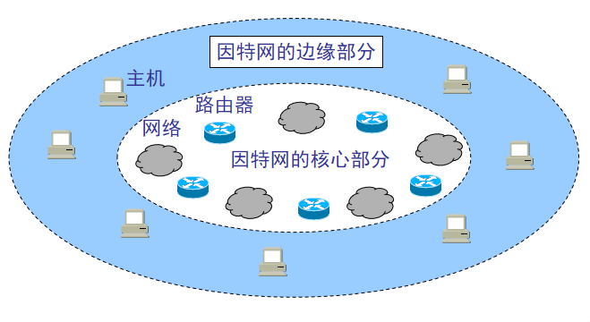

### Logical Rules

Physical connectivity is only the foundation. Devices must also understand each other's “language.” That requires **network protocols**.

:::tip
For convenience, **protocol** below always means **network protocol**.
:::

:::note
**Definition: Protocol**
A protocol is a set of rules, standards, or agreements that communicating parties establish to exchange data.
A complete protocol usually has three elements:

1. **Syntax**: The structure or format of data and control information, such as the first 8 bits being an address and the next 8 being data.
2. **Semantics**: What control information to send, what action to perform, and how to respond; for example, receiving an "RST" packet means resetting the connection.
3. **Timing**: The detailed order of events, such as completing a handshake before sending data.

:::
Protocol = syntax + semantics + timing.

### Packet Switching

With physical connections and logical protocols in place, how does data actually travel through a network? The Internet uses the revolutionary technique of **packet switching**.

#### Data Packets & Encapsulation

Application data is not sent across a computer network all at once as a continuous stream. It is broken into smaller chunks.
:::note
**Definition: Data Packet**
A packet is the smallest logical unit of network transmission. It has two parts:

1. **Header**: Control information such as source and destination addresses, sequence numbers, and checksums.
2. **Payload**: The actual user data being transmitted.

:::

**Encapsulation** is central to a layered architecture:

- When sending data, each protocol layer prepends its own **header** to the data from the layer above.
- **Key point**: To the lower layer, the entire packet from the upper layer, header and payload together, is simply its **payload**.

Each layer labels the data and passes it down. The next layer does not look inside; it works from the label.
> Remember this concept. When you encounter something unfamiliar, you can reassure yourself that it's encapsulation, and that's fine (

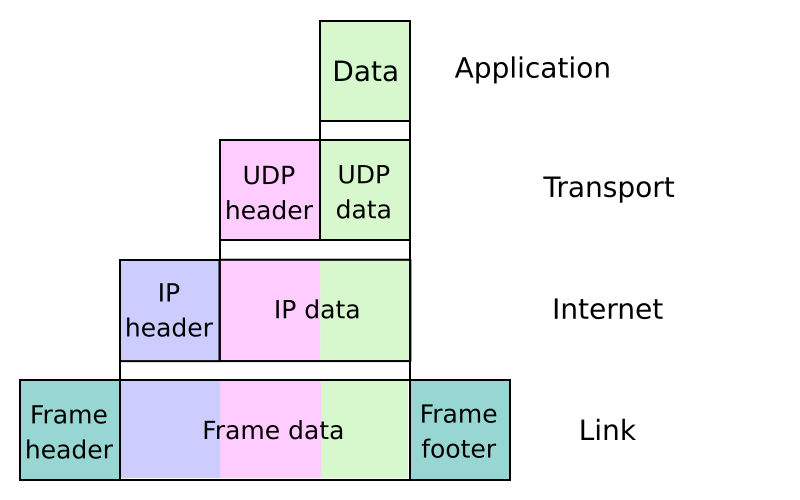

#### Packet Switching

Packet switching is the fundamental design of the modern Internet, unlike the circuit switching used in traditional telephone networks.

:::note
**Concept: Packet Switching vs. Circuit Switching**
**Circuit switching**: An **exclusive** physical path must be established before communication. Resources remain occupied whether anyone is talking or not, making it inefficient.
**Packet switching**: Data is split into packets, each independently finding a path to the destination.
:::

Packet switching has two core features:
**1. Statistical Multiplexing**
Link bandwidth is allocated **on demand**, rather than assigning fixed time slots to users.

- Multiple users' data streams are interleaved on the same link. This greatly improves bandwidth utilization, but also makes congestion possible.

**2. Store-and-Forward**
A router, or switching node, must receive a packet **in full** before forwarding it to the next hop.

- **Process**:
    1. **Store**: Receive the entire packet and store it in a buffer.
    2. **Process**: Inspect the header, look up the routing table, and check for errors.
    3. **Forward**: Push the packet onto the correct outgoing link.
- **Cost**: This is one of the main physical sources of network **latency**. When a link is congested, packets wait in the router's buffer queue, adding **queuing delay**.

### Performance Metrics

> Just a little extra background here.

How do we measure network performance?

#### Rate & Bandwidth

The amount of data transmitted per unit of time, in bps.

#### Latency

The time it takes data to travel from one end to the other.

- Transmission delay: pushing the data onto the link.
- Propagation delay: traveling at the speed of light.
- Processing delay: the router inspecting the packet.
- Queuing delay: a traffic jam at the router.

#### Throughput

The actual effective data rate through the network, affected by bandwidth and congestion control.

#### Packet Loss

**Packet loss rate** is the fraction of transmitted packets that are lost in transit. It is an important network performance metric, calculated as:
> Packet loss rate = [(incoming packets - outgoing packets) / incoming packets] * 100%

### Layered Architecture

Networks are extremely complex. **Layering** helps reduce that complexity.

Two main models emerged to standardize protocols:

#### OSI Model

Academia's “utopia”: finely divided and beautifully complete, but too complex and difficult to implement.

1. **Physical layer**: Transmits bits.
2. **Data link layer**: Transmits frames and handles network-interface MAC addresses.
3. **Network layer**: Transmits packets, handles IP addresses, and selects routes.
4. **Transport layer**: Handles end-to-end connections (TCP/UDP).
5. **Session layer**: Manages session state. No separate equivalent in TCP/IP.
6. **Presentation layer**: Encrypts, compresses, and encodes data. No separate equivalent in TCP/IP.
7. **Application layer**: Directly serves users.

#### TCP/IP Model

The industry's de facto standard is more practical. It merges OSI's cumbersome layers 5, 6, and 7.

1. **Network interface layer** (OSI layers 1 and 2)
2. **Internet layer** (OSI layer 3)
3. **Transport layer** (OSI layer 4)
4. **Application layer** (OSI layers 5, 6, and 7)

> **Note**: In TCP/IP, application developers implement session management and data presentation themselves. The operating system kernel does not handle these two layers.

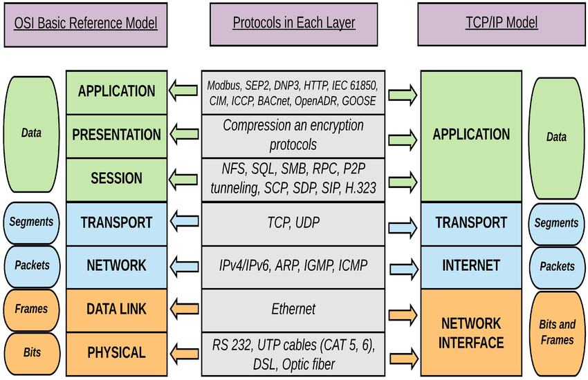

## Application Layer

:::note
**Definition: Application Layer**
The application layer is where network applications and their application-layer protocols reside. It is the top of the protocol stack and directly serves user processes.
:::
Remember: an application != the application layer.

### Application Architectures

Who acts as the server? Who acts as the client?

#### Mainframe Model

An old approach, also called time-sharing: a terminal-oriented, multi-user computer system.

#### Client-Server Architecture

Clients connect intermittently and may change IP addresses.
A dedicated server stays online with a fixed IP address.
This architecture is very common today.
The client issues commands; the server processes them and returns results.

#### P2P Architecture

There is no central server. End systems communicate directly with each other.
This scales well but is difficult to manage.
`BitTorrent` uses this architecture.
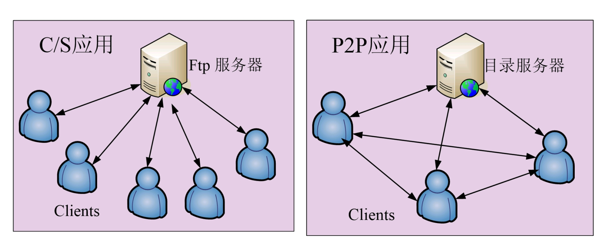

#### B/S Architecture

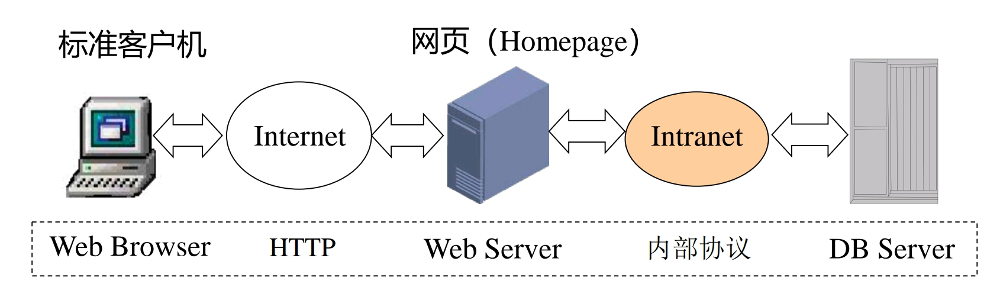

### Process Addressing

> The network is huge. How do I find you?

Application-layer communication is fundamentally communication between **processes**.

#### Port Number

- **Definition**: A 16-bit integer identifying a specific process running on a host.
- **Categories**: Well-known ports (0–1023, such as HTTP 80, HTTPS 443, and SSH 22), registered ports (1024–49151), and dynamic ports (49152–65535).

#### Socket

1. **Socket address**: IP address : port number. This uniquely identifies a process on the network.
2. **Socket API**: The **programming interface** provided by the operating system kernel to applications.
    - On Linux/Unix, a socket appears as a **file descriptor**.
    - Applications read and write this “file” to communicate with a process at the other end, without handling the underlying TCP/IP transmission details themselves.

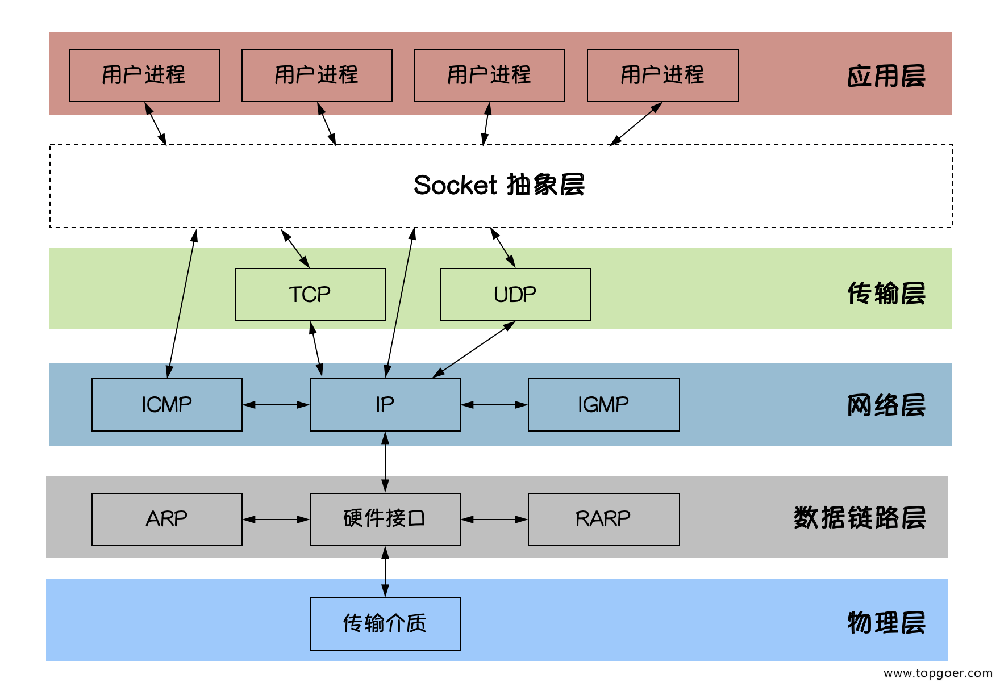

### Infrastructure

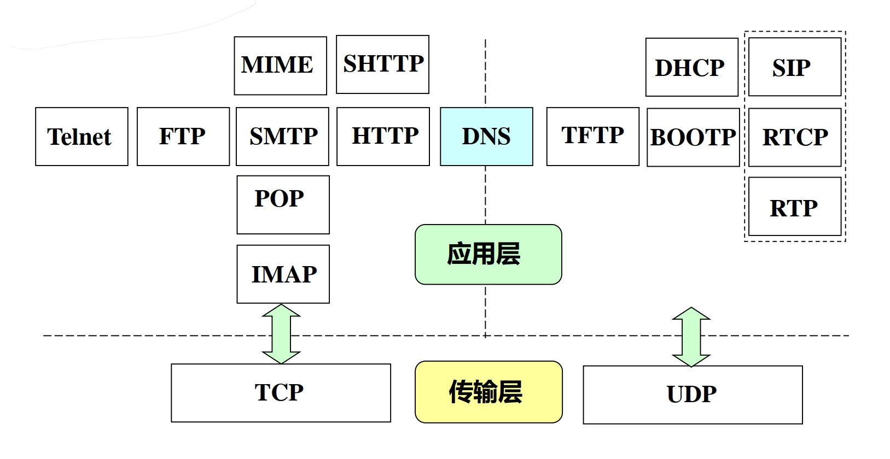

#### DNS

> **Why DNS?**
> Network devices understand IP addresses, but humans remember strings.
> DNS bridges the two.

DNS is a **hierarchical**, **domain-based** naming scheme and a **distributed database** system that translates hostnames into IP addresses.
Three key ideas: *distribution*, *hierarchy*, and *caching*.

- **Why distributed?** With billions of devices worldwide, a single server keeping all the records would collapse immediately from overload or become a single point of failure. DNS therefore distributes its data around the world.

##### Query Process

When visiting `www.example.com`:

1. **Browser cache** -> **OS hosts file** -> **Local DNS server**.
2. If there is no hit, the local DNS server performs an **iterative query**:
    - Ask a **root server** -> obtain a .com TLD server's IP.
    - Ask the **TLD server** -> obtain the IP of the authoritative server for example.com.
    - Ask the **authoritative server** -> obtain the final IP for `www.example.com`.

DNS stores more than IP addresses:

- **A record**: Domain name -> IPv4 address.
- **AAAA record**: Domain name -> IPv6 address.
- **CNAME record**: An alias. For example, `www.a.com` is really another name for b.com. This is a **core mechanism behind CDNs**.
- **MX record**: Mail exchange; tells mail servers where to deliver messages.
- **NS record**: Name server; identifies the DNS server responsible for a domain.

##### nslookup & dig DNS

Let's look at DNS ourselves!
You can inspect it with `nslookup`.

```shell
$ nslookup www.bilibili.com
Server:         127.0.0.53            <-- 1. Your local DNS server
Address:        127.0.0.53#53

Non-authoritative answer:             <-- 2. A non-authoritative answer
www.bilibili.com        canonical name = a.w.bilicdn1.com.
Name:   a.w.bilicdn1.com              <-- 3. CNAME in action: Bilibili points requests to its CDN
Address: 223.111.252.67               <-- 4. The final A record (IP address)
Name:   a.w.bilicdn1.com              This is DNS caching
Address: 117.169.96.199               Multiple IPs demonstrate DNS load balancing
... # Too many results to include them all
;; Truncated, retrying in TCP mode.
Name:   a.w.bilicdn1.com
Address: 2409:8c38:c40:100::2
Name:   a.w.bilicdn1.com
Address: 2409:8c38:c40:100::3
Name:   a.w.bilicdn1.com
Address: 2409:8c38:c40:100::241
...
```

For a more complete picture, use `dig`.

```shell
$ dig www.bilibili.com

;; ANSWER SECTION:
www.bilibili.com.       600     IN      CNAME   a.w.bilicdn1.com.
# The CNAME record points Bilibili's domain to the CDN domain (a.w.bilicdn1.com)

a.w.bilicdn1.com.       600     IN      A       223.111.252.67
a.w.bilicdn1.com.       600     IN      A       117.169.96.199
...
# Multiple A records (IP addresses) demonstrate DNS load balancing
# The client can pick an IP at random to connect to

;; Query time: 10 msec  <-- A very fast response suggests a cache hit
```

Q: Why are there several IP addresses rather than just one?
A: **Load balancing**.

:::note
**What is Load Balancing?**
Load balancing distributes workloads across computing resources such as clusters, network connections, CPUs, and disk drives.

- Core component: the load balancer, a **reverse proxy** or network device between clients and a backend server pool.
- Basic function: receive inbound client traffic and forward it to a particular upstream server according to a chosen algorithm.

~~Maybe I'll cover this in detail if I ever teach a session on nginx or caddy?~~
:::

#### CDN

If you are in China and the server is in the US, more bandwidth will not eliminate the **latency** caused by physical distance.
That is where CDNs come in.
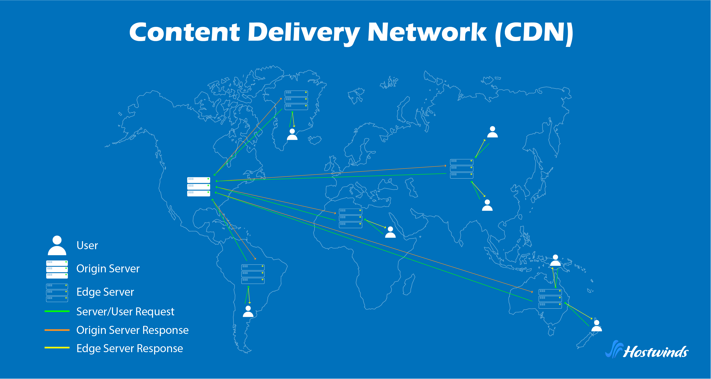

- **Core principles**:
  - **Edge servers**: Nodes deployed around the world.
  - **Redirection**: DNS **CNAME** records redirect lookups for `www.bilibili.com` to the CDN's load balancer, which returns the IP of a nearby edge node with a low load.
  - **Caching**: Static resources such as images, videos, CSS, and JavaScript are cached at edge nodes. Requests go back to the origin only on a cache miss.

> This is what makes smooth video streaming and near-instant page loads possible on the modern Internet.

### Web & HTTP

#### HTTP

##### What is HTTP?

> This section touches on the next layer. We'll get there later; no rush.

:::note
**Definition: HTTP**
HTTP is a **stateless** application-layer protocol defining the format and semantics for exchanging hypertext resources, such as HTML and images, between clients (user agents) and servers.
:::
It follows a request-response model.
Remember “protocol = syntax + semantics”? HTTP's syntax is straightforward.

> - **Request**: verb, path, protocol version; for example, GET /index.html HTTP/1.1.
> - **Response**: protocol version, status code, reason phrase; for example, HTTP/1.1 200 OK or 404 Not Found.
> - **Response body**.

HTTP has these two characteristics:

- Transport-layer dependency:
  - HTTP uses TCP port 80 by default.
  - Reliability: HTTP provides no data-reliability mechanism of its own. It relies entirely on TCP for reliable delivery without loss, errors, or reordering.
- RTT (Round-Trip Time) overhead:
  - A TCP connection must be established before HTTP communication. TCP's three-way handshake adds initial latency.
  - With non-persistent connections, each object requires a separate TCP handshake, causing substantial cumulative delay.

RFC 7231 defines common methods as follows:

- GET: Retrieve the resource identified by the Request-URI.
- POST: Submit data to a resource for processing, such as a form submission or file upload. The data is in the request body.
- PUT: Send data to replace the target resource's current representation.
- DELETE: Ask the server to delete the resource identified by the Request-URI.

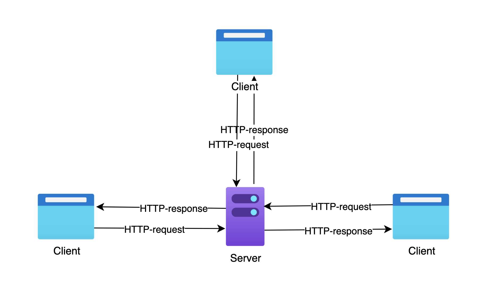

Because HTTP is stateless, the server cannot identify whether successive requests come from the same client using protocol-level information alone.
The **Cookie** mechanism (RFC 6265) addresses this:

1. Generate state: The server includes a `Set-Cookie` field in its HTTP response headers to give the client a state identifier.
2. Store state: The user agent, such as a browser, saves the cookie locally in memory or on disk.
3. Return state: On subsequent requests to the same domain, the user agent automatically includes a `Cookie` request header, maintaining the session.

~~You hear **JWT (JSON Web Token)** a lot these days, too.~~

##### Take a look at HTTP with telnet

```shell
$ telnet www.baidu.com 80
Trying 36.152.44.132...
Connected to www.baidu.com.
Escape character is '^]'. 

# --- [Manual input] ---
GET / HTTP/1.1
Host: www.baidu.com
# (Press Enter twice here to send the request)
# --------------------

# --- [Server response] ---
HTTP/1.1 200 OK                     <-- Status line
Server: BWS/1.1                     <-- Server Header: Baidu's own server
Content-Type: text/html             <-- Tells the terminal this is HTML
Content-Length: 29506               <-- Entity length
Connection: keep-alive              <-- Key point: persistent connection; TCP remains open
Set-Cookie: BAIDUID=0E91...; expires=Thu, 31-Dec-37...
# The Set-Cookie header
# expires=2037: A persistent cookie for long-term user tracking

<!DOCTYPE html>
<html>... (HTML response body)
```

```text
GET / HTTP/1.1
Host: www.baidu.com
```

This is our request:

1. GET /: The method tells the server, “Give me the root path /.”
2. HTTP/1.1: The protocol version indicates that the client supports HTTP/1.1.
3. Host:www.baidu.com: A **mandatory HTTP/1.1 header** specifying the target server's domain name.
4. Two presses of Enter: `\r\n\r\n` (CRLF) in the protocol.

```text
HTTP/1.1 200 OK
```

- 200 OK
The response reveals quite a few of the server's “secrets”:
- Server: BWS/1.1:
  - This usually says nginx or Apache.
  - Here it is BWS (Baidu Web Server), server software Baidu heavily customized for performance.
- Date: Sun, 23 Nov 2025 ...: The server's current time.
- Content-Type: text/html: Tells your terminal what kind of content it is receiving: the MIME type.
- Content-Length: 29506: Announces that the page content contains 29,506 bytes.

```text
Connection: keep-alive
```

Remember HTTP/1.1's persistent connections?

- The server did not close TCP after sending the data.
- If you enter `GET /favicon.ico HTTP/1.1 ...` in this window now, it responds immediately without another handshake.
- Because the connection remains open, you must use `Ctrl+]` followed by `quit` to exit telnet.
Here is HTTP overcoming its “amnesia”:

```text
Set-Cookie: BAIDUID=...; expires=Thu, 31-Dec-37...
Set-Cookie: BIDUPSID=...
Set-Cookie: PSTM=...
```

- Baidu gives you several ID cards, or cookies, in one go.
  - BAIDUID: Its main identifier for tracking you.
  - expires=Thu, 31-Dec-37
    - Unless you manually clear the browser cache, Baidu can recognize this ID for more than a decade: “Oh, it's that person who connected with Telnet in 2025.”
    - This is how targeted advertising and saved search history work.
- X-Xss-Protection: 1;mode=block: Tells the browser to enable its anti-XSS shield. Most modern browsers have deprecated this header, but Baidu keeps it for compatibility with older browsers.
- Vary: Accept-Encoding

What follows is the response body.

```html
<!DOCTYPE html>
<html>
<head>...
```

#### HTTPS

> **Why HTTPS?**
> HTTP sends data in **plaintext**. Log into an HTTP website over public Wi-Fi, and someone capturing packets can see your password directly.
> HTTPS = HTTP + **SSL/TLS**.

HTTPS is not an entirely new protocol; it is **HTTP over SSL/TLS**. It inserts a security layer between HTTP at the application layer and TCP at the transport layer: **TLS (Transport Layer Security)**, or its predecessor SSL (Secure Sockets Layer).

HTTPS addresses three core security problems (the CIA model):

1. **Confidentiality**: Prevent eavesdropping. Encryption encodes the payload so only a recipient with the key can decrypt it.
2. **Integrity**: Prevent tampering. **Message digest** algorithms such as SHA-256 generate digital fingerprints to check that data has not changed in transit.
3. **Authentication**: Prevent spoofing. **Digital certificates** and **PKI (Public Key Infrastructure)** verify the server's real identity.

TLS combines two forms of encryption to balance security and performance:

- **Asymmetric encryption**:
  - **Principle**: A public/private key pair. Data encrypted with the public key can only be decrypted with the private key, and vice versa.
  - **Use**: Only during the **TLS handshake**, to securely exchange a session key.
  - **Algorithms**: RSA, ECC (Elliptic Curve Cryptography), Diffie-Hellman.
- **Symmetric encryption**:
  - **Principle**: Both parties hold the same key and use it for encryption and decryption.
  - **Use**: During **application data transfer**, after the handshake, because it is much faster than asymmetric encryption.
  - **Algorithms**: AES-GCM, ChaCha20-Poly1305.

The **CA (Certificate Authority)** is the trust anchor.

- **Chain-of-trust validation**: The browser uses built-in **Root CA** public keys to validate certificate signatures along the server's certificate chain.

##### Inspecting Certificate Chains with openssl

We can inspect certificates using openssl.

```shell
$ openssl s_client -connect www.bilibili.com:443 -showcerts
Connecting to 223.111.252.67...
# [Part 1: Certificate chain validation]
# OpenSSL received the server's chain and tries to validate each level
depth=2 OU=GlobalSign Root CA - R3, O=GlobalSign, CN=GlobalSign
verify return:1  # depth=2: Root CA

depth=1 C=BE, O=GlobalSign nv-sa, CN=GlobalSign RSA OV SSL CA 2018
verify return:1  # depth=1: Intermediate CA

depth=0 C=CN, ST=上海, L=上海, O=上海幻电信息科技有限公司, CN=*.bilibili.com
verify return:1  # depth=0: Leaf certificate

---
# [Part 2: Certificate chain details]
Certificate chain
 # Certificate 0: Server leaf certificate
 0 s:C=CN, ST=上海, L=上海, O=上海幻电信息科技有限公司, CN=*.bilibili.com  # s (Subject): Certificate holder
   i:C=BE, O=GlobalSign nv-sa, CN=GlobalSign RSA OV SSL CA 2018  # i (Issuer): Issuing authority
   a:PKEY: RSA, 2048 (bit); sigalg: sha256WithRSAEncryption # Signature algorithm

 # Certificate 1: Intermediate CA certificate
 1 s:C=BE, O=GlobalSign nv-sa, CN=GlobalSign RSA OV SSL CA 2018 # Subject
   i:OU=GlobalSign Root CA - R3, O=GlobalSign, CN=GlobalSign # Issuer (points to Root)

 # Certificate 2: Root CA certificate (usually built into the OS; the server may or may not send it)
 2 s:OU=GlobalSign Root CA - R3, O=GlobalSign, CN=GlobalSign
   i:C=BE, O=GlobalSign nv-sa, OU=Root CA, CN=GlobalSign Root CA # Issuer (usually self-signed)
---
Server certificate
...
---
# [Part 3: Handshake result]
SSL handshake has read 4424 bytes and written 1642 bytes
Verification: OK # Key result: chain-of-trust validation passed
---
New, TLSv1.3, Cipher is TLS_AES_256_GCM_SHA384  # TLS 1.3 with AES-256-GCM symmetric encryption
Protocol: TLSv1.3
Server public key is 2048 bit
...
```

#### HTTP Evolution

##### HTTP/1.1

- **Mechanism**: A text protocol with persistent connections.
- **Drawback**: **Application-layer head-of-line (HOL) blocking**. Requests queue serially; later requests must wait for earlier ones to finish.
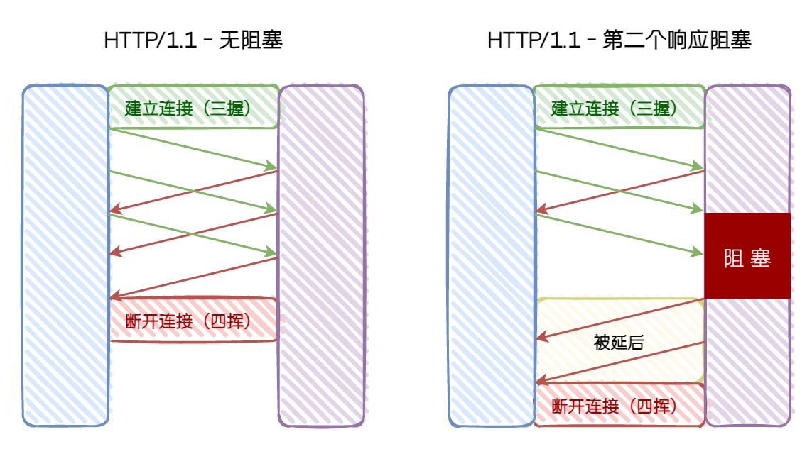

##### HTTP/2

That led to HTTP/2.
HTTP/2 still uses TCP, but redesigns the transfer mechanism to address application-layer HOL blocking.

- **Mechanism**: **Binary framing** + **multiplexing**.
- **Improvements**:
  - **Streams**: Multiple requests/responses can travel concurrently over one TCP connection.
  - **HPACK**: Header compression to save bandwidth.
  - **Server Push**: The server can proactively push resources.

Most places are still on HTTP/2 today.
Take Bilibili as an example.

```shell
$ curl -v -I https://www.bilibili.com
...
# [Step 1: ALPN (Application-Layer Protocol Negotiation)]
# During the TLS handshake, the client says: "I support HTTP/2 (h2) and HTTP/1.1"
* ALPN: curl offers h2,http/1.1
* TLSv1.3 (OUT), TLS handshake, Client hello (1):
...
* TLSv1.3 (IN), TLS handshake, Server hello (2):
* TLSv1.3 (IN), TLS handshake, Encrypted Extensions (8):
...
# At the end of the TLS handshake, the server confirms: "Let's use h2 (HTTP/2)"
* ALPN: server accepted h2
* Server certificate:
...
* Connected to www.bilibili.com (2409:8c20:5624::55) port 443

# [Step 2: HTTP/2 streams and pseudo-headers]
* using HTTP/2
# Open stream 1 to send the request
* [HTTP/2] [1] OPENED stream for https://www.bilibili.com/
# Send a HEADERS frame. HTTP/2 pseudo-header fields begin with a colon
* [HTTP/2] [1] [:method: HEAD]        # The GET/HEAD method from HTTP/1.1
* [HTTP/2] [1] [:scheme: https]       # Scheme
* [HTTP/2] [1] [:authority: www.bilibili.com] # The HTTP/1.1 Host header equivalent
* [HTTP/2] [1] [:path: /]             # Path
* [HTTP/2] [1] [user-agent: curl/8.15.0]
* [HTTP/2] [1] [accept: */*]
> HEAD / HTTP/2
> Host: www.bilibili.com
> User-Agent: curl/8.15.0
> Accept: */*
>
* Request completely sent off

# [Step 3: Receive the response]
< HTTP/2 200
< date: Sun, 23 Nov 2025 08:29:57 GMT
< content-type: text/html; charset=utf-8
...
* Connection #0 to host www.bilibili.com left intact
```

##### HTTP/3

HTTP/2 solves application-layer blocking, but not **TCP-level head-of-line blocking**.

- **TCP's limitation**: TCP is a byte-stream protocol requiring in-order delivery. If a packet in the TCP window is lost, the operating system kernel stalls the entire connection while waiting for retransmission, blocking every stream.

HTTP/3 drops TCP in favor of the UDP-based **QUIC (Quick UDP Internet Connections)** protocol.

- **UDP-based**: UDP is connectionless and unreliable, but QUIC implements reliability, including retransmission and congestion control, at the application layer.
- **Stream independence**:
  - QUIC streams are genuinely independent. Losing a UDP packet for stream A affects only stream A; streams B and C continue unaffected.
- **Connection migration**:
  - TCP identifies a connection with a four-tuple: source IP, source port, destination IP, and destination port. Switching networks, such as Wi-Fi to 4G, changes the IP and breaks the connection.
  - QUIC uses a **Connection ID (CID)**. As long as the CID stays the same, a connection survives an IP change without another handshake.
- **0-RTT handshake**: Together with TLS 1.3, this allows immediate data transfer when resuming a session.

> QUIC implements reliable transport in **user space**, not the kernel. This is why it can evolve quickly.

### Real-Time Communication

We saw that HTTP fundamentally follows a request-response model. This has a serious weakness: **passivity**.
The server is a machine that only answers. Unless the client asks, it never speaks.

That works for browsing, but not for **instant messaging**, **stock quotes**, or **multiplayer online games**. Early developers used **polling** to make servers appear to send messages proactively: every few seconds, the browser sends an HTTP request asking, “Anything new?” This produces many pointless requests and unavoidable delay.

We need genuinely bidirectional communication.

#### WebSocket

WebSocket solves this by allowing **full-duplex** communication over one TCP connection. Both sides can send data simultaneously, without waiting to be asked.

Interestingly, WebSocket does not start from scratch: it **piggybacks** on HTTP. Establishing a WebSocket connection requires a protocol upgrade.

Capture the traffic or simulate it with `curl`, and you will see an exchange that starts as HTTP and ends as a binary stream:

```bash
$ curl --http1.1 -i -N \
    -H "Connection: Upgrade" \
    -H "Upgrade: websocket" \
    -H "Sec-WebSocket-Key: SGVsbG8sIHdvcmxkIQ==" \
    -H "Sec-WebSocket-Version: 13" \
    https://echo.websocket.org
```

The server returns `HTTP/1.1 101 Switching Protocols`.
This marks a transfer of **ownership** of the TCP connection. A raw TCP channel now directly carries WebSocket **binary frames**.
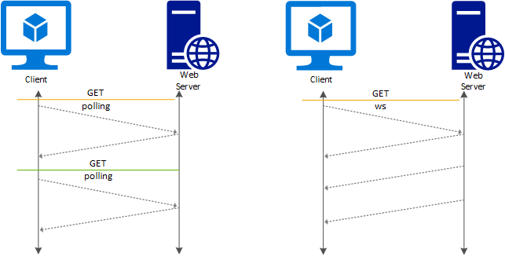

#### WebTransport

WebSocket provides bidirectional communication, but still runs over **TCP**.

**WebTransport** is a new generation of APIs built on **HTTP/3 (QUIC)**. Its UDP-based foundation enables a **datagram** mode in which packets may be lost or arrive out of order. For highly time-sensitive applications, losing a few video frames is much better than freezing for several seconds.

### Remote Management

How do you manage a remote server? SSH is worth a look.

#### SSH

Early **Telnet** (TCP 23) was rudimentary: it simply created a virtual terminal over the network. Worst of all, it sent data in **plaintext** by default.
Every character you typed when logging in, including the root password, traveled in plaintext through the routers. Any man-in-the-middle could intercept your access credentials.

**SSH (Secure Shell, TCP 22)** put an end to Telnet.
SSH is more than a remote shell; fundamentally, it is an **encrypted tunneling protocol**. Immediately after establishing TCP, it performs a key exchange to negotiate a symmetric key over the insecure network. All subsequent data is strongly encrypted.

#### Network Monitoring

Alongside control, we need monitoring.
Traditional **SNMP** uses a **pull model**: every few seconds, the management system asks a router, “What's your CPU usage now?”
This is inefficient and leaves **blind spots**. If traffic spikes and disappears between polls, a microburst, SNMP never notices.

As the Linux kernel evolves, **eBPF** is changing this field.
Instead of asking questions from outside like SNMP, eBPF lets us install safe, **event-driven probes** inside the kernel. A packet crossing an interface or a system call can trigger an eBPF program. Millisecond-level observation from the **kernel's perspective** takes monitoring from a rough view to looking through a microscope.

### File Transfer

#### FTP & SFTP

Moving files sounds simple, but older protocols fit poorly into complex modern networks. **FTP** is the classic cautionary example.

An early Internet protocol, FTP uses a distinctive **two-port mechanism**: TCP 21 for commands and TCP 20 for data.

That worked at the time, but widespread **NAT (Network Address Translation)** makes it a headache today. In FTP's **active mode**, the client tells the server, “Connect to my private IP:port to send me data.” A server on the public Internet cannot connect back into the private network. FTP later introduced passive mode, but its need for many open, random server ports creates a firewall nightmare.

FTP has therefore largely been replaced by **SFTP**.
SFTP is not an encrypted version of FTP. It is an **SSH subsystem** that reuses port 22, needs no extra firewall configuration, and has strong security built in.

### You No Hurry

Before going further, we need to answer a central question: **How does the application layer work?**
When writing HTTP or SSH programs, we seem to call `send()` and magically deliver data to the other side of the planet. We do not worry about broken cables or congested routers.

That is because the **transport layer** gives the application layer a **black-box service model**.

- **Application's perspective**: I put data into the box and say, “Send this to IP:Port.”
- **The box's promise**: I'll handle all the transmission details.

But the box offers two very different packages: “fast, no warranty” (UDP), and “slower, delivery and returns included” (TCP). Let's open the box and see how its gears work.

## Transport Layer

> **Concept: The core mission — from hosts to processes**
> The network layer (IP) delivers data to a **host**. The transport layer distributes it to a specific **process** on that host.
> **Port numbers** make this multiplexing and demultiplexing possible.

Two very different protocols dominate this layer: **UDP** and **TCP**. They represent two distinct philosophies of network design.

### UDP

**UDP** is the black box's first service package. Its philosophy is **best-effort delivery**.

Look at a real UDP packet and you will find an exceptionally simple structure: no elaborate handshake sequence, and a header of just **8 bytes**.
This is a [Fetching Title#3h26](https://wiki.wireshark.org/uploads/e2b98423e5f0dc85e0b1228ebbd044e2/protobuf_udp_addressbook.pcapng) downloaded from [SampleCaptures - Wireshark Wiki](https://wiki.wireshark.org/SampleCaptures).
We can open it in `wireshark`. Install it yourself: [Wireshark • Go Deep | Download](https://www.wireshark.org/download.html).
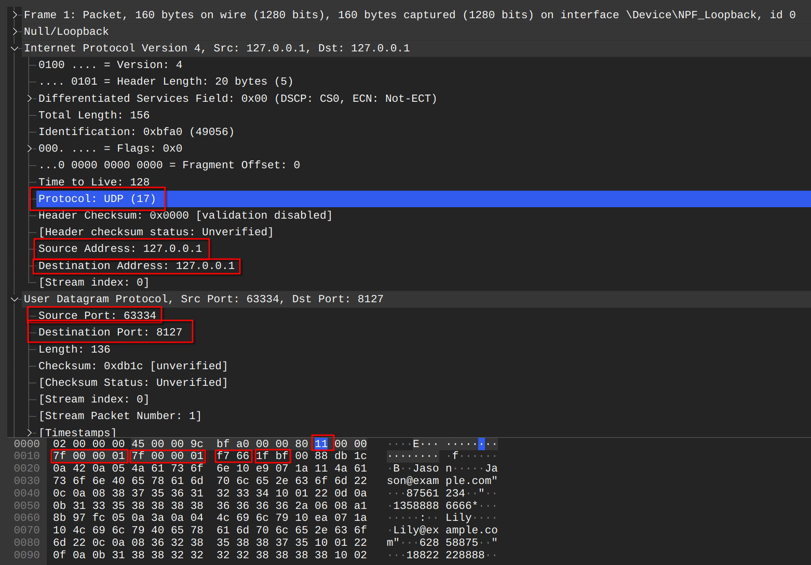

The header is extremely simple, just **8 bytes**:

- **Source and destination ports**: Deliver to the right process.
- **Length**: Tell the receiver how long the packet is.
- **Checksum**: UDP's one basic safeguard.

**Why does the checksum matter so much?**
It is UDP's only reliability measure. If bits flip in transit, UDP **drops** the packet and **does not notify** the sender.
**UDP checksums are optional in IPv4, though usually enabled, but mandatory in IPv6.**

> “If it's so unreliable, why use it?”

For highly **time-sensitive** applications, **latency** is the enemy. With TCP, packet loss can freeze playback while retransmission completes. UDP tolerates occasional loss to keep the overall experience flowing.

### TCP

**TCP** is a cornerstone of the Internet.
Its task is formidable: **build a reliable channel on top of unreliable IP**. To promise delivery without errors, loss, or reordering, TCP is designed as a highly complex **finite-state machine (FSM)**.
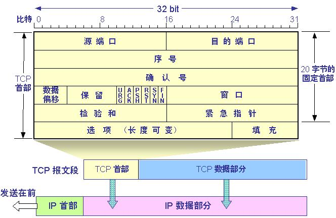

#### Three-Way Handshake

TCP is connection-oriented, so it must “make the call” before communicating. This is more than saying hello: it **synchronizes the two initial sequence numbers (ISNs)**.

- TCP is duplex. A must tell B its ISN, B must tell A its ISN, and both must acknowledge receipt.
- SYN(A) -> SYN(B) + ACK(A) -> ACK(B)
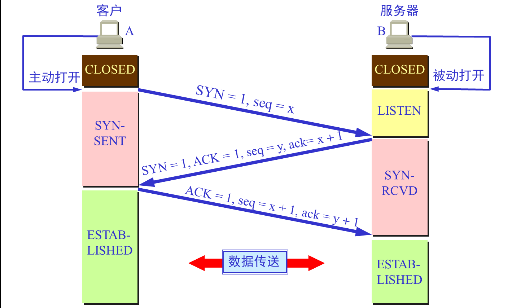
**Why three steps?**
Primarily to prevent **expired connection requests** from unexpectedly reaching the server and making it establish an unnecessary connection that wastes resources.

#### Reliability & Flow Control

Rather than inefficiently sending one packet and waiting for one acknowledgment, TCP uses **pipelining**.
The **sliding window** is central to TCP's efficiency. An ACK carries a `Window` field telling the sender, “I have room for another 4096 bytes. Don't send too fast.” The sender adjusts its volume dynamically based on this feedback. This is **flow control**.

#### Four-Way Wave

Closing a connection after data transfer also involves careful design.
TCP is **full-duplex**, with independent channels in each direction, so the two directions must close separately.
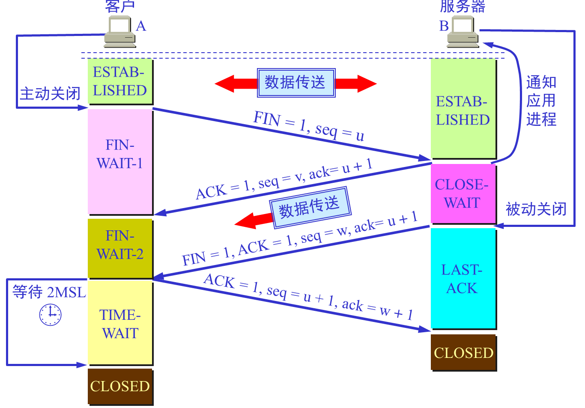

1. The client sends `FIN`: “I have no more data.”
2. The server replies `ACK`: “Understood.” The connection is now **half-closed**; the server may still have data to send.
3. Once finished, the server sends `FIN`: “I'm done too.”
4. The client replies `ACK`: “Goodbye.”

**The point of TIME_WAIT**
After sending the final ACK, the client does not close immediately. It enters `TIME_WAIT` for **2MSL** (Maximum Segment Lifetime, roughly 2 minutes). This protects against the final ACK being lost. If the server does not receive it, it retransmits FIN, and the client must still be “alive” to send another ACK.

#### Congestion Control

What if the receiver is fast, but **routers along the path** are congested? Flow control cannot help with that.
TCP must detect network congestion. It maintains a **congestion window (cwnd)**:

1. **Slow start**: Just after connection establishment, the sending rate grows exponentially to probe the network's load.
2. **Congestion avoidance**: After reaching a threshold, growth becomes linear.
3. **Hard braking**: When loss is detected, sharply reduce the window to give the network some breathing room.

There is too much to unpack here, so I'll leave the details for another time.

##### Take a look at TCP

Here is a complete TCP exchange.
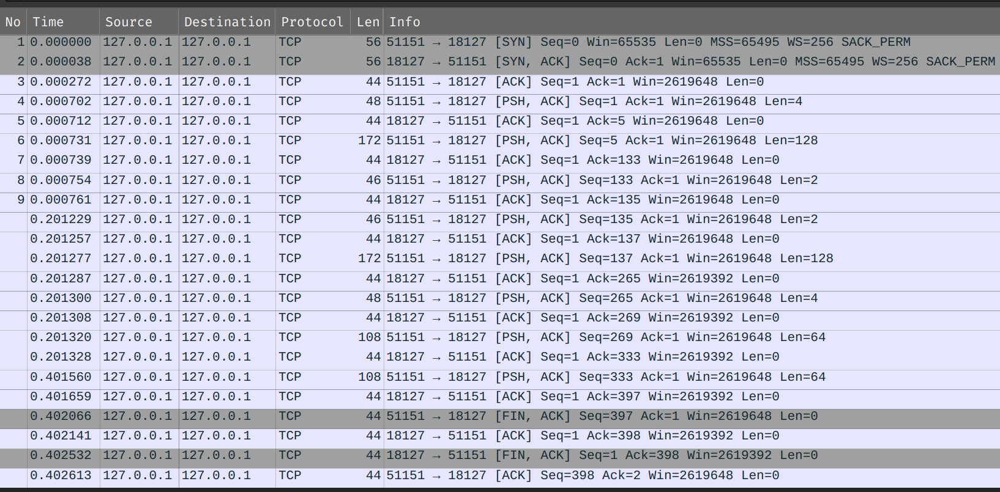

## Network Layer

The network layer sits at the center of the protocol stack. Its primary job is logical **host-to-host** communication. Unlike the data link layer, which transfers frames between adjacent nodes, it must find the best path from source to destination across a complex Internet of interconnected, heterogeneous networks.

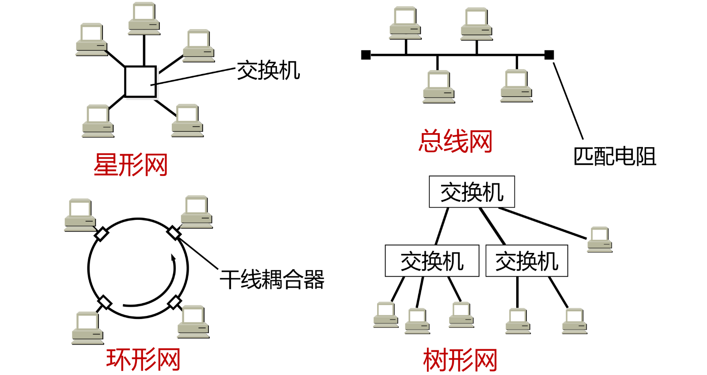

### IP Service Model

Internet Protocol (IP) provides an **unreliable**, **connectionless**, **best-effort** service. When forwarding packets, IP routers keep no state about subsequent packets and do not guarantee freedom from loss, duplication, or reordering. This apparently “irresponsible” design simplifies and lowers the cost of core network devices, leaving reliability to hosts at the edges, through higher transport-layer protocols such as TCP.

#### IPv4 Datagram

An IPv4 datagram has a **header** and a **data portion**. The header's first 20 bytes are fixed and contain the essential transmission control information. Understanding these fields is fundamental to understanding the network layer.
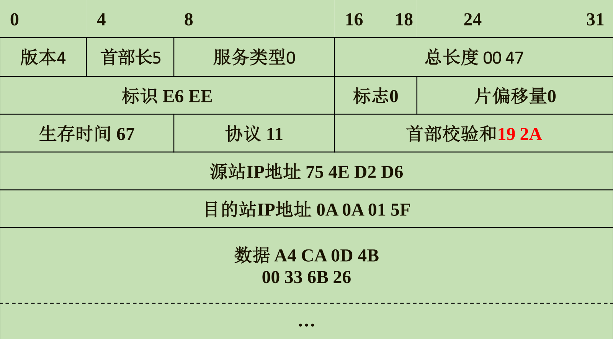

**Basic control fields**
The header begins with version and length information. **Version** occupies 4 bits and is 4 for IPv4.
Next is **Internet Header Length (IHL)**, measuring the total header length in 4-byte units. Optional, variable-length fields mean IHL is needed to locate the start of the data.
**Type of Service** marks datagram priority to support QoS (Quality of Service).
**Total Length** occupies 16 bits and specifies the combined header and data length, giving a theoretical maximum of 65,535 bytes.

**Fragmentation and reassembly fields**
Underlying networks impose a **Maximum Transmission Unit (MTU)**, such as Ethernet's 1500 bytes, so oversized datagrams must be split.
**Identification** is a counter marking all fragments of the same original datagram. **Flags** uses 3 bits: the lowest, MF (More Fragments), is 1 when fragments follow; the middle, DF (Don't Fragment), prohibits fragmentation when set. **Fragment Offset** gives the fragment's position in the original datagram in **8-byte** units. Routers use these fields to fragment packets, and the destination host uses them for reassembly.
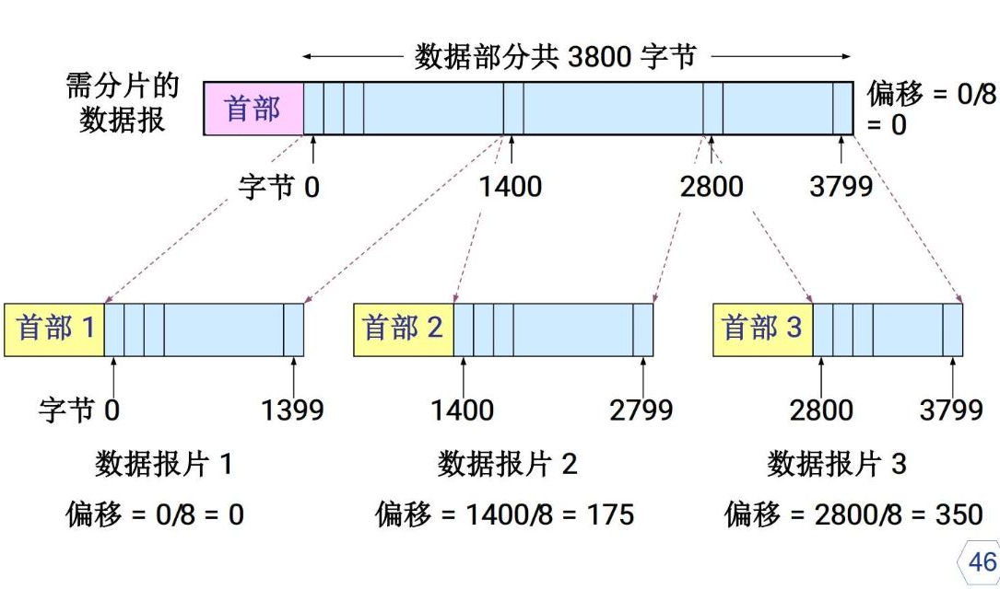

**Lifetime and protocol demultiplexing**
**Time to Live (TTL)** limits the number of router hops. Each router decrements it by 1; at 0, the datagram is discarded to prevent routing loops. **Protocol** identifies the upper-layer protocol in the payload, such as TCP=6, UDP=17, or ICMP=1. It implements network-layer **demultiplexing**, telling the receiver which module should receive the data.

**Checking and addressing**
**Header Checksum** detects errors only in the header, not the data. It must be recalculated at every router because TTL changes. Finally, **source** and **destination addresses**, each 32 bits, provide IP's logical addressing.

#### Subnetting & CIDR

##### Classful Addressing

In ARPANET's early days, IP addressing was blunt: give each physical network a network number. IP addresses were divided into classes A, B, C, D, and E.

| Class | Leading bits | Network number range (first byte) | Default mask | Number of networks | Maximum hosts per network |
| :---: | :--- | :--- | :--- | :--- | :--- |
| **Class A** | `0` | 1 - 126 | /8 | 126 ($2^7-2$) | 16,777,214 ($2^{24}-2$) |
| **Class B** | `10` | 128 - 191 | /16 | 16,384 | 65,534 |
| **Class C** | `110` | 192 - 223 | /24 | 2,097,152 | 254 |

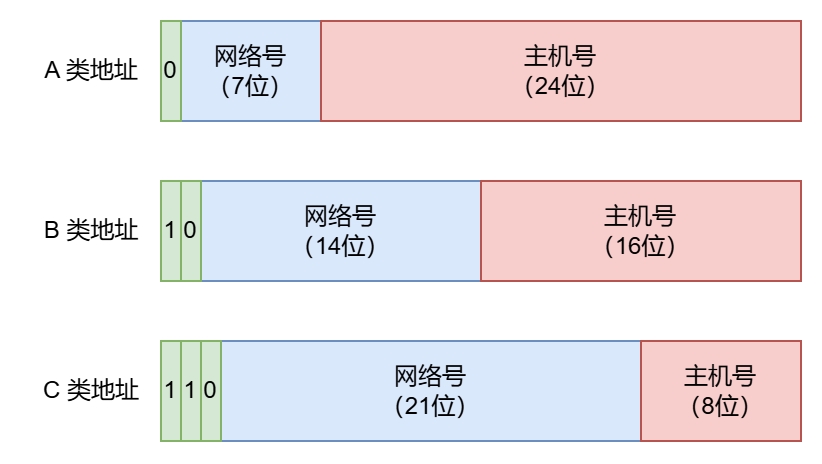

:::warning

1. **127.x.x.x** is also Class A, but is reserved for **loopback**.
2. **Class D (224–239)** is for multicast; **Class E** is reserved for research.

:::

This design has serious problems:

- **Address waste**: A company with 300 hosts outgrows Class C's 254, but allocating Class B's 60,000-plus addresses wastes far too many.
- **Routing-table growth**: Each network needs its own routing-table entry, putting enormous pressure on routers.

##### Subnetting

To improve utilization, people introduced **subnets**.
**Core idea**: Borrow bits from the **host number** to form a **subnet number**.

> **Subnet mask**: Identifies which bits of an IP address belong to the network and which to the host.
> The operation is: `network address = IP address AND subnet mask`.

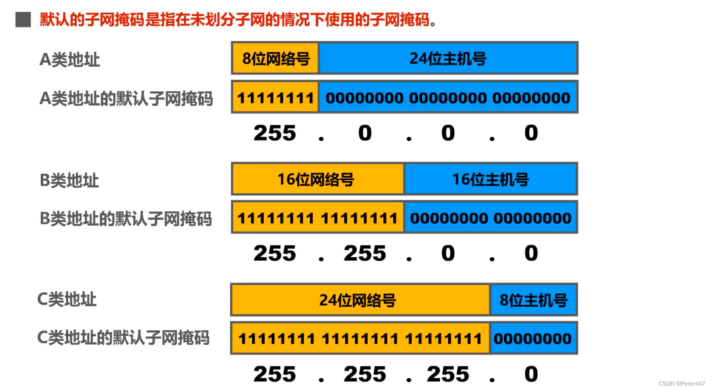

##### CIDR

CIDR removes traditional Class A, B, and C addresses and the associated subnetting concept. Flexible network-address lengths allocate IPv4 space more efficiently.
It replaces classful network and subnet numbers with **network prefixes** of different lengths.
The classless two-level notation is:
> IP address ::= {<network prefix>, <host number>}

CIDR also uses slash notation:
An IP address is followed by `/` and the number of prefix bits, such as 20.5.0.0/10, which can also be shortened to 20.5/10.
Contiguous IP addresses sharing a prefix form a CIDR block.

Here is a question from the **Computer Fundamentals Competition**:
> Divide 192.168.1.0/24 into 4 equal-sized subnets, each supporting the same number of hosts.
>
> - What is each subnet's mask?
> - How many usable hosts does each subnet support?

The *IP address* is *192.168.1.0*, or *1100'0000.1010'1000.0000'0001.0000'0000*.
The *CIDR prefix* is `/24`: *1111'1111.1111'1111.1111'1111.0000'0000*.
To create subnets, the first 24 bits stay fixed. The final **8 bits** (0000'0000) were originally all for hosts.
$2^n = 4$
So `n = 2`.
We need **2 bits** for four subnets: 00, 01, 10, and 11. We therefore **take** the leftmost 2 of the 8 host bits for the network.
*1111'1111.1111'1111.1111'1111.1100'0000*
That is `/26`, or 255.255.255.192.

After borrowing 2 bits, $8 - 2 = 6$ host bits remain.

- Total IP addresses: $2^6 = 64$.
- **Usable IP addresses**: Subtract the **network address** (all zeros) and **broadcast address** (all ones).
- $64 - 2 = 62$

|Subnet|Borrowed bits (SS)|Remaining host range (HHHHHH)|Decimal range|
|--------|----------|----------------|-----------|
|**Subnet 1**|**00**|000000 ~ 111111|.0 ~ .63|
|**Subnet 2**|**01**|000000 ~ 111111|.64 ~ .127|
|**Subnet 3**|**10**|000000 ~ 111111|.128 ~ .191|
|**Subnet 4**|**11**|000000 ~ 111111|.192 ~ .255|

If a destination matches multiple routing-table entries, the router uses **longest prefix match**: it forwards using the entry with the longest network prefix or subnet mask, because that route describes the destination more specifically.

#### IPv6

IPv6 does more than expand the address space. It completely redesigns the packet header for modern high-speed networks.

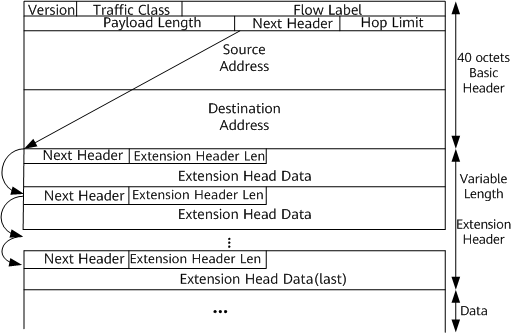
**A leap in address space**
IPv6 expands addresses from 32 to **128 bits**, fundamentally addressing exhaustion. We could assign an IP address to every grain of sand on Earth.

**A simpler base header**
IPv6 has a fixed **40-byte** base header, removing many uncommon IPv4 fields for more efficient processing.

1. **No header-length field**: The header is always 40 bytes.
2. **No header checksum**: Modern links such as Ethernet and fiber already have strong error detection, and the transport layer also checks data. Removing per-hop checksum recalculation significantly speeds forwarding.
3. **No fragmentation fields**: IPv6 allows **only source hosts to fragment**. A router receiving an oversized packet drops it and returns ICMPv6 Packet Too Big, reducing the work for intermediate routers.
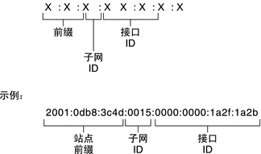
**Flexible extensions**
IPv6 replaces IPv4's Protocol field with **Next Header**.
It can point to TCP, UDP, or **extension headers** such as hop-by-hop options, routing, and fragmentation.
This chain makes IPv6 highly extensible for future features.
Other important fields include **Flow Label**, supporting flows with special QoS requirements, such as real-time audio and video.

### DHCP & NAT

#### DHCP

Q: Why can you get online after connecting to NJUPT without configuring an IP manually?
A: A DHCP server automatically assigns an IP address, subnet mask, gateway, and DNS addresses to devices joining the network.

DHCP is a LAN protocol using UDP ports 67/68.

- **DORA process**:
    1. **Discover**: The client broadcasts, “Is there a DHCP server?”
    2. **Offer**: The server broadcasts, “I have 192.168.1.100. Want it?”
    3. **Request**: The client broadcasts, “I'll use 192.168.1.100.”
    4. **Acknowledge**: The server broadcasts, “Confirmed. The lease is 24 hours.”

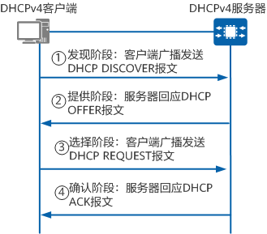

#### NAT

NAT delays IPv4 exhaustion by translating private IP addresses into public ones.
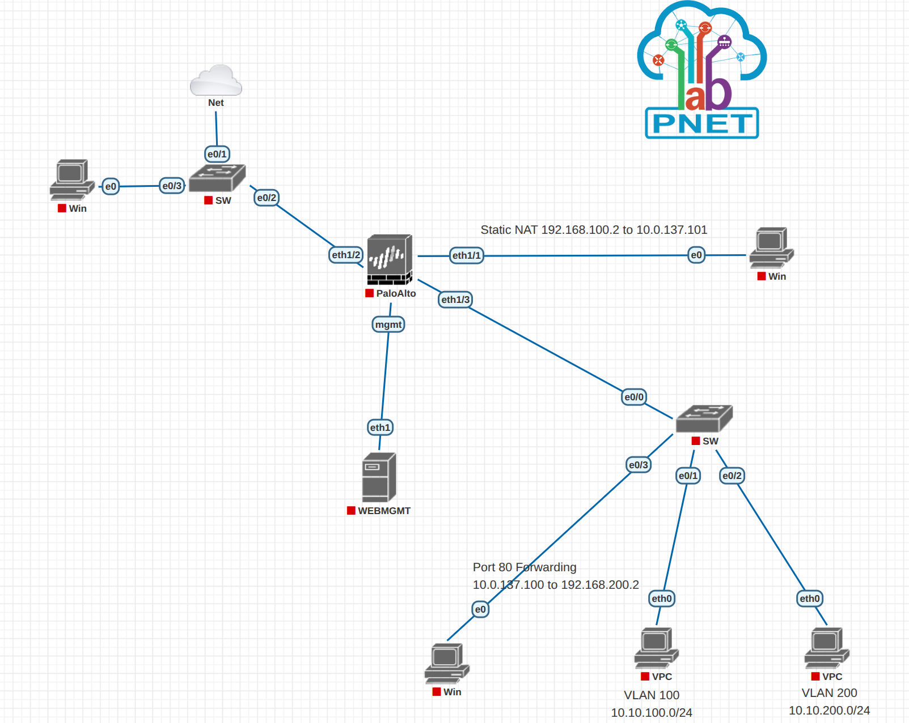

> **Tip**
> This software is PNETlab.
> Give it a try if you are interested in network simulators.
> [PNETLab : Lab is Simple](https://pnetlab.com/pages/main)

### ICMP

**ICMP**: Internet Control Message Protocol.
Direction: host/router -> source (sender).
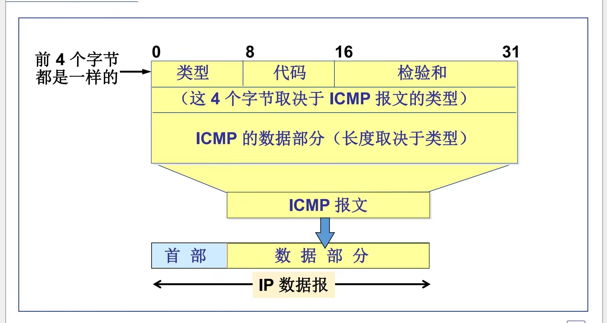
`ICMP` messages fall into two main categories:
`error-reporting messages` and `informational messages (queries)`.

- Error-reporting messages
  - `3` Destination Unreachable
  - `4` Source Quench
  - `5` Redirect (change a route)
  - `11` Time Exceeded for a Datagram
  - `12` Parameter Problem on a Datagram
- Informational messages (queries)
  - `0` Echo Reply
  - `8` Echo Request
  - `9` Router Advertisement
  - `10` Router Solicitation
  - `13` Timestamp Request
  - `14` Timestamp Reply
  - `17` Address Mask Request
  - `18` Address Mask Reply
Types `3`, `11`, `0`, and `8` are commonly used.

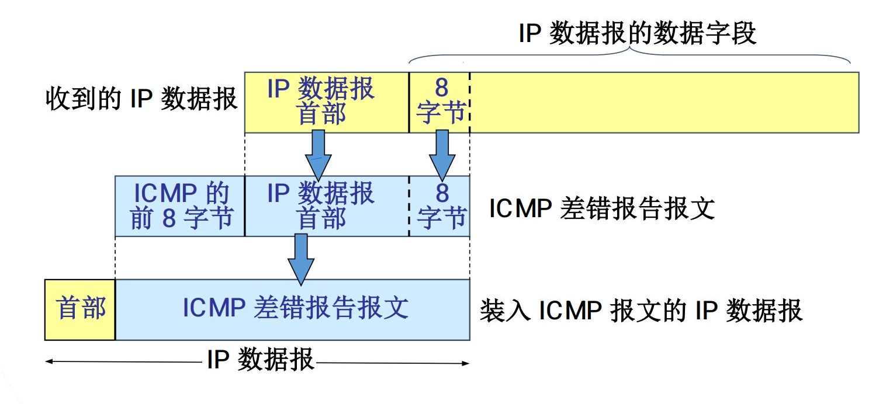

#### PING(Packet InterNet Groper)

PING tests connectivity, or reachability, between two hosts.
It uses ICMP Echo Request and Echo Reply messages.
PING is an example of an application using network-layer ICMP directly, without transport-layer TCP or UDP.
~~There's TCPing now, too.~~

Gateways or firewalls can make connectivity tests misleading because of their protection and packet-filtering behavior.

### Router Architecture

A router is a specialized computer at the heart of the network layer. Its functions are divided between the control plane and data plane.
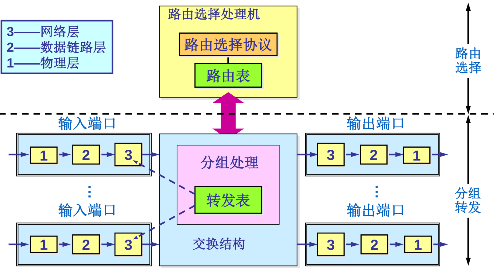
The **control plane** runs routing protocols such as OSPF and BGP and computes routing tables. The **data plane** uses the forwarding table and switching fabric to move arriving datagrams from input ports to the right output ports at line rate.

### Routing Protocols

The Internet is divided into **Autonomous Systems (ASes)**. Routing protocols are therefore divided into Interior Gateway Protocols (IGPs) and Exterior Gateway Protocols (EGPs).

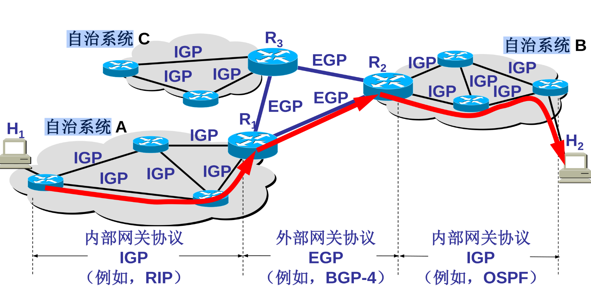

**IGPs** handle routing within an AS. **RIP** uses a distance-vector algorithm, is limited to 15 hops, and suffers from slow propagation of bad news. **OSPF** uses link-state routing: it floods link-state information to build a complete topology and calculates shortest paths with **Dijkstra's algorithm**. It converges quickly and suits large networks.

**EGPs** handle routing between ASes. **BGP**, the Internet's backbone protocol, uses a path-vector algorithm. It exchanges reachability information, prioritizing **routing policy**, such as political or economic considerations, rather than speed alone.

## Data Link Layer

The data link layer sits between the physical and network layers. Its core responsibility is reliable frame transmission between **adjacent nodes**. The physical layer sends unstructured bits; **framing**, **error detection**, and **media access control** turn that physical channel into a logically error-free data link. In Ethernet, MAC addresses identify devices at this layer.

### Framing

The data link layer adds a header and trailer to each network-layer packet, encapsulating it in a **frame**. Frames are its transmission units and delimit where data begins and ends, providing frame synchronization.
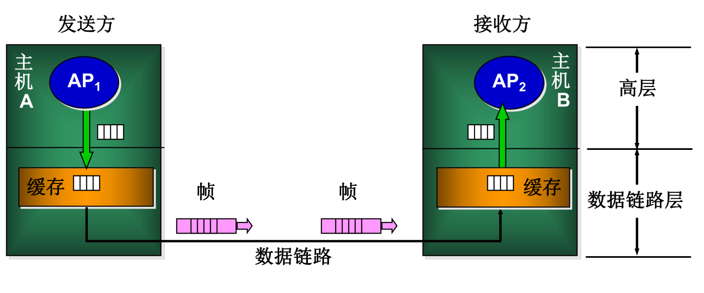

**Transparent transmission**
To prevent payload bit patterns from being mistaken for frame delimiters, or false flags, the following techniques are needed:

- **Byte stuffing**: Byte-oriented protocols such as PPP insert escape characters to distinguish control characters appearing in data.
- **Zero-bit stuffing**: In bit-oriented protocols such as HDLC, a 0 is inserted after five consecutive 1s. The receiver reverses this operation, keeping delimiters such as `01111110` unique in the stream.

### Error Control

Noise on a physical channel can cause bit errors.
The data link layer mainly uses **Cyclic Redundancy Checks (CRC)** to detect them. The sender computes a Frame Check Sequence (FCS) from a generator polynomial and appends it to the frame; the receiver verifies integrity through modulo-2 arithmetic.

Modern Ethernet generally provides only **error-free acceptance**: bad frames are discarded, not retransmitted. Reliable delivery is normally implemented by TCP or particular link protocols, such as wireless links, using **Automatic Repeat Request (ARQ)** mechanisms including stop-and-wait, Go-Back-N, and selective repeat.

### MAC

On broadcast channels such as bus Ethernet or wireless LANs, devices share the same physical medium. Media access control protocols prevent or handle **collisions** caused by simultaneous transmissions.

#### CSMA

**CSMA/CD (Carrier Sense Multiple Access with Collision Detection)**
An early wired-Ethernet random-access protocol, following the principle “listen before speaking, and keep listening while speaking”:

1. **Carrier sensing**: Check whether the channel is idle before transmitting.
2. **Collision detection**: Monitor voltage changes while transmitting. On detecting a collision, stop immediately and broadcast a jamming signal.
3. **Binary exponential backoff**: After a collision, wait a random interval before retransmitting. The interval's range grows exponentially with repeated collisions, reducing the chance of another one.

**CSMA/CA (Carrier Sense Multiple Access with Collision Avoidance)**
Wi-Fi cannot accurately detect collisions while transmitting, including the hidden-station problem, so it uses **collision avoidance**. Interframe spaces (IFS) and channel reservations through RTS/CTS handshakes reduce collisions.

### MAC Address & Ethernet Frame

**MAC (Media Access Control) address**
A MAC address is a globally unique 48-bit identifier burned into a Network Interface Controller (NIC): a **physical address**. Unlike logical IP addresses, MAC addresses are flat and non-hierarchical, distinguishing hardware within a LAN.

**Ethernet frame structure**
A standard Ethernet V2 frame contains destination and source MAC addresses, a type field identifying the upper-layer protocol such as IP, the payload, and an FCS. Ethernet's **MTU**, usually 1500 bytes, limits the payload size.

### ARP

Senders generally know only the destination's IP address. ARP dynamically maps IP addresses to MAC addresses.

#### How ARP Works

1. **Broadcast request**: The source host broadcasts an ARP request asking for the MAC address corresponding to a particular IP.
2. **Unicast reply**: The target recognizes its IP and unicasts an ARP reply containing its MAC address.
3. **ARP cache**: The source stores the mapping in its local ARP cache with an expiration time to avoid repeated broadcasts.

Use `arp -a` to inspect your computer's ARP table.

```shell
$ arp -a
? (192.168.101.146) at c8:d3:ff:0f:70:0e [ether] on wlp4s0
? (192.168.101.42) at 74:9e:f5:d7:f4:bb [ether] on wlp4s0
...
```

### Switch & VLAN

#### Switching

A traditional hub works at the physical layer, merely repeating bits and unable to isolate collisions. A switch is a multiport bridge at the data link layer.

- **Self-learning**: It examines arriving frames' **source MAC addresses** to build and maintain a forwarding table.
- **Frame forwarding**: It looks up the **destination MAC address** and forwards to the appropriate port, flooding when the address is unknown.
- **Collision-domain isolation**: Every port is a separate collision domain supporting full-duplex communication, greatly improving performance.

#### VLAN

Switches isolate collision domains, but all ports still share a **broadcast domain**. VLANs (IEEE 802.1Q) control broadcast storms and improve security.
By inserting a **VLAN tag** into Ethernet frames, administrators logically divide one physical network into independent broadcast domains. Different VLANs cannot communicate through Layer 2 switching alone; a router or Layer 3 switch must route traffic between them.

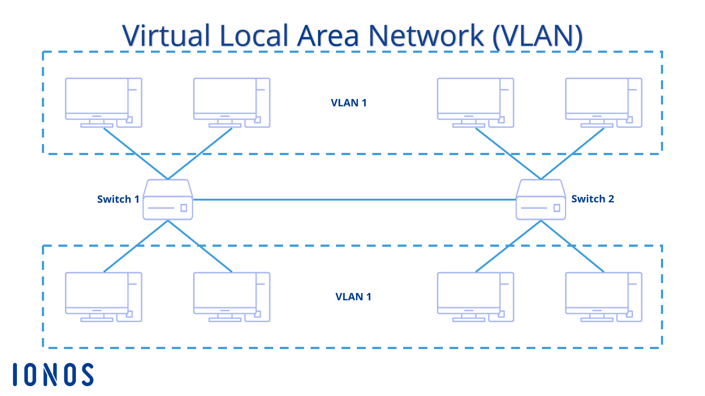
> A quick note:

- **Hub**: Isolates neither collisions nor broadcasts.
- **Switch**: Isolates collisions, **not** broadcasts.
- **Router / VLAN**: Isolates **both** collisions and broadcasts.

### WAN Link Control

Unlike LANs, WANs usually use point-to-point connections. They do not need to resolve shared-media access collisions and instead focus on efficient encapsulation.

- **PPP (Point-to-Point Protocol)**: The most widely used WAN protocol. It supports multiple network-layer protocols, error detection, Link Control Protocol (LCP), and Network Control Protocols (NCP). It is byte-oriented and uses byte stuffing for transparent transmission.
- **HDLC (High-Level Data Link Control)**: A bit-oriented synchronous data link protocol using zero-bit stuffing. Although important theoretically, PPP has replaced it in practical Internet use.

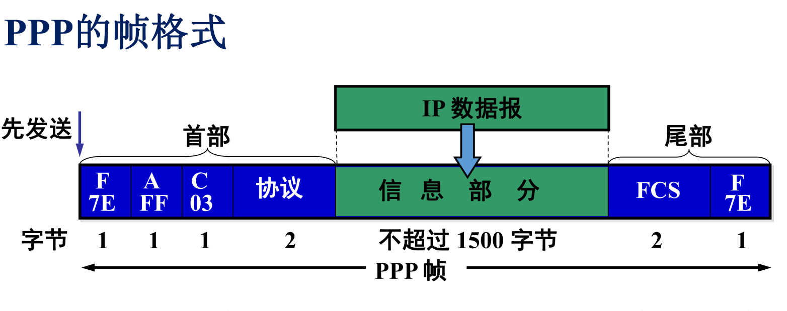

## Physical Layer

At the bottom of the protocol stack, the physical layer defines the mechanical, electrical, functional, and procedural properties needed to transparently transmit **bit streams** over physical media.

### Signal Modulation

A computer's digital signals must be converted into analog signals suitable for the physical channel. This is modulation.

- **Baseband transmission**: Directly sends digital voltage pulses, generally over short distances such as LANs.
- **Passband transmission**: Uses a carrier to shift digital signals into a higher frequency band. Common methods include Amplitude Shift Keying (ASK), Frequency Shift Keying (FSK), and Phase Shift Keying (PSK).

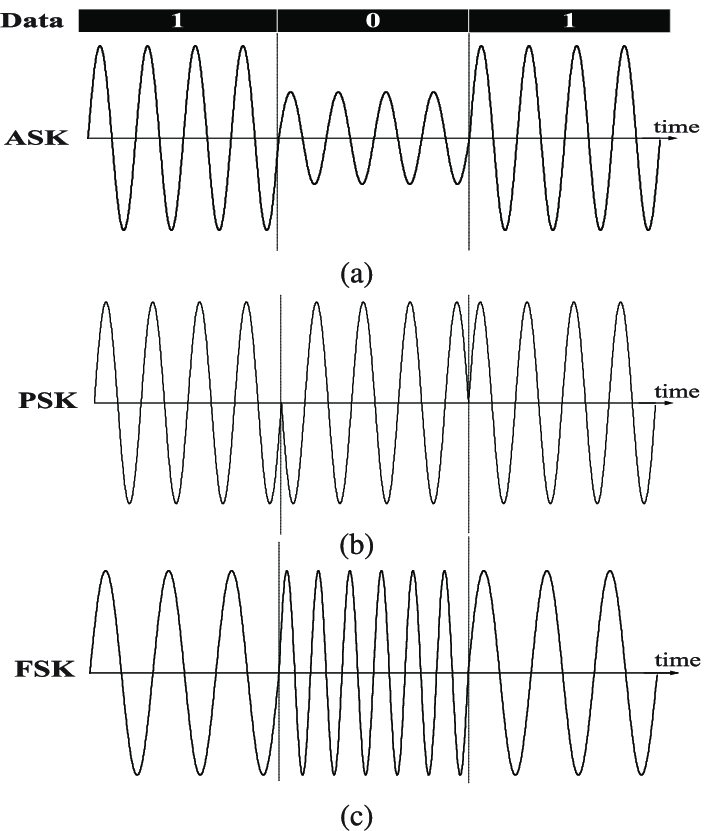

### Nyquist Theorem

In 1924, Nyquist derived the maximum data rate of an **ideal, noiseless low-pass channel**. To avoid **intersymbol interference (ISI)**, the maximum symbol rate is limited by channel bandwidth.

The formula is:
$$ C_{max} = 2W \times \log_2 V $$
Here $W$ is channel bandwidth in Hz, and $V$ is the number of discrete signal levels. In a noiseless environment, the theorem shows that raising the data rate requires higher-order modulation, increasing $V$ so each symbol carries more bits.

### Shannon Theorem

In 1948, Shannon derived the channel-capacity limit in the presence of **white Gaussian noise**, defining an absolute physical upper bound on data rate.

The formula is:
$$ C = B \times \log_2(1 + \frac{S}{N}) $$
Here $B$ is bandwidth and $S/N$ is the signal-to-noise power ratio. In real, noisy channels, increasing the number of signal levels indefinitely cannot increase the rate indefinitely: levels spaced too closely are overwhelmed by noise.

> **A real channel's maximum transmission rate is the smaller of the limits calculated using Nyquist's and Shannon's theorems.**

### Data Encoding

Data encoding converts bits into specific signal waveforms, with an emphasis on clock synchronization and spectral efficiency.

**Non-Return-to-Zero (NRZ)**
NRZ represents 1 and 0 directly with high and low levels. Its main weakness is a lack of self-synchronization: long runs of either value can cause receiver clock drift. It also has a DC component.

**Manchester encoding**
Manchester encoding requires a voltage transition at the center of each bit period. The transition represents data, for example low-to-high for 0 and high-to-low for 1, and supplies a synchronization clock. It is **self-synchronizing**, but doubles the bandwidth requirement: the modulation rate is twice the data rate.

**Differential Manchester encoding**
This encoding is more resistant to interference. It also transitions at the center of each bit for synchronization, but encodes data using the presence or absence of a transition at the **start of the bit**, for example no transition for 1 and a transition for 0.
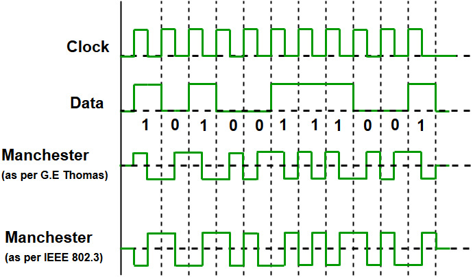

### Media & Modes

Physical media are guided, such as twisted pair and fiber, or unguided, such as radio waves. Optical fiber uses total internal reflection. **Single-mode fiber**, with its very thin core and lack of intermodal dispersion, suits long-distance backbones; **multimode fiber** suits shorter distances.
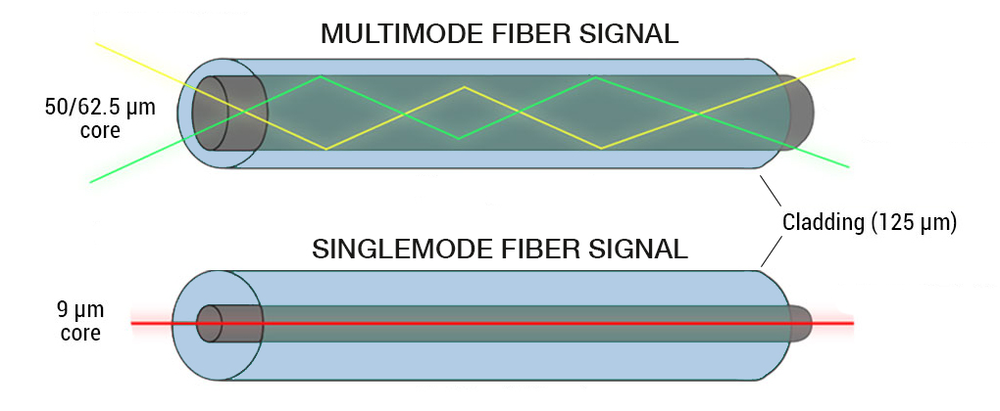

There are three communication modes:

- **Simplex**: Transmission in one direction only.
- **Half-duplex**: Both directions are possible, but only one at a time.
- **Full-duplex**: Both parties can transmit in both directions simultaneously.
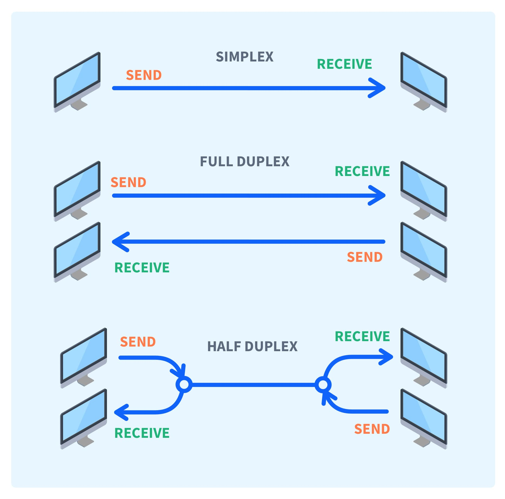

### Interconnection Devices

Physical-layer devices mainly include repeaters and hubs.
A **repeater** **reshapes and regenerates** weakened signals, restoring their waveform and extending transmission distance.
A **hub** is essentially a multiport repeater. It broadcasts incoming signals to every port, placing all connected devices in one **collision domain**. Everyone shares the bandwidth, and efficiency drops sharply as more nodes are added.
