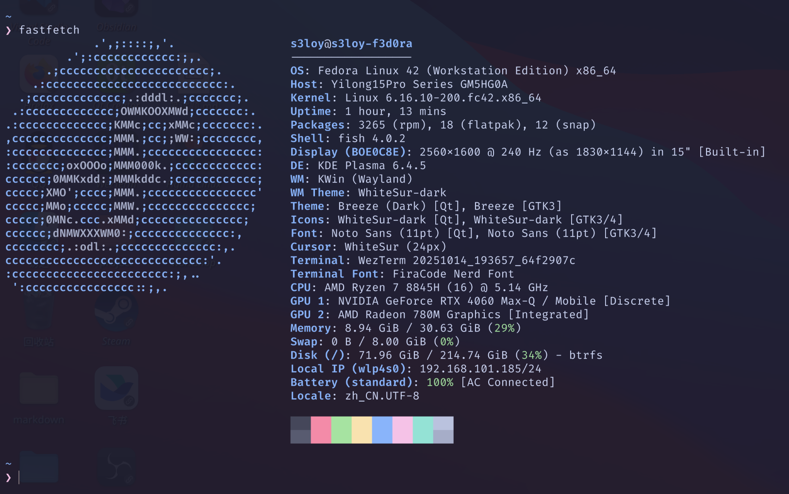

> Fun facts:
>
> - F2 opens the BIOS on the Mechrevo Yilong 15 Pro.
> - Fedora is RPM-based; you can install packages directly with dnf install xxx.rpm.
> - Fedora is not Arch.
> - The stress in Fedora goes like this: fe'dora.
> Disclaimer armor on: this is just for my own use. Mistakes are to be expected.

## 0. the beginning and the ending

beginning : I use arch btw

Surely we can play with something other than Arch?

I chose fedora btw.

## 1. Desktop(KDE plasma 6)::stop using GNOME

I started with the default `GNOME` desktop. Not having a desktop felt uncomfortable, so I switched to `KDE plasma`.

```shell
sudo dnf install @kde-desktop-environment
```

You can then switch desktop environments on the login screen.

### 1.1. Configuration

s3 is an Apple fan.

- Under `Display & Monitor - Display Configuration - Legacy Applications (X11)`, make sure to select `Apply scaling themselves`.
- `Colors & Themes - Global Theme`: WhiteSur-Dark
- `Colors & Themes - Global Theme - Colors` has a problem: it won't download the dark color scheme automatically. Download it manually from [WhiteSur Color - KDE Store](https://store.kde.org/p/1398831), then choose Install from File and select `WhiteSurDark.colors`.
- `Colors & Themes - Global Theme - Cursors`: Breeze Dark. The official one already looks great.
- `Colors & Themes - Global Theme - Application Style`: Breeze
- `Colors & Themes - Global Theme - Application Style - Configure GNOME/GTK Application Style`: WhiteSur-Dark
- `Text & Fonts - Text`: FiraCode Nerd Font, 11pt. (Any good font recommendations, awa?)
**`Animations`**
- Window opening/closing: Scale
- Window maximizing: Stretch animation
- Window minimizing: Minimal transition animation (shrink)
- Window fullscreen: Stretch effect
- Virtual desktop switching: Slide
Click `More Effect Settings` to open `Window Management - Desktop Effects`.
Here are just the options I enabled:
- Appearance enhancements - Dim unresponsive windows
- Appearance enhancements - Blur window backgrounds
- Appearance enhancements - Window transparency - General transparency settings: I only lowered the opacity of `Moving windows` a little.
- Appearance enhancements - Highlight the screen and its corners
- Window management features - Overview

### 1.2. Desktop Tweaks

- `Bottom panel settings:` Alignment: Center; Width: Fill width; Visibility: Always visible; Opacity: Adaptive; Floating: Panel and widgets; Panel height: 40

> Added widgets, on the right: Virtual Desktop Switcher, Peek at Desktop

- Top panel settings: Alignment: Left; Width: Fill width; Visibility: Always visible; Opacity: Adaptive; Floating: Disabled; Panel height: 32

> Added widgets, on the left: Application Launcher
> On the right, from right to left: Digital Clock - Search - System Tray

- `Desktop widgets`: Media Frame, Binary Clock, Window List, Network Speed (changed to show memory usage)

> Fedora 43 has already switched its default to KDE plasma.
> X11 has been removed.
> Do you like Wayland?

### 1.3. Tricks

`KDE plasma` has a few features you're going to like.

#### 1.3.1. Tiling Windows

Shortcut: `Meta` + the `left, right, up, or down arrow key`.
Of course, you can also tile a window by dragging it to the left or right edge.

#### 1.3.2. KRunner

Shortcut: `alt` + `Space`.
Global search, application launching, and so on and so on.
Explore the rest yourself.

#### 1.3.3. Switching Virtual Desktops

Shortcut: `ctrl` + `Meta` + the `left or right arrow key`.
Even nicer if you enable desktop wrapping.

#### 1.3.4. Switching Applications

Shortcut: `Meta` + `tab`, or `alt` + `tab`.

#### 1.3.5. Desktop View

Shortcut: `Meta` + `G`.
Very convenient to use.

## 2. Boot(rEFInd)::UEFI Boot Manager

My computer dual-boots, so I needed a boot setup that worked for both systems.
Instead of using GRUB to boot, I went with `rEFInd`.

```shell
$ sudo dnf install rEFInd

$ sudo refind-install
ShimSource is none
Installing rEFInd on Linux....
ESP was found at /boot/efi using vfat

CAUTION: Your computer appears to be booted with Secure Boot, but you haven't
specified a valid shim.efi file source. Chances are you should re-run with
the --shim option. You can read more about this topic at
http://www.rodsbooks.com/refind/secureboot.html.

Do you want to proceed with installation (Y/N)? n

```

Here's the problem: the script can't figure out where the local EFI file is on its own.
So I used `sudo refind-install --shim /boot/efi/EFI/fedora/shimx64.efi`.

```shell
$ sudo refind-install --shim /boot/efi/EFI/fedora/shimx64.efi
ShimSource is /boot/efi/EFI/fedora/shimx64.efi
Installing rEFInd on Linux....
ESP was found at /boot/efi using vfat
Installing driver for ext4 (ext4_x64.efi)
Storing copies of rEFInd Secure Boot public keys in //etc/refind.d/keys
Copied rEFInd binary files

Copying sample configuration file as refind.conf; edit this file to configure
rEFInd.

Creating new NVRAM entry
rEFInd is set as the default boot manager.
Creating //boot/refind_linux.conf; edit it to adjust kernel options.
The appropriate Secure Boot key is already enrolled.

Installation has completed successfully.

```

Everything looked finished here, but when I went to look in MOK, I was stunned: the keys directory was empty!
After all that messing around, I ended up turning off `Secure Boot`.
The configuration still has issues. Automatic detection produces lots of extra boot entries.
It does find Windows and Fedora automatically, so unified booting works, but the experience isn't great yet.

> Latest update:
> With the default theme, select an unwanted boot entry and press Del to hide it. You can tidy things up before booting.

When it finds lots of entries, as with Fedora, pay attention to which ones you keep. Here's what it found on my machine:

- Boot Microsoft EFI boot from EFI System Partition
- Boot EFI\fedora\grubx64.efi from EFI System Partition
- Boot EFI\fedora\gcdx64.efi from EFI System Partition
- Boot Fallback boot loader from EFI System Partition
- Boot vmlinuz-6.16.12-200.fc42.x86_64 from 1024 MiB ext4 Volume

Here, I only need to keep `Microsoft EFI boot` and the final `vmlinuz` entry.

The theme I'm using is
[GitHub - catppuccin/refind: 🔄 Soothing pastel theme for rEFInd](https://github.com/catppuccin/refind)

> A little background reading

### 2.1. UEFI & BIOS

BIOS(**Basic Input/Output System**)

1. **POST (Power-On Self-Test)**:
    - First it takes inventory, quickly checking that all the core hardware is connected and working. If it finds a serious problem, such as missing RAM, it sounds an alarm with beeps.
2. **Finding the handover manual**:
    - Once the self-test passes, the old butler needs the operating system's boot instructions. It doesn't know what Windows or Linux is, but it knows to look in a **fixed location**: the disk's **first sector**, a tiny 512-byte space called the **Master Boot Record (MBR)**.
3. **Loading and execution**:
    - BIOS loads the code in the MBR into memory, then hands complete control of the computer to it. BIOS's job is essentially done at this point.
4. **Passing the baton**:
    - Starting from the MBR, the following bootloaders take turns until the whole operating system is loaded into memory and running.

> BIOS did an excellent job for decades. It was simple, reliable, and standardized. But as computer technology exploded, some of its old problems became more and more serious:

- **Too narrow a view (the 2.2 TB disk limit)**: MBR uses 32-bit addresses to record partitions, limiting the disk size it can manage to 2.2 TB. With 4 TB and 8 TB drives common today, this has become an insurmountable obstacle.
- **Slow startup**: BIOS can only run in its old 16-bit mode, can address just 1 MB of memory, and initializes hardware one device at a time. Not very efficient.
- **Not secure enough**: BIOS has no security verification mechanism. Attackers can create a virus called a Bootkit that infects the MBR before the operating system starts, gaining the highest level of control and becoming extremely difficult to detect or remove.
- **An ancient interface**

With old-style BIOS booting, the computer looks for boot code in the disk's MBR. That is rather inflexible, so clever people came up with another approach: UEFI.
UEFI, the Unified Extensible Firmware Interface, does not depend on one fixed location. Instead, it requires a special small partition on the disk: the ESP (**EFI System Partition**).

What makes the ESP special:

- **A specific format**: It must use FAT32 so that every operating system and UEFI firmware can read and write it without trouble.
- **A single purpose**: Its only job is to store **bootloaders**.

:::note
The ESP stores and coordinates the boot programs for all installed operating systems.
:::
UEFI's revolutionary advantages

1. **A new boot process: GPT and the ESP**
    - **Goodbye MBR, hello GPT**: UEFI replaces MBR with the new **GPT (GUID Partition Table)** partitioning scheme. GPT uses 64-bit addresses, theoretically supporting disks up to 9.4 ZB (9.4 billion TB), solving the capacity limit entirely. It also supports up to 128 primary partitions.
    - **Goodbye fixed location, hello ESP**: UEFI no longer looks for boot code in the disk's first sector. Instead, it uses a standardized **EFI System Partition (ESP)**. All operating systems' bootloaders (.efi files) live there as ordinary files. UEFI firmware scans and reads them to generate a boot menu. It's like upgrading from slipping notes under a door to having a proper noticeboard.
2. **Secure Boot**
    - One of UEFI's core advantages is its chain of trust. The motherboard firmware contains trusted public keys, usually from Microsoft and hardware vendors.
    - At startup, UEFI verifies the bootloader's digital signature, for example that of gcdx64.efi. If the signature is invalid or has been tampered with, UEFI refuses to execute it, preventing Bootkit infections at their source.
3. **A modern user interface**
    - UEFI has a **graphical interface**, mouse support, higher resolutions, and richer, more user-friendly settings.
    - It is extensible: motherboard vendors can add advanced features such as hardware diagnostics, online firmware updates, or even a basic web browser to the UEFI interface.
4. **Unmatched performance and speed**
    - UEFI runs in 32-bit or 64-bit mode and can access all system memory, without the 1 MB limit.
    - It can initialize hardware in parallel, greatly shortening the power-on self-test and making booting in seconds possible.
5. **Powerful extensibility**
    - UEFI can load separate hardware drivers. This lets it recognize and use more hardware before the operating system starts, such as network cards for network booting or remote diagnostics.

### 2.2. The Stuff in EFI

Boot EFI\fedora\grubx64.efi from EFI System Partition
Take this entry as an example: it is GRUB, Fedora's main bootloader, GRUB2 (*GRand Unified Bootloader*).

Boot EFI\fedora\gcdx64.efi from EFI System Partition
This is a special program called **Secure Boot Shim**, provided for **Secure Boot** compatibility. Secure Boot is a UEFI security feature requiring all boot code to have trusted digital signatures, preventing malicious software from running before the operating system.
grubx64.efi does not have Microsoft's signature, whereas this one uses shim for signing. This is often the default boot method.

Boot Fallback boot loader from EFI System Partition
This is the **fallback/emergency bootloader**. The UEFI specification defines a standard, generic boot path: EFI\BOOT\BOOTX64.EFI. If UEFI cannot find the system's specific boot entry, perhaps because of a configuration error or lost NVRAM records, it tries this fallback path as a last resort.

Boot vmlinuz-6.16.12-200.fc42.x86_64 from 1024 MiB ext4 Volume
This boots the Linux kernel directly from the Linux filesystem. Modern Linux kernels support EFISTUB, which lets UEFI firmware load and run the kernel file directly, just as it would an .efi program.
This is what I currently use to boot, because it really is a little faster.

## 3. System(fedora)::maybe U should know something about this

```shell

$ sudo dnf update

$ sudo dnf upgrade --refresh

$ sudo dnf search htop # Search for a package

$ sudo dnf remove htop # Remove it

$ sudo dnf list installed # List installed packages

$ sudo dnf autoremove    # Remove orphaned dependencies

$ sudo dnf clean all    # Clear the DNF cache

$ ls -lha # Show details (-l) in a human-readable format (-h), including hidden files (-a).
$ cd /etc/nginx # cd .. cd ~ or cd：
$ pwd # Have a look at where you are!
$ mkdir Projects

$ cp source.txt destination.txt
$ cp -r source_folder/ destination_folder/：-r means recursively copying the entire directory.

$ sudo journalctl --vacuum-time=2weeks   # Keep only two weeks of logs

$ flatpak uninstall --unused  # Unused Flatpak packages


$ du -sh ~/.cache
6.2G    /home/s3loy/.cache
$ rm -rf ~/.cache/*
```

I don't feel like writing all of this out. Look things up as you need them.
For some commands, see [Operations Team Lesson 1: Virtual Machines and the Command Line - Feishu Docs](https://njupt-sast.feishu.cn/wiki/OU2Ow2GxuiG2tVkPfLvcmfWxnEd).

## 4. Optimization(sudo)::using sudo without password

Entering a password every time I used `sudo` was a hassle, so I changed it.

```shell
sudo visudo
```

I changed this line:
`%wheel ALL=(ALL)       NOPASSWD: ALL`
Then just save it, since my user already belongs to the wheel group.

## 5. Optimization(auto login)::login without password

System Settings - Appearance & Style - Colors & Themes - Global Theme - Login Screen (SDDM) - Behavior... at the upper right - Automatic Login. Choose the account and desktop environment, then enter the password.

## 6. Optimization(super .desktop)::Writing Shortcuts

`~/.local/share/applications/feishu.desktop`

```desktop
[Desktop Entry]
Version=1.0
Name=飞书
Comment=Feishu | Lark, a work collaboration platform
Exec=/opt/bytedance/feishu/feishu %U
Icon=/opt/bytedance/feishu/product_logo_256.png
Terminal=false
Type=Application
Categories=Network;Office;InstantMessaging;
```

## 7. Optimization(tlp)::Battery

```shell
sudo dnf install tlp tlp-rdw

sudo systemctl enable tlp.service
```

```shell
sudo dnf copr enable sunwire/envycontrol

sudo dnf install python3-envycontrol

$  sudo envycontrol -q
hybrid

sudo envycontrol --switch integrated # Integrated graphics mode
sudo envycontrol --switch hybrid # Hybrid mode
sudo envycontrol --switch discrete # Discrete graphics only
```

## 8. Optimization(blueman)::Bluetooth

```shell
$ sudo dnf install bluez gnome-bluetooth
仓库更新和加载中:
仓库加载完成。
Package "bluez-5.84-2.fc42.x86_64" is already installed.
Package "gnome-bluetooth-1:47.1-2.fc42.x86_64" is already installed.

Nothing to do.
```

It still couldn't find my headphones,
so I tried another package.

```shell
sudo dnf install blueman
```

Connected successfully.

## 9. Tool(neofetch)::Show your OS

`fedora`'s official repositories don't have neofetch, but you can use
`sudo dnf install fastfetch`
as an alternative.
The official project does provide a solution, though:
[Installation · dylanaraps/neofetch Wiki · GitHub](https://github.com/dylanaraps/neofetch/wiki/Installation#fedora--rhel--centos--mageia--openmandriva)

## 10. Tool(bleachbit)::Rubbish Sorting

```shell
sudo dnf install bleachbit
```

## 11. Tool(wezTerm+fish)::Come and use wezTerm

The default terminal is `konsole`. I wasn't quite happy with it, so I switched to **wezTerm** + **fish** + **oh my fish**.

```shell
sudo dnf copr enable wezfurlong/wezterm-nightly

sudo dnf install wezterm

chsh -s /usr/bin/fish
```

From [nerd fonts](https://www.nerdfonts.com/font-downloads),
I downloaded FiraCode Nerd Font and extracted it into `~/.fonts`.

```shell
fc-cache -fv

nano ~/.wezterm.lua
```

```lua
local wezterm = require 'wezterm'
local config = {}
if wezterm.config_builder then
  config = wezterm.config_builder()
end

config.font = wezterm.font_with_fallback({
  'FiraCode Nerd Font',
  'Noto Color Emoji',
})

config.harfbuzz_features = {'calt=1', 'clig=1', 'liga=1'}

config.color_scheme = 'Catppuccin Mocha'

config.window_background_opacity = 0.95

config.window_padding = {
  left = 15,
  right = 15,
  top = 15,
  bottom = 10,
}


config.hide_tab_bar_if_only_one_tab = true


config.default_cursor_style = 'BlinkingBar'
config.enable_scroll_bar = false


config.keys = {
  -- Close the current pane
  {
    key = 'w',
    mods = 'ALT',
    action = wezterm.action.CloseCurrentPane { confirm = true },
  },

  -- Close the current tab
  {
    key = 'w',
    mods = 'CTRL|SHIFT',
    action = wezterm.action.CloseCurrentTab { confirm = false },
  },

  -- Split horizontally (left and right)
  {
    key = '-',
    mods = 'ALT',
    action = wezterm.action.SplitHorizontal { domain = 'CurrentPaneDomain' },
  },

  -- Split vertically (top and bottom)
  {
    key = '=',
    mods = 'ALT',
    action = wezterm.action.SplitVertical { domain = 'CurrentPaneDomain' },
  },
}


return config
```

```shell
curl https://raw.githubusercontent.com/oh-my-fish/oh-my-fish/master/bin/install | fish

omf install pure

sudo dnf install fzf
sudo dnf install grc

omf install fzf
omf install grc
omf install nvm
omf install z
```

I'm using the `pure` theme.

> Theme preview


## 12. Tool(Fcitx5)::Input method

I started with `IBus`.
One problem I ran into was that Chinese input didn't work in Obsidian.
I added these launch arguments:
`--enable-features=UseOzonePlatform --ozone-platform=wayland --enable-wayland-ime`
But after that change, input stopped working in QQ instead.
So I switched back to `Fcitx5`.

```shell
sudo dnf install fcitx5 fcitx5-chinese-addons fcitx5-configtool fcitx5-gtk fcitx5-qt
```

I've seen recommendations for Fcitx5 with Rime, but haven't tried it yet.

Theme: [GitHub - thep0y/fcitx5-themes-candlelight: Candlelight, a minimal fcitx5 theme.](https://github.com/thep0y/fcitx5-themes-candlelight)
I'm using its winter variant.
Its Mac themes have obvious masking issues and don't look good. I wouldn't recommend them.

Configuration changes:

- Bind temporarily switching between the current and first input method to `Shift`; it makes getting used to it easier.
- Enable Cloud Pinyin and change the backend to Baidu.
- In Pinyin, enable corrections for things like front and back nasal endings.

> Known issue:
> In QQ, I can only use the default two-line input rather than single-line input. Even `ctrl` + `alt` + `P` won't change the input mode.

A later problem:
Dropped characters.

```shell
# /etc/environment
GTK_IM_MODULE=fcitx

XMODIFIERS=@im=fcitx

SDL_IM_MODULE=fcitx
```

I added the environment variables shown above.

## 13. Tool(snapper)::Backup

```shell
$ sudo dnf install snapper python3-dnf-plugin-snapper

$ sudo snapper -c root create-config /

# It takes backups automatically
$ sudo snapper list
# │ 类型   │ 前期 # │ 日期                               │ 用户 │ 清空     │ 描述
     │ 用户数据
──┼────────┼────────┼────────────────────────────────────┼──────┼──────────┼──────────┼─────────
0 │ single │        │                                    │ root │          │ current  │
1 │ single │        │ 2025年10月21日 星期二 19时00分00秒 │ root │ timeline │ timeline │
2 │ single │        │ 2025年10月21日 星期二 20时00分00秒 │ root │ timeline │ timeline │
3 │ single │        │ 2025年10月21日 星期二 21时00分00秒 │ root │ timeline │ timeline │

```

See [System Recovery and Snapshot Management with Snapper | Administration Guide | SLES 12 SP5](https://documentation.suse.com/zh-cn/sles/12-SP5/html/SLES-all/cha-snapper.html).

`sudo snapper create --description "进行重要操作前的备份"`

Later edit:
`snapper` is a little too enthusiastic about snapshots on `btrfs`. I noticed a huge gap between `df -h` and `du -h`: tens of gigabytes of ghost files on my computer.
A look at `sudo snapper list` showed it was absolutely packed with snapshots.
Time to delete some.

```shell
sudo snapper delete --sync 1-97
sudo snapper create --type single --description "手动备份-准备清理旧快照"

sudo snapper set-config "TIMELINE_LIMIT_HOURLY=0"
sudo snapper set-config "TIMELINE_LIMIT_DAILY=7"
sudo snapper set-config "TIMELINE_LIMIT_MONTHLY=3"
```

Much cleaner all of a sudden.
qaq

## 14. Tool(vscode)::A Magical Little Tool

```shell
sudo rpm --import https://packages.microsoft.com/keys/microsoft.asc

sudo sh -c 'echo -e "[code]\nname=Visual Studio Code\nbaseurl=https://packages.microsoft.com/yumrepos/vscode\nenabled=1\ngpgcheck=1\ngpgkey=https://packages.microsoft.com/keys/microsoft.asc" > /etc/yum.repos.d/vscode.repo'

sudo dnf check-update
sudo dnf install code
```

Extensions: not sorted into categories yet.

- Better Comments Next
- bis
- Bookmarks
- Chinese (Simplified) Language Pack for Visual Studio Code
- Code Spell Checker
- CodeLLDB
- Container Tools
- Dependi
- Dev Containers
- Dotenv
- Dotenv Official +Vault
- Easy CodeSnap
- Even Better TOML
- Git Graph v3
- GitHub Copilot
- GitHub Copilot Chat
- Go
- Golang Tools
- Kubernetes
- LLDB DAP
- Makefile Tools
- Markdown All in One
- markdownlint
- Prettier - Code format
- Pylance
- Python
- Python Debugger
- Python Environments
- Remote - SSH
- Remote - SSH: Editing
- Remote - Tunnels
- Remote Development
- Remote Explorer
- Rust Syntax
- rust-analyzer
- Slidev
- Svelte for VS Code
- Swift
- TODO Highlight
- YAML

## 15. Tool(virtualization)::Visual Machine

```shell
sudo dnf install @virtualization
```

The firewall needs to be stopped.

```shell
sudo systemctl stop firewalld
```

P.S. This firewall is really annoying.
You can also use VMware Workstation.

## 16. Tool(Termius)::ssh helper

The official download only offers a `.deb` package, so I used the one in the Snap repository.

```shell
sudo snap install termius-app
```

> I don't recommend Flatpak here: the lack of file sharing makes SFTP awkward to use.

Then you can find it in your applications.
`termius` offers free access through student verification. Just link your GitHub account.

Connect to the server over SSH, then enjoy.

```shell
sudo dnf install openssh-server

sudo systemctl start sshd

sudo systemctl enable sshd

systemctl daemon-reload
```

## 17. Workshop(Obsidian+Gdrive+rclone)::working with different workspaces

The setup:

- markdown：**Obsidian+OneDrive**
- coding：**github&gitlab**
- [ ] TODO： CI/CD

[OneDrive for linux](https://github.com/abraunegg/onedrive/blob/master/docs/install.md)

```shell
sudo dnf install onedrive
```

OneDrive failed: **NJUPT's administrators hadn't enabled authentication**.

> Switching plans: Google Drive

[**rclone**](https://rclone.org/)

```shell
$ sudo -v ; curl https://rclone.org/install.sh | sudo bash
...
rclone v1.71.1 has successfully installed.
Now run "rclone config" for setup. Check https://rclone.org/docs/ for more details.

```

```shell
$ rclone config

# For the remaining steps, see https://www.cnblogs.com/Undefined443/p/18615701
```

Usage:
> My local configuration is named **work_space** ().
> If yours has a different name, replace work_space before the colon.
> Use paths that match where your files are stored.

```shell
# Pull from upstream
$ rclone sync -P work_space:work_space /workshop/work_space/
# Push local changes upstream
$ rclone sync -P /workshop/work_space/ work_space:work_space
# List files and directories
$ rclone lsd work_space:work_space   
$ rclone ls work_space:work_space   
# Blog backup
$ rclone sync -P /workshop/Blog/source/_posts  work_space:work_space/s3_workshop/Blogs  
```

```shell
rclone sync -P work_space: /workshop/work_space/ --drive-root-folder-id 1gQg-FNNg2kLR8vnQMV9b5-Mqpro2roMN # Download

rclone sync -P /workshop/work_space/ work_space: --drive-root-folder-id 1gQg-FNNg2kLR8vnQMV9b5-Mqpro2roMN # Upload
```

> A new approach:
> I created a workshop command using a custom fish function.

```sh
function workshop --description "Sync local workshop directory with Google Drive"
    set filter_file ~/.config/rclone/filter-rules.txt
    
    set rclone_opts --checkers=16 --transfers=2 --low-level-retries=20

    switch $argv[1]
        case pull
            echo (set_color green)"⬇️  Syncing from Google Drive to local..."(set_color normal)
            rclone sync -P work_space: /workshop/work_space/ --drive-root-folder-id 1gQg-FNNg2kLR8vnQMV9b5-Mqpro2roMN --filter-from $filter_file $rclone_opts
            echo (set_color green)"✅ Pull complete."(set_color normal)

        case push
            echo (set_color cyan)"⬆️  Syncing from local to Google Drive..."(set_color normal)
            rclone sync -P /workshop/work_space/ work_space: --drive-root-folder-id 1gQg-FNNg2kLR8vnQMV9b5-Mqpro2roMN --filter-from $filter_file $rclone_opts
            echo (set_color cyan)"✅ Push complete."(set_color normal)

        case '*'
            echo "Usage: workshop [subcommand]"
            echo ""
            echo "Subcommands:"
            echo (set_color green)"  pull"(set_color normal)"   Download changes from Google Drive"
            echo (set_color cyan)"  push"(set_color normal)"   Upload local changes to Google Drive"
    end
end
```

## 18. Environment(rust)::Join the Rust Cult, Meow Meow, Join the Rust Cult

`curl --proto '=https' --tlsv1.2 -sSf https://sh.rustup.rs | sh`

```shell
$ curl --proto '=https' --tlsv1.2 -sSf https://sh.rustup.rs | sh  
info: downloading installer  
  
Welcome to Rust!  
  
This will download and install the official compiler for the Rust  
programming language, and its package manager, Cargo.  
  ...
  
1) Proceed with standard installation (default - just press enter)  
2) Customize installation  
3) Cancel installation
```

Just press Enter.

```shell
info: default toolchain set to 'stable-x86_64-unknown-linux-gnu'  
  
 stable-x86_64-unknown-linux-gnu installed - rustc 1.90.0 (1159e78c4 2025-09-14)  
  
  
Rust is installed now. Great!  
  
To get started you may need to restart your current shell.  
This would reload your PATH environment variable to include  
Cargo's bin directory ($HOME/.cargo/bin).  
  
To configure your current shell, you need to source  
the corresponding env file under $HOME/.cargo.  
  
This is usually done by running one of the following (note the leading DOT):  
. "$HOME/.cargo/env"            # For sh/bash/zsh/ash/dash/pdksh  
source "$HOME/.cargo/env.fish"  # For fish  
source $"($nu.home-path)/.cargo/env.nu"  # For nushell
```

```shell
s3loy@fedora:~$ rustc --version
rustc 1.90.0 (1159e78c4 2025-09-14)
s3loy@fedora:~$ cargo --version
cargo 1.90.0 (840b83a10 2025-07-30)
```

## 19. Environment(c/c++)::NJUPT wanted

```shell
sudo dnf group install development-tools

sudo dnf install gcc-c++
```

```shell
$ gdb --version
GNU gdb (Fedora Linux) 16.3-1.fc42
Copyright (C) 2024 Free Software Foundation, Inc.
License GPLv3+: GNU GPL version 3 or later <http://gnu.org/licenses/gpl.html>
This is free software: you are free to change and redistribute it.
There is NO WARRANTY, to the extent permitted by law.
$ g++ --version
g++ (GCC) 15.2.1 20250808 (Red Hat 15.2.1-1)
Copyright © 2025 Free Software Foundation, Inc.
本程序是自由软件；请参看源代码的版权声明。本软件没有任何担保；
包括没有适销性和某一专用目的下的适用性担保。
$ gcc --version
gcc (GCC) 15.2.1 20250808 (Red Hat 15.2.1-1)
Copyright © 2025 Free Software Foundation, Inc.
本程序是自由软件；请参看源代码的版权声明。本软件没有任何担保；
包括没有适销性和某一专用目的下的适用性担保。

```

Something U can use.

```shell
sudo dnf install cmake

sudo dnf install qt6-qtbase-devel qt6-qtsvg-devel qt6-qttools-devel

sudo dnf install qt-creator
```

## 20. Environment(Front-end)::nonononode_module

```shell
sudo dnf install nodejs npm

sudo dnf install google-chrome

curl -o- https://raw.githubusercontent.com/nvm-sh/nvm/v0.39.7/install.sh | bash

source ~/.bashrc

nvm install --lts
nvm use --lts
nvm alias default lts/*

npm install -g pnpm@latest-10
```

```shell
$ pnpm -v
10.17.1
$ npm -v
11.6.1
$ nvm -v
0.39.7
$ node -v
v22.20.0
```

## 21. Environment(docker)::Container

[Install Docker Engine on Fedora](https://docs.docker.com/engine/install/fedora/)

```shell
$ sudo dnf upgrade --refresh

$ sudo dnf -y install dnf-plugins-core

$ sudo dnf remove docker \
                  docker-client \
                  docker-client-latest \
                  docker-common \
                  docker-latest \
                  docker-latest-logrotate \
                  docker-logrotate \
                  docker-selinux \
                  docker-engine-selinux \
                  docker-engine

$ sudo dnf -y install dnf-plugins-core

$ sudo dnf-3 config-manager --add-repo https://download.docker.com/linux/fedora/docker-ce.repo

$ sudo dnf install docker-ce docker-ce-cli containerd.io docker-buildx-plugin docker-compose-plugin

# sudo systemctl enable --now docker 
# Use this if you want it to start automatically
$ sudo systemctl start docker

$ sudo docker run hello-world
```

```shell
$ sudo systemctl enable --now docker
Created symlink '/etc/systemd/system/multi-user.target.wants/docker.service' → '/usr/lib/systemd/system/docker.service'.
$ sudo systemctl start docker
$ sudo docker run hello-world
Unable to find image 'hello-world:latest' locally
latest: Pulling from library/hello-world
17eec7bbc9d7: Pull complete
Digest: sha256:54e66cc1dd1fcb1c3c58bd8017914dbed8701e2d8c74d9262e26bd9cc1642d31
Status: Downloaded newer image for hello-world:latest

Hello from Docker!
This message shows that your installation appears to be working correctly.

To generate this message, Docker took the following steps:
 1. The Docker client contacted the Docker daemon.
 2. The Docker daemon pulled the "hello-world" image from the Docker Hub.
    (amd64)
 3. The Docker daemon created a new container from that image which runs the
    executable that produces the output you are currently reading.
 4. The Docker daemon streamed that output to the Docker client, which sent it
    to your terminal.

To try something more ambitious, you can run an Ubuntu container with:
 $ docker run -it ubuntu bash

Share images, automate workflows, and more with a free Docker ID:
 https://hub.docker.com/

For more examples and ideas, visit:
 https://docs.docker.com/get-started/
```

## 22. Environment(k8s)::Container

```shell
$ curl -LO https://storage.googleapis.com/minikube/releases/latest/minikube-latest.x86_64.rpm
$ sudo rpm -Uvh minikube-latest.x86_64.rpm

$ minikube start

$ minikube kubectl -- get pods -A

$ kubectl completion fish | source
fish: kubectl: 未找到命令...
提供此文件的软件包是：
'kubernetes1.29-client'
'kubernetes1.30-client'
'kubernetes1.31-client'
'kubernetes1.32-client'
'kubernetes1.33-client'
'kubernetes1.34-client'

$ sudo dnf install kubernetes1.34-client
$ kubectl completion fish | source
```

### 22.1. A Simple k8s Experiment: An nginx Server

```shell
$ minikube start
$ kubectl create deployment nginx-deployment --image=nginx

$ kubectl get deployment
NAME               READY   UP-TO-DATE   AVAILABLE   AGE
nginx-deployment   1/1     1            1           43s

$ kubectl get pods
NAME                                READY   STATUS    RESTARTS   AGE
nginx-deployment-7457467ffd-6fxtv   1/1     Running   0          87s

$ kubectl expose deployment nginx-deployment --type=NodePort --port=80
service/nginx-deployment exposed

$ kubectl get service nginx-deployment
NAME               TYPE       CLUSTER-IP     EXTERNAL-IP   PORT(S)        AGE
nginx-deployment   NodePort   10.98.106.65   <none>        80:31891/TCP   18s

$ minikube service nginx-deployment
┌───── ┬─────────┬────── ┬───────────── ┐
│ NAMESPACE │       NAME       │ TARGET PORT │            URL            │
├───── ┼─────────┼────── ┼───────────── ┤
│ default   │ nginx-deployment │ 80          │ http://192.168.49.2:31891 │
└───── ┴─────────┴────── ┴───────────── ┘
🎉  正通过默认浏览器打开服务 default/nginx-deployment...
# Why did the table get so crooked?
$ curl http://192.168.49.2:31891/ 
<!DOCTYPE html>
<html>
<head>
<title>Welcome to nginx!</title>
<style>
html { color-scheme: light dark; }
body { width: 35em; margin: 0 auto;
font-family: Tahoma, Verdana, Arial, sans-serif; }
</style>
</head>
<body>
<h1>Welcome to nginx!</h1>
<p>If you see this page, the nginx web server is successfully installed and
working. Further configuration is required.</p>

<p>For online documentation and support please refer to
<a href="http://nginx.org/">nginx.org</a>.<br/>
Commercial support is available at
<a href="http://nginx.com/">nginx.com</a>.</p>

<p><em>Thank you for using nginx.</em></p>
</body>
</html>
```

Second experiment: multiple containers

```shell
$ kubectl scale deployment nginx-deployment --replicas=3
deployment.apps/nginx-deployment scaled

$ kubectl get pods
NAME                                READY   STATUS    RESTARTS   AGE
nginx-deployment-7457467ffd-489qf   1/1     Running   0          25s
nginx-deployment-7457467ffd-6fxtv   1/1     Running   0          7m5s
nginx-deployment-7457467ffd-b6km2   1/1     Running   0          25s

$ kubectl delete service nginx-deployment
service "nginx-deployment" deleted from default namespace

$ kubectl delete deployment nginx-deployment
deployment.apps "nginx-deployment" deleted from default namespace

$ curl http://192.168.49.2:31891/
curl: (7) Failed to connect to 192.168.49.2 port 31891 after 0 ms: Could not connect to server

$ kubectl get pods
No resources found in default namespace.

$ minikube stop
✋  正在停止节点 "minikube" ...
🛑  正在通过 SSH 关闭“minikube”…
🛑  1 个节点已停止。

$ minikube delete
🔥  正在删除 docker 中的“minikube”…
🔥  正在删除容器 "minikube" ...
🔥  正在移除 /home/s3loy/.minikube/machines/minikube…
💀  已删除所有关于 "minikube" 集群的痕迹。
```

Third experiment: creating multiple nodes

```shell
$ minikube start --nodes 3 -p multi-node-cluster
😄  Fedora 42 上的 [multi-node-cluster] minikube v1.37.0
✨  自动选择 docker 驱动。其他选项：podman, qemu2, none, ssh
📌  使用具有 root 权限的 Docker 驱动程序
👍  在集群中 "multi-node-cluster" 启动节点 "multi-node-cluster" primary control-plane
🚜  正在拉取基础镜像 v0.0.48 ...
❗  minikube was unable to download gcr.io/k8s-minikube/kicbase:v0.0.48, but successfully downloaded docker.io/kicbase/stable:v0.0.48@sha256:7171c97a51623558720f8e5878e4f4637da093e2f2ed589997bedc6c1549b2b1 as a fallback image
🔥  创建 docker container（CPU=2，内存=3072MB）...
🐳  正在 Docker 28.4.0 中准备 Kubernetes v1.34.0…
🔗  配置 CNI (Container Networking Interface) ...
🔎  正在验证 Kubernetes 组件...
    ▪ 正在使用镜像 gcr.io/k8s-minikube/storage-provisioner:v5
🌟  启用插件： storage-provisioner, default-storageclass

👍  在集群中 "multi-node-cluster" 启动节点 "multi-node-cluster-m02" worker
🚜  正在拉取基础镜像 v0.0.48 ...
🔥  创建 docker container（CPU=2，内存=3072MB）...
🌐  找到的网络选项：
    ▪ NO_PROXY=192.168.49.2
🐳  正在 Docker 28.4.0 中准备 Kubernetes v1.34.0…
    ▪ env NO_PROXY=192.168.49.2
🔎  正在验证 Kubernetes 组件...

👍  在集群中 "multi-node-cluster" 启动节点 "multi-node-cluster-m03" worker
🚜  正在拉取基础镜像 v0.0.48 ...
🔥  创建 docker container（CPU=2，内存=3072MB）...
🌐  找到的网络选项：
    ▪ NO_PROXY=192.168.49.2,192.168.49.3
🐳  正在 Docker 28.4.0 中准备 Kubernetes v1.34.0…
    ▪ env NO_PROXY=192.168.49.2
    ▪ env NO_PROXY=192.168.49.2,192.168.49.3                                                                                                                                         🔎  正在验证 Kubernetes 组件...
🏄  完成！kubectl 现在已配置，默认使用"multi-node-cluster"集群和"default"命名空间

$ kubectl get nodes
NAME                     STATUS   ROLES           AGE     VERSION
multi-node-cluster       Ready    control-plane   3m21s   v1.34.0
multi-node-cluster-m02   Ready    <none>          3m8s    v1.34.0
multi-node-cluster-m03   Ready    <none>          2m58s   v1.34.0

$ minikube status -p multi-node-cluster
multi-node-cluster
type: Control Plane
host: Running
kubelet: Running
apiserver: Running
kubeconfig: Configured

multi-node-cluster-m02
type: Worker
host: Running
kubelet: Running

multi-node-cluster-m03
type: Worker
host: Running
kubelet: Running

$ kubectl create deployment nginx-deployment --image=nginx
deployment.apps/nginx-deployment created

$ kubectl scale deployment nginx-deployment --replicas=6
deployment.apps/nginx-deployment scaled

$ kubectl get pods -o wide
NAME                                READY   STATUS    RESTARTS   AGE   IP           NODE                     NOMINATED NODE   READINESS GATES
nginx-deployment-7457467ffd-67tv9   1/1     Running   0          54s   10.244.2.2   multi-node-cluster-m03   <none>           <none>
nginx-deployment-7457467ffd-6vt69   1/1     Running   0          54s   10.244.2.3   multi-node-cluster-m03   <none>           <none>
nginx-deployment-7457467ffd-8wsmk   1/1     Running   0          54s   10.244.1.3   multi-node-cluster-m02   <none>           <none>
nginx-deployment-7457467ffd-g9ngm   1/1     Running   0          54s   10.244.0.4   multi-node-cluster       <none>           <none>
nginx-deployment-7457467ffd-gjk49   1/1     Running   0          75s   10.244.1.2   multi-node-cluster-m02   <none>           <none>
nginx-deployment-7457467ffd-vffxz   1/1     Running   0          54s   10.244.0.3   multi-node-cluster       <none>           <none>

$ minikube profile list
┌──────────┬────┬──── ┬───────┬──── ┬────┬─── ┬────────┬──────────┐
│      PROFILE       │ DRIVER │ RUNTIME │      IP      │ VERSION │ STATUS │ NODES │ ACTIVE PROFILE │ ACTIVE KUBECONTEXT │
├──────────┼────┼──── ┼───────┼──── ┼────┼─── ┼────────┼──────────┤
│ multi-node-cluster │ docker │ docker  │ 192.168.49.2 │ v1.34.0 │ OK     │ 3     │                │ *                  │
└──────────┴────┴──── ┴───────┴──── ┴────┴─── ┴────────┴──────────┘

$ kubectl expose deployment nginx-deployment --type=NodePort --port=80

$ minikube ip -p multi-node-cluster
192.168.49.2

$ curl 192.168.49.2
curl: (7) Failed to connect to 192.168.49.2 port 80 after 0 ms: Could not connect to server
$ kubectl get service nginx-deployment
NAME               TYPE       CLUSTER-IP       EXTERNAL-IP   PORT(S)        AGE
nginx-deployment   NodePort   10.106.236.139   <none>        80:32530/TCP   3m38s

$ curl http://192.168.49.2:32530/
<!DOCTYPE html>
<html>
<head>
<title>Welcome to nginx!</title>
<style>
html { color-scheme: light dark; }
body { width: 35em; margin: 0 auto;
font-family: Tahoma, Verdana, Arial, sans-serif; }
</style>
</head>
<body>
<h1>Welcome to nginx!</h1>
<p>If you see this page, the nginx web server is successfully installed and
working. Further configuration is required.</p>

<p>For online documentation and support please refer to
<a href="http://nginx.org/">nginx.org</a>.<br/>
Commercial support is available at
<a href="http://nginx.com/">nginx.com</a>.</p>

<p><em>Thank you for using nginx.</em></p>
</body>
</html>

$ kubectl delete service nginx-deployment
service "nginx-deployment" deleted from default namespace
$ kubectl delete deployment nginx-deployment
deployment.apps "nginx-deployment" deleted from default namespace
$ minikube delete -p multi-node-cluster
🔥  正在删除 docker 中的“multi-node-cluster”…
🔥  正在删除容器 "multi-node-cluster" ...
🔥  正在删除容器 "multi-node-cluster-m02" ...
🔥  正在删除容器 "multi-node-cluster-m03" ...
🔥  正在移除 /home/s3loy/.minikube/machines/multi-node-cluster…
🔥  正在移除 /home/s3loy/.minikube/machines/multi-node-cluster-m02…
🔥  正在移除 /home/s3loy/.minikube/machines/multi-node-cluster-m03…
💀  已删除所有关于 "multi-node-cluster" 集群的痕迹。
```

### 22.2. A Quick Look at k8s Concepts and Using minikube

#### 22.2.1. Important k8s Concepts

- Pod (the smallest unit of work)

> A Pod is the smallest deployable unit that K8s can create and manage. It contains one or more closely related containers, such as a main application container and a log collector. They share a network environment and storage volumes, so you can treat them as a single unit.
> They are usually managed by a higher-level resource.

- Deployment

> Ensures that the specified number of Pods are running. Its three main functions are replica management, rolling updates, and rollbacks.

- Service

> Service discovery automatically tracks changes to its backend Pods; load balancing sends requests to healthy Pods first.

- Namespace

> Provides logical isolation for resources. Deployments, Services, and other resources belong to a Namespace. By default, they are in the default namespace.

#### 22.2.2. kubectl

[**kube control**](https://kubernetes.io/zh-cn/docs/reference/kubectl/) is used to interact with K8s clusters.

Usage

```shell
kubectl [command] [TYPE] [NAME] [flags]
```

## 23. Gaming(gamemode)::Games optimize

```shell
sudo dnf install gamemode

systemctl --user enable gamemoded.service && systemctl --user start gamemoded.service
```

## 24. Sideloading(legacy-ios-kit)

[GitHub - LukeZGD/Legacy-iOS-Kit: An all-in-one tool to restore/downgrade, save SHSH blobs, jailbreak legacy iOS devices, and more](https://github.com/LukeZGD/Legacy-iOS-Kit)

I haven't used it yet, but it looks like a good sideloading option.

## 25. Trick(Wayland-Docker-OSX)::Building macOS with docker

```shell
$ docker run -it \                                                           
             --device /dev/kvm \
             -p 50922:10022 \
             -e XDG_RUNTIME_DIR=/tmp \
             -e WAYLAND_DISPLAY=$WAYLAND_DISPLAY \
             -v $XDG_RUNTIME_DIR/$WAYLAND_DISPLAY:/tmp/$WAYLAND_DISPLAY  \
             -e GENERATE_UNIQUE=true \
             -e MASTER_PLIST_URL='https://raw.githubusercontent.com/sickcodes/osx-serial-generator/master/config-custom.plist' \
             -e SHORTNAME=sonoma \
             sickcodes/docker-osx:latest
             
```

I haven't got it working yet. I got as far as setting up the disk, but couldn't start it. Since `wayland`'s `display` differs from `x11`, I need to refer to the `github` issues.

## 26. Trick(systemd-analyze blame)::Optimization

```shell
❯ systemd-analyze blame
5.338s NetworkManager-wait-online.service
4.232s sys-module-fuse.device
4.171s sys-devices-LNXSYSTM:00-LNXSYBUS:00-MSFT0101:00-tpm-tpm0.device
4.171s dev-tpm0.device
4.117s dev-ttyS3.device
4.117s sys-devices-platform-serial8250-serial8250:0-serial8250:0.3-tty-ttyS3.de>
4.115s sys-devices-platform-serial8250-serial8250:0-serial8250:0.2-tty-ttyS2.de>
...

Looks useful for performance tuning.
```
