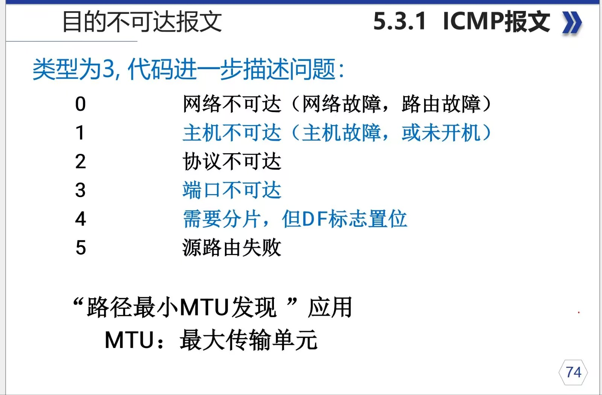
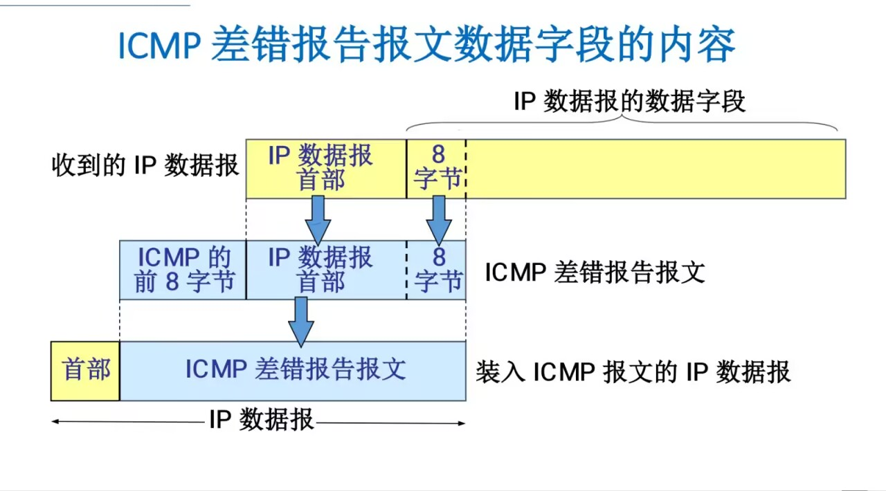

> The network layer is the third layer of the `OSI` model. It routes and forwards packets between networks, from end to end. Internetworking is built on `IP`, and the basic unit of transmission is the `IP` datagram. This chapter covers the core protocols and techniques of the network layer.

The `essence` of internetworking is `IP`; `transmission` happens through `IP datagrams`.

## 1.1. IP

`IP` provides a connectionless, unreliable datagram service.

- **Connectionless**: The sender does not need to establish a connection with the receiver before sending data. Each datagram travels independently, so neither arrival order nor completeness is guaranteed.
- **Unreliable**: `IP` has no error recovery or retransmission mechanism. If a datagram is lost or corrupted in transit, the `IP` layer itself does not handle it. Reliability is left to higher-layer protocols such as `TCP`.

### 1.1.1. IPv4 Datagram Format

An `IP` datagram consists of a `Header` and `Data`. The header is normally 20 bytes long and contains the key information needed for routing and forwarding.

- **Version** (4 bits): Identifies the `IP` version. For `IPv4`, the value is 4.
- **IHL — Internet Header Length** (4 bits): The length of the entire `IP` header, measured in **4-byte** (32-bit) units. For example, a value of 5 means a header length of 5 * 4 = 20 bytes. The minimum is 5 (20 bytes), and the maximum is 15 (60 bytes).
- **ToS — Type of Service** (8 bits): Specifies the datagram's priority and quality-of-service (`QoS`) requirements, such as minimum delay or maximum throughput.
- **Total Length** (16 bits): The total length of the `IP` datagram, including both header and data, in bytes. The maximum is `65535` bytes.
- **Identification** (16 bits): Uniquely identifies a datagram. When a datagram is too large and has to be fragmented, all its fragments share the same identification value so the receiver can reassemble them.
- **Flags** (3 bits):
  - Bit 1: Reserved; must be 0.
  - Bit 2: **`DF (Don't Fragment)`**. When set to 1, routers must not fragment the datagram. If it is too large to pass through, the router drops it and returns an `ICMP` error message.
  - Bit 3: **`MF (More Fragments)`**. A value of 1 means more fragments follow. A value of 0 means this is the last fragment, or the datagram was not fragmented.
- **Fragment Offset** (13 bits): The fragment's position within the original datagram. The offset is measured in **8-byte** units.
- **TTL — Time to Live** (8 bits): Sets the maximum number of hops, or routers, a datagram can pass through. Each router decreases `TTL` by 1. When `TTL` reaches 0, the router drops the datagram and sends an `ICMP` Time Exceeded message to the source host. This prevents datagrams from looping through the network forever.
- **Protocol** (8 bits): Identifies the higher-layer protocol carried in the data portion of the `IP` datagram. For example, `6` means `TCP`, `17` means `UDP`, and 1 means `ICMP`.
- **Header Checksum** (16 bits): Checks whether the `IP` header was corrupted in transit. It covers only the header, not the data.
- **Source IP Address** (32 bits): The sending device's `IP` address.
- **Destination IP Address** (32 bits): The receiving device's `IP` address.
- **Options** (variable length): Used for special processing, such as recording the route or timestamps. Options are uncommon because they increase the header length and reduce processing efficiency. If options are present, the header length field is greater than 5.

### 1.1.2. IP Fragmentation

When an `IP` datagram exceeds a link's **Maximum Transmission Unit (`MTU`)**, a router needs to split it into smaller datagrams. This is called fragmentation.

- The Identification, Flags, and Fragment Offset fields work together so the destination host can reassemble the fragments correctly.
- All fragments share the same identification value.
- Every fragment except the last has its `MF` flag set to 1.
- The Fragment Offset field records the position of each fragment's data within the original data.

---

## 1.2. ICMP

**ICMP**: `Internet Control Message Protocol`

Direction: host/router -> source (sender)

The `Code` field provides more detail. I won't go into those details here. ~~The code behind the code, I guess?~~

---

**However**, first I want to untangle these four bytes, what the diagram shows, and the difference between hexadecimal and binary.

The `0  8  16  31` positions in the diagram span 32 bits: 32 binary digits. The `Type` field is 1 byte, or two hexadecimal digits. In other words, when you read a datagram, you see two hexadecimal characters for this field. ~~But diagrams love to show lengths in bits.~~

`8 binary digits` = `2 hexadecimal digits` = `1 byte`

---

| Type | ICMP Message Type |
| ---- | ----------------- |
| 0 | Echo Reply |
| 3 | Destination Unreachable |
| 4 | Source Quench |
| 5 | Redirect (change a route) |
| 8 | Echo Request |
| 9 | Router Advertisement |
| 10 | Router Solicitation |
| 11 | Time Exceeded for a Datagram |
| 12 | Parameter Problem on a Datagram |
| 13 | Timestamp Request |
| 14 | Timestamp Reply |
| 15 | Information Request (obsolete) |
| 16 | Information Reply (obsolete) |
| 17 | Address Mask Request |
| 18 | Address Mask Reply |

`ICMP` messages fall into two broad categories:

`Error-reporting messages` and `informational messages (query messages)`.

- Error-reporting messages

  - `3` Destination Unreachable

  - `4` Source Quench

  - `5` Redirect (change a route)

  - `11` Time Exceeded for a Datagram

  - `12` Parameter Problem on a Datagram

- Informational messages (query messages)

  - `0` Echo Reply

  - `8` Echo Request

  - `9` Router Advertisement

  - `10` Router Solicitation

  - `13` Timestamp Request

  - `14` Timestamp Reply

  - `17` Address Mask Request

  - `18` Address Mask Reply

The commonly used types are `3`, `11`, `0`, and `8`.

`3` and `11` are `error-reporting messages`.

`0` and `8` are `informational messages`.

### 1.2.1. Common ICMP Message Types

#### 1.2.1.1. Destination Unreachable (3)

As the name suggests, `Destination Unreachable` means the destination cannot be reached. The `Code` field explains why.

So the `Code` field contains hexadecimal values such as `00`, `01`, and so on.

> `MTU` is the largest packet size that can be transmitted through a network interface.
>
> The `minimum MTU along a path` affects transmission, especially when the path includes different network devices. If a device along the path cannot handle a packet that large, it drops or fragments it.
>
> An application using `Path MTU Discovery` can therefore determine the `MTU` and avoid fragmentation.

#### 1.2.1.2. Time Exceeded (11)

The `Code` field identifies the kind of timeout:

`00` — IP `TTL (Time to Live)` expired in transit.

`01` — Fragment reassembly timed out.

> TTL expiration can be used to trace a route (`tracert`).
>
> *How route tracing works:*
>
> - The tool sends successive packets with increasing `TTL` values to work its way along the path.
> - Each router decreases `TTL` by 1. When it reaches 0, the router drops the packet and returns an `ICMP` Time Exceeded message.
> - By collecting replies from intermediate routers, the tool can display the path and the latency at each hop.

#### 1.2.1.3. **Echo Request and Echo Reply (Types 8 and 0)**

These are the messages used by the familiar `ping` command.

- **PING (`Packet InterNet Groper`)**: Tests connectivity between two hosts.
- Host A sends an `ICMP` Echo Request (type 8) to host B.
- If host B receives it, it replies with an `ICMP` Echo Reply (type 0).
- `ping` is a typical example of an application-layer program using network-layer `ICMP` directly, bypassing transport-layer `TCP` or `UDP`.

---

## 1.3. ARP (Address Resolution Protocol)

On a local area network such as Ethernet, frames ultimately travel using **MAC addresses (physical addresses)**, not `IP` addresses. So when a host such as `192.168.1.100` wants to communicate with another host on the same network, such as `192.168.1.50`, how does it find the other host's `MAC` address? That is what `ARP` does.

**Definition**: `ARP (Address Resolution Protocol)` resolves, or maps, a known `IP` address (a network-layer address) to its corresponding MAC address (a data-link-layer address).

**How it works**:

1. **Check the `ARP` cache**: Host A first checks its **`ARP` cache table** for a `MAC` address corresponding to the destination `IP` address, `192.168.1.50`. If it finds one, it uses that `MAC` address to build and send the frame.
2. **Send an `ARP` request**: If no entry exists, host A broadcasts an **`ARP` request** on the LAN. The message essentially says: “**Who has `IP` address 192.168.1.50? Please tell me your `MAC` address.**” Because it is a broadcast, every device on the network receives it.
3. **Unicast an `ARP` reply**: Every device on the network examines the request, but only host B, whose `IP` address is `192.168.1.50`, replies. Host B sends an **`ARP` reply** directly to host A by unicast: “**My `IP` address is `192.168.1.50`, and my `MAC` address is `XX:XX:XX:XX:XX:XX`.**”
4. **Update the `ARP` cache**: After receiving the reply, host A knows host B's `MAC` address. It stores the mapping (`IP -> MAC`) in its `ARP` cache for later use and can then send data to host B.

**The `ARP` cache**: Each host maintains an ARP cache containing recently resolved `IP`-to-`MAC` mappings. Entries have a lifetime, usually a few minutes, and are removed when they expire to keep the information current.

---

## 1.4. DHCP (Dynamic Host Configuration Protocol)

When a new device, such as a laptop or phone, joins a network, it needs an `IP` address to communicate. Manually configuring every device's IP address, subnet mask, default gateway, and `DNS` servers is tedious and error-prone. `DHCP` automates this process.

**Definition**: **Dynamic Host Configuration Protocol (`DHCP`)** is an application-layer protocol based on `UDP`. It lets a `DHCP` server automatically assign IP addresses and other network configuration parameters to clients.

**The `DORA` process**: The exchange is usually called **`DORA`**, after its four main steps.

1. **`Discover`**: The client, a newly connected device, **broadcasts** a **`DHCP Discover`** message to find an available `DHCP` server. Essentially: “**I need an `IP` address. Is there a `DHCP` server on this network?**”
2. **`Offer`**: Each `DHCP` server that receives the `Discover` chooses an available `IP` address from its pool and sends the client a **`DHCP Offer`**, by unicast or broadcast. Essentially: “**Hello, I can give you `IP` address `192.168.1.123`, along with these other settings.**”
3. **`Request`**: The client may receive multiple offers. It chooses one, usually the first, and **broadcasts** a **`DHCP Request`** to formally request that `IP` address. Broadcasting tells all the `DHCP` servers, including those whose offers were not selected, which offer it chose. Essentially: “**Everyone, I've decided to use `IP` address `192.168.1.123` from server X.**”
4. **`Acknowledge`**: The selected `DHCP` server sends a **`DHCP ACK`**, confirming the lease and specifying its duration. The client can now use the IP address to communicate on the network.

---

## 1.5. Routing Protocols

IP itself forwards datagrams, but it does not know how to choose the best path. **Routers** run **routing protocols** to learn the network topology and build **routing tables**, which let them make informed path-selection decisions. Routing protocols fall into two main categories:

### 1.5.1. Interior Gateway Protocols (IGP)

IGPs exchange routing information within an **Autonomous System (`AS`)**. An `AS` may be the network of a company, a university, or an Internet Service Provider (`ISP`).

- **RIP (`Routing Information Protocol`)**
  - **Type**: Distance-vector.
  - **How it works**: RIP routers periodically exchange their entire routing tables with their neighbors. The metric is **hop count**: a route is better when it passes through fewer routers.
  - **Characteristics**: Simple to implement, but with clear drawbacks: a maximum of 15 hops, slow convergence, and susceptibility to routing loops. It has largely been replaced by `OSPF`.
- **OSPF (`Open Shortest Path First`)**
  - **Type**: Link-state.
  - **How it works**: `OSPF` routers exchange **Link-State Advertisements (`LSAs`)**, rather than routing tables. Each router collects the network's `LSAs` and builds a complete local map of the topology. It then uses **Dijkstra's algorithm** to calculate the shortest path to each destination.
  - **Characteristics**: Fast convergence, no routing loops, support for Variable-Length Subnet Masks (`VLSM`), and areas for better scalability. It is the most widely used `IGP` in enterprise networks today.

### 1.5.2. Exterior Gateway Protocols (EGP)

EGPs exchange routing information between Autonomous Systems (`ASes`) and form the backbone of the Internet.

- **BGP (`Border Gateway Protocol`)**
  - **Definition**: BGP is the only exterior gateway protocol currently in use. It does more than look for the shortest path: it is a **path-vector protocol** that can choose routes according to administrator-defined policies, including cost, security, and political considerations.
  - **Characteristics**: Highly stable and scalable. It is the Internet's core routing protocol, connecting thousands of Autonomous Systems around the world.

---

## 1.6. IPv6

With the rise of the Internet of Things and the rapid growth of the Internet, the `IPv4` address space, about 4.3 billion addresses, has been exhausted. Its successor, `IPv6`, offers a vast address space and a range of improvements.

**Main advantages**:

1. **A huge address space**: `IPv6` uses 128-bit addresses, theoretically providing `2^128` addresses, enough for any imaginable demand over the next several centuries.
2. **A simpler header**: The `IPv6` header has a fixed length of 40 bytes. It removes uncommon or redundant `IPv4` fields such as `IHL`, Identification, Flags, Fragment Offset, and Header Checksum, making packet processing more efficient for routers.
3. **No router fragmentation**: `IPv6` requires the sending host to perform Path `MTU` Discovery (`PMTUD`) before transmission so packets do not exceed the smallest `MTU` along the path. Routers no longer fragment packets, greatly reducing their workload.
4. **Enhanced security**: `IPsec` was designed as a mandatory part of `IPv6`, although it later became optional. It provides end-to-end encryption and authentication at the network layer, offering much greater security than `IPv4`.
5. **Stateless Address Autoconfiguration (`SLAAC`)**: An `IPv6` host can use the prefix advertised by a router, together with information such as its own `MAC` address, to generate a globally unique `IP` address and connect without a `DHCP` server.
6. **Improved Neighbor Discovery Protocol (`NDP`)**: `IPv6` uses **Neighbor Discovery Protocol (`NDP`)**, based on `ICMPv6`, to replace functions such as `IPv4`'s `ARP` and `ICMP` router discovery. It handles address resolution, router discovery, Duplicate Address Detection (`DAD`), and more, with greater efficiency and capability.

---

## 1.7. IGMP (Internet Group Management Protocol)

When data needs to reach a specific group of interested hosts, rather than one host (unicast) or every host (broadcast), **multicast** is used. `IGMP` manages membership in these multicast groups.

**Definition**: Internet Group Management Protocol (`IGMP`) lets hosts tell their local router that they want to join or leave a particular multicast group.

**How it works**:

- **Joining a group**: When an application on a host wants to receive data from a particular multicast group, such as a video stream, the host sends an `IGMP` **Membership Report** to its local router.
- **Maintaining membership**: The router periodically sends `IGMP` **Query** messages to ask whether any hosts on the local network are still interested in a multicast group. Members still in the group reply with reports.
- **Leaving a group**: When a host no longer wants the data, it sends an `IGMP` **Leave Group** message.

`IGMP` only handles communication between hosts and their local router. Routers use dedicated multicast routing protocols, such as `PIM`, to build distribution paths between themselves.

---

## 1.8. NAT (Network Address Translation)

`NAT` is a key technique designed to delay `IPv4` address exhaustion. It allows many computers within an organization to use **private `IP` addresses** while sharing one or a small number of **public `IP` addresses** when communicating with the Internet.

**Definition**: **Network Address Translation (`NAT`)** runs on routers or firewalls and translates source/destination addresses and port numbers in `IP` datagrams between private and public networks.

**Private `IP` address ranges** (not routed on the public Internet):

- `10.0.0.0` to `10.255.255.255` (Class A)
- `172.16.0.0` to `172.31.255.255` (Class B)
- `192.168.0.0` to `192.168.255.255` (Class C)

**Types and how they work**:

1. **Static NAT**:
   - Maps a private `IP` address **one-to-one** to a public IP address.
   - Mainly used when an internal server, such as a web server, needs a stable address through which external networks can reach it.
2. **Dynamic NAT**:
   - Maintains a pool of public `IP` addresses. When an internal host needs Internet access, an unused public `IP` address is **temporarily assigned** to it from the pool.
   - When communication ends, the public `IP` address is returned to the pool for another host to use.
3. **PAT (`Port Address Translation`) / NAPT**:
   - This is the **most common** form of `NAT`, also called `NAPT` (Network Address and Port Translation). It maps multiple private `IP` addresses to different **ports** on **one public IP address**.
   - **Process**: Suppose internal host `192.168.1.100` uses port `50000` to contact an external server. The `NAT` router changes the source address and port to a public IP and a new port, such as (`202.100.1.1`, `60001`), and records the mapping. When the external server replies to (`202.100.1.1`, `60001`), the router uses that record to restore the destination address and port to (`192.168.1.100`, `50000`) and forwards the packet to the internal host.
   - **Advantage**: Saves a huge number of public `IP` addresses. Hundreds or thousands of devices can access the Internet at once through a single public `IP` address.
   - **Disadvantage**: Breaks the end-to-end connectivity model and can cause problems for some `P2P` applications or `VoIP` protocols.

---

## 1.9. IPsec (Internet Protocol Security)

**`IPsec`** is a suite of protocols that provides high-quality, interoperable, cryptography-based security for `IP` communication at the network layer. It offers data-origin authentication, data integrity, confidentiality through encryption, and protection against replay attacks. It is a core technology for building **Virtual Private Networks (`VPNs`)**.

**Two modes of operation**:

1. **Transport mode**:
   - **How it works**: Encrypts or authenticates only the **payload** of an IP datagram. The original IP header remains unchanged; an `IPsec` header is inserted.
   - **Use**: Mainly for secure **end-to-end** communication between two hosts.
2. **Tunnel mode**:
   - **How it works**: Encrypts and authenticates the **entire original `IP` datagram, including its header and data**, then encapsulates it in a new IP datagram.
   - **Use**: Mainly for secure **gateway-to-gateway** communication between two networks, such as a company's headquarters and a branch office. `VPN` gateways at the network edges handle it. This is the most common way to build a `VPN`.

**Core protocols**:

- **AH (`Authentication Header`)**: Provides **data integrity** and **authentication**, but no encryption. It ensures data has not been tampered with in transit, while the contents remain in plaintext.
- **ESP (`Encapsulating Security Payload`)**: Provides **data integrity**, **authentication**, and **confidentiality through encryption**. It is the most widely used IPsec protocol.

---

## 1.10. VRRP (Virtual Router Redundancy Protocol)

If the router serving as a LAN's default gateway fails, every host on that network loses access to external networks. This is a **single point of failure**. `VRRP` is a gateway redundancy protocol designed to address it.

**Definition**: **Virtual Router Redundancy Protocol (`VRRP`)** is a fault-tolerance protocol that groups several physical routers into a **virtual router**, providing a highly available default gateway.

**How it works**:

1. **Virtual router**: Multiple physical routers in a `VRRP` group share a **virtual `IP` address** and a **virtual `MAC` address**. All clients on the network use this virtual `IP` address as their default gateway.
2. **`Master` and `Backup`**: At any given time, only one router in the group is the **`Master`**. It owns the virtual IP address and forwards packets. The other routers are **`Backups`**.
3. **Heartbeat detection**: The `Master` periodically sends `VRRP` advertisements, or heartbeats, to tell the `Backup` routers that it is active.
4. **Failover**: If a `Backup` stops receiving the `Master`'s heartbeats for a certain period, it considers the `Master` to have failed. The highest-priority `Backup` becomes the new `Master`, takes over the virtual `IP` and `MAC` addresses, and starts forwarding traffic.
5. **Seamless switchover**: The transition is transparent to clients. They do not need to change anything, preserving network connectivity.

---

## 1.11. MPLS (Multiprotocol Label Switching)

`MPLS` is a high-performance, carrier-grade networking technology that operates between traditional IP routing (Layer 3) and data-link-layer switching (Layer 2). It is often called a **Layer 2.5** technology.

**Definition**: **Multiprotocol Label Switching (`MPLS`)** assigns short, fixed-length **labels** to packets and forwards them based on those labels, rather than looking up a complex IP routing table at every hop.

**How it works**:

1. **Label distribution**: Routers in an `MPLS` network, called `LSRs` (Label Switching Routers), use protocols such as `LDP` (Label Distribution Protocol) to establish label mappings for IP prefixes, or routes. These mappings form the **Label Forwarding Information Base (`LFIB`)**.
2. **Ingress labeling (`Push`)**: When an IP packet enters an `MPLS` network, the ingress router (`Ingress LER`) performs a normal `IP` route lookup, then pushes one or more `MPLS` labels onto the packet.
3. **Label switching (`Swap`)**: Inside the `MPLS` network, core `LSRs` no longer inspect the `IP` header. They read the outermost label, perform a fast `LFIB` lookup, swap it for a new label, and forward the packet to the next `LSR`.
4. **Egress label removal (`Pop`)**: When the packet reaches the egress router (`Egress LER`), the label is removed, or popped. The original `IP` packet is restored and continues through standard `IP` forwarding.

**Main advantages**:

- **Fast forwarding**: Exact-match label switching is much faster than longest-prefix-match lookups based on `IP` addresses.
- **Traffic engineering**: `MPLS` can establish predetermined paths for traffic, called `LSPs` (Label Switched Paths), rather than strictly following the shortest paths calculated by an `IGP`. This gives administrators fine-grained control over traffic to optimize bandwidth use or route around congestion.
- **VPN support**: `MPLS` is a foundation for large-scale, high-performance `VPNs`, especially `MPLS L3VPNs`, and is widely used by major `ISPs` worldwide.

Still putting off the rest...
