## start from OAuth 2.0

Let's start directly with OAuth 2.0.

OAuth 1 is long outdated. [RFC 5849](https://www.rfc-editor.org/info/rfc5849/)

So let's go straight to OAuth 2.0. [RFC6749](https://www.rfc-editor.org/info/rfc6749/)

### what is OAuth 2.0

Before we start, keep these points in mind:

- OAuth is an authorization framework.
- The OAuth protocol is an authorization protocol.
- OAuth 2.0 is an authorization protocol.
- The OAuth 2.0 framework is an authorization framework.

(Mm-hm.)

The OAuth 2.0 framework lets third-party applications access HTTP services with limited permissions. It can establish
an approval interaction between the resource owner and the HTTP service, allowing a third-party application to access the service on the owner's behalf, or
grant permissions to the third-party application so it can access the service on its own behalf.

#### Authorized Access

The OAuth protocol was designed to:

_Let end users use OAuth to **delegate** some of their permissions on protected resources to a client application._

Protected resources rely on an authorization server to issue clients a dedicated security credential: the OAuth access token.

> Two basic elements:
> Getting a token
> Using a token

Core: Delegated Authorization

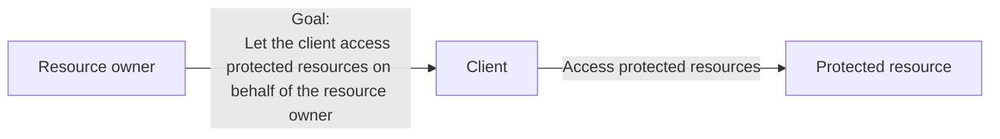

So how do we actually grant this authorization?

~~There is nothing another layer of middleware cannot solve. If there is, add one more layer.~~

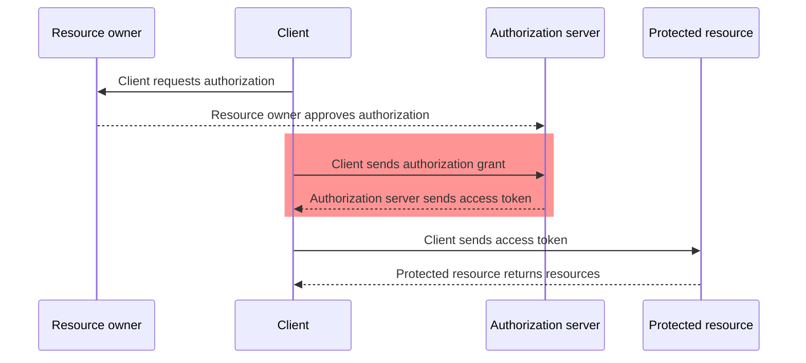

It provides a way for a client to ask a user to delegate some of their permissions to it,
without exposing the resource owner's credentials to the client along the way.

Of course, this is only a general overview of how OAuth works. OAuth has several ways to obtain tokens.

#### Roles and Endpoints

The diagrams above already introduced four roles: the resource owner, client, authorization server, and protected resource.

Communication between these roles goes through three clearly defined HTTP endpoints.

- **Authorization Endpoint**: The client redirects the resource owner to this endpoint. It only supports GET.
- **Token Endpoint**: The client exchanges an authorization grant for an access token.
- **Redirection Endpoint**（callback / redirect_uri）

OAuth divides clients into two types.
[Client type](https://datatracker.ietf.org/doc/html/rfc6749#section-2.1)

- **Confidential Client**
- **Public Client**

### Grant Types

A grant type is a type of authorization grant.

#### Authorization Code Grant

1. The client redirects the user to the Authorization Endpoint.
2. The user logs in and approves authorization.
3. The authorization server returns an authorization code to the client through the Redirection Endpoint.
4. The client exchanges the authorization code for an access token through the Token Endpoint (on the AS).

#### Implicit Grant

A shortcut designed for purely frontend single-page applications in the early days.

It skips the code exchange at the Token Endpoint. The authorization server puts the access token directly in the fragment of the redirect URL (`#access_token=xxx`).

That saves one network request.

But

the token is directly exposed in the URL, browser history, and Referer headers, and there is no refresh token.

#### Resource Owner Password Credentials

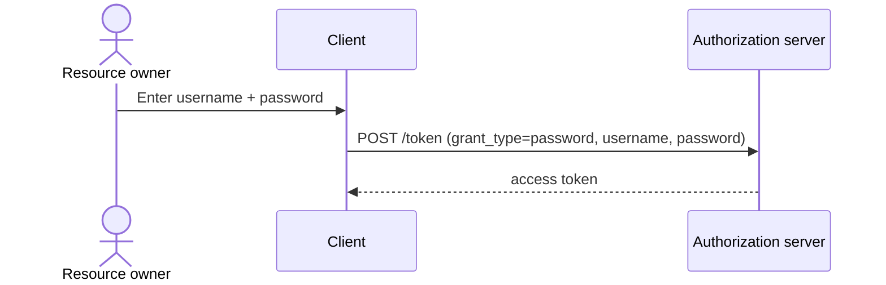

Whoa, why are you handing over the user's password directly? That's not how it works in my OAuth dating sim!

OAuth exists precisely to avoid this, yet ROPC makes it explicit.

The only reasonably sensible case is an organization's own app authenticating directly without going through the browser.

#### Client Credentials Grant

> only for Credential Client

The previous flows all assume there is a user.

But in machine-to-machine (M2M) scenarios, there is no user at all.

What if one backend service needs to access another backend service's API?

_Resource owners? We don't need those._

The client can go straight to the Token Endpoint with client_id + client_secret to get a token:

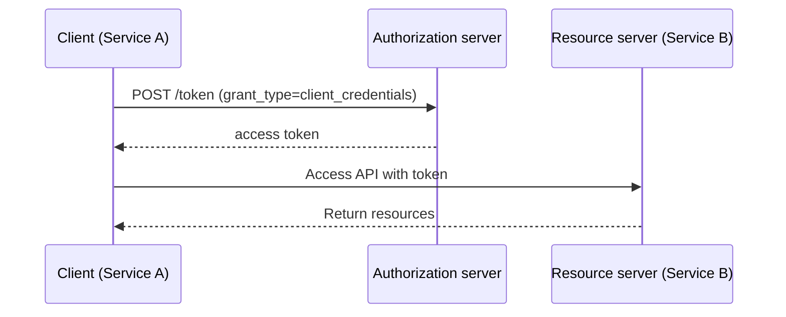

#### Refresh Token and scope

Access tokens are short-lived, but expiration does not mean the user has to log in again.

The client can use a **refresh token** to get a new access token directly from the Token Endpoint.

:::note
Precisely because a refresh token can unconditionally obtain a new access token, leaking a refresh token is a little worse than leaking an access token. But only a little. (Read into that what you will.)
:::

**scope**: When first requesting authorization, the client can declare the permission scopes it needs (e.g. `scope=read:email write:posts`). The resource owner only approves that scope, and the permissions of the resulting access token are then fixed.

#### state

Before redirecting to the Authorization Endpoint, the client generates a random value for `state`, then checks `state` after the authorization server finishes.

_CSRF protection._

### Pros and Cons

OAuth 2.0 is very good at capturing a user's delegation decision and transmitting it over a network. It allows multiple parties to participate in security decisions, especially the end user at runtime. It is a protocol with many moving parts, but in many ways it is simpler and more secure than other approaches.

A single authorization server can easily protect multiple resource servers, and many different kinds of clients may want to access a particular API. One authorization server can even have several levels of client trust. This architecture moves as much complexity as possible from the client to the server.

OAuth tokens provide a mechanism slightly more complex than passwords, so they are much more secure when used correctly. <- Figuring out what 'used correctly' means is an important development problem.

Extensibility and modularity are among OAuth 2.0's greatest strengths, making the protocol suitable for many environments. Yet this very flexibility creates fundamental compatibility problems between implementations.

Some custom options can also be misused or used incorrectly, making an implementation insecure.
Even implementing OAuth correctly according to the specification does not mean a system is secure in production.

### OAuth 2.0 CANNOT

1. OAuth does not define scenarios outside the `HTTP` protocol.

OAuth 2.0 with bearer tokens does not provide message signing, so it needs a transport mechanism such as `TLS` to protect information.
[RFC7628: A Set of Simple Authentication and Security Layer (SASL) Mechanisms for OAuth](https://datatracker.ietf.org/doc/html/rfc7628)

Of course, there are now plenty of attempts to use it over non-TLS connections.

2. OAuth is not an authentication protocol.

You're right that you can build authentication with it, but it still isn't one.

An OAuth transaction itself does not reveal information about the user.
It may use authentication in several places (e.g. the resource owner and client software authenticate to the authorization server), but that embedded authentication does not turn OAuth into an authentication protocol.

3. OAuth does not define a user-to-user authorization mechanism.

Even though it is fundamentally a protocol for a user to authorize software.

OAuth assumes the resource owner can control the client. OAuth alone cannot let a resource owner authorize another user.
But the [User Managed Access protocol](https://www.rfc-editor.org/info/rfc6749/) can.

4. OAuth does not define an authorization-processing mechanism.

OAuth provides a way to communicate that authorization has been delegated, but does not define what is authorized. It only communicates that the delegation happened.

The *service API* defines permissions for operations using OAuth components such as scopes and tokens.

5. OAuth does not define a token format.

The OAuth protocol declares token contents completely opaque to the client, but the authorization server and protected resource still need to understand them.

This need for interoperability gave rise to the JSON Web Token format and the [token introspection format](https://datatracker.ietf.org/doc/html/rfc7662).

## OAuth 2.1

[Oauth 2.1](https://oauth.net/2.1/) / [draft-ietf-oauth-v2-1](https://datatracker.ietf.org/doc/draft-ietf-oauth-v2-1/)

> 2.1 is still an IETF draft, not a final RFC.

OAuth 2.1 combines the OAuth 2.0 core protocol, Bearer Token usage, and PKCE documents. **It adds no new endpoints.**

Much of it comes directly from [RFC 9700](https://www.rfc-editor.org/info/rfc9700/) (OAuth 2.0 Security Best Current Practice

### Subtraction

That's right, 2.1 < 2.0.

> Core: Narrow down the choices.

### What changed in Oauth 2.1

1. The authorization code flow must use PKCE, and PKCE's `plain` mode is removed entirely.

PKCE originally protected mobile native apps against intercepted authorization codes [RFC 7636](https://www.rfc-editor.org/info/rfc7636/). 2.1 extends it to all clients, including confidential clients.

There are three additional parameters: `code_verifier`, `code_challenge`, and `code_challenge_method`.

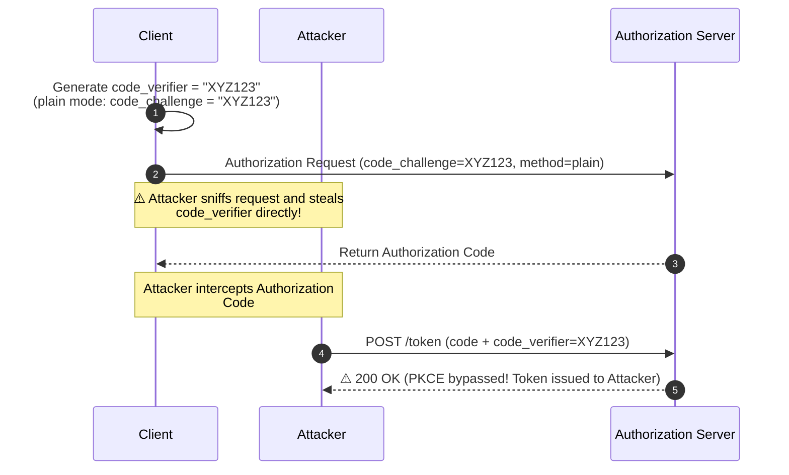

Intercepting the code is useless without the `code_verifier`. 🚫

2. The implicit grant is removed entirely.

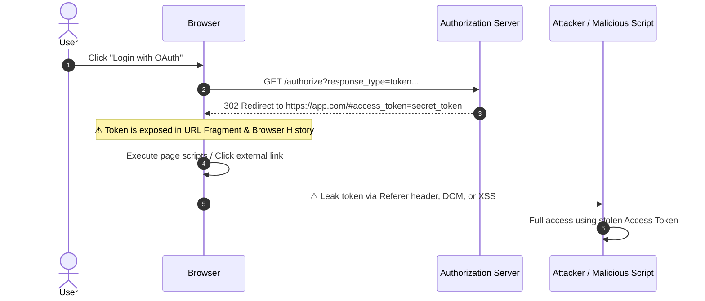

3. ROPC (Resource Owner Password Credentials) is removed.

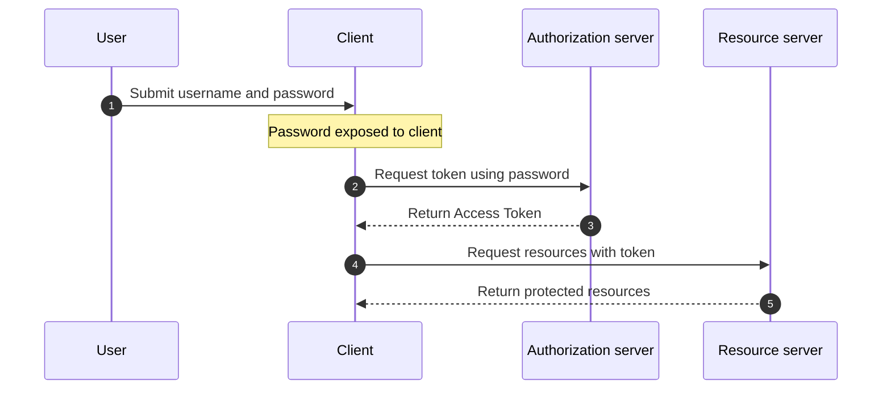

**The problem with this flow**: The user hands their original credentials to the client. The plaintext password may end up in client memory, logs, or third-party SDKs. Exchanging it directly for a token also bypasses MFA, Passkeys, SSO, and the authorization consent page.

The request details from the diagram are kept here so they don't stretch the entire diagram horizontally:

```http
POST /token
Content-Type: application/x-www-form-urlencoded

grant_type=password&username=<username>&password=<password>

HTTP/1.1 200 OK
```

After obtaining the Access Token, the client accesses resources through a request header:

```http
GET /resource
Authorization: Bearer <token>
```

4. `redirect_uri` must match exactly, character for character.

5. Bearer tokens may not be placed in the query string.

Putting a token in a URL means it will appear in browser history, server access logs, Referer headers, and even the logging systems of any layer along the forwarding path. This has been upgraded from a recommendation to a hard requirement: tokens must go in a header or the body.

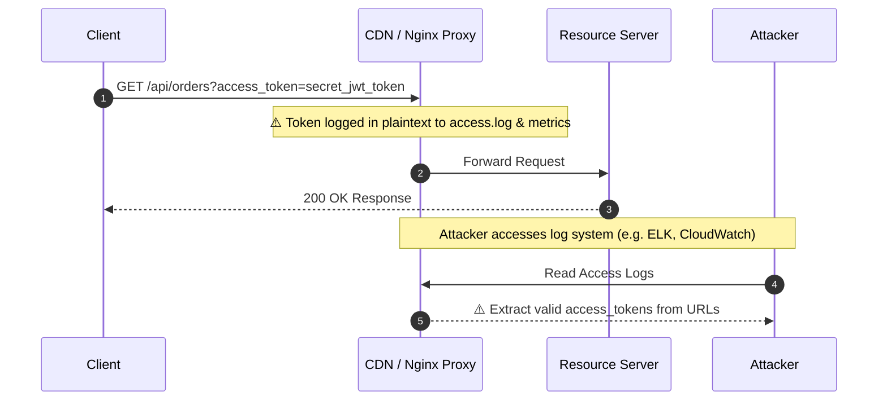

6. Refresh tokens must use rotation or be sender-constrained.

A token must be replaced after every use (rotation), or strongly bound to a particular client (sender-constrained, e.g. DPoP [RFC 9449](https://www.rfc-editor.org/info/rfc9449/) or mTLS).

> Edge case: A user opens two tabs that trigger a refresh almost simultaneously. Revoking the entire family immediately would kick out a legitimate user too.
> In practice, a short grace period allows reuse of an old token shortly after rotation to count as harmless concurrency rather than a replay.

Sender-constraining is stronger: DPoP requires the client to sign a proof with its own private key on every request;

mTLS is heavier and requires client certificates.

Most scenarios do not need something this heavy. Rotation already covers most threat models.

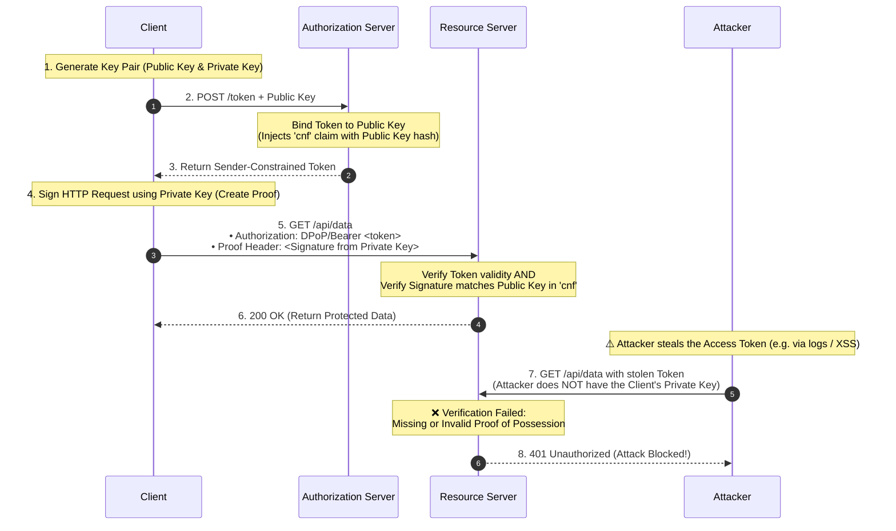

## OAuth Endpoints

Although 2.1 itself adds no endpoints, that does not mean OAuth only has an Authorization Endpoint and a Token Endpoint.

There are also:

- **Pushed Authorization Requests / PAR**（[RFC 9126](https://datatracker.ietf.org/doc/html/rfc9126/)）
- **Token Revocation**（[RFC 7009](https://datatracker.ietf.org/doc/html/rfc7009/)
- **Token Introspection**（[RFC 7662](https://datatracker.ietf.org/doc/html/rfc7662/)
- **Device Authorization Grant**（[RFC 8628](https://datatracker.ietf.org/doc/html/rfc8628/)
- **Dynamic Client Registration**（[RFC 7591](https://datatracker.ietf.org/doc/html/rfc7591/)

## OpenID Connect (OIDC)

OAuth is not an authentication protocol.

OAuth only handles Authorization, not Authentication.

And so OpenID Connect appeared.

> OpenID Connect 1.0 is a simple identity layer on top of the OAuth 2.0 protocol.
> —— [OIDC Core 1.0](https://openid.net/specs/openid-connect-core-1_0.html)

OIDC reuses OAuth's authorization flows and endpoints, adding an **ID Token** to the Token Endpoint response, along with a `UserInfo Endpoint`.

### ID Token vs Access Token

- **Access Token**: Native to OAuth, intended for the **resource server**, proves the client's permissions, and has a format opaque to the client.
- **ID Token**: Part of OIDC, always a **JWT**, intended for the **client**, and proves the identity that logged in.

### How to use OIDC

The client's authorization request includes `openid` in `scope` (e.g. `scope=openid profile email`).

The authorization server then returns an additional `id_token` field at the Token Endpoint.

### UserInfo Endpoint

The claims in an ID Token are a compact version.

For more complete user information, OIDC defines a `UserInfo` endpoint.

The client uses its access token to obtain information from this endpoint.

### Discovery

OIDC providers (e.g. Google and Auth0) serve JSON at the fixed path `/.well-known/openid-configuration`, listing their Authorization Endpoint, Token Endpoint, UserInfo Endpoint, supported scopes, signing algorithms, and so on.

```bash
$ curl https://link.sast.fun/v2/.well-known/openid-configuration

{"authorization_endpoint":"https://link.sast.fun/v2/oauth/authorize","claim_types_supported":["normal"],"claims_parameter_supported":false,"claims_supported":["sub","iss","aud","exp","iat","nonce","name","picture","preferred_username","role","email","email_verified","updated_at"],"code_challenge_methods_supported":["S256"],"grant_types_supported":["authorization_code","refresh_token"],"id_token_signing_alg_values_supported":["EdDSA"],"issuer":"https://link.sast.fun/v2","jwks_uri":"https://link.sast.fun/v2/.well-known/jwks.json","request_parameter_supported":false,"request_uri_parameter_supported":false,"response_modes_supported":["query"],"response_types_supported":["code"],"revocation_endpoint":"https://link.sast.fun/v2/oauth/revoke","scopes_supported":["openid","profile","email","admin:read","admin:write","user:read","user:write"],"subject_types_supported":["public"],"token_endpoint":"https://link.sast.fun/v2/oauth/token","token_endpoint_auth_methods_supported":["none","client_secret_post"],"userinfo_endpoint":"https://link.sast.fun/v2/userinfo"}
```

### Standard Claims

OIDC defines a set of standard claims, spread across three sources:

1. **ID Token**: Returned directly when authorization completes, containing the most basic identity assertions.
2. **UserInfo Endpoint**: Requires a separate request and returns a more complete user profile.
3. **Scope control**: Different scopes determine which claims are included.

#### Standard Claims Set

The standard claims defined by OIDC Core fall into several categories:

**Required / core claims** (in the ID Token):

- `sub`: Subject Identifier, a unique user identifier that never changes within the same OP (OpenID Provider).
- `iss`: Issuer, the OP URL.
- `aud`: Audience, usually the client's `client_id`.
- `exp`: Expiration Time, the expiration timestamp.
- `iat`: Issued At, the issuance timestamp.

Claims associated with the **profile scope**:

- `name`: Full name.
- `family_name` / `given_name`: Family name / given name.
- `middle_name`: Middle name.
- `nickname`: Nickname.
- `preferred_username`: Preferred username.
- `profile`: Profile page URL.
- `picture`: Avatar URL.
- `website`: Personal website.
- `gender`: Gender.
- `birthdate`: Date of birth (YYYY-MM-DD format).
- `zoneinfo`: Time zone (e.g. `Asia/Shanghai`).
- `locale`: Locale (e.g. `zh-CN`).
- `updated_at`: Timestamp of the last profile update.

Claims associated with the **email scope**:

- `email`: Email address.
- `email_verified`: Whether the email address has been verified (boolean).

Claims associated with the **address scope**:

- `address`: A JSON object containing `formatted` (full address), `street_address`, `locality` (city), `region` (province/state), `postal_code`, and `country`.

Claims associated with the **phone scope**:

- `phone_number`: Phone number (E.164 format, e.g. `+86 138...`).
- `phone_number_verified`: Whether the phone number has been verified.

#### Optional claims

- `nonce`: A random value the client sends in the authorization request. _Prevents replay attacks._ Note: (Replay attacks)[https://en.wikipedia.org/wiki/Replay_attack]
- `auth_time`: Timestamp of the user's actual authentication.
- `acr`: Authentication Context Class Reference, the authentication context level (e.g. `urn:mace:incommon:iap:silver` indicates multifactor authentication).
- `amr`: Authentication Methods References, an array of authentication methods (e.g. `["pwd", "otp"]` means password + OTP).
- `azp`: Authorized Party, the ID of the client actually using the token (which may differ from `aud` in multi-RP scenarios).

#### Custom Claims

Custom claims outside the standard have no namespace restrictions.
Still, a little care wouldn't hurt, right? (

- Avoid names that clash with standard claims.
- Use a URL as a namespace prefix to avoid collisions.
- Or use conventional short prefixes (e.g. `org_role`, `tenant_id`).

#### How claims are split between ID Token and UserInfo

Not every claim appears in both places:

- **ID Token**: Space is limited, so it usually contains only the core claims (`sub`, `iss`, `aud`, `exp`, `iat`, plus `nonce` and a few identity fields such as `email`).
- **UserInfo**: The complete version.

#### Trustworthiness of Claims

- **Claims in the ID Token**: Protected by a signature; clients can verify them offline for third parties or caching.
- **Claims in UserInfo**: Retrieved from the OP over HTTPS, without a signature.

Security-critical decisions must never rely solely on the snapshot of claims in a token. The backend must read the database again.

_The values in a token are only for routing requests or frontend display._

## JWT Structure and Verification

Since an ID Token is a JWT, we might as well cover this too.

### The Three Parts of a JWT

A JWT consists of three Base64URL-encoded parts:

```
eyJhbGciOiJFZERTQSIsInR5cCI6IkpXVCIsImtpZCI6ImxpbmstdjItYWN0aXZlIn0.
eyJzdWIiOiIxMjM0NTYiLCJpc3MiOiJodHRwczovL2xpbmsuc2FzdC5mdW4vdjIiLCJhdWQiOiJjbGllbnRfaWQiLCJleHAiOjE3MDAwMDAwMDAsImlhdCI6MTcwMDAwMDAwMCwibm9uY2UiOiJhYmMxMjMifQ.
6F8kT9VnX3p5ZrQw2J4Ks8YbL1MvN3uP7tR5eX9Gh2Qm4Wp3Yt7Zl6Kj8Hn9Vm2
```

The three parts are:

1. **Header** (`eyJ...`): Describes the signing algorithm and key ID.
2. **Payload** (`eyJ...`): The actual claims.
3. **Signature** (`6F8...`): A signature over the first two parts using the private key.

Base64URL-decode the Header:

```json
{
  "alg": "EdDSA",
  "typ": "JWT",
  "kid": "link-v2-active"
}
```

- `alg`: Signing algorithm.
- `kid`: Key ID, telling the verifier which public key in the JWKS to use.

Base64URL-decode the Payload:

```json
{
  "sub": "123456",
  "iss": "https://link.sast.fun/v2",
  "aud": "client_id",
  "exp": 1700000000,
  "iat": 1700000000,
  "nonce": "abc123"
}
```

### Verification Flow

Once the client receives an ID Token, it proceeds to verify it.

1. **Split it into three parts** and Base64URL-decode the first two.
2. **Check the Header**:
   - `alg` must be an accepted algorithm.
   - `kid` identifies the public key.
3. **Get the public key**:
   - Fetch the JWKS from `/.well-known/jwks.json`.
   - Find the public key matching `kid`.
4. **Verify the signature**:
   - Use the public key to verify the third part's signature.
5. **Verify the claims**:
   - `iss`：=== OP issuer
   - `aud`: === your own `client_id`.
   - `exp`: > the current time.
   - `iat`: Must not be too early (to prevent replaying a very old token).
   - `nonce`: === the originally generated value.

**Verification order**: Signature → `exp` → `iss`/`aud`/`nonce`.

### kid and JWKS

`kid` ——> Key ID

Let's take a look at Link's JWKS:

```json
{
  "keys": [
    {
      "kty": "OKP",
      "use": "sig",
      "kid": "link-v2-active",
      "crv": "Ed25519",
      "alg": "EdDSA",
      "x": "BFj6m10rdWe_1VZ6bMB7FTU034NNMUueRBuw8-Ah_B0"
    }
  ]
}
```

- `kid`: `link-v2-active`
- `kty`: `OKP` means Octet Key Pair ([RFC 8037](https://datatracker.ietf.org/doc/html/rfc8037/)).
- `crv`: The `Ed25519` elliptic curve.
- `x`: The public key coordinate, 32 bytes encoded as Base64URL.

The verifier uses `x` to verify the signature.
The private key `d` never appears in the JWKS.

### Is an Access Token a JWT?

> Not necessarily.

An access token can be:

- A **self-contained JWT**: The resource server verifies it offline without calling the authorization server.
- An **opaque token**: The resource server must call the Token Introspection endpoint to ask the authorization server to validate it.

## Something else

### PKCE Implementation Details

As mentioned earlier, 2.1 mandates PKCE.

The core of PKCE is binding an authorization code to a random value generated by the client.

Even if the authorization code is intercepted, the attacker cannot get a token.

#### The S256 Transformation

PKCE has two `code_challenge_method` values:

- `plain`：`code_challenge = code_verifier`
- `S256`: `code_challenge = BASE64URL(SHA256(code_verifier))` (mandatory in 2.1).

Q: Why is `plain` insecure?
A: Because `code_challenge` appears in the authorization request URL.

#### The Full PKCE Flow

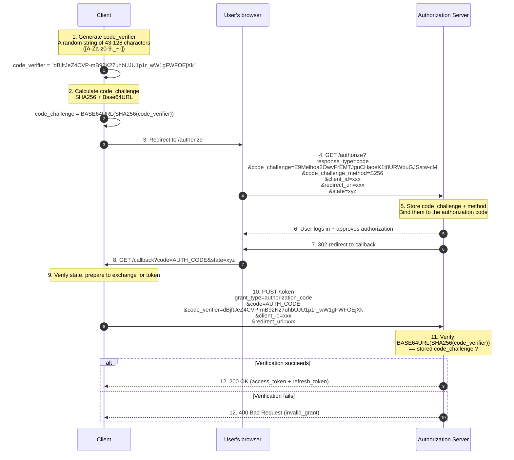

### Pushed Authorization Requests (PAR)

Traditional authorization requests concatenate every parameter into the URL.

```
GET /authorize?response_type=code&client_id=xxx&redirect_uri=https://...&scope=openid+profile+email&state=xyz&nonce=abc&code_challenge=...&code_challenge_method=S256
```

But does that really make complete sense?

In most cases, it's actually fine.
But there are still problems. (Well, why didn't you say so earlier?)

1. **URL length limits**: Browsers and proxies impose limits on URL length, and complex scopes or OIDC can blow past them.
2. **Parameter exposure**: URLs appear in browser history, server logs, and Referer headers, so `state`/`nonce` can still leak.
3. **Parameter tampering**: URL parameters can be modified (e.g. widening `scope`).

> I'm telling you, when in doubt, add an intermediary.

And so we got Pushed Authorization Requests.

The idea behind PAR: Push parameters to the authorization server with a backend POST, get a time-limited `request_uri`, and then authorize using that URI.

It's really the same idea as a shortened URL.

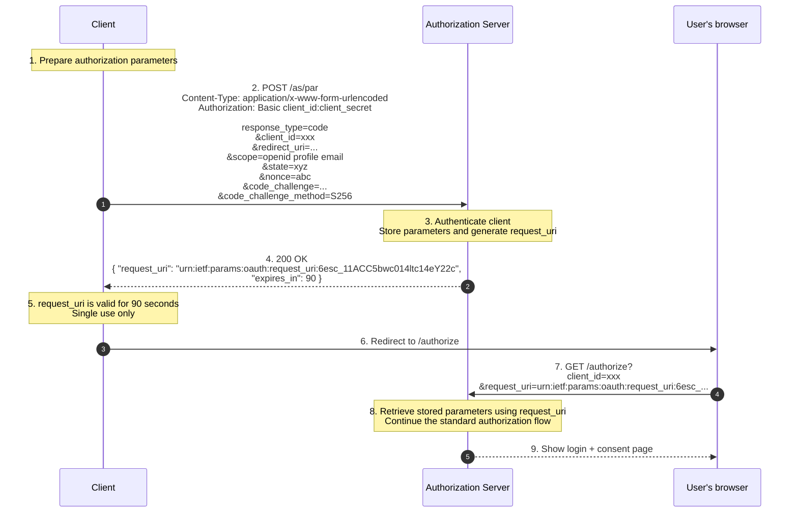

PAR is worth implementing if you're building a public-facing OAuth provider.

### Token Introspection and Opaque Tokens

As mentioned earlier, an access token can be a JWT or an opaque token.

But if it's the latter, how does the resource server know it's valid?

The answer is **Token Introspection** ([RFC 7662](https://datatracker.ietf.org/doc/html/rfc7662/)).

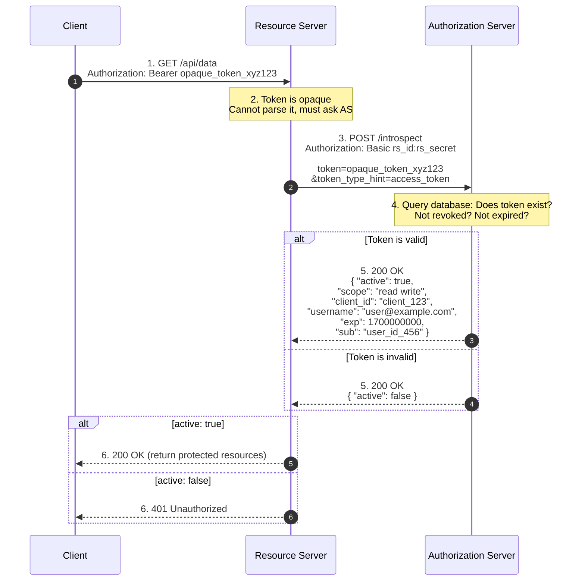

Token Introspection makes things much more convenient.

- **All in on the authorization server**: Everything is queried and returned by the AS (Authorization Server) in real time.
- **Immediate revocation**: When a user logs out, the AS marks the token revoked, and the next introspection returns `active: false`.
- **Resource servers must authenticate**: Usually with a `client_secret` at the introspection endpoint.

#### JWT vs Opaque ：

| Dimension      | JWT                                        | Opaque Token                              |
| -------------- | ------------------------------------------ | ----------------------------------------- |
| Resource server load | Low (offline verification, signature only) | High (introspection call on every request) |
| Immediate revocation | Hard (valid until expiration unless the resource server also queries the database) | Easy (AS marks it revoked; introspection returns false) |
| Information disclosure risk | High (Base64) | Low (opaque token carries no information, just a random string) |
| Passing across services | Easy (resource server A can forward the JWT to B) | Hard (each resource server must call the AS) |

For a distributed architecture, opaque tokens + introspection may be the better choice.

### DPoP: Key-Bound Tokens

Earlier, we mentioned that refresh tokens must either rotate or be sender-constrained.

DPoP (Demonstrating Proof of Possession, [RFC 9449](https://www.rfc-editor.org/info/rfc9449/)) is one implementation of sender-constraining.

#### The Idea Behind DPoP

Bind the token to the client's **asymmetric key pair**:

1. The client generates a public/private key pair.
2. When requesting a token, it provides the public key to the authorization server.
3. The authorization server records the public key thumbprint in the token's `cnf` (confirmation) claim.
4. Every time the client accesses a resource with the token, it signs a proof with its private key (including the current request's HTTP method, URL, and timestamp).
5. The resource server checks whether the proof's signature matches the public key in the token.

#### The Full Flow

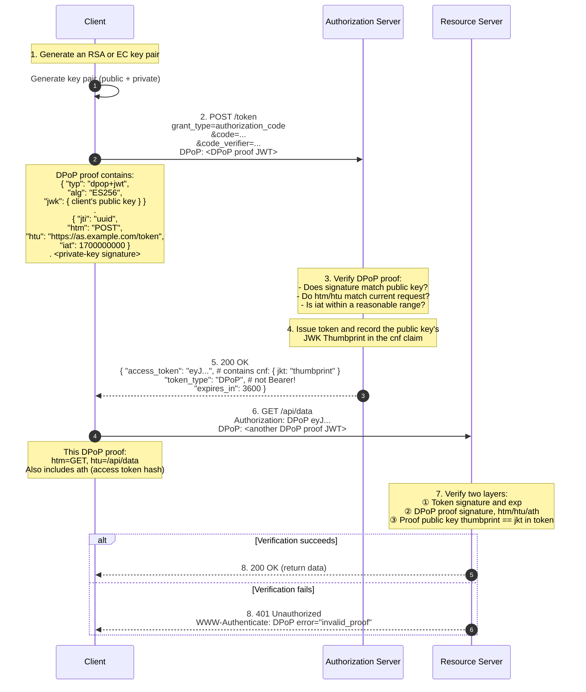

**The structure of a DPoP proof**:

Header:

```json
{
  "typ": "dpop+jwt",
  "alg": "ES256",
  "jwk": {
    "kty": "EC",
    "crv": "P-256",
    "x": "...",
    "y": "..."
  }
}
```

Payload (when requesting `/token`):

```json
{
  "jti": "unique-uuid",
  "htm": "POST",
  "htu": "https://as.example.com/token",
  "iat": 1700000000
}
```

Payload (when requesting a resource):

```json
{
  "jti": "another-uuid",
  "htm": "GET",
  "htu": "https://rs.example.com/api/data",
  "iat": 1700000100,
  "ath": "fUHyO2r2Z3DZ53EsNrWBb0xWXoaNy59IiKCAqksmQEo" // BASE64URL(SHA256(access_token))
}
```

**Each request gets a fresh proof**, because `jti`, `iat`, `htm`, and `htu` all change. Even if an attacker records a complete HTTP request (including the DPoP proof), replaying it against another endpoint fails (`htu` does not match).

**Advantages of DPoP**:

- **Fully prevents stolen tokens from being used**
- **Replay protection**
- **No server-side state required**

**Costs of DPoP**:

- Much more client complexity: A JWT must be signed for every request.
- Managing private keys on mobile devices/in browsers is a hassle.
- The resource server must verify two layers (token signature + proof signature), increasing latency.

### Token Binding and mTLS

DPoP binds tokens using asymmetric keys. There is also a lower-level approach: **mTLS** (mutual TLS).

Traditional HTTPS only verifies the server certificate (the client trusts the server). mTLS requires the client to provide a certificate too (the server also verifies the client), binding the TCP connection itself to the client's identity.

#### Binding OAuth Tokens with mTLS

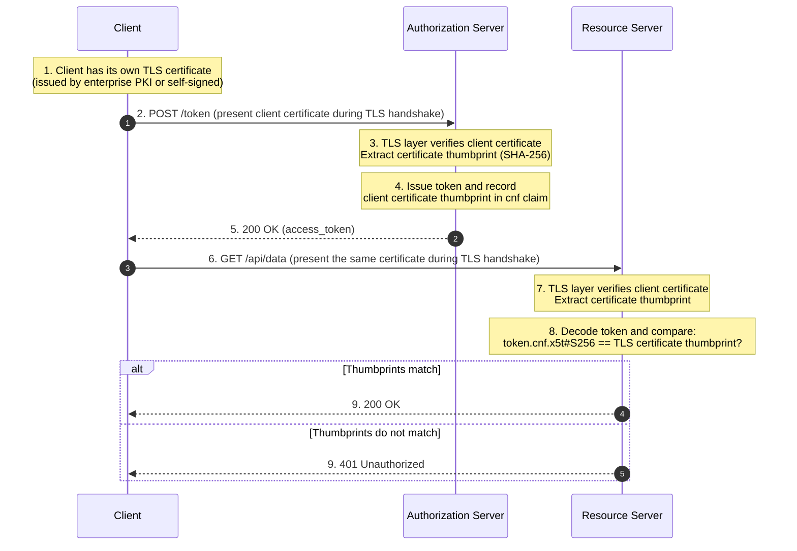

**Advantages of mTLS**:

- **Lower-level than DPoP**: Binding happens at the TLS layer.
- **Better performance**: The TLS handshake happens only once when establishing the connection.
- **Man-in-the-middle protection**

**Disadvantages of mTLS**:

- **Complex certificate management**: Every client needs a certificate; issuance, distribution, rotation, and revocation all have a cost.
- **Unfriendly to mobile/browser environments**: Browser environments cannot access client certificates, and mobile apps must implement their own certificate storage.
- **Load balancers/reverse proxies need special handling**: Nginx and Cloudflare terminate TLS by default, so client certificates do not reach the backend. `ssl_client_certificate` must be configured to pass them through.

### Device Flow: Authorization for Devices Without Browsers

The Device Authorization Grant ([RFC 8628](https://datatracker.ietf.org/doc/html/rfc8628/)) is designed for devices without a browser or with awkward input methods.

Typical scenarios:

- Logging in to Netflix on a smart TV.
- CLI tools (`gh auth login`, `docker login`).
- Raspberry Pis and IoT devices.

#### How It Works

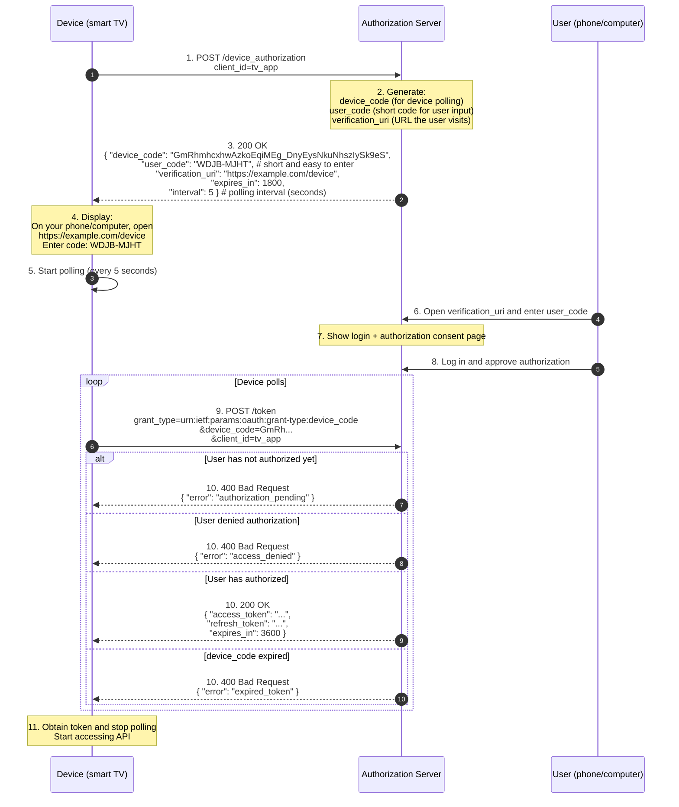

**Device Flow Security**:

- `user_code` is short and easy to guess, so the authorization server must limit attempts (lock after 5 failures).
- `device_code` is a high-entropy random value. The polling endpoint does not require client authentication (the device has no `client_secret`).
- The user enters their password on their own phone/computer. The device never sees it.
- `verification_uri` can be a complete URL (e.g. `https://example.com/device?user_code=WDJB-MJHT`), so the user can simply follow a link without typing the code manually.

Maybe we'll implement this if there's a Link CLI someday.

### Cross-Origin Requests and CORS

OAuth flows often run into seemingly insurmountable **cross-origin problems**.

#### The Problem Scenario

Suppose we have:

- Authorization server: `https://auth.example.com`
- Frontend application: `https://app.example.com`

Frontend JS calls `/token` directly to exchange the authorization code:

```javascript
// That's bad...
fetch('https://auth.example.com/token', {
  method: 'POST',
  headers: { 'Content-Type': 'application/x-www-form-urlencoded' },
  body: 'grant_type=authorization_code&code=...',
})
```

The browser sends a CORS preflight (`OPTIONS` request). If the authorization server does not return the correct CORS headers, the browser blocks the request.

#### solutions

**Option 1: The authorization server returns CORS headers**

```http
Access-Control-Allow-Origin: https://app.example.com
Access-Control-Allow-Methods: POST
Access-Control-Allow-Headers: Content-Type
```

But the `/token` endpoint serves all clients. Whose domain should go in `Allow-Origin`?
`*` is insecure, and handling multiple origins is a hassle.

**Option 2: The BFF pattern (Backend For Frontend)**

The frontend does not call the authorization server directly. It goes through its own backend:

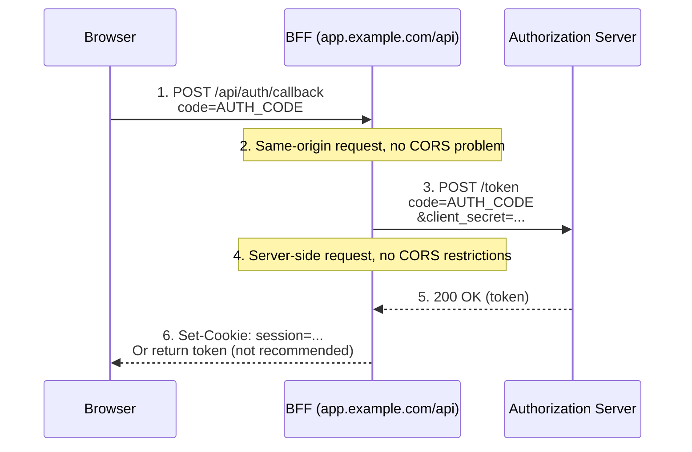

**Benefits of a BFF**:

- The frontend never directly handles `client_secret` (for confidential clients).
- The frontend never directly handles `refresh_token` (it can be stored in the BFF's session).
- The authorization server does not need CORS configuration.

We use the BFF pattern in Link, zwz—the frontend receives the authorization code and calls `/oauth/exchange-code` (exchanging the login code for a token), a same-origin endpoint.

### `aud` and `azp` in an ID Token

We covered `aud` earlier, but OIDC has a special case: **one ID Token can have multiple audiences**.

For example, a user authorizes three clients (A, B, C) to share the same ID Token, so `aud` is an array:

```json
{
  "iss": "https://op.example.com",
  "sub": "user123",
  "aud": ["client_a", "client_b", "client_c"],
  "azp": "client_a",
  "exp": 1700000000
}
```

Every client must verify that `aud` **contains** its own `client_id`.
But if you're `client_b`, you also need to check whether `azp` (Authorized Party) is trusted—`azp`

## Emerging Standards and Practices

### RFC 9068: JWT Access Token Profile

OAuth 2.0 does not define a token format, but JWT has become the de facto standard in practice. [RFC 9068](https://www.rfc-editor.org/rfc/rfc9068.html) is the first RFC to formally standardize using JWTs as access tokens, defining a uniform claims structure.

#### Why RFC 9068

Before RFC 9068, every OP used its own format for JWT access tokens:

- Some used `scope`, others `scp`.
- Some used `client_id`, others `azp` or `cid`.
- A resource server receiving a JWT access token did not know which claim represented permission scopes.

RFC 9068 standardizes these fields so resource servers can use the same logic to verify JWT access tokens from different OPs.

#### Standard Claims

| Claim         | Required | Description |
| ------------- | ---- | --------------------------------------------------------------- |
| `iss`         | ✓    | Issuer (the OP's URL) |
| `exp`         | ✓    | Expiration time |
| `aud`         | ✓    | Audience (resource server identifier; may be an array) |
| `sub`         | ✓    | Subject (user identifier) |
| `client_id`   | ✓    | Client ID (**fixed field name**) |
| `iat`         | ✓    | Issued-at time |
| `jti`         | ✓    | Token ID                                                        |
| `scope`       | —    | Permission scopes (**space-separated string**); required for the client credentials grant |
| `auth_time`   | —    | Time the user actually authenticated |
| `acr` / `amr` | —    | Authentication context / authentication methods |

#### example

```json
{
  "iss": "https://op.example.com",
  "sub": "user123",
  "aud": "https://api.example.com",
  "client_id": "my_client",
  "scope": "openid profile email",
  "exp": 1700003600,
  "iat": 1700000000,
  "jti": "550e8400-e29b-41d4-a716-446655440000"
}
```

### RFC 9207: OAuth 2.0 Authorization Server Issuer Identification

**When redirecting back to the client, the authorization server must include the `iss` (issuer) parameter.**

#### Mix-Up Attack solution

Suppose your application supports two OAuth login providers: Google and Facebook.

1. The user clicks 'Log in with Google'. The client generates `state=abc` and redirects to Google's `/authorize`.
2. **An attacker in the middle tampers with the redirect**, changing the URL to Facebook's `/authorize`, while `state` and `redirect_uri` still belong to the client.
3. The user authorizes on Facebook, which sends the authorization code back to the client's `redirect_uri?code=xyz&state=abc`.
4. The client sees that `state=abc` matches, assumes this is a Google authorization code, and takes it to Google's `/token` to exchange for a token.
5. **Google rejects it**, but the attacker has already achieved their goal: the client has leaked Facebook's authorization code in the request to Google's `/token`.

RFC 9207 requires the authorization server to include an `iss` parameter when redirecting:

```
https://client.example.com/callback?code=xyz&state=abc&iss=https://facebook.com
```

Upon receiving it, the client checks whether `iss` matches the authorization server URL recorded when authorization started:

### Revoking JWT Access Tokens: `jti` and a Denylist

RFC 9068 requires JWT access tokens to have a `jti` precisely to address the problem of 'self-contained JWT = cannot be revoked'.

#### The JWT Revocation Dilemma

A JWT is self-contained: When the resource server receives it, a valid signature and an unexpired `exp` are enough to consider it valid.

But this creates a problem: If a user changes their password or an administrator bans their account, the JWT still works until it expires, because the resource server never queries the database.

#### Link's Approach

Link's JWT access tokens are self-contained, but **the resource server queries the database on every request**:

```go
func (a *Authenticator) RequireAdminAuth(ctx context.Context, header string) (Principal, error) {
    // 1. Verify JWT signature, exp, and aud
    claims := verifyJWT(header)

    // 2. Read token metadata from the database
    tokenMeta := db.QueryOne("SELECT revoked_at FROM oauth_access_tokens WHERE jti = ?", claims.JTI)
    if tokenMeta.RevokedAt != nil {
        return nil, ErrTokenRevoked
    }

    // 3. Read the user's current state from the database
    user := db.QueryOne("SELECT role, state, token_version FROM user WHERE id = ?", claims.Sub)
    if user.TokenVersion != claims.TokenVersion {
        return nil, ErrTokenVersionMismatch  // Old token after a password change
    }
    if user.State == "is_deleted" {
        return nil, ErrAccountClosed
    }

    // 4. Check permissions
    if user.Role != "admin" && user.Role != "lecturer" {
        return nil, ErrForbidden
    }

    return Principal{UserID: claims.Sub, Role: user.Role}, nil
}
```

1. **`revoked_at` denylist**: A password change, logout, or administrator ban immediately writes `oauth_access_tokens.revoked_at`, so the next request is rejected.
2. **`token_version` global version number**: A password change, privilege reduction, or account closure increments `user.token_version`, invalidating all JWTs with older versions.
3. **`state` live status**: Every request reads `user.state` from the database, so an account ban (`is_deleted`) takes effect immediately.

**If the AS and RS are separate**:

- The RS can cache the revocation status of `jti` in Redis, with the TTL set to the JWT's remaining lifetime.
- On a password change/account ban, the AS writes to the database and also writes Redis `SET jti:xxx "revoked" EX 3600`.
- When verifying a JWT, the RS checks Redis first and queries the database only on a miss.

### RFC 9396: OAuth 2.0 Rich Authorization Requests (RAR)

Traditional OAuth `scope` is a flat list of strings:

```
scope=read:email write:posts delete:posts
```

But some scenarios need finer-grained permissions:

- 'Read orders from 2024, but not from 2023.'
- 'Access only `/api/users/me`, not `/api/users/{id}`.'
- 'Access only on weekdays from 9:00 to 18:00.'

RFC 9396 lets clients send **structured permission descriptions** in authorization requests instead of just scope strings.

#### RAR Format

At `/authorize`, a client can send `authorization_details` (a JSON array) in addition to `scope`:

```json
{
  "authorization_details": [
    {
      "type": "payment",
      "actions": ["initiate", "cancel"],
      "locations": ["https://api.example.com/payments"],
      "max_amount": 1000,
      "currency": "USD"
    },
    {
      "type": "account_information",
      "actions": ["read"],
      "accounts": ["account-123", "account-456"]
    }
  ]
}
```

When issuing the access token, the authorization server writes the portion the user approved into the token (either as a JWT claim or as metadata associated with an opaque token).

When the resource server receives the token, it parses `authorization_details` to determine whether the current request falls within the authorized scope.

#### Why RAR

Traditional `scope` has limitations.

RAR's `authorization_details` can express arbitrary structures:

- `type` is the authorization type (custom, defined by the resource server).
- Other fields depend on `type` (e.g. a `payment` type has `max_amount`, while an `account_information` type has `accounts`).

### Completeness Checks for Discovery and JWKS

OIDC's Discovery document is the standard entry point. A client can learn all the endpoints by fetching `/.well-known/openid-configuration`.

```bash
$ curl -s https://link.sast.fun/v2/.well-known/openid-configuration | jq .
```

```json
{
  "issuer": "https://link.sast.fun/v2",
  "authorization_endpoint": "https://link.sast.fun/v2/oauth/authorize",
  "token_endpoint": "https://link.sast.fun/v2/oauth/token",
  "userinfo_endpoint": "https://link.sast.fun/v2/userinfo",
  "jwks_uri": "https://link.sast.fun/v2/.well-known/jwks.json",
  "revocation_endpoint": "https://link.sast.fun/v2/oauth/revoke",
  "scopes_supported": [
    "openid",
    "profile",
    "email",
    "admin:read",
    "admin:write",
    "user:read",
    "user:write"
  ],
  "response_types_supported": ["code"],
  "grant_types_supported": ["authorization_code", "refresh_token"],
  "subject_types_supported": ["public"],
  "id_token_signing_alg_values_supported": ["EdDSA"],
  "token_endpoint_auth_methods_supported": ["none", "client_secret_post"],
  "claims_supported": [
    "sub",
    "iss",
    "aud",
    "exp",
    "iat",
    "nonce",
    "name",
    "picture",
    "preferred_username",
    "role",
    "email",
    "email_verified",
    "updated_at"
  ],
  "code_challenge_methods_supported": ["S256"],
  "response_modes_supported": ["query"],
  "claim_types_supported": ["normal"],
  "request_parameter_supported": false,
  "request_uri_parameter_supported": false,
  "claims_parameter_supported": false
}
```

[OIDC Discovery 1.0](https://openid.net/specs/openid-connect-discovery-1_0.html) classifies fields as **REQUIRED**, **RECOMMENDED**, or **OPTIONAL**.

#### Checking the JWKS Response

```bash
$ curl -s https://link.sast.fun/v2/.well-known/jwks.json | jq .
```

```json
{
  "keys": [
    {
      "kty": "OKP",
      "crv": "Ed25519",
      "kid": "link-v2-active",
      "use": "sig",
      "alg": "EdDSA",
      "x": "BFj6m10rdWe_1VZ6bMB7FTU034NNMUueRBuw8-Ah_B0"
    }
  ]
}
```

### Let's Code, Code, Code an OIDC Client

Suppose we're writing a third-party application that uses Link to log in.

#### Step 1: Read the Discovery Document

```javascript
const discovery = await fetch(
  'https://link.sast.fun/v2/.well-known/openid-configuration',
).then((r) => r.json())

console.log(discovery.authorization_endpoint) // https://link.sast.fun/v2/oauth/authorize
console.log(discovery.token_endpoint) // https://link.sast.fun/v2/oauth/token
console.log(discovery.userinfo_endpoint) // https://link.sast.fun/v2/userinfo
```

**What Discovery tells us**:

- ✓ Supports the authorization code flow (`response_types_supported: ["code"]`).
- ✓ Requires PKCE (`code_challenge_methods_supported: ["S256"]`).
- ✓ Supports refresh tokens (`grant_types_supported` includes `refresh_token`).
- ✗ Does not support `client_secret_basic` (`token_endpoint_auth_methods_supported` contains only `none` and `client_secret_post`).

#### Step 2: Generate PKCE Parameters

```javascript
// Generate a random code_verifier of 43-128 bytes
function generateCodeVerifier() {
  const array = new Uint8Array(32) // 32 bytes = 43 base64url characters
  crypto.getRandomValues(array)
  return base64urlEncode(array)
}

// S256: code_challenge = BASE64URL(SHA256(ASCII(code_verifier)))
async function generateCodeChallenge(verifier) {
  const encoder = new TextEncoder()
  const data = encoder.encode(verifier)
  const hash = await crypto.subtle.digest('SHA-256', data)
  return base64urlEncode(new Uint8Array(hash))
}

const codeVerifier = generateCodeVerifier()
const codeChallenge = await generateCodeChallenge(codeVerifier)

// Store in sessionStorage for use when the callback returns
sessionStorage.setItem('pkce_verifier', codeVerifier)
```

#### Step 3: Redirect to the Authorization Endpoint

```javascript
const state = generateRandomString() // Prevent CSRF
const nonce = generateRandomString() // Prevent ID Token replay

sessionStorage.setItem('oauth_state', state)
sessionStorage.setItem('oauth_nonce', nonce)

const authUrl = new URL(discovery.authorization_endpoint)
authUrl.searchParams.set('response_type', 'code')
authUrl.searchParams.set('client_id', 'my-app-client-id')
authUrl.searchParams.set('redirect_uri', 'https://my-app.com/callback')
authUrl.searchParams.set('scope', 'openid profile email')
authUrl.searchParams.set('state', state)
authUrl.searchParams.set('nonce', nonce)
authUrl.searchParams.set('code_challenge', codeChallenge)
authUrl.searchParams.set('code_challenge_method', 'S256')

window.location.href = authUrl.href
```

#### Step 4: Handle the Callback

```javascript
// After the user authorizes, Link redirects to https://my-app.com/callback?code=xxx&state=yyy

const urlParams = new URLSearchParams(window.location.search)
const code = urlParams.get('code')
const state = urlParams.get('state')

// Verify state
if (state !== sessionStorage.getItem('oauth_state')) {
  throw new Error('State mismatch (CSRF detected)')
}

// Exchange for tokens
const codeVerifier = sessionStorage.getItem('pkce_verifier')
const tokenResponse = await fetch(discovery.token_endpoint, {
  method: 'POST',
  headers: { 'Content-Type': 'application/x-www-form-urlencoded' },
  body: new URLSearchParams({
    grant_type: 'authorization_code',
    code: code,
    redirect_uri: 'https://my-app.com/callback',
    client_id: 'my-app-client-id',
    client_secret: 'my-secret', // For a confidential client
    code_verifier: codeVerifier,
  }),
})

const tokens = await tokenResponse.json()
console.log(tokens)
// {
//   access_token: "eyJhbGciOi...",
//   token_type: "Bearer",
//   expires_in: 3600,
//   refresh_token: "...",
//   id_token: "eyJhbGciOi...",
//   scope: "openid profile email"
// }
```

#### Step 5: Verify the ID Token

```javascript
// 1. Split the JWT
const [headerB64, payloadB64, signatureB64] = tokens.id_token.split('.')
const header = JSON.parse(base64urlDecode(headerB64))
const payload = JSON.parse(base64urlDecode(payloadB64))

// 2. Get the public key from JWKS
const jwks = await fetch(discovery.jwks_uri).then((r) => r.json())
const key = jwks.keys.find((k) => k.kid === header.kid)
if (!key) throw new Error('kid not found in JWKS')

// 3. Verify the signature (using the Web Crypto API)
const publicKey = await crypto.subtle.importKey(
  'jwk',
  key,
  { name: 'EdDSA', namedCurve: 'Ed25519' },
  false,
  ['verify'],
)

const signatureValid = await crypto.subtle.verify(
  'EdDSA',
  publicKey,
  base64urlDecode(signatureB64),
  new TextEncoder().encode(headerB64 + '.' + payloadB64),
)

if (!signatureValid) throw new Error('Signature verification failed')

// 4. Verify claims
if (payload.iss !== discovery.issuer) throw new Error('iss mismatch')
if (payload.aud !== 'my-app-client-id') throw new Error('aud mismatch')
if (payload.exp < Date.now() / 1000) throw new Error('ID Token expired')
if (payload.nonce !== sessionStorage.getItem('oauth_nonce'))
  throw new Error('nonce mismatch')

// 5. Extract user information
console.log('User ID:', payload.sub)
console.log('Name:', payload.name)
console.log('Email:', payload.email)
```

#### Step 6: Call UserInfo (Optional)

```javascript
// Claims in the ID Token are a compact version; call UserInfo for a complete profile
const userinfo = await fetch(discovery.userinfo_endpoint, {
  headers: { Authorization: `Bearer ${tokens.access_token}` },
}).then((r) => r.json())

console.log(userinfo)
// {
//   sub: "250",
//   name: "Sean",
//   email: "woshinailong@sast.fun",
//   email_verified: true,
//   picture: "https://sast-link-1309205610.cos.ap-shanghai.myqcloud.com/avatar/9.jpg",
//   preferred_username: "zs",
//   role: "admin",
//   updated_at: 1700000000
// }
```

#### Step 7: Refresh Token

```javascript
// After the Access Token expires (1 hour), exchange the Refresh Token for a new one
const refreshResponse = await fetch(discovery.token_endpoint, {
  method: 'POST',
  headers: { 'Content-Type': 'application/x-www-form-urlencoded' },
  body: new URLSearchParams({
    grant_type: 'refresh_token',
    refresh_token: tokens.refresh_token,
    client_id: 'my-app-client-id',
    client_secret: 'my-secret', // For a confidential client
  }),
})

const newTokens = await refreshResponse.json()
// {
//   access_token: "eyJhbGciOi...",  // New
//   token_type: "Bearer",
//   expires_in: 3600,
//   refresh_token: "...",  // New (rotation)
//   scope: "openid profile email"
// }

// The old refresh_token has been revoked; use the new one next time
```

#### Step 8: Logout

```javascript
// Link's logout is an internal endpoint, not standard OIDC RP-Initiated Logout
// If you hold a Link access token (internal session), you can call:
await fetch('https://link.sast.fun/v2/auth/logout', {
  method: 'POST',
  headers: { Authorization: `Bearer ${tokens.access_token}` },
})

// A third-party application only needs to clear local tokens; there is no need to notify Link
sessionStorage.removeItem('access_token')
sessionStorage.removeItem('refresh_token')
```
