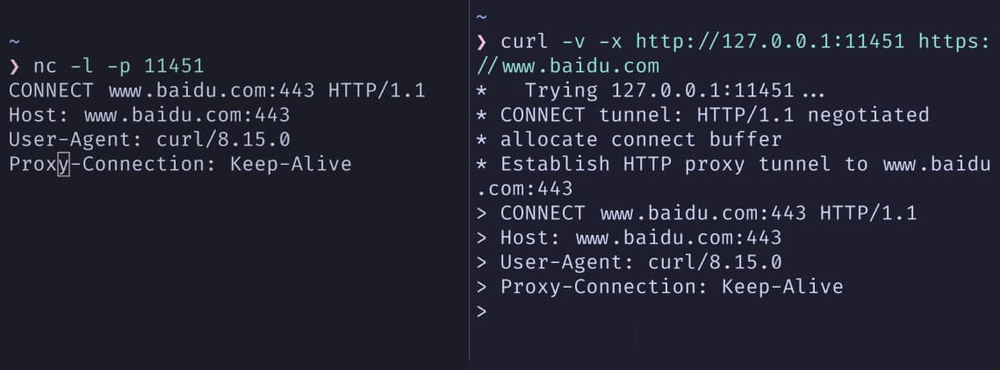

> Disclaimer: This is only an introductory overview.
> Refer to official documentation for details, implementation, and deployment.
>
> Notes for the third session of the 2025 SAST operations team course.

## Why Proxies Exist

> In a direct-connection model, once an endpoint knows the destination IP and port, it opens a TCP connection. The operating system completes the three-way handshake, and the application starts exchanging HTTP messages.

This model quickly falls short in real networks.

So people came up with another idea: introduce an intermediary that opens connections on behalf of one side, forwards data, and centralizes control and observation. That is a proxy server.
For example:

- When debugging local APIs, you want to inspect all HTTP/HTTPS request headers, response headers, and bodies, then modify and replay them. Run a local proxy such as mitmproxy, point the browser's HTTP proxy at 127.0.0.1:xxxx, and let this intermediary handle the requests.
- A production service exposes just one domain, `https://example.com`, but runs multiple applications and services behind it. Put Nginx or Caddy at the entrance to accept requests and distribute them to backends by path, Host, or other information.

### Common Use Cases

We can group proxy use cases more abstractly.

**Egress control**: A school wants all outbound traffic to pass through one or more gateways for centralized access control, auditing, and bandwidth management. Routing or firewall rules drop direct external connections; only traffic through an HTTP/SOCKS egress proxy succeeds.

**Centralized endpoint configuration**: Browsers, Git, command-line tools, and IDE plugins all need external access. One local HTTP/SOCKS port can filter and route their traffic more conveniently than configuring them individually, and makes policy changes easier.

**Website ingress**: Expose only a few domains and ports. An ingress proxy routes and load-balances requests across backends using Host/Path, while centralizing TLS termination, compression, caching, and security controls.

**API management**: Public APIs often need authentication, rate limits, auditing, and staged rollouts based on caller identity. Centralizing these at ingress is easier to control than implementing them independently in every microservice. This is where API gateways evolved.

**Service-to-service communication**: Once an application is split into microservices, their calls form a network of their own. Sidecar proxies handle inbound and outbound traffic, while a control plane distributes routing, retry, rate-limit, and mTLS policies. Together, they form a service mesh.

## Different Ways to Classify Proxies

### Which Side They Represent

From this perspective, there are three roles:

#### Forward Proxy

A forward proxy sits on the client side. The endpoint explicitly supplies the destination, and the proxy accesses the external service on its behalf.
HTTP/SOCKS egress proxies, browser-configured HTTP proxies, and Clash-Verge's local mixed port are typical examples.

#### Reverse Proxy

A reverse proxy sits on the server side and presents itself externally as the service.
Clients know only its exposed IP and domain. The backend topology remains hidden inside the private network. Nginx, Caddy, and Envoy act as reverse proxies when placed at a website's entrance.

#### Transparent Proxy

Neither endpoint explicitly configures a proxy. Network devices or the operating system redirect matching connections to a proxy process using NAT, TProxy, TUN, or similar mechanisms.

ISP transparent HTTP caches, mesh TProxy mode, and endpoint TUN proxies belong here.

### Deployment Location

The same proxy software takes on different roles and priorities depending on where it is deployed.

- On an endpoint: Handles traffic for one machine or group of users, commonly routing by domain, IP, or process and choosing an outbound connection.
- At an egress gateway: Handles a subnet or VPC's outbound traffic, focusing on access control, auditing, and bandwidth.
- At public ingress: Fronts websites or APIs, focusing on TLS, routing, load balancing, security, and observability.
- Beside a service instance: A sidecar handling east-west service traffic in a mesh.
- At an edge node: A CDN or edge-computing HTTP proxy that caches, compresses, and protects traffic near users.

### Protocol Layer

Broadly, there are two levels:

1. L3/L4 proxies and load balancers care about IP addresses, ports, and protocols. They forward traffic based on the five-tuple and perform NAT when needed. Typical examples are Layer 4 load balancers and transparent proxies using REDIRECT/TPROXY.

2. L7 application proxies parse HTTP, gRPC, WebSocket, and other protocols. They use Host, Path, Method, headers, or even bodies for routing, rate limiting, authentication, rewriting, and caching. Nginx, Caddy, Envoy, and most API gateways belong here.

Endpoint proxies often span both: TUN/TPROXY captures IP-layer traffic, reconstructs TCP/UDP connections, then applies policies using L7 semantics.

### Proxy Protocol

Another dimension is the protocol spoken between client and proxy.

#### HTTP/HTTPS Proxies

The client sends a complete URL or CONNECT request. The proxy accesses the destination using HTTP information such as Host/Path. This suits web traffic and URL-level controls and is common in browsers.

#### SOCKS Proxies

After a simple handshake specifying the destination, the proxy forwards TCP/UDP traffic without interpreting the application protocol. SOCKS5 also supports UDP ASSOCIATE for DNS or game traffic.

#### DNS Proxies

These receive DNS queries and centralize caching, forwarding, and filtering. Endpoint proxies often include a DNS module working with fake-IP or redir-host modes.

#### Specialized Protocol Proxies

Database middleware understands MySQL/PostgreSQL; message-queue proxies understand Kafka/Redis...
They are still proxies, just with deeper handling of a particular protocol.
~~Surprise, these all count as proxies too.~~

## Egress and Endpoint Proxies

### Basic Topology

A typical egress proxy looks like this:

```text
Client ── TCP1 ──> Proxy ── TCP2 ──> Server
```

Client-to-proxy and proxy-to-server are separate TCP connections.
The proxy can fully control their establishment, closure, retries, and more.

If routing requires all external traffic to pass through the proxy, a proxy failure creates a **network black hole**: endpoints can resolve DNS and ping internal hosts, but all external HTTP/HTTPS connections time out. SYN packets go out without any reply.

An endpoint proxy moves this logic onto the local machine.
-> Applications first connect to a local HTTP/SOCKS port rather than the destination, and the local proxy decides how to forward them.

### Explicit Egress Proxy

An explicit proxy requires applications to know they are using it and send destination information using its protocol.
> Application connects to proxy → supplies the real destination → proxy connects to destination.

With an HTTP proxy configured in the browser, a request for `http://host/` goes to the proxy, not directly to `host:80`:

```http
GET http://host/path HTTP/1.1 
Host: host
```

HTTPS requests also reach the proxy first, opening a CONNECT tunnel:

```http
CONNECT host:443 HTTP/1.1 
Host: host:443
```

The proxy returns `200 Connection established`. The client then performs TLS over this connection and exchanges encrypted HTTPS messages.

Let's use `curl` again to see the difference.
> On my machine, `clash-verge` has enabled the system proxy with mixed port `7897`.

```shell
$ curl -v https://www.baidu.com
* Host www.baidu.com:443 was resolved.
*   Trying [2409:8c20:6:1794:0:ff:b080:87f0]:443...
...# Omitted
* Connected to www.baidu.com (2409:8c20:6:1794:0:ff:b080:87f0) port 443
> GET / HTTP/1.1
> Host: www.baidu.com
```

```shell
$ curl -v -x http://127.0.0.1:7897 https://www.baidu.com
*   Trying 127.0.0.1:7897...
* CONNECT tunnel: HTTP/1.1 negotiated
* Establish HTTP proxy tunnel to www.baidu.com:443
> CONNECT www.baidu.com:443 HTTP/1.1
> Host: www.baidu.com:443
...# Omitted
< HTTP/1.1 200 Connection established
...# Omitted
* Connected to 127.0.0.1 (127.0.0.1) port 7897
> GET / HTTP/1.1
> Host: www.baidu.com

```

We can clearly see a few things ~~or can we~~:

1. curl first connects to `127.0.0.1:7897`, Clash-Verge's mixed port, not Baidu.
2. After TCP is established, curl sends `CONNECT www.baidu.com:443 HTTP/1.1`.
    This is talking to the proxy: “Please connect to `www.baidu.com:443` and open a tunnel for me.”
3. Clash-Verge accepts CONNECT, connects to Baidu itself, and replies `HTTP/1.1 200 Connection established`.
4. From then on, the connection carries the TLS handshake and encrypted HTTP data.
    curl sees it as: “I'm connected to 127.0.0.1:7897, and the other end of the tunnel is `www.baidu.com:443`.”

That is the essence of an explicit egress proxy.

Try it yourself.
Start a listener in one terminal:

```shell
nc -l -p 11451
```

Then send a request from another:

```shell
curl -v -x http://127.0.0.1:11451 https://www.baidu.com
```

The request never leaves the machine. This is just a fake proxy to inspect the two sides of the connection.


### Transparent Egress Proxy

A transparent egress proxy aims to leave application configuration untouched, redirecting traffic at the network layer.

At a gateway, iptables REDIRECT or TProxy can redirect matching TCP/UDP traffic to a local proxy port. REDIRECT changes the destination address; TProxy changes the socket bound to the skb, intercepting traffic without modifying packet headers.

On an endpoint, TUN mode creates a virtual network interface and changes the default route. Outgoing IP packets reach this interface first; a user-space proxy reads them, parses them, and chooses the next hop. TProxy/redir mode instead hooks selected connections in the local firewall.

Yep, Baidu again.
> On my machine, `clash-verge` has **TUN mode** enabled, with mixed port `7897`.

```shell
$ curl -v https://www.baidu.com
* Host www.baidu.com:443 was resolved.
* IPv6: (none)
* IPv4: 198.18.0.23
...
* Connected to www.baidu.com (198.18.0.23) port 443
...
* Server certificate:
*  subject: ... CN=baidu.com
...
< HTTP/1.1 200 OK
...

```

The application sees `curl -v https://www.baidu.com`.
The actual path is `curl → transparent proxy (Clash TUN/fake-ip) → the real www.baidu.com`.

> With TUN + fake-IP, system DNS and routing are rewritten. The application resolves a fake IP and connects to the local virtual address range.
> The proxy maps the fake IP back to the original domain, then connects to the real remote address. The entire outbound proxy process is transparent to the application.
>
> - The fake-IP mapping is a **dynamic, in-memory table**.
> - Addresses in the fake-IP subnet **are reused; an assignment does not bind an address to a domain forever**.

Transparent proxies are easy to get wrong because they change system-wide routing or firewall behavior. Bad rules or a failed proxy affect the whole path, not just one application.

```text
Tip:
  Application
     ↘-System routing/firewall (iptables/nftables/TUN/TProxy..)
         ↘-A local proxy port (Clash/Squid/Nginx..)
             ↘-The real destination server
```

### What an Endpoint Proxy Does

An endpoint proxy has three main jobs: provide an entry point, integrate with the system, and make decisions.

First, give applications a **configurable entry point**.
Usually this is a local HTTP/SOCKS port. Browsers, Git, curl, and SDKs can explicitly use `http://127.0.0.1:7897`. Traffic reaches the endpoint proxy before being forwarded.

Second, **take over system-wide traffic**.
When applications do not understand proxies, the proxy uses system mechanisms to intercept their connections:

> TUN creates a virtual network interface and points the default route at it. IP packets enter that interface and are read by the proxy in user space.
> TProxy hooks the kernel firewall. Applications think they are connecting to the destination IP, but iptables/nftables mark the connection and attach it to the proxy's listening socket. The proxy retrieves the original destination through interfaces such as `SO_ORIGINAL_DST`.

Both look like direct connections to applications.
To the proxy, TUN or TProxy is another inbound channel carrying connections from the **whole system**.

Third, **apply rules and select an outbound path**.
For each connection, the proxy matches the domain, IP, port, and inbound source (HTTP, SOCKS, or TUN) against rules. It decides whether to connect directly, use an upstream node, or reject the connection.

Clash Core's configuration makes these parts explicit:

- inbounds: Available entry points, such as HTTP/SOCKS/TUN/TProxy.
- proxies: Available outbound options: direct connections, nodes, and upstream proxies.
- proxy-groups: Combine outbound options into policies such as preferred selection, latency tests, or load balancing.
- rules: Assign each connection to a policy group.

That is the complete endpoint-proxy model.
Applications need not care how routing or TProxy works. A stable **local entry/exit point** and predictable **rules** are enough to make it work on the machine.

## HTTP and SOCKS Proxies

The earlier proxy-protocol section introduced both. This section adds a few protocol details.

### re:HTTP Proxy

Refer to the Baidu example above; repeating it would only make this messier.
> An HTTP proxy's control plane is the HTTP message itself.

HTTP proxies can see Host, and Path outside CONNECT tunnels, making them useful for domain/path routing, caching, and access control.

### re:SOCKS Proxy

SOCKS operates above the transport layer, independently of the application-layer protocol.
It does not interpret the upper-layer protocol; it forwards **destination address ↔ byte stream**.

A SOCKS5 handshake roughly proceeds as follows:

1. The client establishes TCP to the proxy and advertises supported authentication methods.
2. The proxy selects a method.
3. The client specifies a destination address and port with CONNECT, BIND, or UDP ASSOCIATE.
4. The proxy attempts the destination connection and replies with a status code on success.
5. Subsequent bidirectional data no longer contains the SOCKS protocol; it becomes ordinary TCP/UDP forwarding.

Baidu again, of course.
> Locally, `clash-verge` has enabled the system proxy with mixed port `7897`.

```shell
 $ curl -v --socks5 127.0.0.1:7897 https://www.baidu.com
*   Trying 127.0.0.1:7897...
* Host www.baidu.com:443 was resolved.
* IPv6: ...
* IPv4: 36.152.44.132, 36.152.44.93
* SOCKS5 connect to 36.152.44.132:443 (locally resolved)
* SOCKS5 request granted.
* Connected to 127.0.0.1 (127.0.0.1) port 7897
...
> GET / HTTP/1.1
> Host: www.baidu.com

```

- curl puts destination `36.152.44.132:443` into a SOCKS5 CONNECT request to 127.0.0.1:7897.
- Clash-Verge connects to 36.152.44.132:443 itself, then returns “granted.”

From `curl`'s perspective, it stays connected to local port 7897.
From `clash-verge`'s perspective, it connects to 36.152.44.132:443 on the other side and joins the byte streams.

> Because SOCKS5 does not care about the upper-layer protocol, it works as a general-purpose tunnel.

### Differences and Use Cases

HTTP proxies understand HTTP semantics and can read `Host/Path/Method/Headers`. They suit web-specific tasks such as path routing, caching, header injection, and rewriting. *Reverse proxies mostly fall into this category.*

SOCKS is transparent to application-layer protocols, making it better as a **general-purpose tunnel** carrying different protocols' outbound traffic at the endpoint.

Endpoint proxies commonly expose both HTTP and SOCKS inbounds, abstract them as **connections to a destination address**, and use one rule engine and outbound-selection mechanism for both.

## Endpoint Proxies and System Traffic

### Endpoint Proxy Architecture

An endpoint proxy can be divided into three parts:

- Inbound: Receives application or system traffic through HTTP/SOCKS listening ports or system-level TUN/TPROXY entry points.
- Rules: Match a policy or policy group using domain, IP, port, inbound source, or even process information.
- Outbound: Decide how to establish the next connection: direct, through an upstream node or proxy, or reject it.

Most configurations follow this pattern: define entry points, list available exits, then write rules directing each connection from an entry to an exit or set of exits.

### Inbound and Outbound

> Inbounds are local listening ports and virtual interfaces.

#### HTTP Inbound

Listens on a port and provides HTTP proxy service directly to browsers, curl, and similar clients.

#### SOCKS Inbound

Listens for SOCKS5, supporting non-HTTP protocols and applications that need UDP.

#### TUN/TProxy Inbound

Intercepts system-generated IP packets or TCP connections through a virtual interface or kernel transparent proxy, providing system-wide transparent proxying.

> Outbounds describe possible next hops.

#### Direct (DIRECT)

The proxy process connects directly to the destination server.

#### Upstream Proxy

Forwards the connection to another HTTP, SOCKS, or specialized proxy.

#### Node Cluster

Describes multiple possible exits for a policy group to select from.

### Rules and Policy Groups

Rules are an ordered list of “match condition → policy group.”

Typical conditions include:

- Domain matching: exact, suffix, or keyword.
- IP matching: CIDR ranges or GeoIP regions.
- Port, inbound source, and more.

Policy groups may include:

- select: Manually select an outbound candidate.
- url-test/load-balance: Automatically test latency or balance load across exits.
- special: Actions such as DIRECT/REJECT.

The Rule/Global/Direct mode switch in an endpoint proxy's UI essentially selects a rule set or bypasses rules to force every connection onto one policy.

If you've got time to spare, inspect Clash-Verge's configuration yourself.

```yaml
mixed-port: 7897
tun:
  auto-detect-interface: true
  auto-route: true
  device: Mihomo
  dns-hijack:
  - any:53
  mtu: 1500
  stack: system
  strict-route: false
  enable: false
external-controller-unix: /tmp/verge/verge-mihomo.sock
proxies:
- name: xxxxxxxx
  type: trojan
  server: xxxxxxxxxxx
  port: 9120
  password: xxxxxxxxxxxx
  udp: true
  sni: xxxxxxxxxx
  skip-cert-verify: true
proxy-groups:
- name: xxxx
  type: select
  proxies:
  - xxxx
rules:
- DOMAIN,xxxxxxxxxxxxxxxxxx,DIRECT
- DOMAIN-SUFFIX,xxxxxxx,xxxx
- DOMAIN-SUFFIX,xxxx,xxxx
- DOMAIN-SUFFIX,xxxxxxxxxxxxxxxxxx,xxxx
- DOMAIN-SUFFIX,xxxxxxxxxxxxxx,xxxx
- DOMAIN-SUFFIX,xxxxxxxxxxxxxx,xxxx
- DOMAIN-SUFFIX,xxxxxxxxxxx,xxxx
```

However, *mind your privacy and security*.

### System-Wide Transparent Mode

TUN or TProxy brings traffic from the entire system into the proxy.

- With TUN, the routing table points the default route to a **virtual interface**. The proxy reads IP packets from the TUN device and reconstructs TCP/UDP streams.
- With TProxy, applications think they are connecting directly. The kernel uses iptables rules to bind packets to the proxy's listening socket, and the proxy recovers the original destination through mechanisms such as SO_ORIGINAL_DST or IP_TRANSPARENT.

Misconfiguration can cause **complete loss of external connectivity, looping DNS queries, or incorrect redirection of the proxy's own connections**. Troubleshooting requires examining routing tables, iptables, and proxy logs together.

***Don't mess around blindly, UwU.***

### DNS Cooperation

IP-only routing cannot reliably support domain rules with multi-tenant CDNs and shared IPs, so endpoint proxies commonly participate in DNS resolution.

Common approaches include:

- Local DNS server: Listen on local port 53, intercept system queries, forward them upstream, and cache domain-to-IP mappings. Later connections can be mapped back from IP to domain so domain rules apply.
- Fake-IP mode: Maintain a virtual local range and assign a fixed fake IP to each domain. Return it to the system, intercept connections to it, and recover the original domain for precise domain-based routing.

## Reverse Proxies and Website Ingress

### Topology and Role

A reverse proxy sits between clients and backends. It presents a unified entry point to clients and shields backends from external details.

A typical topology:

```text
Client → Nginx / Caddy → app1 / app2 / static / …
```

Ingress listens only on 80/443 or a few ports and handles TLS handshakes, routing, load balancing, logging, and basic security. Backends use private addresses and ports on the internal network.

### Routing and Load Balancing

Nginx uses `proxy_pass` with the `upstream` module for reverse proxying and load balancing.

Caddy's `reverse_proxy` provides similar functions with simpler configuration for straightforward cases: [Caddy Web Server](https://caddyserver.com/docs/caddyfile/directives/reverse_proxy).

> Documentation is there to teach us. We don't have to memorize all of it, right?

#### nginx

[nginx: download](https://nginx.org/en/download.html)
maybe U should find yourself(?
[Beginner’s Guide](https://nginx.org/en/docs/beginners_guide.html)
Nginx is the authoritative old hand here, so I can only offer a quick introduction.

```shell
# Skipping installation. Definitely not because I couldn't be bothered.

$ sudo systemctl start nginx.service

$ sudo systemctl enable nginx.service # Start on boot, if you want

# $ sudo systemctl status nginx.service  
# Use this to inspect the service status
```

I found a fun [sorting visualization](https://github.com/aoverb/sorting), so let's deploy it with nginx.

```shell
cd /var/www/html
sudo git clone https://github.com/aoverb/sorting.git
```

First, build the project with npm.

```shell
$ cd /var/www/html/sorting
$ sudo npm install

$ sudo npm run build

$ ls /var/www/html/sorting
dist
eslint.config.js
index.html
LICENSE
node_modules
package.json
package-lock.json
pnpm-lock.yaml
postcss.config.cjs
public
README.md
src
tailwind.config.cjs
vite.config.js
```

The build output is in /dist.
Once that's done, take a look at nginx.

```shell
$ cd /etc/nginx/
$ ls
conf.d
default.d
fastcgi.conf
fastcgi.conf.default
fastcgi_params
fastcgi_params.default
koi-utf
koi-win
mime.types
mime.types.default
nginx.conf
nginx.conf.default
scgi_params
scgi_params.default
uwsgi_params
uwsgi_params.default
win-utf
```

The main things to know:

- nginx.conf: The core configuration, containing `include /etc/nginx/conf.d/*.conf;`.
- conf.d: Pretty self-explanatory; put new service configurations here.
- mime.types: [MIME types (IANA media types) - HTTP | MDN](https://developer.mozilla.org/zh-CN/docs/Web/HTTP/Guides/MIME_types).

Let's write some configuration.

```shell
cd /etc/nginx/conf.d/

sudo nano /etc/nginx/conf.d/sorting.conf
```

What, your first time using nano?
Just remember `ctrl S` to save and `ctrl X` to exit.

```txt
server {
    listen 11451;

    server_name _;

    root /var/www/html/sorting/dist;

    index index.html;
    location / {
        try_files $uri $uri/ /index.html;
    }
    access_log /var/log/nginx/sorting_access.log;

    error_log /var/log/nginx/sorting_error.log;
}
```

Nginx has a syntax-checking tool:

```shell
$ sudo nginx -t
nginx: the configuration file /etc/nginx/nginx.conf syntax is ok
nginx: configuration file /etc/nginx/nginx.conf test is successful
```

Then reload nginx:

```shell
sudo systemctl reload nginx
```

Visit [http://localhost:11451](http://localhost:11451).
A quick look at what the directives mean:

- `server { ... }`: A virtual-host configuration block.
- `listen  11451`: Listening port and address binding.
- `server_name  _`: Server-name matching rule.
- `root /var/www/html/sorting/dist`: Root-directory mapping.
- `index index.html`: Default index file.

🤓☝️
You might ask: wasn't that just a static web server?
Can't I run npm run dev?
Why use nginx?

> You're right, but *Nginx* is a brand-new high-performance HTTP and reverse proxy server independently developed by Igor Sysoev. It runs in an open-source world called “Linux,” where configurations chosen by nginx.conf receive a “Worker Process” and wield the power of concurrency. You play a mysterious “operations engineer,” freely deploying and meeting directives such as proxy_pass, try_files, and gzip, each with its own personality and abilities. Together, you defeat the mighty **C10K** and recover the lost **200 OK**, while gradually uncovering the truth behind “web services.”

Almost forgot this section was supposed to be about reverse proxies (
🤔 How about something weird?

```shell
sudo nano /etc/nginx/conf.d/gateweiii.conf
```

Let's look at a gateway.

```txt
server {
    listen 80;

    server_name gugugaga.gugugaga.gugugaga;

    location / {
        proxy_pass http://127.0.0.1:11451;
        proxy_set_header Host $host;
        proxy_set_header X-Real-IP $remote_addr;
        proxy_set_header X-Forwarded-For $proxy_add_x_forwarded_for;
    }

    add_header X-Proxy-By "SAST嘿壳,低调的嘿壳有多恐怖";

}

```

One more little trick:

```shell
$ sudo nano /etc/hosts
# Add this line
# 127.0.0.1   gugugaga.gugugaga.gugugaga
```

Now visit [http://gugugaga.gugugaga.gugugaga](http://gugugaga.gugugaga.gugugaga).
It's the same thing!
Yes, that is reverse proxying.

Jokes aside, here's what's happening:

- `proxy_pass http://127.0.0.1:11451;`
This tells Nginx to **forward** every matching request to local port 11451.

The reverse proxy is the **main entrance** for all traffic.

1. **Security isolation**: Outsiders do not know which backend runs behind it or on which port.
2. **Load balancing**: Run 10 sorting instances on ports 11451–11460, then use `upstream` to distribute traffic round-robin. Now you have a cluster.
3. **Unified ingress**: On the same port 80, route /api to Python, /web to Node.js, and handle /static locally. In short, do whatever you need.

A more complete configuration might look like this.
I didn't prepare a proper project here, so I had AI mock one up for everyone.
~~My apologies, orz.~~

```txt
# =========================================================
# 1. Define the upstream pool for easy expansion to multiple servers
# =========================================================
upstream my_backend_api {
    # This may be 127.0.0.1 or another server's private IP
    # keepalive keeps connections open for better performance
    server 127.0.0.1:3000;
    keepalive 64;
}

# =========================================================
# 2. Redirect HTTP to HTTPS (80 -> 443)
# =========================================================
server {
    listen 80;
    listen [::]:80;
    server_name www.s3loy.tech s3loy.tech;

    # Return a permanent 301 redirect to HTTPS for requests on port 80
    return 301 https://www.s3loy.tech$request_uri;
}

# =========================================================
# 3. Main server (HTTPS / 443)
# =========================================================
server {
    listen 443 ssl http2;      # Enable HTTP/2
    listen [::]:443 ssl http2;
    server_name www.s3loy.tech;

    # -----------------------------------------------------
    # SSL certificates (Certbot fills these in automatically)
    # -----------------------------------------------------
    # ssl_certificate /etc/letsencrypt/live/www.s3loy.tech/fullchain.pem;
    # ssl_certificate_key /etc/letsencrypt/live/www.s3loy.tech/privkey.pem;
    
    # SSL optimization
    ssl_protocols TLSv1.2 TLSv1.3;  # Allow only secure protocols
    ssl_ciphers HIGH:!aNULL:!MD5;
    ssl_session_cache shared:SSL:10m;
    ssl_session_timeout 10m;

    # -----------------------------------------------------
    # Security headers: XSS/clickjacking protection and more
    # -----------------------------------------------------
    add_header Strict-Transport-Security "max-age=31536000; includeSubDomains" always; # Require HTTPS for one year
    add_header X-Frame-Options SAMEORIGIN;           # Prevent other sites from embedding yours in an iframe
    add_header X-Content-Type-Options nosniff;       # Prevent MIME sniffing
    add_header X-XSS-Protection "1; mode=block";     # Enable XSS filtering

    # -----------------------------------------------------
    # Performance: Gzip compression
    # -----------------------------------------------------
    gzip on;
    gzip_types text/plain text/css application/json application/javascript text/xml;
    gzip_min_length 1000; # Skip files under 1k: compression saves little

    # -----------------------------------------------------
    # Static frontend assets
    # -----------------------------------------------------
    root /var/www/html/sleepinggggg;
    index index.html;

    location / {
        # Essential for single-page applications:
        # Fall back to index.html when no file exists, letting frontend routing take over
        try_files $uri $uri/ /index.html;
    }

    # -----------------------------------------------------
    # Cache static assets (images/JS/CSS)
    # -----------------------------------------------------
    location ~* \.(js|css|png|jpg|jpeg|gif|ico|svg)$ {
        expires 30d; # Cache for 30 days
        add_header Cache-Control "public, no-transform";
    }

    # -----------------------------------------------------
    # Forward backend API requests
    # -----------------------------------------------------
    location /api/ {
        proxy_pass http://my_backend_api; # Forward to the upstream defined above
        
        # Include real client information, or the backend sees only 127.0.0.1
        proxy_set_header Host $host;
        proxy_set_header X-Real-IP $remote_addr;
        proxy_set_header X-Forwarded-For $proxy_add_x_forwarded_for;
        proxy_set_header X-Forwarded-Proto $scheme;
    }
}
```

For certificates, install certbot beforehand.
Then use `sudo certbot --nginx` for one-command configuration.

> What, you want to know exactly what certificates are and how to obtain them?
> Learn it and teach me, zwz. It's not that complicated anyway.

### Common Components

Common reverse proxies and their characteristics:

- Nginx / OpenResty: Mature, high-performance HTTP reverse proxies and load balancers with flexible configuration. ngx_http_upstream_module supports multiple balancing algorithms and health checks, and Lua scripts can extend complex logic.
- Caddy: Simple configuration and sensible, secure TLS defaults. `reverse_proxy` supports multiple load-balancing policies and health checks, making it useful for quickly building reverse proxies and small gateways.
- HAProxy: Focuses on L4/L7 load balancing and is widely used in demanding finance and telecom environments. Its backend-pool and frontend-listener configuration suits highly reliable ingress.
- Envoy / Traefik: More cloud-native-oriented, with rich L7 filters and dynamic configuration interfaces. They underpin many API gateways and service-mesh data planes.

## API Gateway

### The Problem to Solve

As backend services and public APIs multiply, ingress needs more than routing and load balancing.

> It needs to:
> Authenticate and authorize callers by identity.
> Apply rate limits, quotas, and billing to different APIs and callers.
> Roll out versions gradually or run canaries by user or traffic percentage.
> Centralize request logs and audit records for tracing and compliance.

Implementing these independently in every microservice duplicates work and creates inconsistency. An API gateway builds on reverse proxying to move these API-related cross-cutting concerns into a shared entry point.

### Main Capabilities

A typical API gateway adds the following to an L7 proxy:

1. Authentication and authorization: JWT, OAuth2/OpenID Connect, API keys, and more.
2. Fine-grained access control: Permissions by caller, tenant, path, method, and other dimensions.
3. Rate limits and quotas: Limit request rates and total calls by IP, user, or API, using algorithms such as sliding windows.
4. Protocol translation: Accept external HTTP+JSON and translate internally to gRPC or a custom RPC protocol.
5. Staged rollouts and routing policies: Allocate traffic among service versions using headers, cookies, user attributes, or percentages.
6. Audit logging and monitoring: Detailed call records combined with metrics and tracing for comprehensive observability.

Open-source gateways such as Kong and APISIX generally use Nginx or Envoy as a core, adding Lua/plugin chains and a control plane to provide these capabilities.

### Relationship to Reverse Proxies

An API gateway is a **reverse proxy with API semantics and a policy system**.

A reverse proxy maps **paths/hosts to backend instances**, focusing on performance and reliability.

A gateway adds **who is calling, what they may access, when, and how calls are billed and audited**. Architecturally, it often forms the unified external entrance, then accesses microservice clusters directly or through reverse proxies.

## Service Mesh

### Why It Appeared

When services are split into microservices, their calls form a large network, and the problems change:

- Every service needs retries, timeouts, circuit breaking, and load balancing for downstream calls.
- Uniform mTLS is needed; encryption and authentication should not depend on each language's implementation details.
- Service-to-service routing and staged rollouts should work without modifying application code.

> These are fundamentally network and infrastructure responsibilities.

A service mesh deploys a sidecar proxy beside each service instance and adds a centralized control plane, moving network-management concerns out of business code.

### Control Plane and Data Plane

A mesh usually has a control plane and a data plane.

The control plane:

- Stores and distributes service-discovery information.
- Distributes routing, retry, timeout, and circuit-breaking policies.
- Manages and distributes certificates for mTLS.
- Collects metrics, logs, and traces.

The data plane consists of many sidecars, such as Envoy, one beside each service instance. All application inbound and outbound traffic passes through the local sidecar:

```text
Service A ↔ sidecar A ↔ sidecar B ↔ Service B
```

Using control-plane configuration, the sidecar handles load balancing, TLS handshakes, traffic control, and observation.

### Sidecar Responsibilities

Locally, a sidecar:

- Applies service discovery, load balancing, routing, retry, and circuit-breaking policies to outbound traffic.
- Applies authentication and rate limits to inbound traffic, injecting tracing headers and metrics.
- Interacts with the control plane to receive dynamic configuration and certificate updates.

> Think of it as a reverse proxy and egress proxy combined in front of each service process, with configuration centralized in the control plane.

### Relationship to Gateways and Reverse Proxies

By source and destination, the responsibilities simplify to:

> Ingress API gateways and reverse proxies handle north-south traffic: external clients → the system.
> Service-mesh sidecars handle east-west traffic: service-to-service calls within the system.

A typical call path:

```text
Client → API gateway / ingress reverse proxy → Service A sidecar → Service A
                                                      ↓
                                                   Service B sidecar → Service B
```

The underlying component may be Envoy in every case; deployment location and control plane differ.

## Proxy Implementation and Performance

### Concurrency Models

#### Blocking Model

Early proxies commonly used blocking I/O, assigning a thread or process to each connection and calling blocking read/write. This is straightforward, but thread counts grow linearly with connections, increasing scheduling, memory, and context-switching costs.

#### Event-Driven Model

Modern high-performance proxies generally use nonblocking sockets with multiplexing interfaces such as epoll/kqueue. A small number of worker threads wait for readable/writable events and process ready events in a loop.

Nginx workers are typical event loops, each maintaining its own event queue and connections. HAProxy and Envoy use similar designs.

#### Coroutine Model

Adding coroutines, or user-space threads, to an event-driven model lets developers write synchronous-style logic without sacrificing performance. Go goroutines and Rust async/await can both support highly concurrent proxies.

During I/O waits, a scheduler suspends the coroutine and frees its thread for other tasks, combining a few threads with many concurrent connections.

### Common Data Path

For an HTTP request, a typical L7 proxy follows this path:

1. Accept TCP on a listening port and complete TLS if needed.
2. Read and parse the protocol, such as HTTP/HTTP2/HTTP3, into an internal request structure.
3. Match routes and rules using Host/Path/Method/Header or other metadata, choosing an upstream cluster and instance.
4. Establish or reuse an upstream connection, using HTTP keepalive or HTTP/2 multiplexing, and send the request.
5. Forward response data, applying header/body rewrites, compression, or caching as needed.
6. Decide from the protocol and configuration whether to reuse the connection, use HTTP pipelining/multiplexing, or close it.

This is the basic skeleton of any L7 egress proxy, reverse proxy, or sidecar.

### Performance Optimization

Optimization usually focuses on several areas:

#### Connection Management

Use keepalive, connection pools, and HTTP/2/HTTP/3 where possible to reduce setup and teardown costs. Control pool size and idle timeouts so unused connections do not consume excessive resources.

#### Data Copies

Use system calls such as sendfile and splice to reduce user/kernel-space copying. Size buffers appropriately to avoid excessive small packets or wasted buffer space.

#### Kernel Parameters

Tune file-descriptor limits, port ranges, receive/send buffers, connection-queue lengths, and TIME_WAIT recycling policies for higher concurrency and smoother connection reuse.

#### Rules and Plugin Chains

Simplify hot-path rule matching and plugin calls, avoiding latency and jitter from expensive regular expressions or complex logic.

Nginx's worker_connections, keepalive, and proxy_buffering, Envoy's connection pools and circuit breakers, and endpoint proxies' TCP keepalive and concurrency limits all fit here.

### Security Considerations

A proxy sits in the data path, making it a high-value control point.

An unauthenticated egress proxy exposed publicly can become an open proxy used for spam or DDoS reflection chains, potentially blacklisting an entire outbound IP range.

Incorrect handling of Host, X-Forwarded-For, or X-Real-IP can let attackers bypass access controls or create SSRF paths to management interfaces meant only for the internal network.

For HTTPS interception proxies, protecting the private CA certificate and key is crucial. A leak can enable site impersonation and, when forward-secret cipher suites were not used, decryption of previously captured traffic.

> Define trust boundaries when designing the topology: who can access the proxy, which internal and external ranges it may reach, whether management and data-plane interfaces are isolated, and whether logs or monitoring expose sensitive data.

### Observability and Debugging

Proxy observability directly affects troubleshooting efficiency.

Ingress access logs and structured logs record paths, status codes, timings, and upstream details, helping distinguish ingress, backend, and network faults.

Metrics expose connection counts, QPS, error rates, and latency histograms. Tracing injects IDs at ingress and service hops to connect the full request path from proxy to backend.

> *Endpoint-proxy logs can record matched rules, outbound selection, and connection errors. These are especially useful for debugging traffic routing.*

A common troubleshooting sequence:

1. Check whether the direct endpoint-to-destination path works without the proxy.
2. Check proxy-to-destination connectivity, using curl on the proxy machine or explicitly selecting the proxy locally.
3. Combine logs and packet captures to verify the expected path and rule matches.
4. For transparent proxying, inspect routing tables, iptables/TProxy/TUN state, incorrect redirection, and routing loops.
