:::warning
This article only discusses mechanisms already documented in public papers, protocol standards, and public analyses of leaked material.
:::

## Preface

> Proxy traffic has recognizable features, so it gets detected.

Tell us something we don't know.

But as time goes on, the technology keeps improving too.

- Proxy protocols keep changing their outer layers.
- Censorship systems keep finding new points of attack.

**As protocols change, censorship changes with them.**

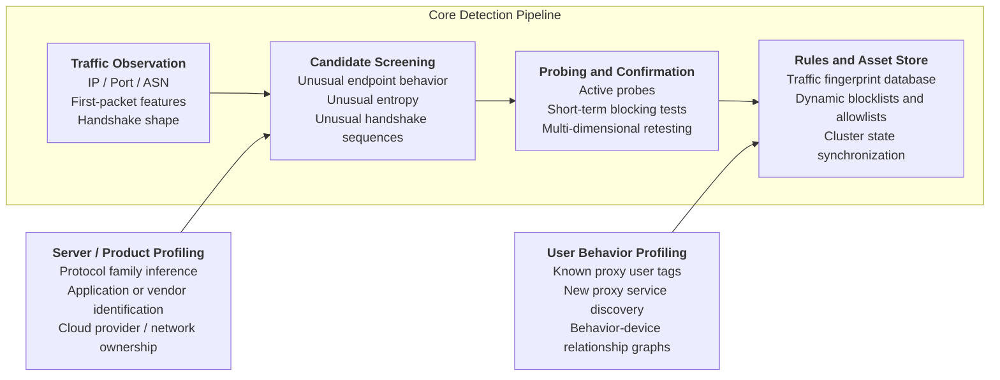

## Before the Ciphertext

How do you picture "traffic detection"?

A huge system sitting there, taking your ciphertext apart, understanding it, classifying it, and reaching a verdict.

Heavier inspection certainly exists in the real world, but for a large-scale system to keep running reliably, the mechanisms are usually quite plain:

1. Pick out suspicious targets.
2. Decide whether to spend more resources.
3. Turn confirmed findings into rules, fingerprints, lists, and profiles.
4. Reduce the time needed for subsequent processing.

So "being detected" often means something closer to these states:

- Entering a candidate set.
- Receiving an active probe.
- Triggering short-lived residual blocking.
- Being added to the fingerprint database of a protocol, product, or service provider.
- Being attached to a user or server profile.

This brings us to a crucial fact: **once the payload goes dark, the shape is still there**.

Plenty remains visible on the network:

- `IP / Port / AS`
- The length of the first packet.
- Whether the first packet resembles a normal protocol.
- The order of handshake fields.
- Whether the implementation has consistent habits.
- Whether packet-length distributions and timing look reasonable.
- Whether the endpoint has appeared on a list before.
- Whether the user has been tagged before.

The question becomes: **which layer did the proxy actually hide, and which layer did it leave exposed?**

## Starting Proxy Detection from Zero: Explicit Proxies and Fixed Endpoints

Very early proxies were quite honest.

An explicit `HTTP proxy` has `CONNECT`, `SOCKS5` has its own greeting, and the destination endpoints are often fixed too.

If a proxy service stays with a particular cloud provider, on a popular port, or in a network range already under close watch, it is naturally more likely than ordinary services to enter the candidate set.

This step looks crude, but it is useful.

"Endpoint discovery" is the cheapest layer of screening in the first place.

Early `Tor` could not avoid this problem either.

:::note
[What is Tor](https://zh.wikipedia.org/wiki/Tor)
Short for "The Onion Router", Tor is free software for anonymous communication.
:::

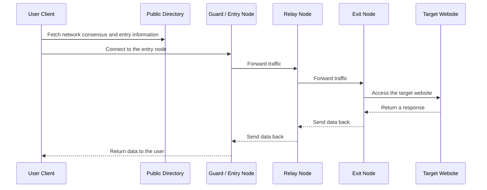

The key problem at this stage is straightforward: once entry nodes can be enumerated, they can be blocked en masse.
Phil Winter and Stefan Lindskog's 2012 research described this stage clearly: the early GFW could take out groups of Tor entry nodes directly through string matching and IP blocking.
Reference: [How the Great Firewall of China Is Blocking Tor](https://www.usenix.org/sites/default/files/conference/protected-files/winter_foci12_slides.pdf)

So the evolution follows naturally:

Public entry nodes → easy to block
Start "hiding the entry" (bridges)
Then add an outer layer to the traffic (such as TLS encapsulation)
The focus shifts from "plaintext features" to "handshake fingerprints, implementation details, timing, and active probing"

## re: Starting Proxy Detection from Zero: TLS Handshakes

The idea behind a `Tor bridge` is simple:

If public relays are easy to take down together, make the entry points smaller, more dispersed, and private.

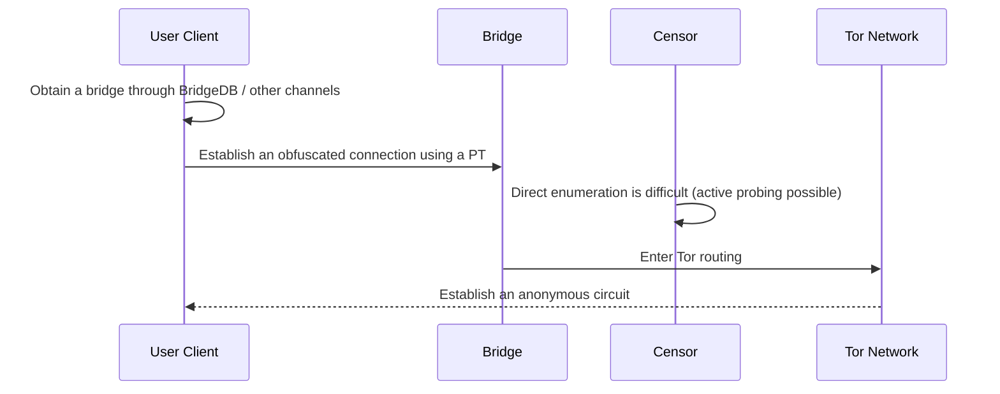

Detection systems then countered with handshake features and active probing.

The entry may be hidden, but the handshake still has to happen.

One classic finding from those 2012 measurements was:

The GFW could first identify suspected Tor connections through specific patterns in `TLS ClientHello`, then connect back from different IP addresses inside China to actively probe the corresponding bridge. If probing succeeded, the `IP:port` would enter the blocking process.

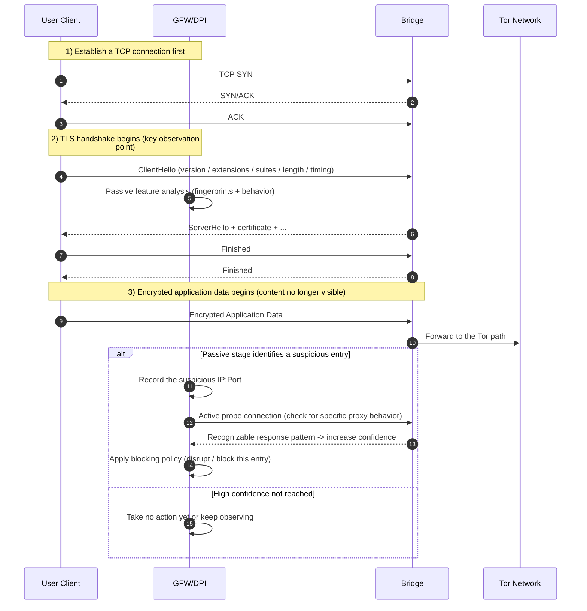

This became the template for many later detection chains:

- Passive observation first.
- Active probing next.

Passive observation is cheap and works at scale.

Active probing costs more, but by this point the target set has already narrowed.

Active probing also depends heavily on implementation details.

If a proxy server responds to certain probe inputs consistently enough, and enough like a particular implementation, it leaves evidence.

## rere: Details

Later, people naturally wondered:

>Why not just pretend to be another protocol?

Pretend to be `HTTP`.

Pretend to be `Skype`.

Pretend to be "an ordinary website".

Or even pretend to be random noise.

This was a natural idea at the time. The problem is that protocol impersonation is genuinely hard to get right.
The 2013 paper `The Parrot is Dead: Observing Unobservable Network Communications` challenged the assumption that mimicking an allowlisted protocol is enough to become invisible: a censorship-resistant system that only copies message formats, without fully reproducing the target protocol's semantics in its state machine, error handling, edge cases, and coordinated behavior at both ends, can still be identified.
[The Parrot is Dead](https://dedis.cs.yale.edu/dissent/papers/parrot-abs/)

But first, let's look at the parrot systems.

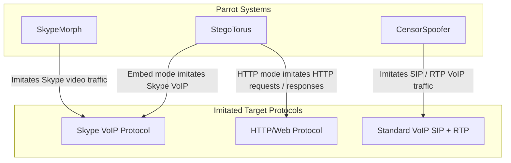

So how did the parrot die?

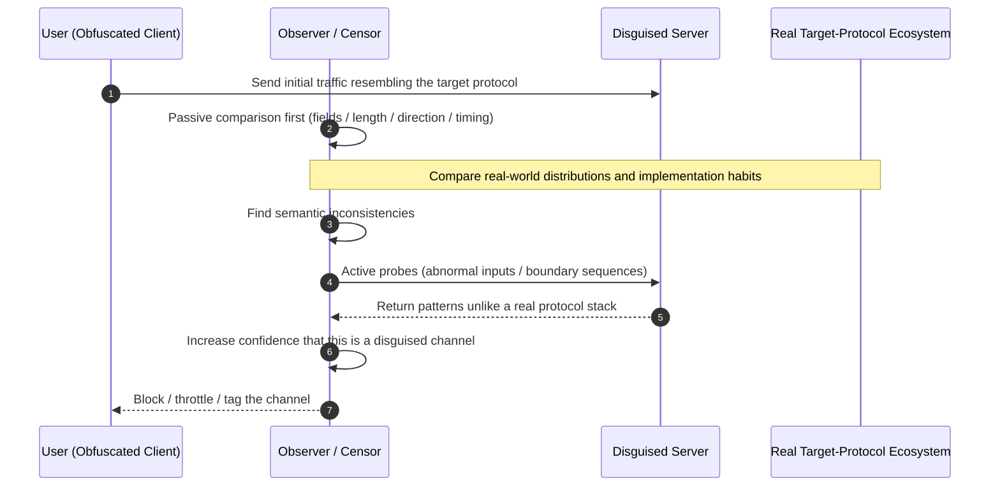

Field order, error handling, edge cases, retransmission habits, timing, fragmentation, and coordinated client-server behavior all have to look right.

The 2015 paper `Seeing through Network-Protocol Obfuscation` pushed this question further.
[Seeing through Network-Protocol Obfuscation](https://pages.cs.wisc.edu/~akella/papers/ccsfp653-wangA.pdf)

The authors tested various obfuscated protocols against more realistic background traffic, and the overall picture was consistent:

You think you "look like someone else".

To the system, you look more like "a resemblance with slightly off behavior".

So censorship gradually shifted from "catching a fixed plaintext feature" toward:

- Implementation.
- Timing.
- Responses to invalid input.
- Whether passive observation and active probing expose problems.

The challenge for censorship-resistant systems is no longer just "making the bytes look right", but "making the entire communication process look right".

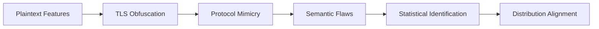

This shifted the focus from "protocol mimicry" to "distribution mimicry": not only resembling a protocol, but consistently fitting the real-world traffic distribution over time, without giving yourself away under either passive observation or active probing.

## rerere: The First Packet Goes Dark

Later, the competition moved further in one direction: **make the first packet as unintelligible as possible**.

The first impression of things like `Shadowsocks`, `VMess`, and `Obfs4` is darkness.

The first packet looks more like random numbers. Fields no longer resemble a straightforward application-layer protocol, and many explicit features are suppressed.

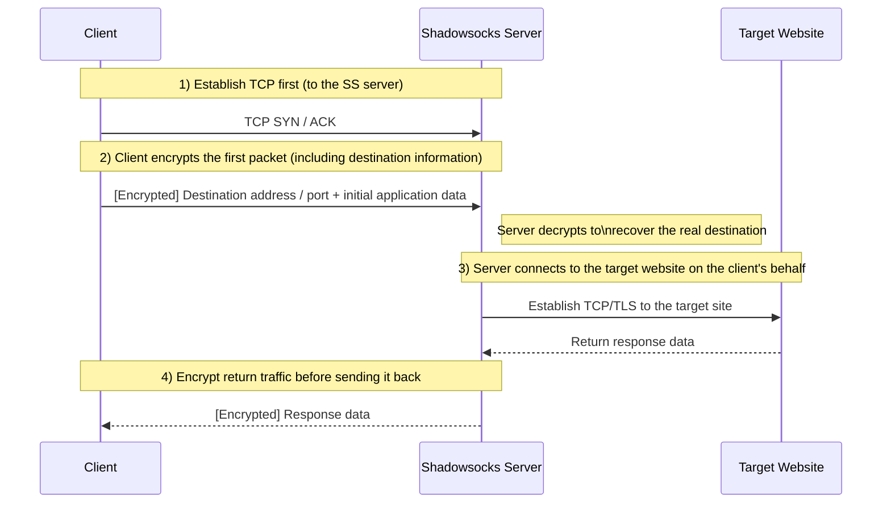

Looks secure, right?

But this step amplifies another problem:

***Darkness.***

What kind of dark? A colorful shade of black?

On the ordinary internet, many normal protocols leave traces at the beginning that "look like normal services", even when encrypted.

- `TLS` has its own handshake structure.
- `HTTP` leaves printable characters.
- Some apps have stable length patterns.

A fully encrypted first packet often looks more like "a blob of high entropy", which can itself put it in the candidate set.

:::note
Shannon entropy can measure the "randomness" of the first packet's byte distribution.

Let the first packet's byte sequence be $X$, with length $N$ and byte values in $0..255$. For each byte value $b$,

its frequency is $p_b=\frac{count(b)}{N}$,

and entropy is defined as $H(X)=-\sum_{b=0}^{255}p_b\log_2 p_b$.

- Unit: bits/byte
- Range: 0 to 8
  - Closer to 8: a more random byte distribution (high entropy).
  - Closer to 0: a more concentrated, structured distribution (low entropy).

In traffic analysis, entropy is usually used alongside first-packet length, direction, timing, and other features, rather than as a standalone criterion.
:::

The 2020 IMC paper on `Shadowsocks` breaks this stage down in detail.  
[How China Detects and Blocks Shadowsocks](https://gfw.report/publications/imc20/en/)

The researchers observed that:

- The system first selects suspected targets using first-packet length and entropy.
- It then sends several types of active probes to the server.
- Blocking follows only after a probe hits.

At this point, something interesting emerges:

Protocol designers are trying to suppress plaintext features.

Censorship systems are trying to turn "the high-entropy first packet itself" into a feature.

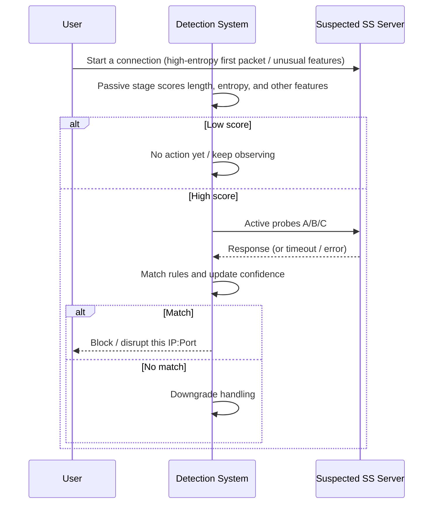

Then we reach **November 6, 2021**.

The USENIX Security 2023 paper measured the GFW beginning purely passive, real-time blocking of several kinds of fully encrypted traffic, affecting protocols including `Shadowsocks`, `VMess`, and `Obfs4`.  
[USENIX Security 2023](https://gfw.report/publications/usenixsecurity23/en)

The most interesting part is the approach: **let as much normal traffic through as possible, and retain the small remainder that is very dark and unlike common protocols**.

The rules summarized in the paper are telling:

- If the first few bytes look like `HTTP / TLS`, let it through.
- Lots of printable characters? Let it through.
- Long runs of consecutive printable characters? Let it through.
- An unusual bit distribution resembling normal text or a normal protocol? Let it through.

The remaining first packets—dark, unlike common handshakes, and not exempted—are in trouble.

This step deserves some thought.

It shows a reality: full encryption did not make the problem disappear. It just pushed observation further toward the start.

## rererere: QUIC

Many people have a misconception when they see `QUIC`:

Based on `UDP`, a newer handshake, `HTTP/3`.

It looks more modern, and harder to inspect.

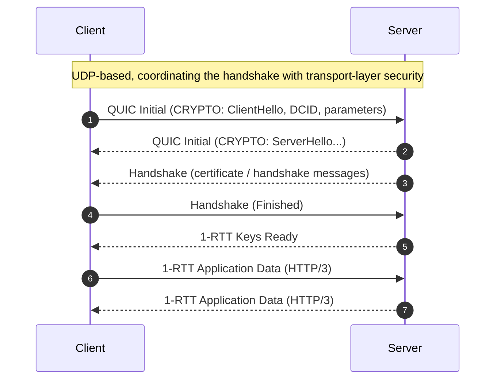

It isn't that simple.
[China's Great Firewall is now blocking QUIC with the SNI field](https://gfw.report/publications/usenixsecurity25/en/)

Researchers observed that, starting on **April 7, 2024**, the GFW could recover the `TLS ClientHello` encapsulated in `QUIC Initial` and block based on its `SNI`.

That may sound like "QUIC was cracked", but the actual reason is in `RFC 9001`.
[RFC 9001](https://datatracker.ietf.org/doc/html/rfc9001)
RFC 9001 defines how QUIC uses TLS 1.3. By design, QUIC Initial does not provide strong confidentiality against on-path observers: its key material can be derived from parameters visible on the path. The TLS ClientHello encapsulated in Initial can therefore be recovered and used for policy matching; strong confidentiality comes in the later Handshake/1-RTT stages.

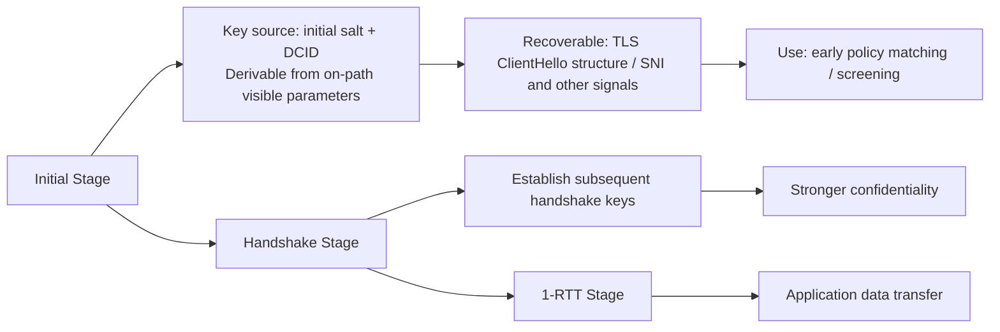

The keys used in the `Initial` stage are designed to be derivable by on-path observers.

So when the protocol changes, the observation point changes too:

- Previously, the first `TCP` packet.
- Now, `QUIC Initial`.
- Previously, application-layer plaintext.
- Now, structures still recoverable from the early part of the encrypted handshake.

## rerererere: Products and People

If we only looked at academic papers, the story would already be fairly complete at `Tor -> obfuscation -> fully encrypted -> QUIC`.

The `Geedge / MESA leak` was striking because it took a large step from "phenomena measured in papers" toward "how a real product stack might work".
[GFW Report's Chinese-language analysis](https://gfw.report/blog/geedge_and_mesa_leak/zh/)

[InterSecLab report](https://interseclab.org/research/the-internet-coup/)

:::warning
Treat this rationally; this is academic analysis only.
:::

### 1. Detection Shifts from "Protocols" to "Products"

The leak analysis mentions an `AppSketch` fingerprint database, buying VPN accounts, maintaining mobile devices with VPN apps, and performing static reverse engineering and dynamic traffic analysis.

Detection targets also include:

- A particular app's handshake habits.
- A provider's certificates and `JA3 / JA4`.
- Behavioral features produced by a particular client-server combination.

### 2. Confirmed Findings Become Long-Term Assets

Components such as `Maat`, `SAPP`, and `Stellar` in the leaks look more like platform-level infrastructure.

In other words, matched samples, written rules, and synchronized fingerprints do not disappear when a single blocking event ends.

They remain.

And the next round of processing gets faster.

### 3. Recognizing People

One point in GFW Report's analysis of the leaked material stands out:

Some systems can already attribute traffic to user identities, even tagging an individual as a "known VPN user".

What does that mean?
Mean what, exactly?

It means the chain is starting to run in reverse.

Earlier, the familiar pattern was:

> First discover a server, then see who connects to it.

What is now increasingly imaginable is:

> First watch a high-risk user, then follow their later connections to discover new servers, providers, and products.

Later research therefore also moves toward graph analysis, relationship modeling, and behavioral clustering.
[Identifying VPN Servers through Graph-Represented Behaviors](https://openreview.net/forum?id=tnljBcXhmz)

## so why

By now, the answer is fairly clear.

Why proxy traffic gets detected
is closer to this:

**To actually work, a proxy has to leave many stable structures on the network.**

For example:

- It has to exist at an endpoint.
- It has to perform a handshake.
- It has to be compatible with clients.
- It has to respond to invalid input.
- It has to maintain some consistent timing.
- It has to be used by users continuously.
- It has to appear repeatedly over time.

To provide a service, it has to be stable.

Once it is stable, there is a fingerprint.

Reading this whole evolution leaves a strong impression: **the further back the payload retreats, the further forward censorship moves**.

From endpoints to handshakes, first packets, `Initial`, and then product and user profiles, the route keeps changing—and so does the point of attack.

## ending

In the end, this is analysis for the sake of learning.

Of course, s3 can't promise to cover everything.

Thanks, meow. Thanks, meow.
