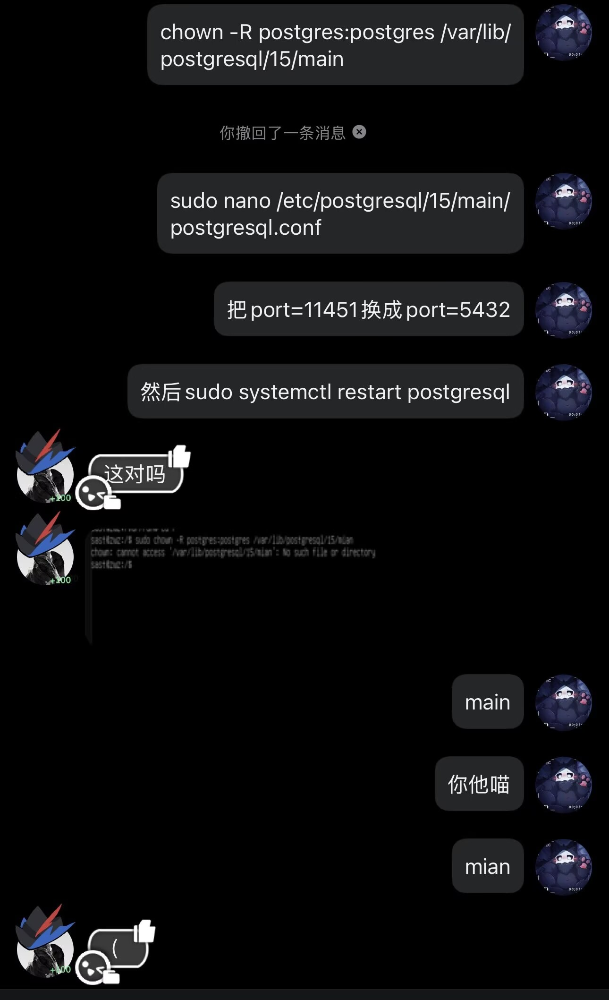

## Preface

Thanks to everyone who put these challenges together, zwz. Solving them wasn't easy either.

We were a little short on time, so the WoC PDF and the repository differ slightly. It shouldn't affect the results too much.

If any of the wording doesn't line up, you have my deepest apologies.

## Task 1

```txt
Set up Gitea locally using docker-compose on GNU/Linux or a server.
Verification: From the host, verify the connection with ssh -p <port> git@localhost -T, or successfully run git clone
ssh: /git@localhost:<port>/ .
```

If your first thought was to look up Gitea, you could probably have knocked this one out right away.
[Installation with Docker | Gitea Documentation](https://docs.gitea.com/zh-cn/installation/install-with-docker)

Install docker-compose however you like.

## Task 2 & 4 & 6

Tasks 2 and 6 were written by our senior member fermata. Task 5 was written by 2εr00иe.

We didn't coordinate well enough at the start and ended up with two kernel challenges. That's why this part feels a bit stitched together. Sorry about that.

### Task 2

```txt
Build and run the [SAST Rust kernel module](https://github.com/f3rmata/woc2026-hello-from-skm).
[Bonus] CI/CD: Configure GitHub Actions (or GitLab CI) to automatically build a Docker
image after a code push and publish it to a registry (Docker Hub / GHCR).
```

Compiling is fun, right? Once the dependencies are sorted out, just run it.

Then there's CI/CD. As long as it runs, we're good (

### Task 4

```txt
0001 left a dev1ce in the Task 2 kernel as a little gift,
and a secret code: 0x1337.
Can you find the secret she left in dmesg?
Please use insmod /lib/modules/magic.ko
```

You all really know how to go straight for the flag.
I'll release the source when I have time.

### Task 6

```txt
This is a bonus challenge for Task 2.

Add a statistics feature using DebugFS in GitHub - f3rmata/woc2026-hello-from-skm, then submit a PR to the repository for review.
```

I haven't done this one myself either, UwU.
AI is pretty handy, though. It gives you the illusion that you can do anything.

## Task 3

```txt
s3 found a lovely PostgreSQL in a not-so-lovely place.
Apparently there's treasure inside? But it doesn't seem to start.
Attachment: linux-WoC.ova
name:sast
password:123456
```

Remember how this team is also called the operations team (
So why did nobody try fixing psql and going in that way ((

Still, any solution counts. Unintended solutions are the saddest part of CTFs, but also the most fun.

```bash
$ sudo nano /etc/sudoers.d/sast
sast ALL=(ALL) NOPASSWD: ALL, !/usr/bin/su, !/usr/bin/bash

$ sudo apt install postgresql -y

$ su - postgres

$ psql
```

```sql
postgre=# CREATE DATABASE owo_db;
postgre=# \c owo_db

CREATE TABLE flag1 (
    flag TEXT
);

postgre=# INSERT INTO flag1 VALUES ('flag{W0w_');
postgre=# CREATE USER sast WITH PASSWORD '123456';
postgre=# GRANT CONNECT ON DATABASE owo_db TO sast;
postgre=# GRANT USAGE ON SCHEMA public TO sast;
postgre=# GRANT SELECT ON flag1 TO sast;

```

```sql
CREATE TABLE flag2 (flag text);
ALTER TABLE flag2 SET (autovacuum_enabled = false);
ALTER TABLE flag2 SET (toast.autovacuum_enabled = false);

INSERT INTO flag2 VALUES ('w3lcOme_2_SAST!}');
DELETE FROM flag2;
INSERT INTO flag2 VALUES ('Oh...The flag was deleted by admin..BUT WAIT?Autovacuum was disabled?');


```

```bash
$ nano /etc/postgresql/15/main/postgresql.conf

# port = 5432
port = 11451
```

```bash
exit 
systemctl stop postgresql

chown -R 1145:1145 /var/lib/postgresql/15/main
chmod 700 /var/lib/postgresql/15/main

```

Here's the idea behind the challenge.

It came from data migration. If you move PostgreSQL directly from one server to another, both systems may have a user named postgres, but their numeric user IDs can differ. That can leave you unable to log in. That's where user 1145 came from.

Autovacuum was disabled.

So after a DELETE, the data isn't automatically cleaned up. It remains on disk, which is what made your shortcut possible )



solution

```bash
chown -R postgres:postgres /var/lib/postgresql/15/main

sudo nano /etc/postgresql/15/main/postgresql.conf

# Change port=11451 to port=5432

sudo systemctl restart postgresql
```

And psql is working again.

```bash
sudo -u postgres 
```

Go in.

```bash
# \c owo_db
# SELECT * FROM flag1
```

When you run `SELECT * FROM flag2`, you find that message. A quick search turns up a way to recover the data.

`SELECT pg_relation_filepath('flag2');` tells us where to look.

/var/lib/postgresql/15/main/base/16388

You'll find it near the end.

Join the two flag fragments to get the result:
`flag{W0w_w3lcOme_2_SAST!}`

## Task 5

```txt
s3's mental state is a little worrying: while sleepwalking, they keep wanting to run sudo rm -rf /workshop/PPProject *. As the operations team's defender of justice,
you need to use eBPF to intercept this operation in the kernel.
Suggested tools:
Rust Aya
Go cilium/ebpf
A bonus to the bonus:
What if s3 first moves the directory with mv, then deletes it?
How can you use eBPF to monitor and block rename operations on this directory?
Implementing it might be difficult; we can talk it through during the review.
```

You'll have to figure this one out yourselves. I'm only here to write the challenge, xwx.

C probably makes the most sense, but implement it however you like.
